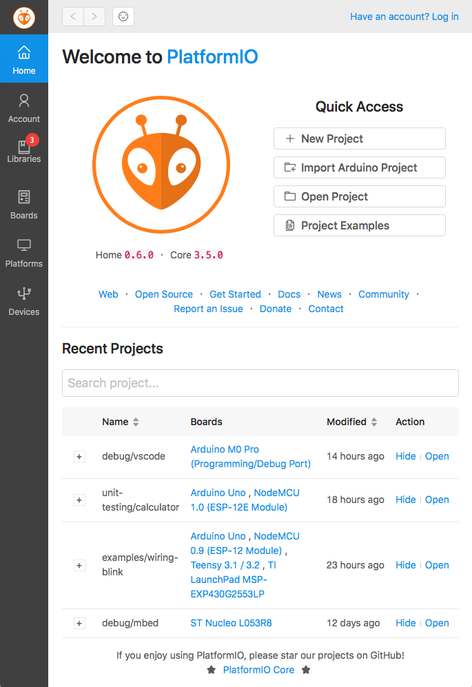
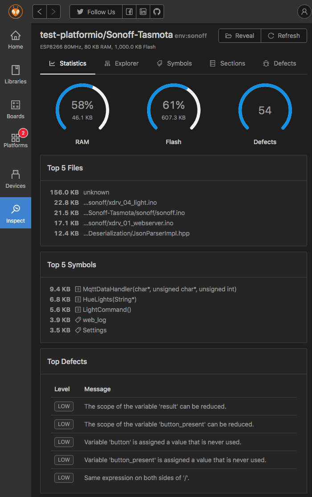
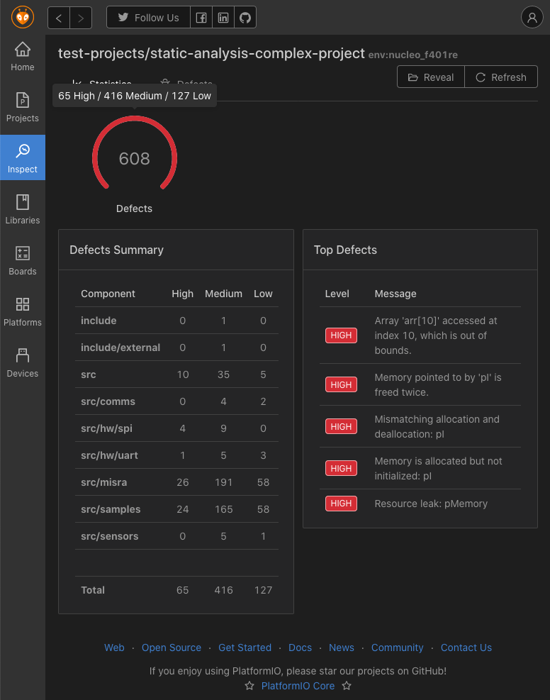
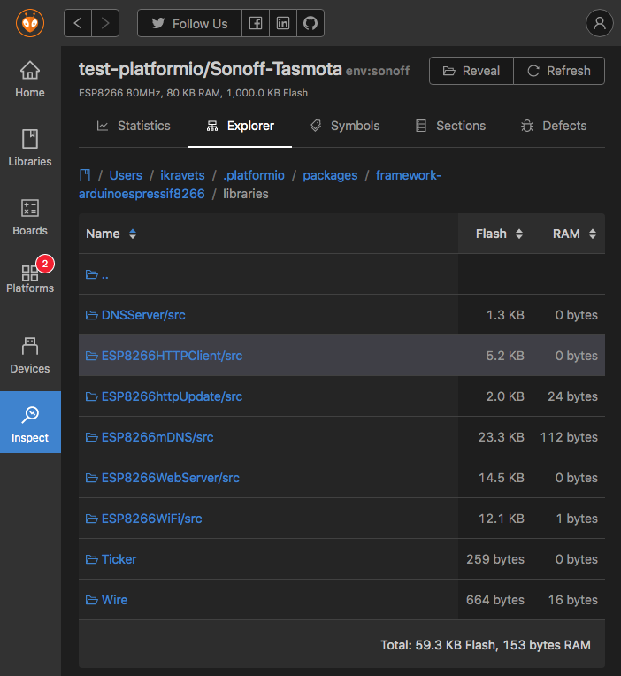
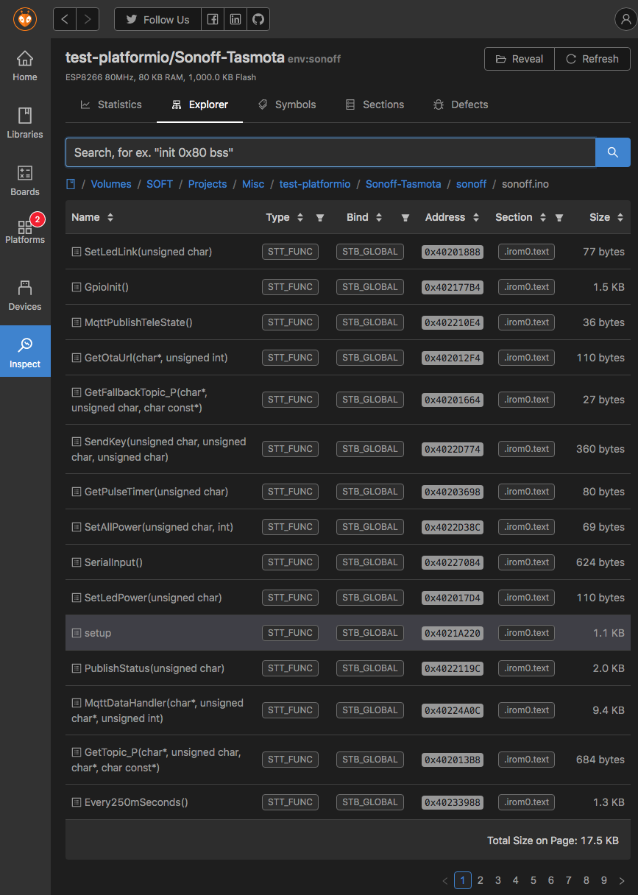
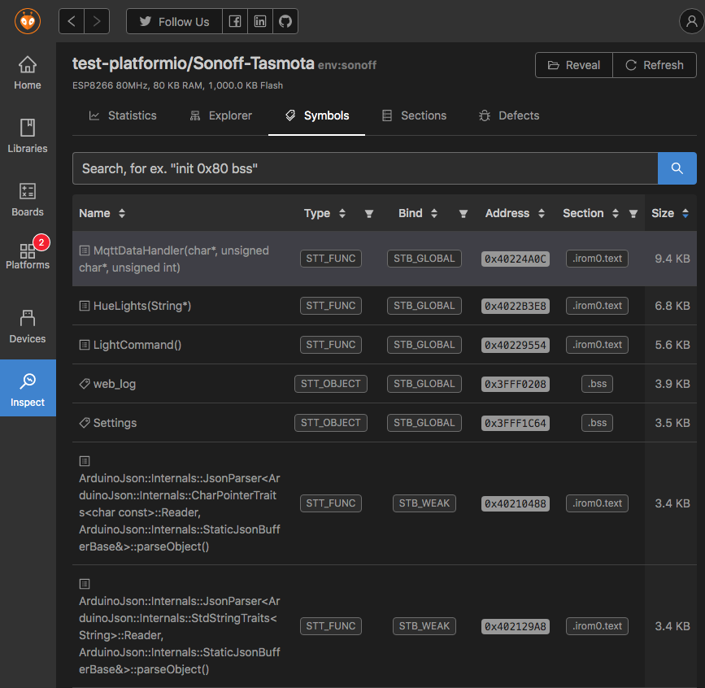
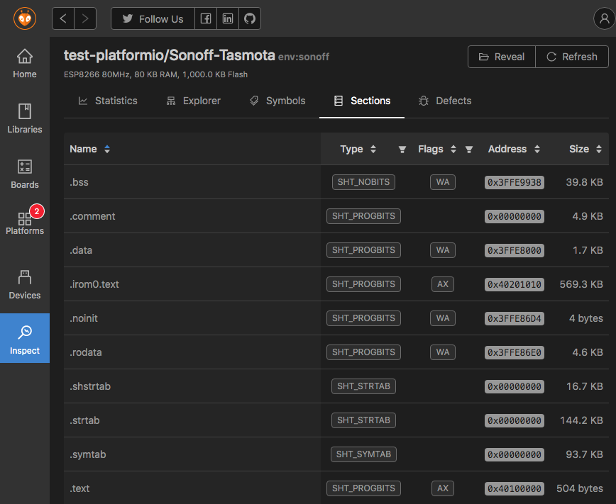
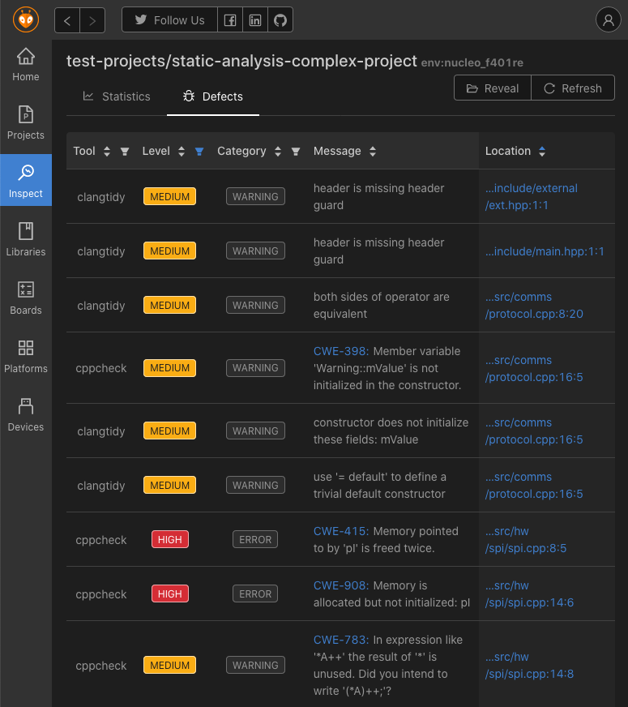
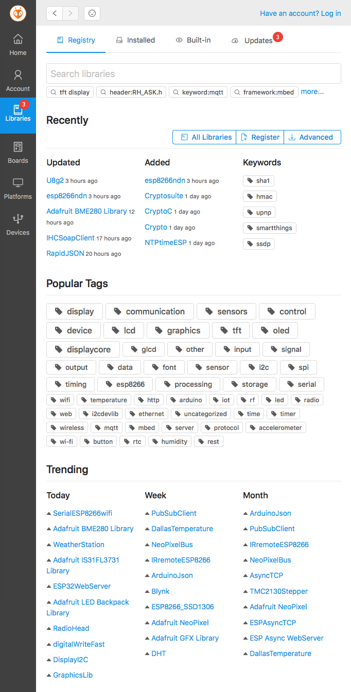
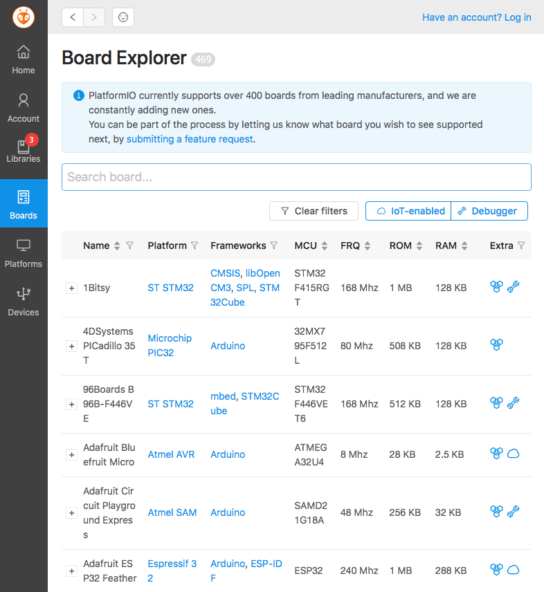

# PlatformIO Home

PlatformIO Home is a graphical interface for PlatformIO that runs in a web
browser or inside [PlatformIO IDE](./platformio-ide.md). Use it to:

- Create, import and open projects.
- Search, install and update [libraries](../guides/libraries/index.md).
- Browse and manage [development platforms](../hardware/platforms/index.md),
  [frameworks](../hardware/frameworks/index.md) and [boards](/hardware/boards).
- List connected [devices](../reference/cli/pio-device/index.md): serial ports,
  logical drives and multicast DNS services.
- Inspect a project: memory usage, firmware sections and symbols, and
  [static code analysis](../guides/static-code-analysis/index.md) results.
- Manage your [PlatformIO Account](./platformio-account.md).

PlatformIO Home is part of PlatformIO IDE and PlatformIO Core; there is
nothing extra to install.

## Open PlatformIO Home {#quick-start}

<a id="platformio-ide"></a>

**In PlatformIO IDE for VS Code**, select the **Home** button on the
[PlatformIO toolbar](../guides/ide/vscode.md#platformio-toolbar).

<a id="platformio-core"></a>

**From the command line**, start the PlatformIO Home server with
[`pio home`](../reference/cli/pio-home.md):

```bash
pio home
```

It opens [http://127.0.0.1:8008](http://127.0.0.1:8008) in your browser. To
use another host or port, see the [`pio home` options](../reference/cli/pio-home.md).

## Screens {#demo}

### Welcome and projects {#welcome-project-manager}



### Project inspection {#project-inspect}

#### Statistics {#statistics}

Memory usage and code statistics of the built firmware:



When you run only the code analysis:



#### Firmware file explorer {#firmware-file-explorer}



Symbols of a selected file:



#### Firmware symbols {#firmware-symbols}



#### Firmware sections {#firmware-sections}



#### Code defects {#static-code-analysis}

Results of [static code analysis](../guides/static-code-analysis/index.md):



### Libraries {#library-manager}



### Boards {#board-explorer}


