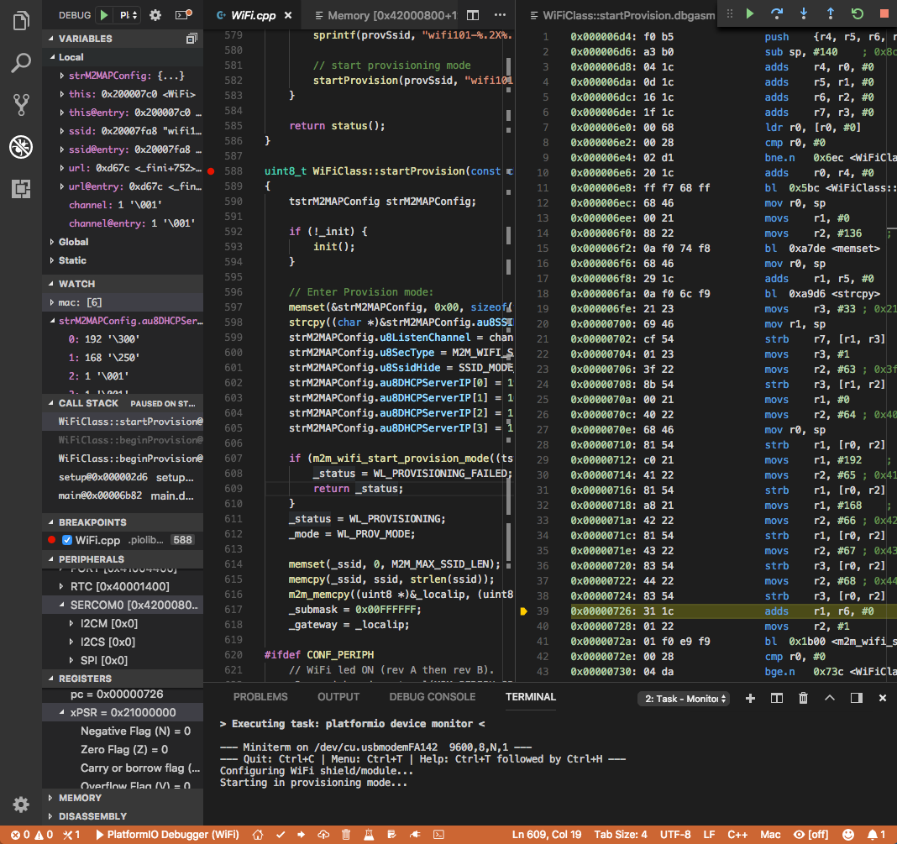
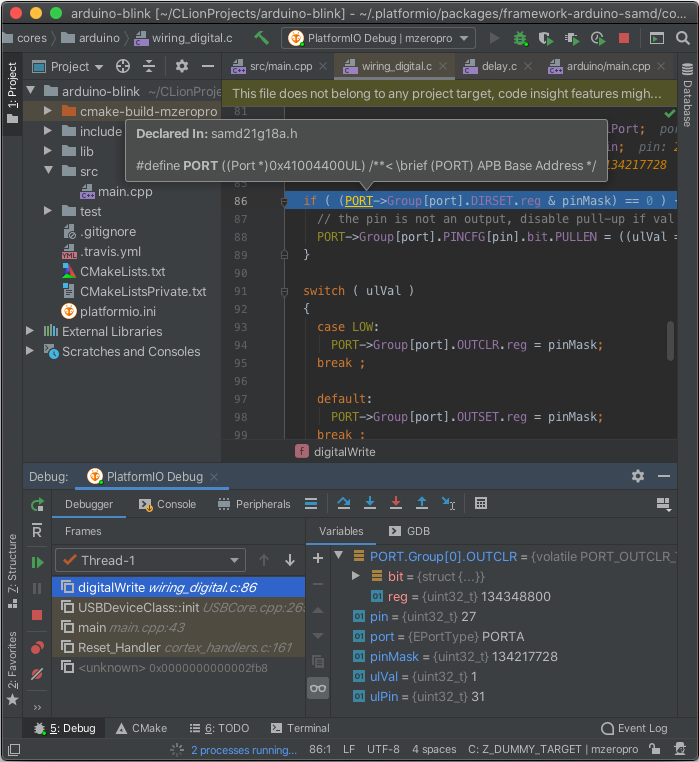

# PlatformIO IDE

PlatformIO IDE is the set of official PlatformIO extensions for code editors.
It bundles [PlatformIO Core](./platformio-core.md), so you do not need to
install anything else, and adds a graphical workflow on top of it.

We recommend **PlatformIO IDE for Visual Studio Code** for most users: it is
the most complete and the most widely used.

## Features {#features}

- Builds for 1,500+ [boards](/hardware/boards) across 30+
  [development platforms](../hardware/platforms/index.md) and 20
  [frameworks](../hardware/frameworks/index.md), with no system-wide toolchain
  installation.
- [Debugging](../guides/debugging/index.md) with breakpoints, peripheral
  registers and memory views.
- [Unit testing](../guides/unit-testing/index.md) on the host or on the target
  device.
- [Remote development](../guides/remote-development.md): build, upload and test
  on devices connected to another machine.
- C/C++ code completion and linting.
- A library manager, a serial port monitor and
  [PlatformIO Home](./platformio-home.md).
- A built-in terminal with the `pio` command
  ([CLI reference](../reference/cli/index.md)).

## PlatformIO IDE for Visual Studio Code {#platformio-for-vscode}

Visual Studio Code is a free, cross-platform source code editor for Windows,
macOS and Linux.

To install it, follow [PlatformIO IDE for VS Code](../guides/ide/vscode.md#installation).

## PlatformIO for CLion {#platformio-for-clion-experimental}

CLion is a cross-platform C/C++ IDE from JetBrains. The PlatformIO plugin for
CLion is experimental.

To install it, follow [PlatformIO for CLion](../guides/ide/clion.md).

## Other editors {#other-editors}

PlatformIO Core can generate project files for many other editors, such as
Neovim, Emacs and Eclipse. See [IDE integrations](../guides/ide/index.md).
