# Arduino on ESP32-DevKitC: debugging and unit testing

In this tutorial you use [PlatformIO IDE for VS Code](../../../guides/ide/vscode.md)
to create an [Arduino](/hardware/frameworks/arduino) project for the
ESP32-DevKitC board, upload it, debug it over JTAG, run unit tests on the
board and, finally, add a Bluetooth LE service.

- **Level:** beginner
- **Host:** Windows, macOS or Linux

## What you need {#what-you-need}

- [PlatformIO IDE for VS Code](../../../guides/ide/vscode.md), installed.
- An [Espressif ESP32 Dev Module](/hardware/boards/espressif32/esp32dev)
  (ESP32-DevKitC) board.
- For debugging, a JTAG probe. This tutorial uses an
  [Olimex ARM-USB-OCD-H](../../../hardware/debug-probes/olimex-arm-usb-ocd-h.md);
  an [Olimex ARM-USB-OCD](../../../hardware/debug-probes/olimex-arm-usb-ocd.md)
  or [Olimex ARM-USB-TINY](../../../hardware/debug-probes/olimex-jtag-tiny.md)
  also works with a matching [`debug_tool`](../../../reference/platformio-ini/env/debug-tool.md)
  value.

## Create the project {#setting-up-the-project}

1. Open [PlatformIO Home](../../platformio-home.md) with the **Home** button on
   the PlatformIO toolbar, and select **New Project**:

   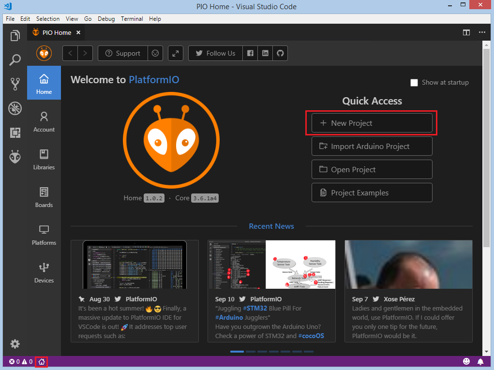

2. Select **Espressif ESP32 Dev Module** as the board and **Arduino** as the
   framework. Keep the default location or choose another one, and select
   **Finish**:

   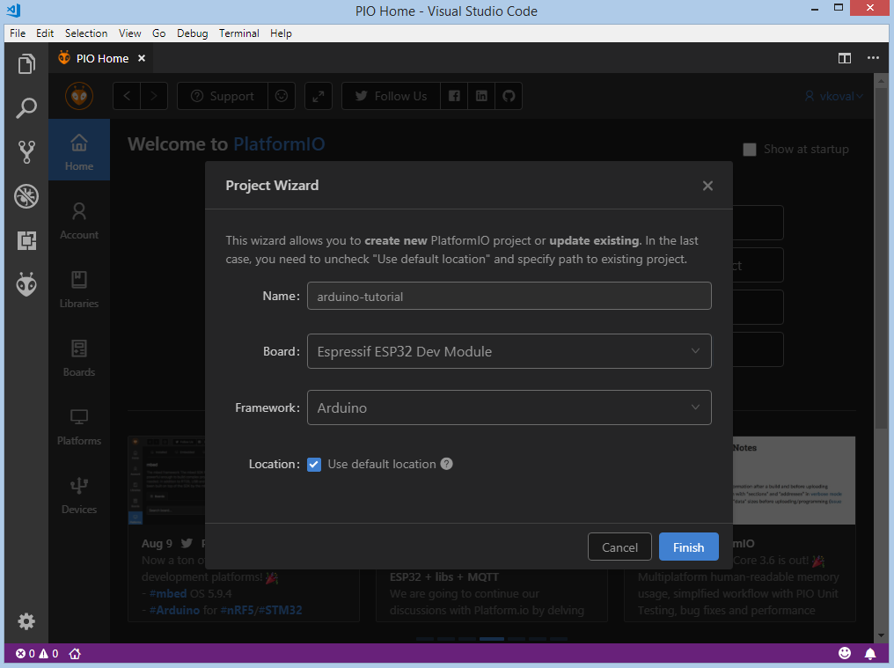

PlatformIO creates the project and installs the toolchain and framework. The
first time, this can take a few minutes.

## Add the code {#adding-code-to-the-generated-project}

Open `src/main.cpp` (in the [`src_dir`](../../../reference/platformio-ini/platformio/src-dir.md)
folder) and replace its content with:

```cpp
#include <Arduino.h>

void setup()
{
    Serial.begin(9600);
}

void loop()
{
    Serial.println("Hello world!");
    delay(1000);
}
```

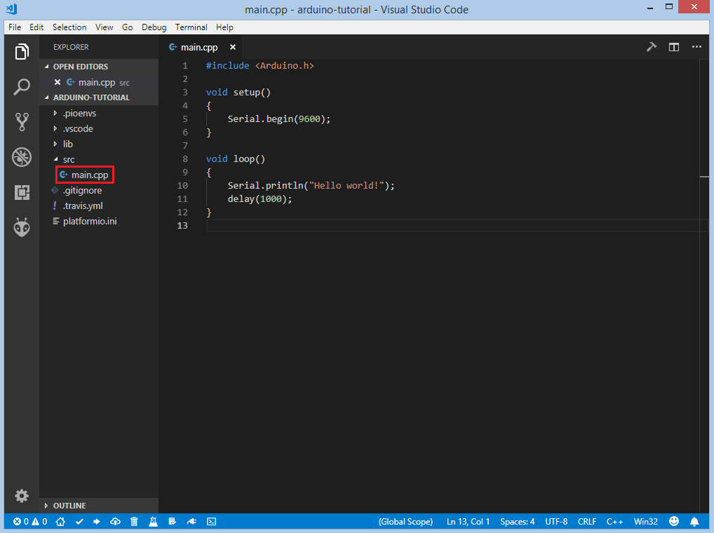

## Build and upload {#compiling-and-uploading-the-firmware}

1. Build the project. Use any of these:

   - **Build** in the **Project Tasks** panel
   - The **Build** button on the [PlatformIO toolbar](../../../guides/ide/vscode.md#platformio-toolbar)
   - **Command Palette** > **PlatformIO: Build**
   - <kbd>Ctrl</kbd>+<kbd>Alt</kbd>+<kbd>B</kbd> (<kbd>Cmd</kbd>+<kbd>Alt</kbd>+<kbd>B</kbd> on macOS)

   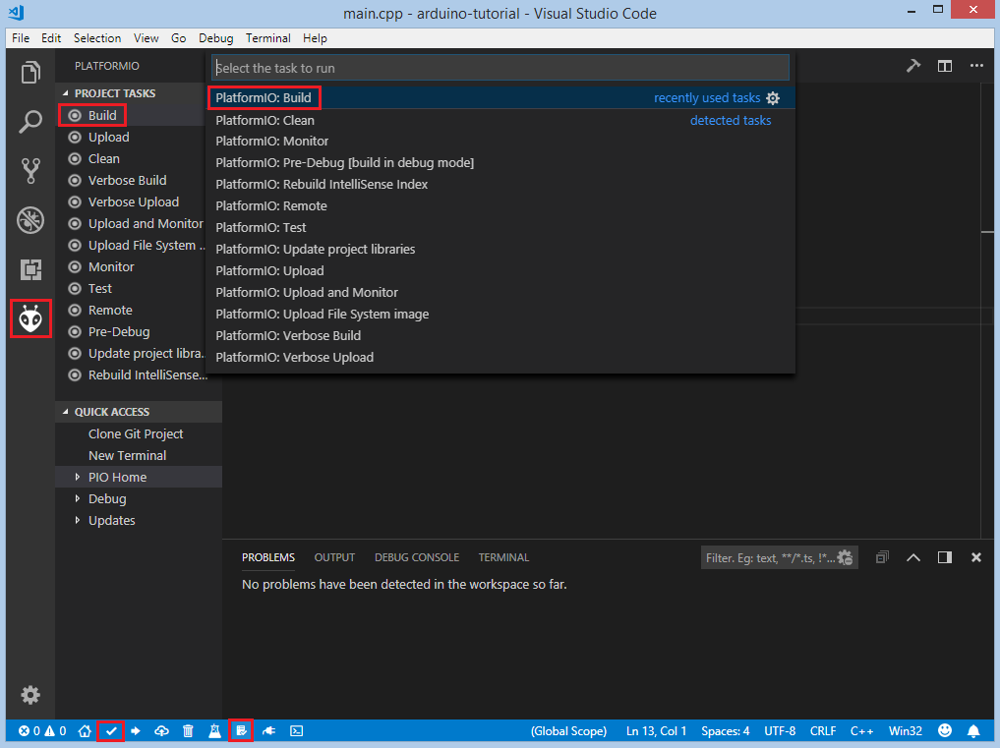

   The terminal shows `SUCCESS` when the build finishes:

   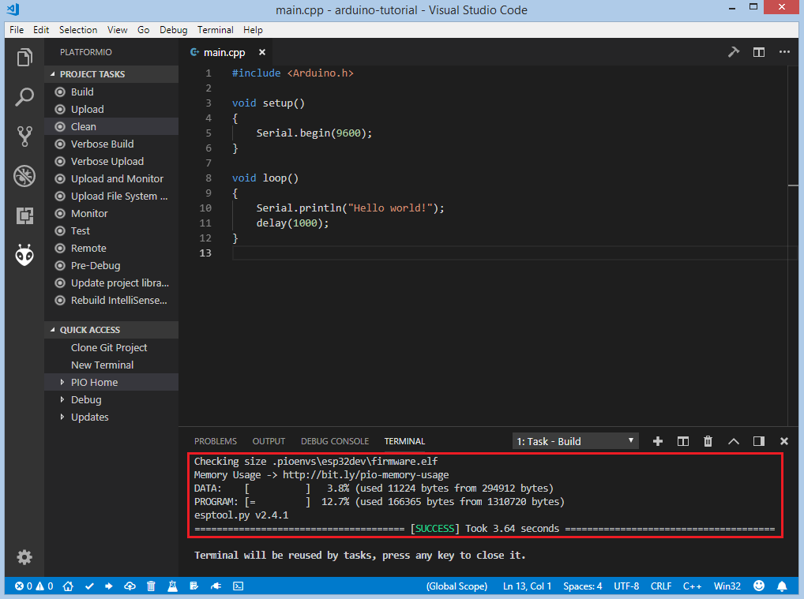

2. Connect the board and upload the firmware with **Upload** in the same
   places, or with <kbd>Ctrl</kbd>+<kbd>Alt</kbd>+<kbd>U</kbd>
   (<kbd>Cmd</kbd>+<kbd>Alt</kbd>+<kbd>U</kbd> on macOS):

   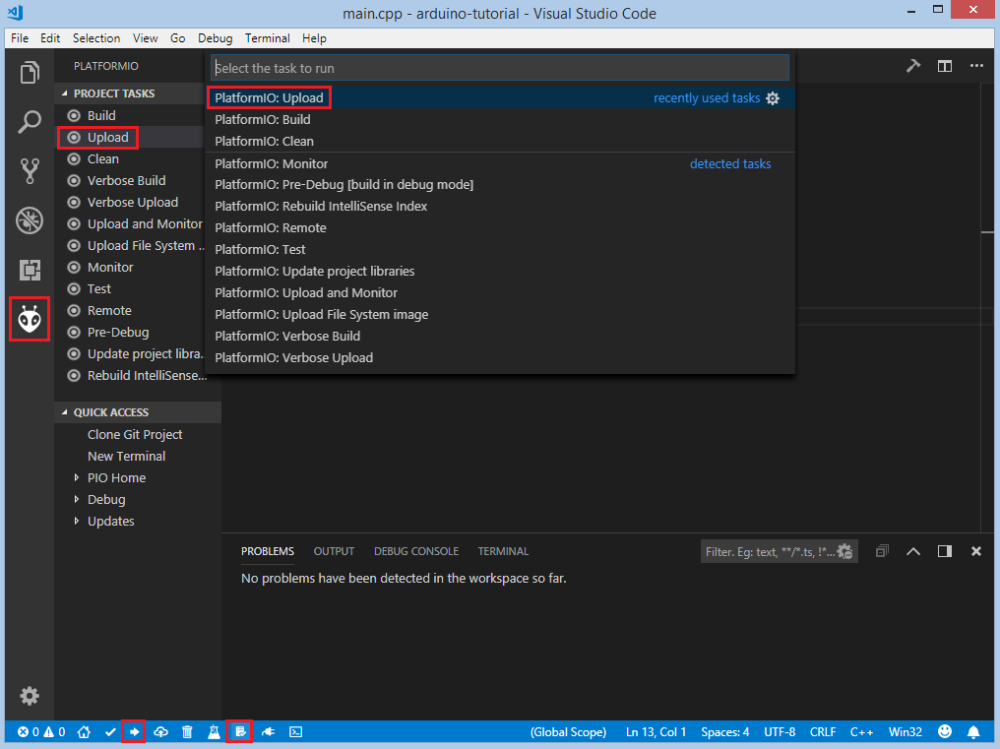

3. Open the serial monitor with **Monitor** in the **Project Tasks** panel,
   the **Serial Monitor** button on the toolbar, or **Command Palette** >
   **PlatformIO: Monitor**:

   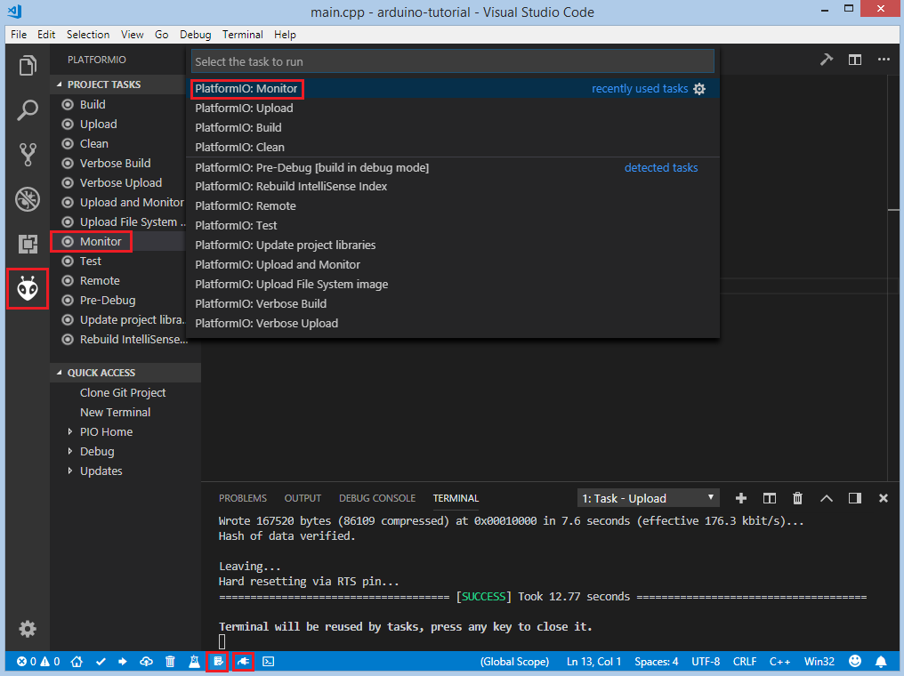

   The board prints `Hello world!` every second:

   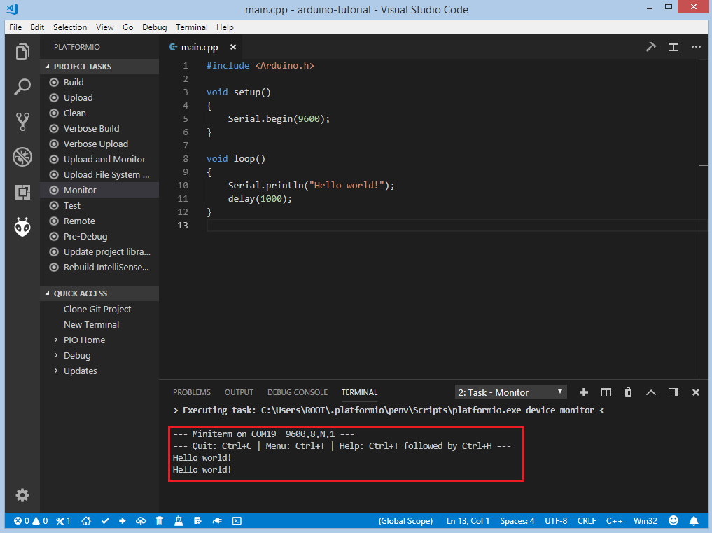

## Debug the firmware {#debugging-the-firmware}

### Connect the probe {#setting-up-the-hardware}

Connect the JTAG probe to the board:

| ESP32 pin | JTAG probe pin |
| --- | --- |
| `3.3V` | `Pin 1 (VTref)` |
| `EN` | `Pin 3 (nTRST)` |
| `GND` | `Pin 4 (GND)` |
| `GPIO 12 (TDI)` | `Pin 5 (TDI)` |
| `GPIO 14 (TMS)` | `Pin 7 (TMS)` |
| `GPIO 13 (TCK)` | `Pin 9 (TCK)` |
| `GPIO 15 (TDO)` | `Pin 13 (TDO)` |

### Start debugging {#start-debugging}

1. Tell PlatformIO which probe you use with the
   [`debug_tool`](../../../reference/platformio-ini/env/debug-tool.md)
   option in `platformio.ini`:

   ```ini
   [env:esp32dev]
   platform = espressif32
   board = esp32dev
   framework = arduino
   debug_tool = olimex-arm-usb-ocd-h
   ```

2. Start a debug session with **Run** > **Start Debugging**, or press
   <kbd>F5</kbd>:

   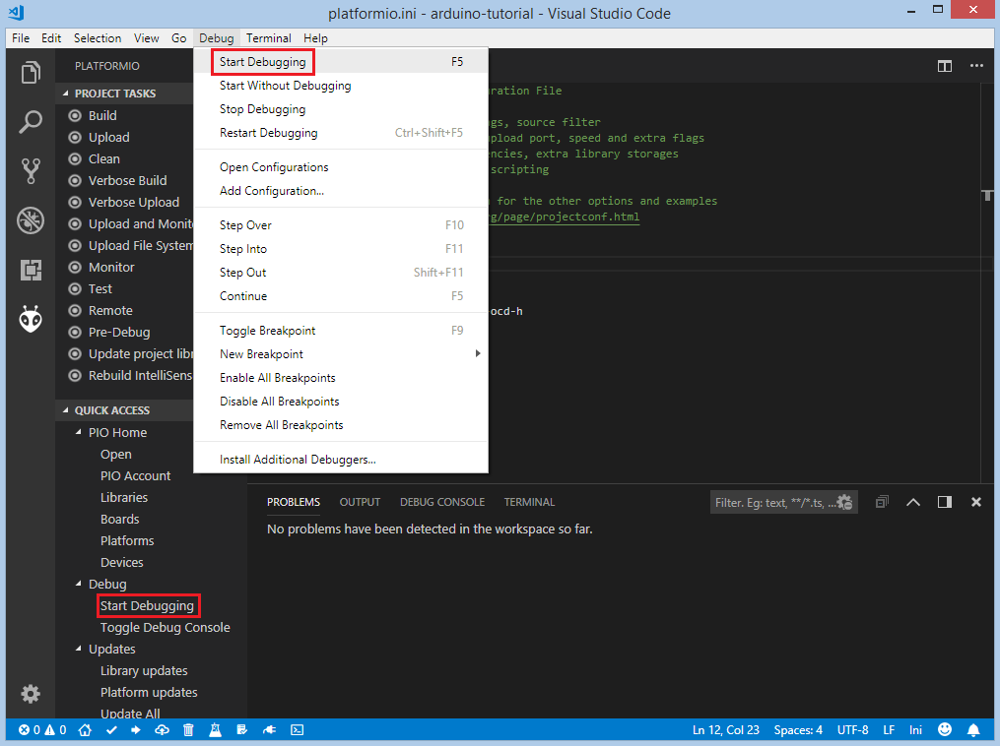

3. Wait until the session stops at the first line of `app_main()`.

4. On the ESP32, the Arduino `setup()` and `loop()` run in a FreeRTOS task.
   Set a breakpoint in `void loopTask(void *pvParameters)` (line 13 in the
   screenshot below; the line number depends on the framework version), and
   select **Continue** (<kbd>F5</kbd>). The session stops in `loopTask`:

   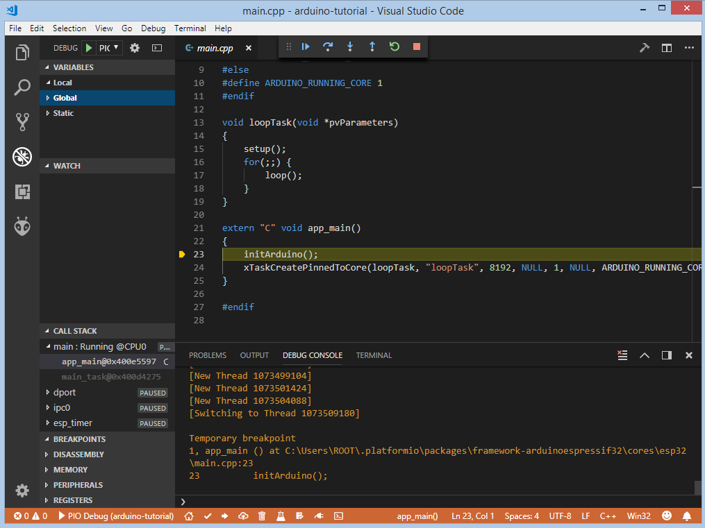

5. Open `src/main.cpp` and debug as usual: set breakpoints, step through the
   code, and add variables to **Watch**:

   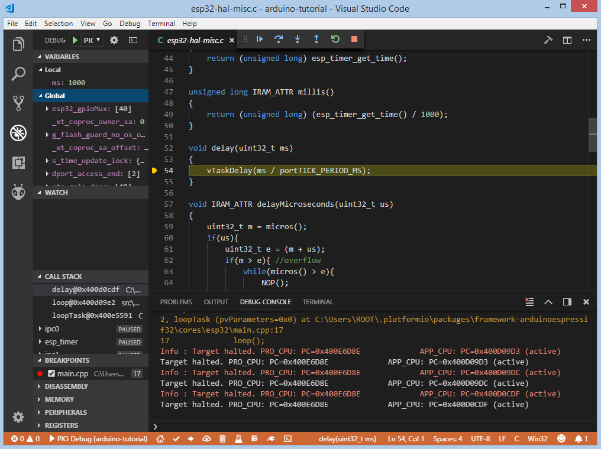

For more about debugging, see [Debugging](../../../guides/debugging/index.md).

## Write unit tests {#writing-unit-tests}

[Unit tests](../../../guides/unit-testing/index.md) with the
[Unity](../../../guides/unit-testing/frameworks/unity.md) framework use four
functions:

- `setUp()` runs before each test and `tearDown()` after it. Use them to
  prepare and reset the test data. They are optional.
- `setup()` and `loop()` are a regular Arduino program that runs the tests.

The tests below check the Arduino `String` class:

| Test | Checks |
| --- | --- |
| `test_string_concat` | Concatenation of two strings |
| `test_string_substring` | Substring extraction |
| `test_string_index_of` | Index of a character |
| `test_string_equal_ignore_case` | Case-insensitive comparison |
| `test_string_to_upper_case` | Conversion to upper case |
| `test_string_replace` | Character replacement |

1. Create `test/test_main.cpp` in the project:

   ```cpp
   #include <Arduino.h>
   #include <unity.h>

   String STR_TO_TEST;

   void setUp(void) {
       // set stuff up here
       STR_TO_TEST = "Hello, world!";
   }

   void tearDown(void) {
       // clean stuff up here
       STR_TO_TEST = "";
   }

   void test_string_concat(void) {
       String hello = "Hello, ";
       String world = "world!";
       TEST_ASSERT_EQUAL_STRING(STR_TO_TEST.c_str(), (hello + world).c_str());
   }

   void test_string_substring(void) {
       TEST_ASSERT_EQUAL_STRING("Hello", STR_TO_TEST.substring(0, 5).c_str());
   }

   void test_string_index_of(void) {
       TEST_ASSERT_EQUAL(7, STR_TO_TEST.indexOf('w'));
   }

   void test_string_equal_ignore_case(void) {
       TEST_ASSERT_TRUE(STR_TO_TEST.equalsIgnoreCase("HELLO, WORLD!"));
   }

   void test_string_to_upper_case(void) {
       STR_TO_TEST.toUpperCase();
       TEST_ASSERT_EQUAL_STRING("HELLO, WORLD!", STR_TO_TEST.c_str());
   }

   void test_string_replace(void) {
       STR_TO_TEST.replace('!', '?');
       TEST_ASSERT_EQUAL_STRING("Hello, world?", STR_TO_TEST.c_str());
   }

   void setup()
   {
       delay(2000); // service delay
       UNITY_BEGIN();

       RUN_TEST(test_string_concat);
       RUN_TEST(test_string_substring);
       RUN_TEST(test_string_index_of);
       RUN_TEST(test_string_equal_ignore_case);
       RUN_TEST(test_string_to_upper_case);
       RUN_TEST(test_string_replace);

       UNITY_END(); // stop unit testing
   }

   void loop()
   {
   }
   ```

2. Run the tests on the board with the **Test** button on the PlatformIO
   toolbar or **Test** in the **Project Tasks** panel:

   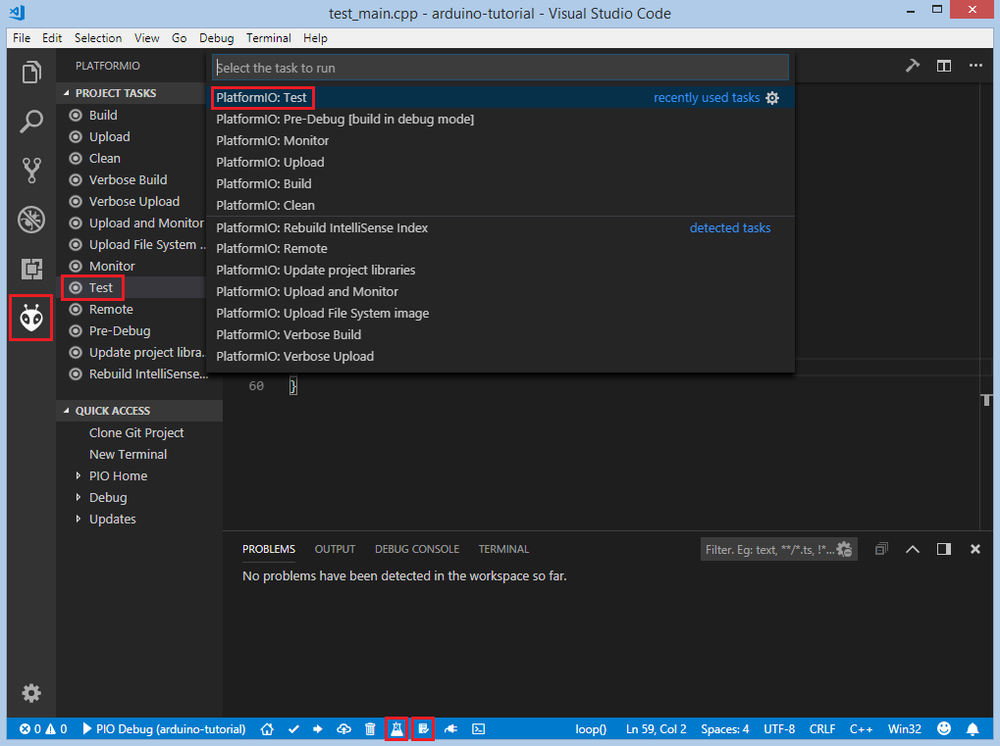

   PlatformIO builds and uploads the tests and shows a report. All tests pass:

   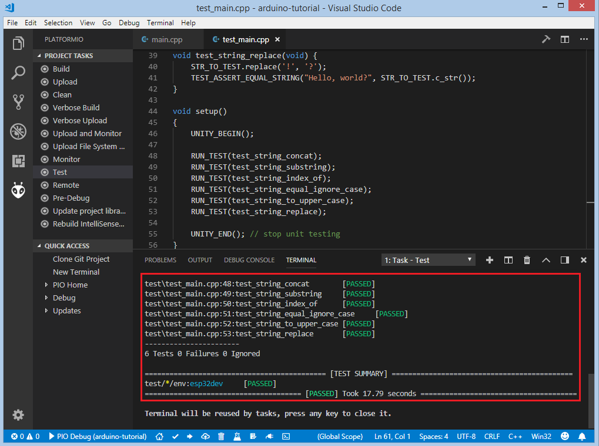

## Add a Bluetooth LE service {#adding-bluetooth-le-features}

Next, make the board talk to other Bluetooth LE devices, such as a phone. The
following program advertises a BLE service with one characteristic and prints
every new value written to it:

```cpp
#include <Arduino.h>
#include <BLEDevice.h>
#include <BLEUtils.h>
#include <BLEServer.h>

#define SERVICE_UUID        "4fafc201-1fb5-459e-8fcc-c5c9c331914b"
#define CHARACTERISTIC_UUID "beb5483e-36e1-4688-b7f5-ea07361b26a8"

class MyCallbacks: public BLECharacteristicCallbacks {
    void onWrite(BLECharacteristic *pCharacteristic) {
      std::string value = pCharacteristic->getValue();
      if (value.length() > 0) {
        Serial.print("\r\nNew value: ");
        for (int i = 0; i < value.length(); i++)
          Serial.print(value[i]);
        Serial.println();
      }
    }
};

void setup() {
  Serial.begin(9600);

  BLEDevice::init("ESP32 BLE example");
  BLEServer *pServer = BLEDevice::createServer();
  BLEService *pService = pServer->createService(SERVICE_UUID);
  BLECharacteristic *pCharacteristic = pService->createCharacteristic(
                                         CHARACTERISTIC_UUID,
                                         BLECharacteristic::PROPERTY_READ |
                                         BLECharacteristic::PROPERTY_WRITE
                                       );

  pCharacteristic->setCallbacks(new MyCallbacks());

  pCharacteristic->setValue("Hello World");
  pService->start();

  BLEAdvertising *pAdvertising = pServer->getAdvertising();
  pAdvertising->start();
}

void loop() {
  delay(2000);
}
```

1. Replace `src/main.cpp` with this program, then build and upload it as
   before.
2. On an Android phone with Bluetooth LE, open
   [nRF Connect](https://play.google.com/store/apps/details?id=no.nordicsemi.android.mcp&hl=en),
   scan for devices, and connect to **ESP32 BLE example**. It shows one
   **Unknown Service** with one **Unknown Characteristic**:

   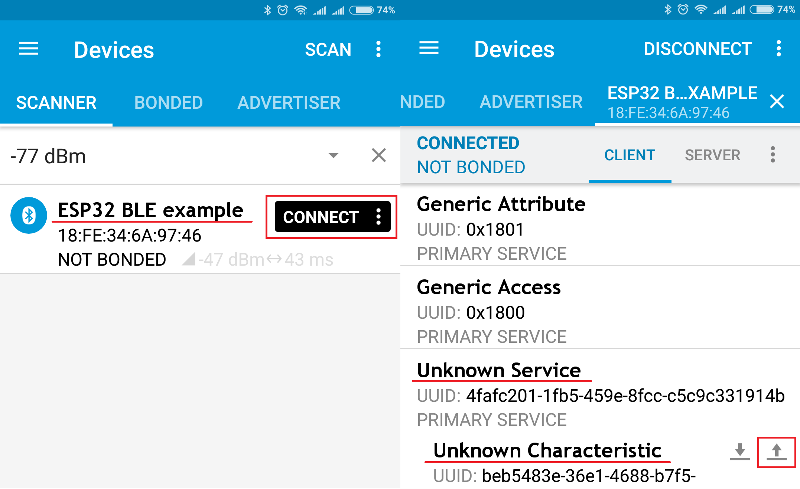

3. Write a new text value to the characteristic:

   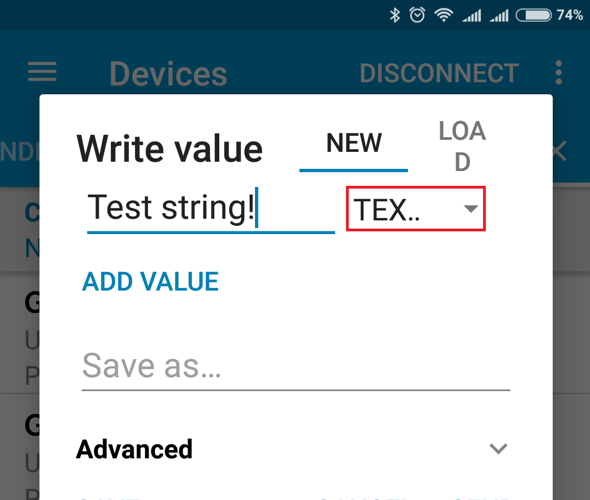

4. The serial monitor prints the new value:

   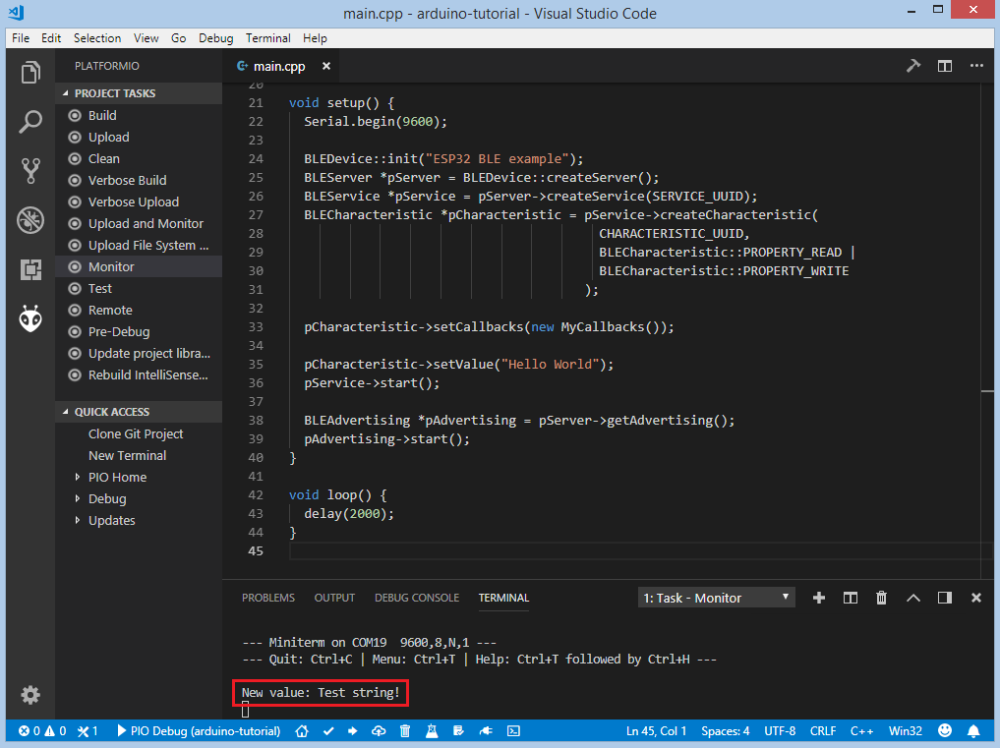

## Next steps {#conclusion}

You now have a working ESP32 project that you can use as a starting point.
To go further:

- [Espressif 32 platform](/hardware/platforms/espressif32): configuration,
  file systems and over-the-air updates.
- [Unit testing](../../../guides/unit-testing/index.md): run tests on the host
  or in CI.
- [Debugging](../../../guides/debugging/index.md): all debugging features.
