# ESP-IDF on ESP32-DevKitC: debugging, unit testing and project analysis

In this tutorial you use [PlatformIO IDE for VS Code](../../../guides/ide/vscode.md)
to build a Wi-Fi access point with the
[ESP-IDF](/hardware/frameworks/espidf) framework on the ESP32-DevKitC board.
You then debug it over JTAG, unit test a small library on the board, and
inspect the firmware's memory use and code quality.

- **Level:** intermediate
- **Host:** Windows, macOS or Linux

## What you need {#what-you-need}

- [PlatformIO IDE for VS Code](../../../guides/ide/vscode.md), installed.
- An [Espressif ESP32 Dev Module](/hardware/boards/espressif32/esp32dev)
  (ESP32-DevKitC) board.
- For debugging, a JTAG probe such as the
  [Olimex ARM-USB-OCD-H](../../../hardware/debug-probes/olimex-arm-usb-ocd-h.md)
  used here, or an [Olimex ARM-USB-OCD](../../../hardware/debug-probes/olimex-arm-usb-ocd.md).

## Create the project {#setting-up-the-project}

1. Select the **Home** button on the PlatformIO toolbar to open
   [PlatformIO Home](../../platformio-home.md):

   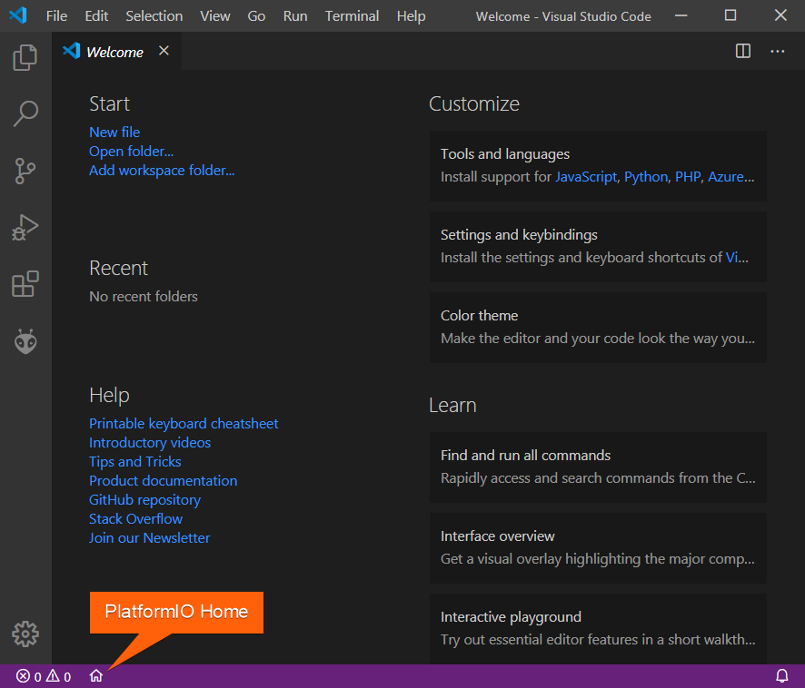

2. Select **New Project**. Choose **Espressif ESP32 Dev Module** as the board
   and **Espidf** as the framework, keep or change the location, and select
   **Finish**:

   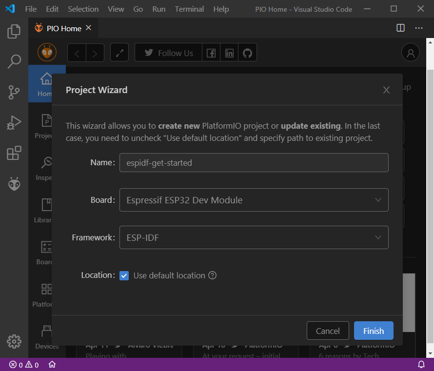

## Add the code {#adding-code-to-the-generated-project}

1. Create `src/main.c` (in the [`src_dir`](../../../reference/platformio-ini/platformio/src-dir.md)
   folder) with the following code. It starts a Wi-Fi access point named
   `mywifissid` and logs the stations that join or leave it.

   ```c
   /*  WiFi softAP Example

      This example code is in the Public Domain (or CC0 licensed, at your option.)

      Unless required by applicable law or agreed to in writing, this
      software is distributed on an "AS IS" BASIS, WITHOUT WARRANTIES OR
      CONDITIONS OF ANY KIND, either express or implied.
   */
   #include <string.h>
   #include "freertos/FreeRTOS.h"
   #include "freertos/task.h"
   #include "esp_mac.h"
   #include "esp_wifi.h"
   #include "esp_event.h"
   #include "esp_log.h"
   #include "nvs_flash.h"

   #include "lwip/err.h"
   #include "lwip/sys.h"

   /* The examples use WiFi configuration that you can set via project configuration menu.

      If you'd rather not, just change the below entries to strings with
      the config you want - ie #define EXAMPLE_WIFI_SSID "mywifissid"
   */
   #define EXAMPLE_ESP_WIFI_SSID      "mywifissid"
   #define EXAMPLE_ESP_WIFI_PASS      "mywifipass"
   #define EXAMPLE_ESP_WIFI_CHANNEL   1
   #define EXAMPLE_MAX_STA_CONN       4

   static const char *TAG = "wifi softAP";

   static void wifi_event_handler(void* arg, esp_event_base_t event_base,
                                       int32_t event_id, void* event_data)
   {
       if (event_id == WIFI_EVENT_AP_STACONNECTED) {
           wifi_event_ap_staconnected_t* event = (wifi_event_ap_staconnected_t*) event_data;
           ESP_LOGI(TAG, "station "MACSTR" join, AID=%d",
                    MAC2STR(event->mac), event->aid);
       } else if (event_id == WIFI_EVENT_AP_STADISCONNECTED) {
           wifi_event_ap_stadisconnected_t* event = (wifi_event_ap_stadisconnected_t*) event_data;
           ESP_LOGI(TAG, "station "MACSTR" leave, AID=%d",
                    MAC2STR(event->mac), event->aid);
       }
   }

   void wifi_init_softap(void)
   {
       ESP_ERROR_CHECK(esp_netif_init());
       ESP_ERROR_CHECK(esp_event_loop_create_default());
       esp_netif_create_default_wifi_ap();

       wifi_init_config_t cfg = WIFI_INIT_CONFIG_DEFAULT();
       ESP_ERROR_CHECK(esp_wifi_init(&cfg));

       ESP_ERROR_CHECK(esp_event_handler_instance_register(WIFI_EVENT,
                                                           ESP_EVENT_ANY_ID,
                                                           &wifi_event_handler,
                                                           NULL,
                                                           NULL));

       wifi_config_t wifi_config = {
           .ap = {
               .ssid = EXAMPLE_ESP_WIFI_SSID,
               .ssid_len = strlen(EXAMPLE_ESP_WIFI_SSID),
               .channel = EXAMPLE_ESP_WIFI_CHANNEL,
               .password = EXAMPLE_ESP_WIFI_PASS,
               .max_connection = EXAMPLE_MAX_STA_CONN,
               .authmode = WIFI_AUTH_WPA_WPA2_PSK,
               .pmf_cfg = {
                       .required = false,
               },
           },
       };
       if (strlen(EXAMPLE_ESP_WIFI_PASS) == 0) {
           wifi_config.ap.authmode = WIFI_AUTH_OPEN;
       }

       ESP_ERROR_CHECK(esp_wifi_set_mode(WIFI_MODE_AP));
       ESP_ERROR_CHECK(esp_wifi_set_config(WIFI_IF_AP, &wifi_config));
       ESP_ERROR_CHECK(esp_wifi_start());

       ESP_LOGI(TAG, "wifi_init_softap finished. SSID:%s password:%s channel:%d",
                EXAMPLE_ESP_WIFI_SSID, EXAMPLE_ESP_WIFI_PASS, EXAMPLE_ESP_WIFI_CHANNEL);
   }

   void app_main(void)
   {
       //Initialize NVS
       esp_err_t ret = nvs_flash_init();
       if (ret == ESP_ERR_NVS_NO_FREE_PAGES || ret == ESP_ERR_NVS_NEW_VERSION_FOUND) {
         ESP_ERROR_CHECK(nvs_flash_erase());
         ret = nvs_flash_init();
       }
       ESP_ERROR_CHECK(ret);

       ESP_LOGI(TAG, "ESP_WIFI_MODE_AP");
       wifi_init_softap();
   }
   ```

2. ESP-IDF builds only the source files you register. Check that
   `src/CMakeLists.txt` lists `main.c`:

   ```cmake
   idf_component_register(SRCS "main.c")
   ```

3. ESP-IDF logs at 115200 baud. Set the serial monitor to the same speed with
   [`monitor_speed`](../../../reference/platformio-ini/env/monitor-speed.md)
   in `platformio.ini`:

   ```ini
   [env:esp32dev]
   platform = espressif32
   board = esp32dev
   framework = espidf
   monitor_speed = 115200
   ```

## Build, upload and run {#build-upload-and-run}

1. Build the project with **Build** in the **Project Tasks** panel, the
   **Build** button on the [PlatformIO toolbar](../../../guides/ide/vscode.md#platformio-toolbar),
   **Command Palette** > **PlatformIO: Build**, or
   <kbd>Ctrl</kbd>+<kbd>Alt</kbd>+<kbd>B</kbd>
   (<kbd>Cmd</kbd>+<kbd>Alt</kbd>+<kbd>B</kbd> on macOS):

   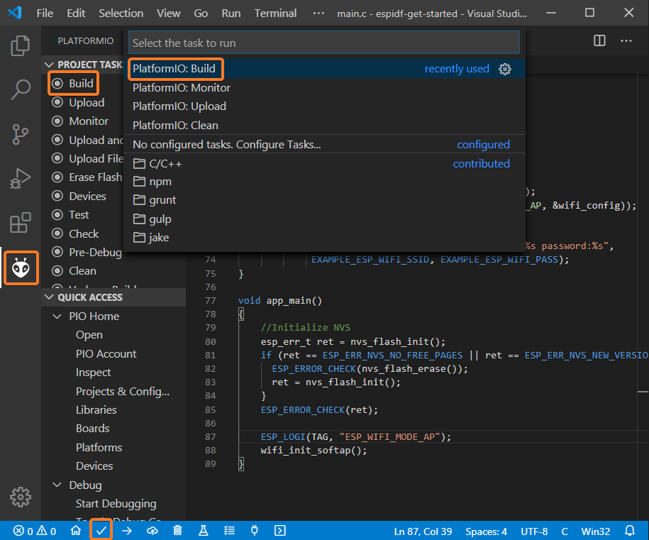

   The terminal shows `SUCCESS` when the build finishes:

   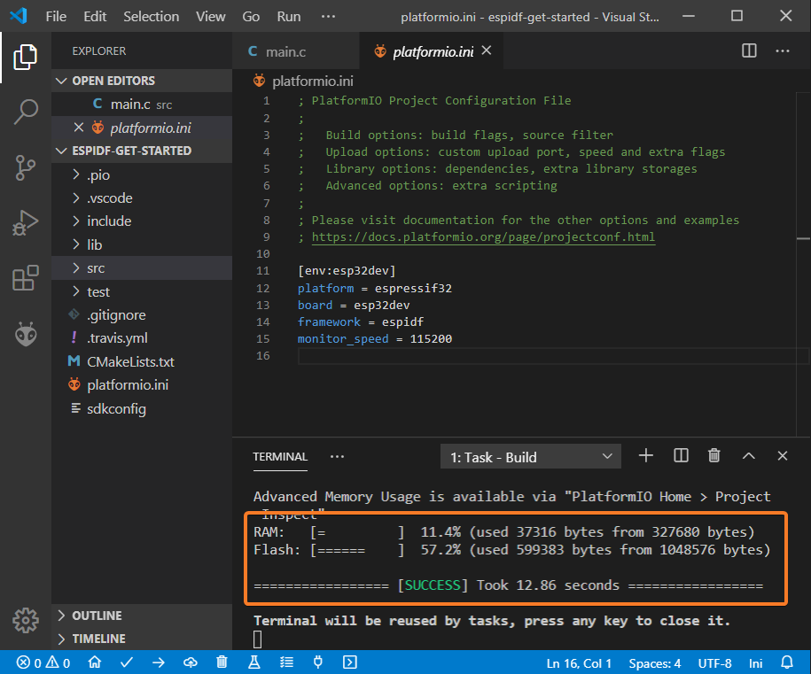

2. Connect the board and upload with **Upload** in the same places, or
   <kbd>Ctrl</kbd>+<kbd>Alt</kbd>+<kbd>U</kbd>
   (<kbd>Cmd</kbd>+<kbd>Alt</kbd>+<kbd>U</kbd> on macOS):

   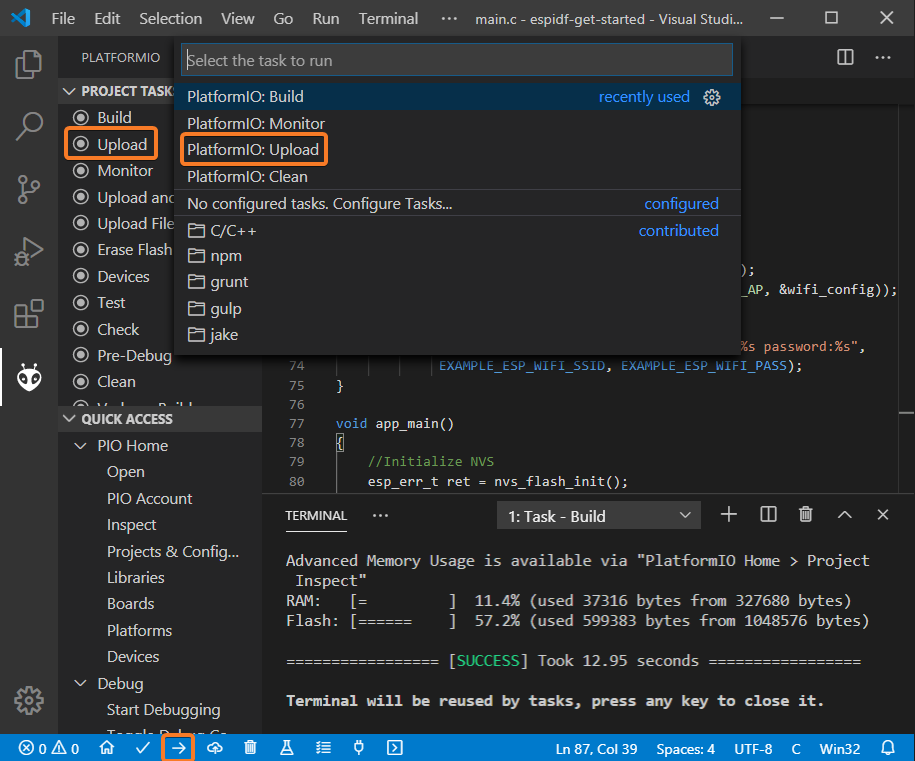

3. Open the serial monitor to see the log:

   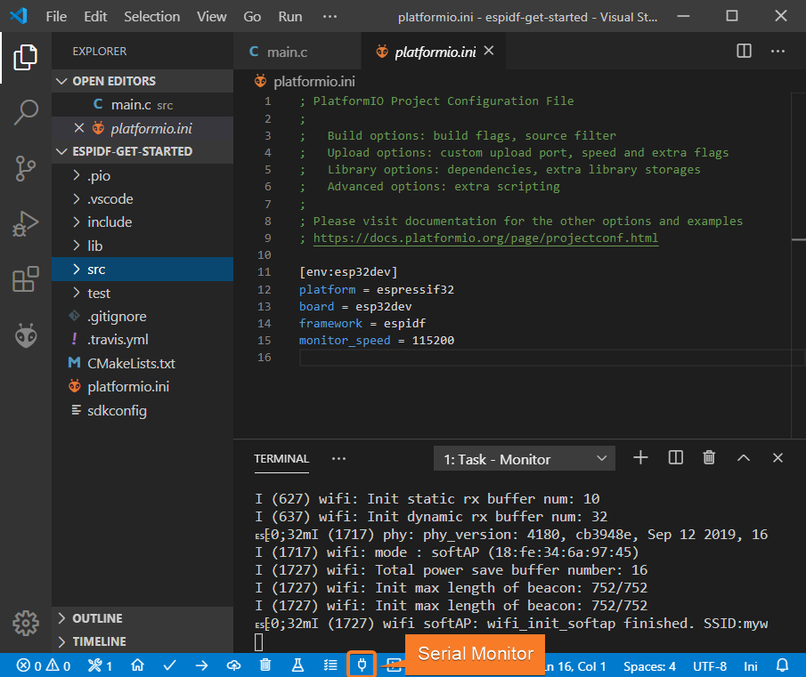

4. The board now appears as a Wi-Fi access point:

   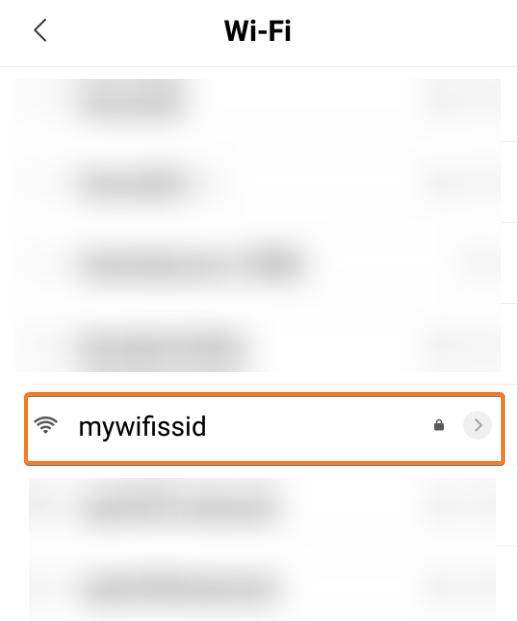

## Debug the firmware {#debugging-the-firmware}

### Connect the probe {#setting-up-the-hardware}

Connect the JTAG probe to the board:

| ESP32 pin | JTAG probe pin |
| --- | --- |
| `3.3V` | `Pin 1 (VTref)` |
| `EN` | `Pin 3 (nTRST)` |
| `GND` | `Pin 4 (GND)` |
| `GPIO 12 (TDI)` | `Pin 5 (TDI)` |
| `GPIO 14 (TMS)` | `Pin 7 (TMS)` |
| `GPIO 13 (TCK)` | `Pin 9 (TCK)` |
| `GPIO 15 (TDO)` | `Pin 13 (TDO)` |

### Start debugging {#start-debugging}

1. Set your probe with the
   [`debug_tool`](../../../reference/platformio-ini/env/debug-tool.md)
   option in `platformio.ini`:

   ```ini
   [env:esp32dev]
   platform = espressif32
   board = esp32dev
   framework = espidf
   monitor_speed = 115200
   debug_tool = olimex-arm-usb-ocd-h
   ```

2. Start a debug session with **Run** > **Start Debugging**, or press
   <kbd>F5</kbd>:

   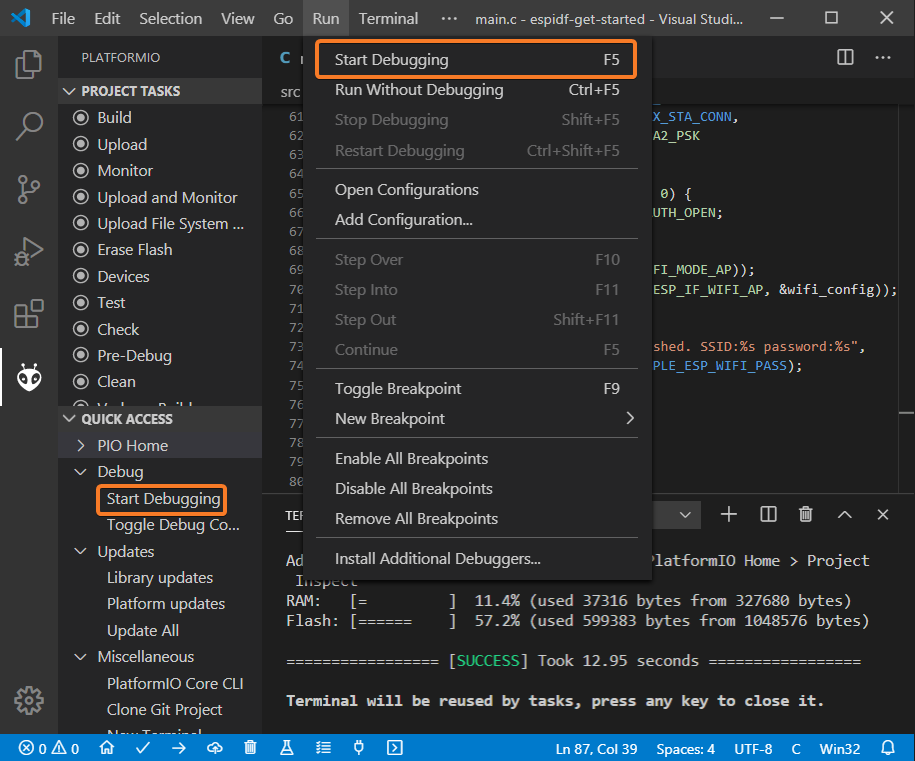

3. Step through the code, set breakpoints, and add variables to **Watch**:

   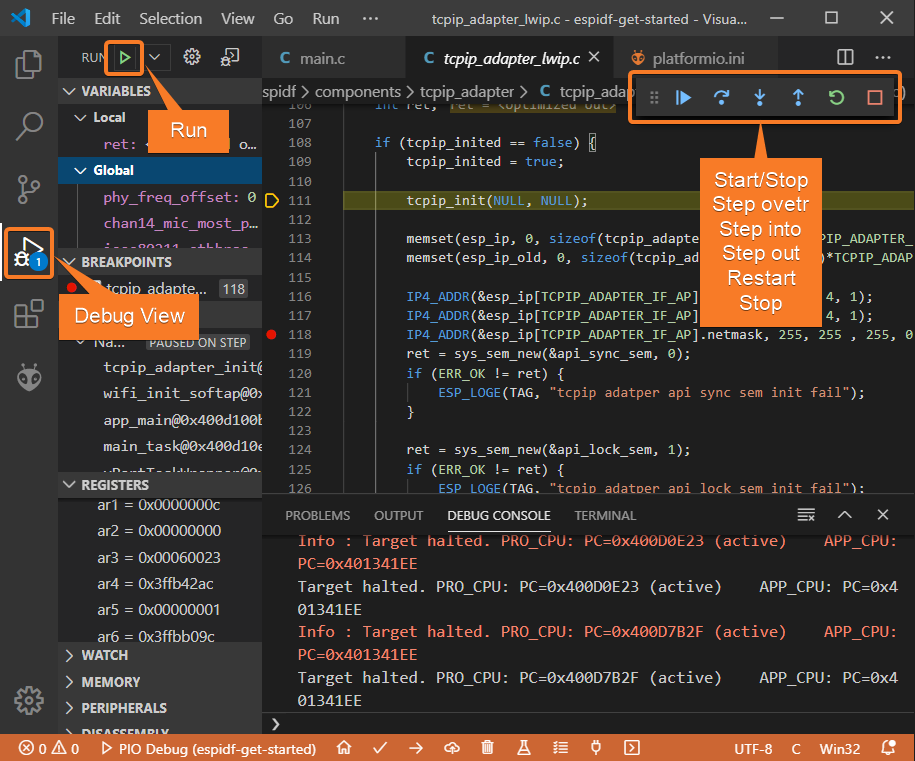

For more about debugging, see [Debugging](../../../guides/debugging/index.md).

## Write unit tests {#writing-unit-tests}

You will create a small `calculator` library and
[test](../../../guides/unit-testing/index.md) it on the board with the
[Unity](../../../guides/unit-testing/frameworks/unity.md) framework.

:::note

Unity calls `setUp()` before and `tearDown()` after each test. Use them to
prepare and clean up test data; they can be empty.

:::

1. In the [`lib_dir`](../../../reference/platformio-ini/platformio/lib-dir.md)
   folder, create a `calculator` folder with two files.

   `lib/calculator/calculator.h`:

   ```c
   #ifndef _CALCULATOR_H_
   #define _CALCULATOR_H_

   #ifdef __cplusplus
   extern "C"
   {
   #endif

     int addition(int a, int b);
     int subtraction(int a, int b);
     int multiplication(int a, int b);
     int division(int a, int b);

   #ifdef __cplusplus
   }
   #endif

   #endif // _CALCULATOR_H_
   ```

   `lib/calculator/calculator.c`:

   ```c
   #include "calculator.h"

   int addition(int a, int b)
   {
     return a + b;
   }

   int subtraction(int a, int b)
   {
     return a - b;
   }

   int multiplication(int a, int b)
   {
     return a * b;
   }

   int division(int a, int b)
   {
     return a / b;
   }
   ```

2. Create `test/test_calc.c` (in the
   [`test_dir`](../../../reference/platformio-ini/platformio/test-dir.md)
   folder) with tests for the library. One expected value is wrong on
   purpose, so that you can see a failing test:

   ```c
   #include <calculator.h>
   #include <unity.h>

   void setUp(void)
   {
     // set stuff up here
   }

   void tearDown(void)
   {
     // clean stuff up here
   }

   void test_function_calculator_addition(void)
   {
     TEST_ASSERT_EQUAL(32, addition(25, 7));
   }

   void test_function_calculator_subtraction(void)
   {
     TEST_ASSERT_EQUAL(20, subtraction(23, 3));
   }

   void test_function_calculator_multiplication(void)
   {
     TEST_ASSERT_EQUAL(50, multiplication(25, 2));
   }

   void test_function_calculator_division(void)
   {
     TEST_ASSERT_EQUAL(32, division(100, 3));
   }

   void app_main()
   {
     UNITY_BEGIN();

     RUN_TEST(test_function_calculator_addition);
     RUN_TEST(test_function_calculator_subtraction);
     RUN_TEST(test_function_calculator_multiplication);
     RUN_TEST(test_function_calculator_division);

     UNITY_END();
   }
   ```

3. Run the tests on the board with the **Test** button on the PlatformIO
   toolbar or **Test** in the **Project Tasks** panel.
   `test_function_calculator_division` fails, because integer division of
   100 by 3 gives 33:

   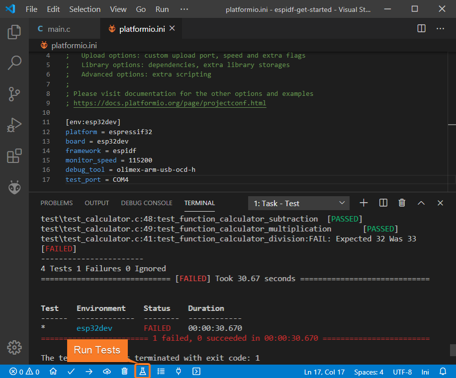

4. Change the expected value to `33` and run the tests again. All tests pass:

   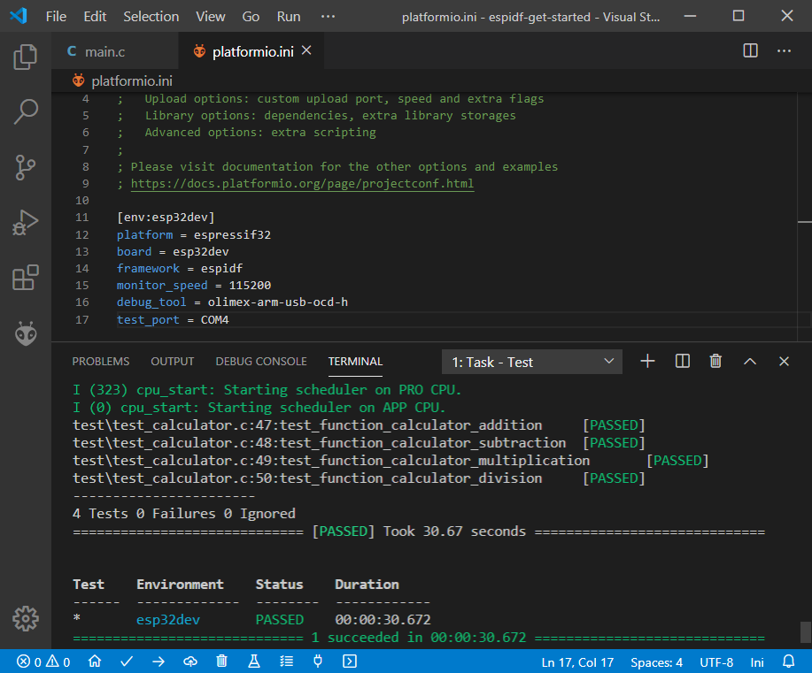

## Inspect the project {#project-inspection}

PlatformIO Home can show where the firmware uses memory and run
[static code analysis](../../../guides/static-code-analysis/index.md).

1. In PlatformIO Home, open **Inspect**, select the project, and select
   **Inspect**:

   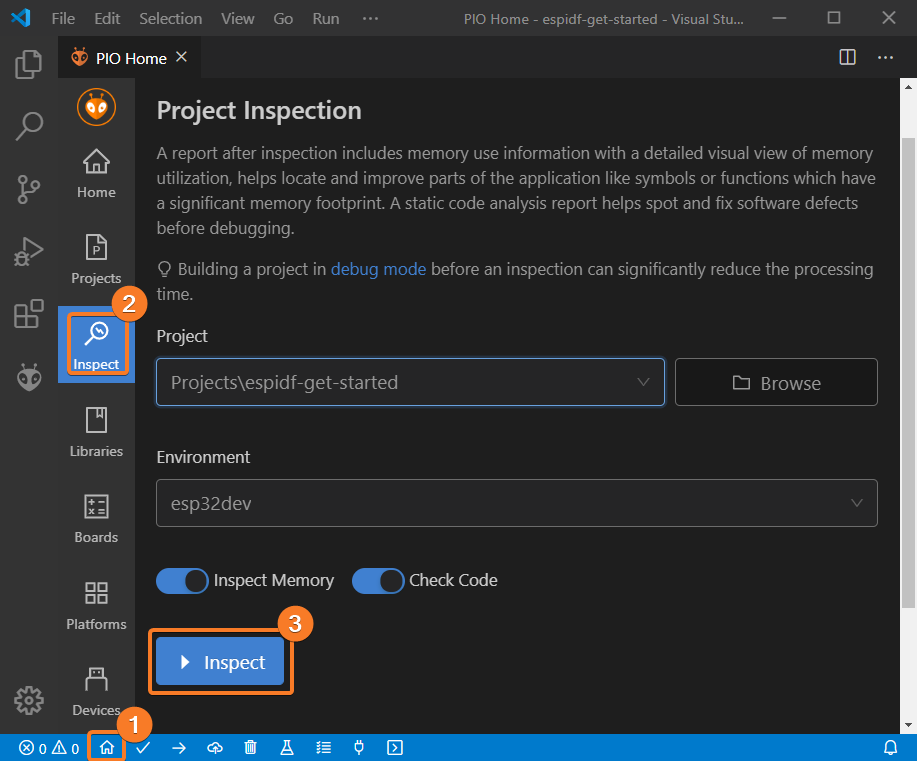

2. The **Statistics** tab summarizes memory use and code quality:

   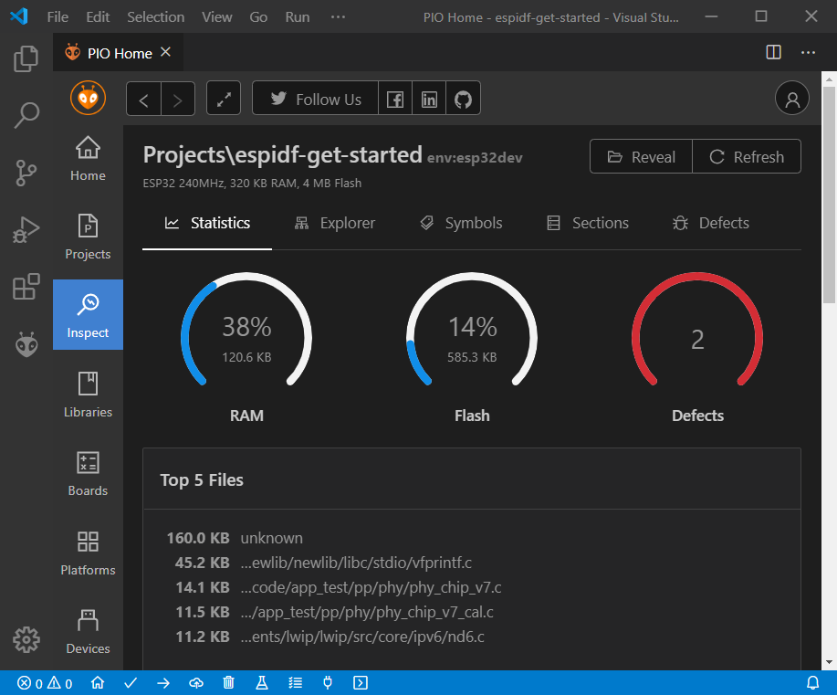

3. Sort the symbols by size to find the function with the largest memory
   footprint:

   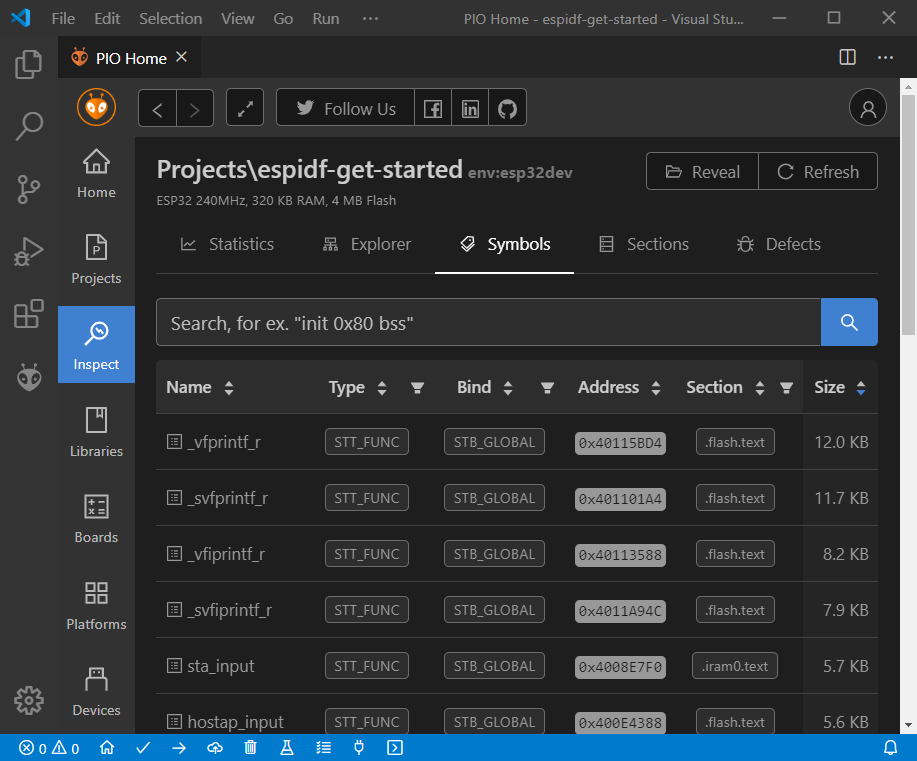

4. The **Defects** tab lists possible bugs found by static analysis:

   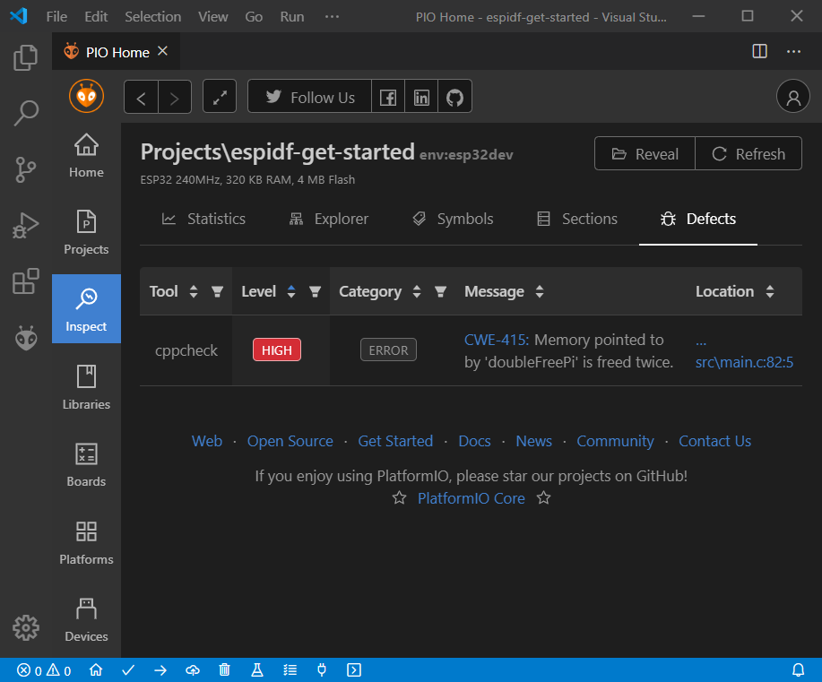

## Next steps {#conclusion}

You now have a working ESP-IDF project that you can use as a starting point.
To go further:

- [ESP-IDF framework](/hardware/frameworks/espidf): configuration with
  `menuconfig` and `sdkconfig`.
- [Espressif 32 platform](/hardware/platforms/espressif32): file systems and
  over-the-air updates.
- [Static code analysis](../../../guides/static-code-analysis/index.md).
