<a id="tutorial-nordicnrf52-arduino-debugging-unit-testing"></a>

# Arduino on Nordic nRF52-DK: debugging and unit testing {#arduino-and-nordic-nrf52-dk-debugging-and-unit-testing}

In this tutorial you use [PlatformIO IDE for VS Code](../../../guides/ide/vscode.md)
to create an [Arduino](/hardware/frameworks/arduino) project for the Nordic
nRF52-DK board, debug it with the on-board J-Link probe, run unit tests on the
board and, finally, control the LED over Bluetooth LE.

- **Level:** beginner
- **Host:** Windows, macOS or Linux

## What you need {#what-you-need}

- [PlatformIO IDE for VS Code](../../../guides/ide/vscode.md), installed.
- A [Nordic nRF52-DK](/hardware/boards/nordicnrf52/nrf52-dk) board.
- The [J-Link drivers](../../../hardware/debug-probes/jlink.md) for the board's
  on-board J-Link probe.

## Create the project {#setting-up-the-project}

1. Open [PlatformIO Home](../../platformio-home.md) with the **Home** button on
   the PlatformIO toolbar, and select **New Project**:

   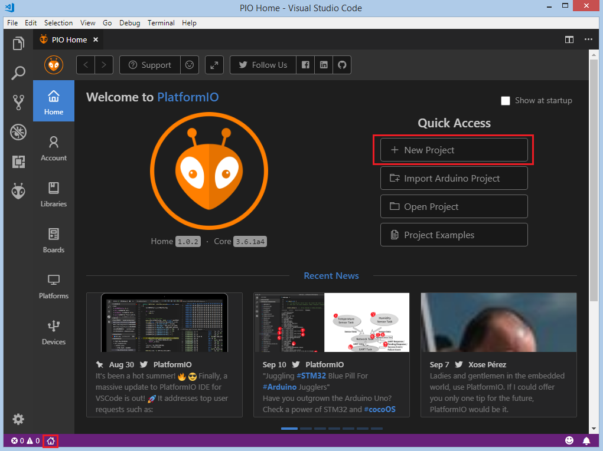

2. Select **Nordic nRF52-DK** as the board and **Arduino** as the framework.
   Keep or change the location, and select **Finish**:

   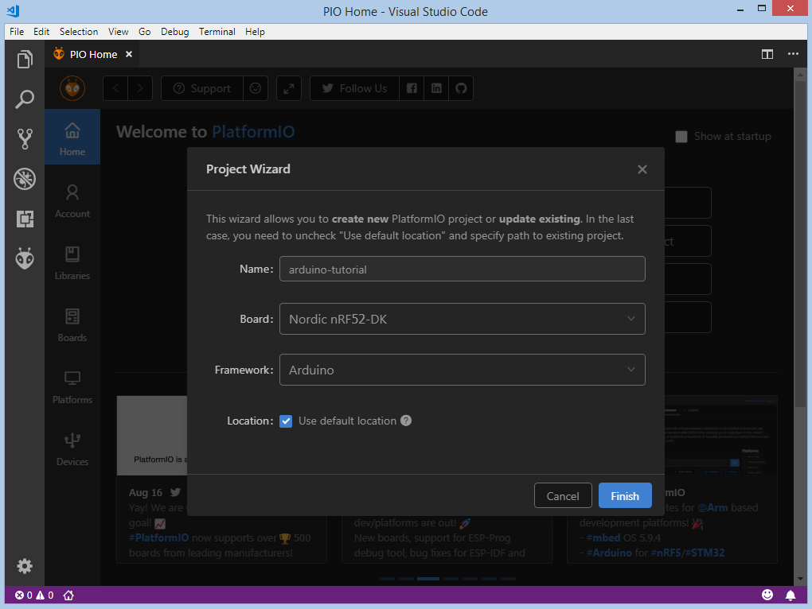

PlatformIO creates the project and installs the toolchain and framework. The
first time, this can take a few minutes.

## Add the code {#adding-code-to-the-generated-project}

Open `src/main.cpp` (in the [`src_dir`](../../../reference/platformio-ini/platformio/src-dir.md)
folder) and replace its content with a program that blinks the LED:

```cpp
#include <Arduino.h>

void setup()
{
  pinMode(LED_BUILTIN, OUTPUT);
}

void loop()
{
  digitalWrite(LED_BUILTIN, HIGH);
  delay(100);
  digitalWrite(LED_BUILTIN, LOW);
  delay(100);
}
```

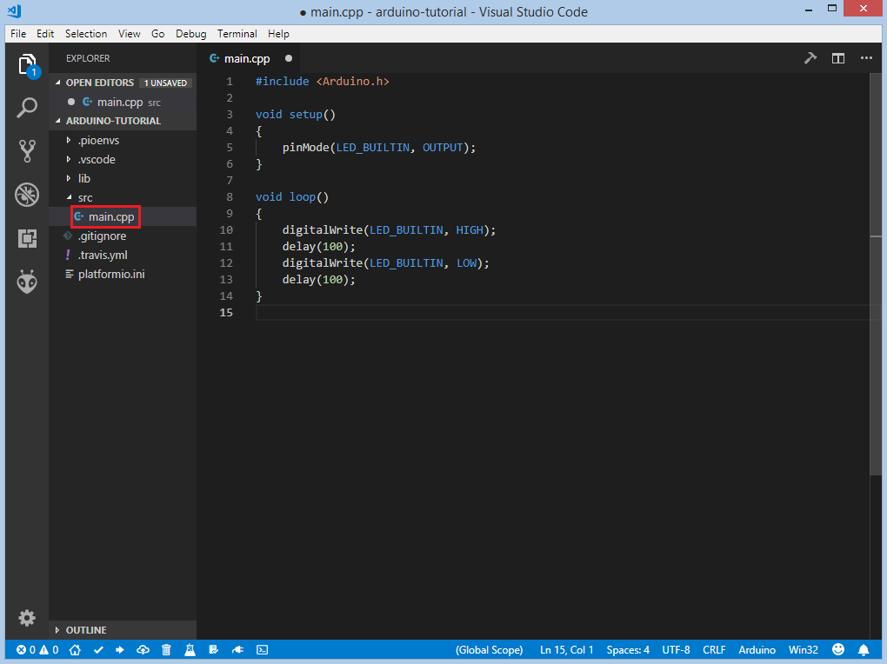

## Build and upload {#compiling-and-uploading-the-firmware}

1. Build the project with **Build** in the **Project Tasks** panel, the
   **Build** button on the [PlatformIO toolbar](../../../guides/ide/vscode.md#platformio-toolbar),
   **Command Palette** > **PlatformIO: Build**, or
   <kbd>Ctrl</kbd>+<kbd>Alt</kbd>+<kbd>B</kbd>
   (<kbd>Cmd</kbd>+<kbd>Alt</kbd>+<kbd>B</kbd> on macOS):

   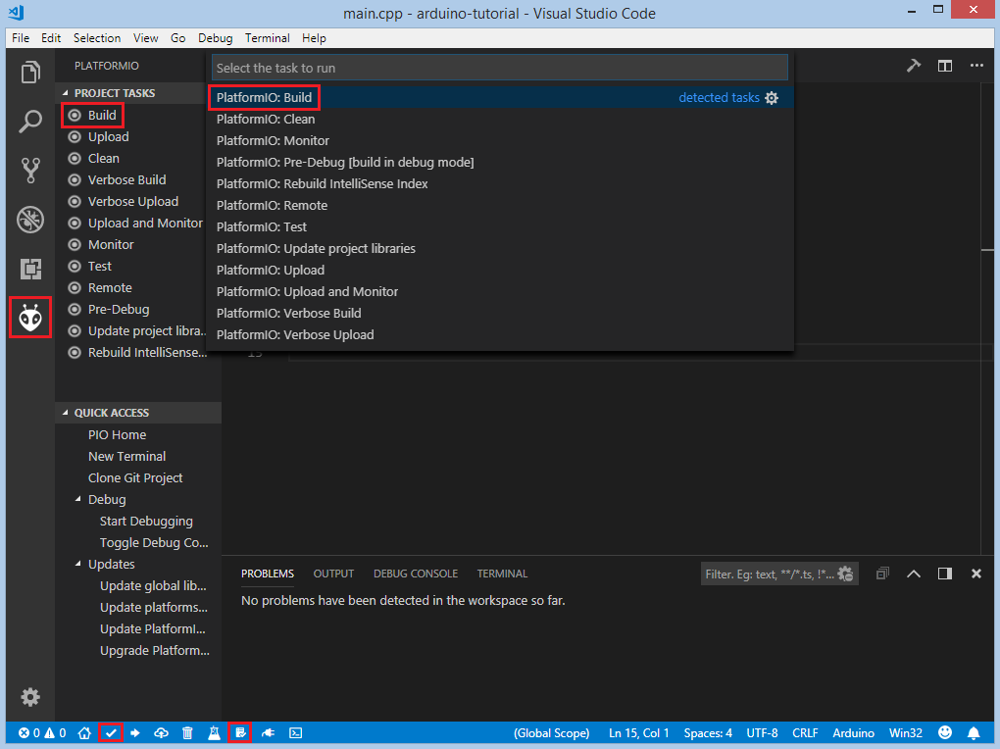

   The terminal shows `SUCCESS` when the build finishes:

   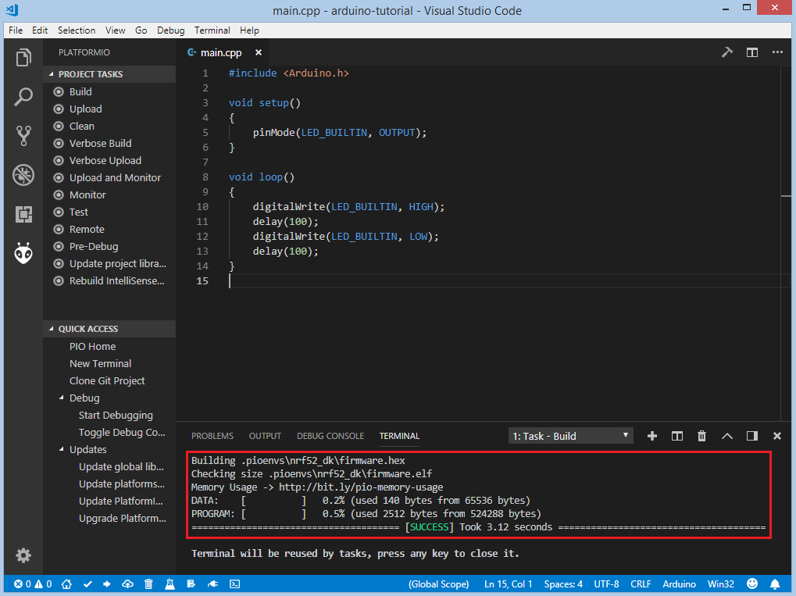

2. Connect the board and upload with **Upload** in the same places, or
   <kbd>Ctrl</kbd>+<kbd>Alt</kbd>+<kbd>U</kbd>
   (<kbd>Cmd</kbd>+<kbd>Alt</kbd>+<kbd>U</kbd> on macOS):

   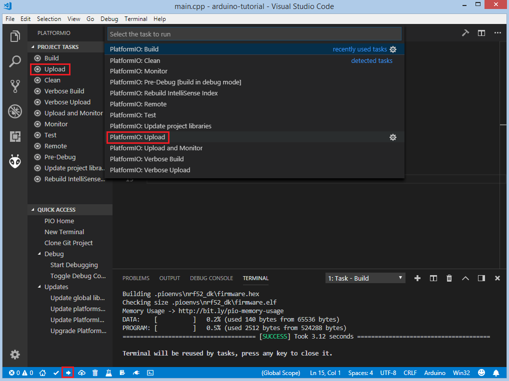

The green LED1 starts blinking.

## Debug the firmware {#debugging-the-firmware}

1. The board has an on-board J-Link probe. Select it with the
   [`debug_tool`](../../../reference/platformio-ini/env/debug-tool.md) option
   in `platformio.ini`:

   ```ini
   [env:nrf52_dk]
   platform = nordicnrf52
   board = nrf52_dk
   framework = arduino
   debug_tool = jlink
   ```

2. Start a debug session with **Run** > **Start Debugging**, or press
   <kbd>F5</kbd>:

   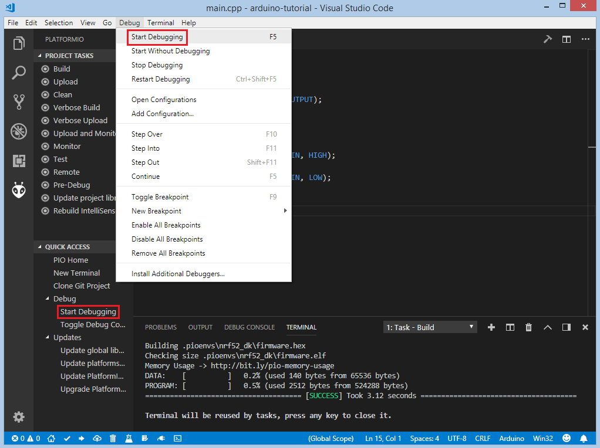

3. Wait until the session stops at the first line of `main()`:

   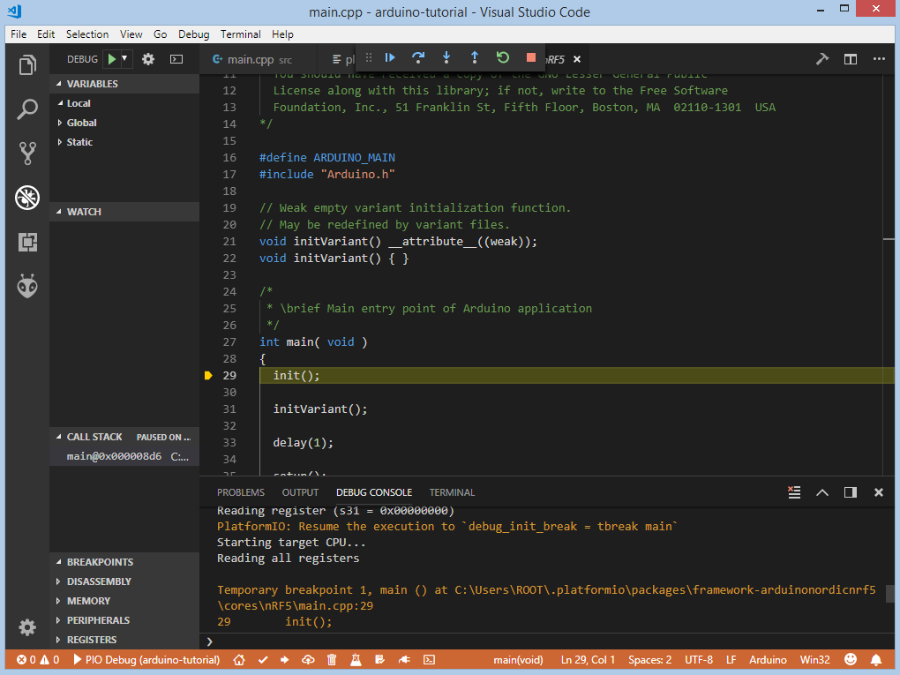

4. Step through the code, set breakpoints, and add variables to **Watch**:

   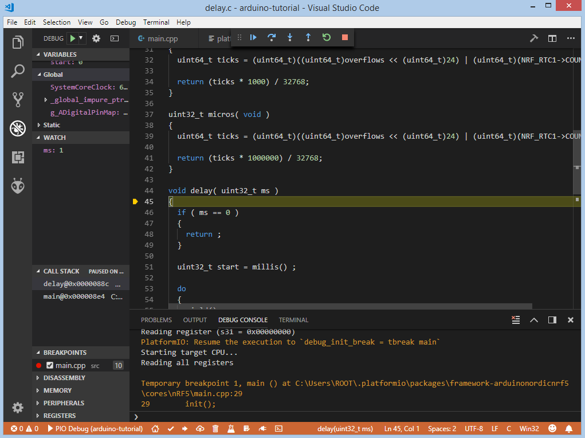

For more about debugging, see [Debugging](../../../guides/debugging/index.md).

## Write unit tests {#writing-unit-tests}

[Unit tests](../../../guides/unit-testing/index.md) with the
[Unity](../../../guides/unit-testing/frameworks/unity.md) framework use four
functions:

- `setUp()` runs before each test and `tearDown()` after it. Use them to
  prepare and reset the test data. They are optional.
- `setup()` and `loop()` are a regular Arduino program that runs the tests.

The tests below check the Arduino `String` class:

| Test | Checks |
| --- | --- |
| `test_string_concat` | Concatenation of two strings |
| `test_string_substring` | Substring extraction |
| `test_string_index_of` | Index of a character |
| `test_string_equal_ignore_case` | Case-insensitive comparison |
| `test_string_to_upper_case` | Conversion to upper case |
| `test_string_replace` | Character replacement |

1. Create `test/test_main.cpp` in the project:

   :::note

   The 2-second delay in `setup()` gives the test runner time to open the
   serial port, because this board cannot be reset through the serial port's
   DTR/RTS lines.

   :::

   ```cpp
   #include <Arduino.h>
   #include <unity.h>

   String STR_TO_TEST;

   void setUp(void)
   {
     // set stuff up here
     STR_TO_TEST = "Hello, world!";
   }

   void tearDown(void)
   {
     // clean stuff up here
     STR_TO_TEST = "";
   }

   void test_string_concat(void)
   {
     String hello = "Hello, ";
     String world = "world!";
     TEST_ASSERT_EQUAL_STRING(STR_TO_TEST.c_str(), (hello + world).c_str());
   }

   void test_string_substring(void)
   {
     TEST_ASSERT_EQUAL_STRING("Hello", STR_TO_TEST.substring(0, 5).c_str());
   }

   void test_string_index_of(void)
   {
     TEST_ASSERT_EQUAL(7, STR_TO_TEST.indexOf('w'));
   }

   void test_string_equal_ignore_case(void)
   {
     TEST_ASSERT_TRUE(STR_TO_TEST.equalsIgnoreCase("HELLO, WORLD!"));
   }

   void test_string_to_upper_case(void)
   {
     STR_TO_TEST.toUpperCase();
     TEST_ASSERT_EQUAL_STRING("HELLO, WORLD!", STR_TO_TEST.c_str());
   }

   void test_string_replace(void)
   {
     STR_TO_TEST.replace('!', '?');
     TEST_ASSERT_EQUAL_STRING("Hello, world?", STR_TO_TEST.c_str());
   }

   void setup()
   {
     delay(2000); // service delay
     UNITY_BEGIN();

     RUN_TEST(test_string_concat);
     RUN_TEST(test_string_substring);
     RUN_TEST(test_string_index_of);
     RUN_TEST(test_string_equal_ignore_case);
     RUN_TEST(test_string_to_upper_case);
     RUN_TEST(test_string_replace);

     UNITY_END(); // stop unit testing
   }

   void loop()
   {
   }
   ```

2. Run the tests on the board with the **Test** button on the PlatformIO
   toolbar or **Test** in the **Project Tasks** panel:

   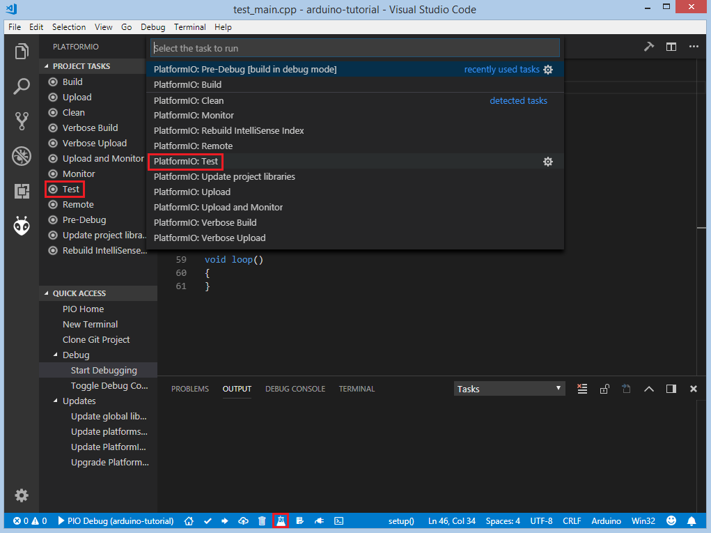

   PlatformIO builds and uploads the tests and shows a report. All tests pass:

   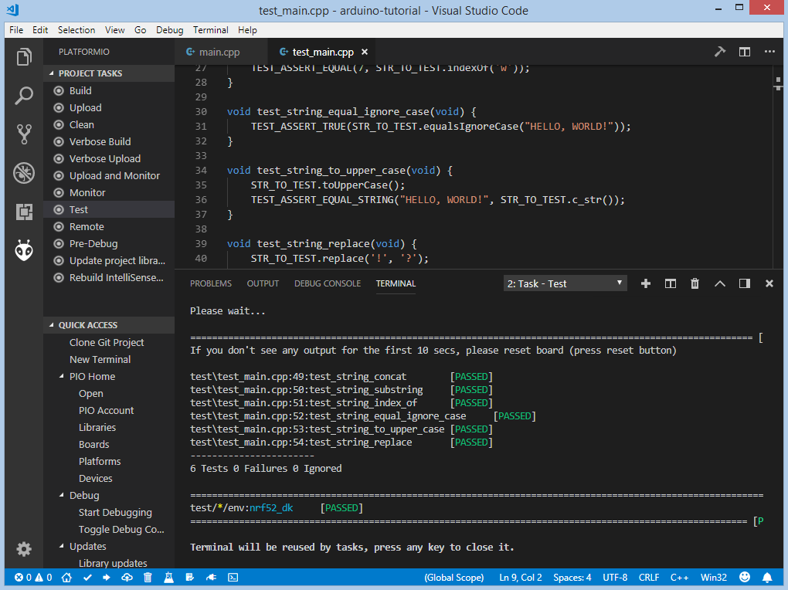

## Control the LED over Bluetooth LE {#adding-bluetooth-le-features}

1. Bluetooth LE on the nRF52 needs a SoftDevice (Nordic's Bluetooth stack)
   and the [BLEPeripheral](https://registry.platformio.org/libraries/sandeepmistry/BLEPeripheral)
   library. Select the S132 SoftDevice with
   [`build_flags`](../../../reference/platformio-ini/env/build-flags.md) and
   add the library with
   [`lib_deps`](../../../reference/platformio-ini/env/lib-deps.md):

   ```ini
   [env:nrf52_dk]
   platform = nordicnrf52
   board = nrf52_dk
   framework = arduino
   debug_tool = jlink
   ; SoftDevice version
   build_flags = -DNRF52_S132
   lib_deps =
     BLEPeripheral
   ```

2. Replace `src/main.cpp` with the following program. It advertises a BLE
   service with one characteristic that switches LED1 on and off:

   ```cpp
   #include <Arduino.h>
   #include <SPI.h>
   #include <BLEPeripheral.h>

   BLEPeripheral ledPeripheral = BLEPeripheral();

   BLEService ledService = BLEService("19b10000e8f2537e4f6cd104768a1214");
   BLECharCharacteristic ledCharacteristic = BLECharCharacteristic("19b10001e8f2537e4f6cd104768a1214", BLERead | BLEWrite);

   void setup()
   {
     pinMode(LED_BUILTIN, OUTPUT);

     ledPeripheral.setAdvertisedServiceUuid(ledService.uuid());
     ledPeripheral.addAttribute(ledService);
     ledPeripheral.addAttribute(ledCharacteristic);
     ledPeripheral.setLocalName("Nordic NRF52 DK");
     ledPeripheral.begin();
   }

   void loop()
   {
     BLECentral central = ledPeripheral.central();

     if (central)
     {
       while (central.connected())
       {
         if (ledCharacteristic.written())
         {
           if (ledCharacteristic.value())
           {
             digitalWrite(LED_BUILTIN, HIGH);
           }
           else
           {
             digitalWrite(LED_BUILTIN, LOW);
           }
         }
       }
     }
   }
   ```

3. Build and upload the program as before.

4. On an Android phone with Bluetooth LE, open
   [nRF Connect](https://play.google.com/store/apps/details?id=no.nordicsemi.android.mcp&hl=en),
   scan for devices, and connect to **Nordic NRF52 DK**. It shows one
   **Unknown Service** with one **Unknown Characteristic**:

   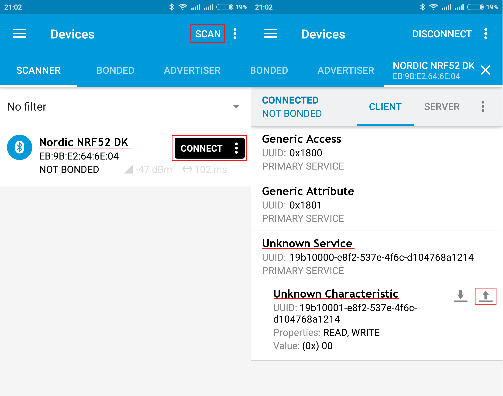

5. Write `1` or `0` as a `UINT8` value to the characteristic to switch the LED
   on or off:

   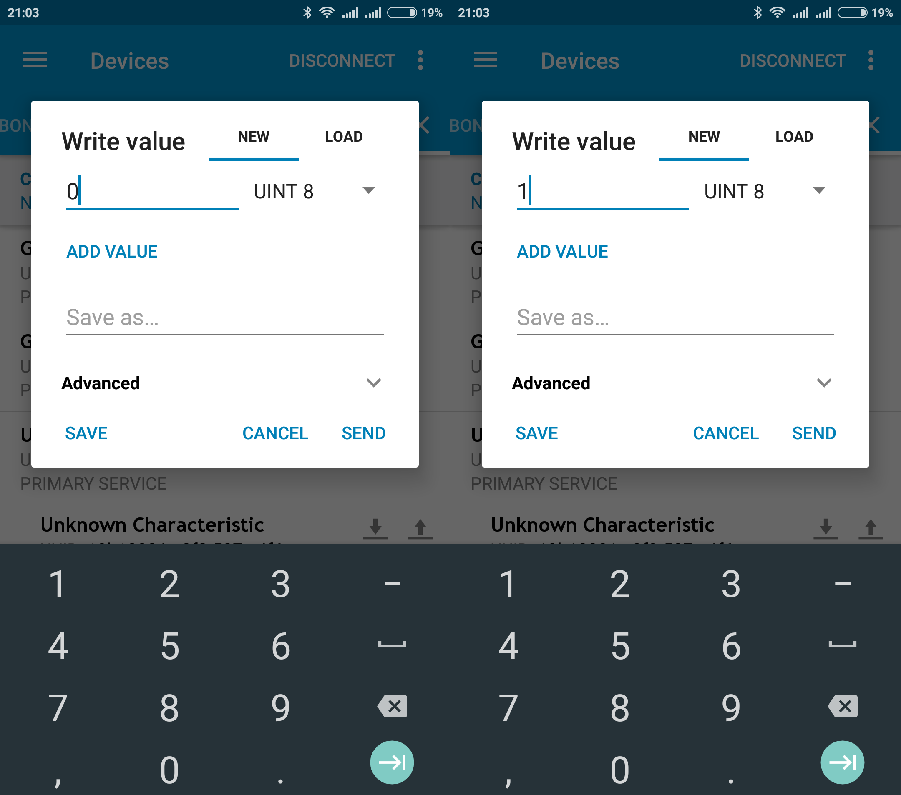

## Next steps {#conclusion}

You now have a working nRF52 project that you can use as a starting point.
To go further:

- [Nordic nRF52 platform](/hardware/platforms/nordicnrf52): SoftDevices,
  bootloaders and upload methods.
- [Unit testing](../../../guides/unit-testing/index.md): test on the host or
  in CI.
- [Debugging](../../../guides/debugging/index.md): all debugging features.
