<a id="tutorial-nordicnrf52-zephyr-debugging-unit-testing-analysis"></a>

# Zephyr and Nordic nRF52-DK: debugging, unit testing, project analysis {#zephyr-and-nordic-nrf52-dk-debugging-unit-testing-project-analysis}

The goal of this tutorial is to demonstrate how simple it is to use [PlatformIO IDE for VSCode](../../../guides/ide/vscode.md) to develop, run and debug a simple Bluetooth project using [Zephyr](/hardware/frameworks/zephyr) framework for the `Nordic nRF52-DK` board.

- **Level:** Intermediate
- **Platforms:** Windows, Mac OS X, Linux

**Requirements:**

- Downloaded and installed [PlatformIO IDE for VSCode](../../../guides/ide/vscode.md)
- Install drivers for [J-LINK](../../../hardware/debug-probes/jlink.md) debug tool
- [Nordic nRF52-DK](/hardware/boards/nordicnrf52/nrf52-dk) development board

## Setting Up the Project {#setting-up-the-project}

1. Click on "PlatformIO Home" button on the bottom PlatformIO Toolbar:

   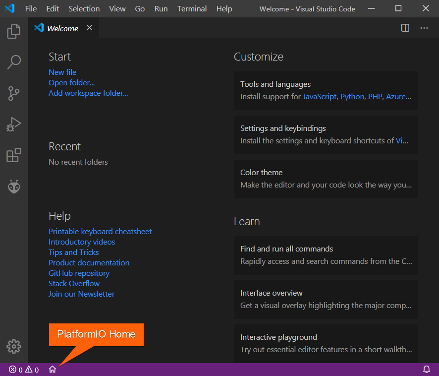

2. Click on "New Project", select `Nordic nRF52-DK` as the development board, [Zephyr](/hardware/frameworks/zephyr) as the framework and a path to the project location (or use the default one):

   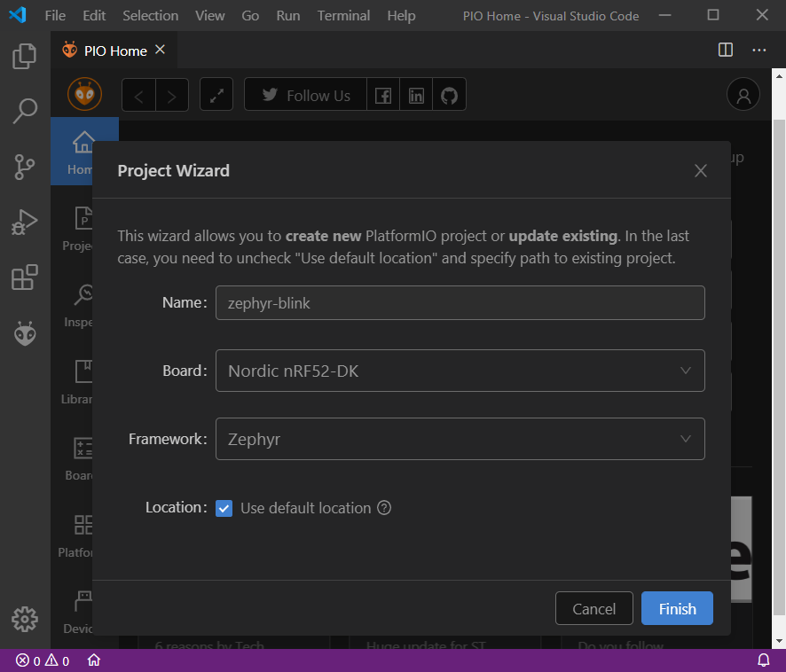

## Adding Code to the Generated Project {#adding-code-to-the-generated-project}

1. Create a new file `main.c` in [src_dir](../../../reference/platformio-ini/platformio/src-dir.md) folder and add the following code:

   ```c
   //
   // Copyright (c) 2015-2016 Intel Corporation
   //
   // SPDX-License-Identifier: Apache-2.0
   //

   #include <zephyr/types.h>
   #include <stddef.h>
   #include <sys/printk.h>
   #include <sys/util.h>

   #include <bluetooth/bluetooth.h>
   #include <bluetooth/hci.h>

   #define DEVICE_NAME CONFIG_BT_DEVICE_NAME
   #define DEVICE_NAME_LEN (sizeof(DEVICE_NAME) - 1)

   // Set Advertisement data. Based on the Eddystone specification:
   // https://github.com/google/eddystone/blob/master/protocol-specification.md
   // https://github.com/google/eddystone/tree/master/eddystone-url

   static const struct bt_data ad[] = {
       BT_DATA_BYTES(BT_DATA_FLAGS, BT_LE_AD_NO_BREDR),
       BT_DATA_BYTES(BT_DATA_UUID16_ALL, 0xaa, 0xfe),
       BT_DATA_BYTES(BT_DATA_SVC_DATA16,
                     0xaa, 0xfe,
                     0x10, // Eddystone-URL frame type
                     0x00, // Calibrated Tx power at 0m
                     0x00, // URL Scheme Prefix http://www.
                     'z', 'e', 'p', 'h', 'y', 'r',
                     'p', 'r', 'o', 'j', 'e', 'c', 't',
                     0x08) // .org
   };

   // Set Scan Response data
   static const struct bt_data sd[] = {
       BT_DATA(BT_DATA_NAME_COMPLETE, DEVICE_NAME, DEVICE_NAME_LEN),
   };

   static void bt_ready(int err)
   {
     if (err)
     {
       printk("Bluetooth init failed (err %d)\n", err);
       return;
     }

     printk("Bluetooth initialized\n");

     // Start advertising
     err = bt_le_adv_start(BT_LE_ADV_NCONN, ad, ARRAY_SIZE(ad),
                           sd, ARRAY_SIZE(sd));
     if (err)
     {
       printk("Advertising failed to start (err %d)\n", err);
       return;
     }

     printk("Beacon started\n");
   }

   void main(void)
   {
     int err;

     printk("Starting Beacon Demo\n");

     // Initialize the Bluetooth Subsystem
     err = bt_enable(bt_ready);
     if (err)
     {
       printk("Bluetooth init failed (err %d)\n", err);
     }
   }
   ```

2. By default Bluetooth feature is disabled, we can enable it by creating a new file `prj.conf` in `zephyr` folder and adding the following lines:

   ```text
   CONFIG_BT=y
   CONFIG_BT_DEBUG_LOG=y
   CONFIG_BT_DEVICE_NAME="Test beacon"
   ```

## Compiling and Uploading the Firmware {#compiling-and-uploading-the-firmware}

1. To compile the project use one of the following options:

   - Build option from the `Project Tasks` menu
   - Build button in [PlatformIO Toolbar](../../../guides/ide/vscode.md#ide-vscode-toolbar)
   - Task Menu `Tasks: Run Task... > PlatformIO: Build` or in [PlatformIO Toolbar](../../../guides/ide/vscode.md#ide-vscode-toolbar)
   - Command Palette `View: Command Palette > PlatformIO: Build`
   - Hotkeys `cmd-alt-b / ctrl-alt-b`:

   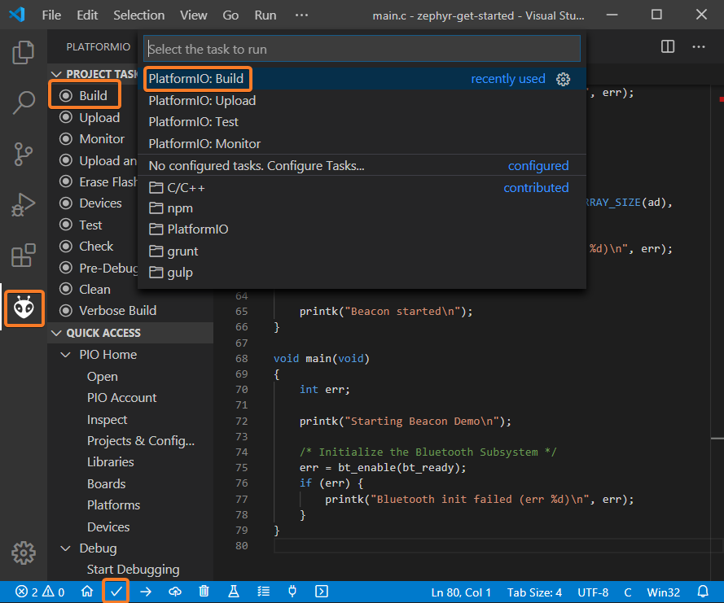

2. If everything went well, we should see a successful result message in the terminal window:

   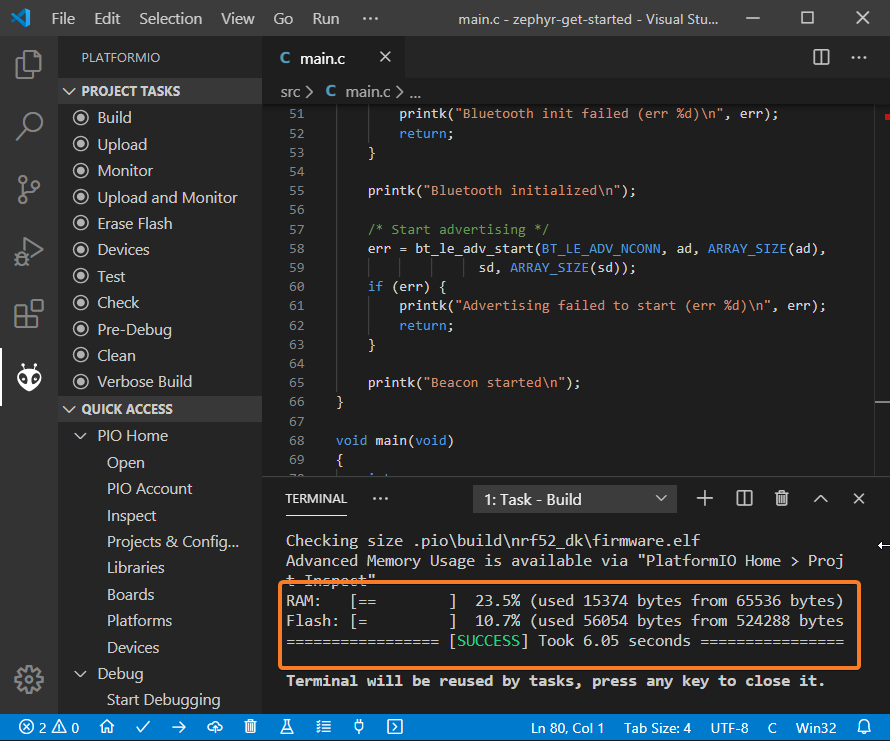

3. To upload the firmware to the board we can use the following options:

   - Upload option from the `Project Tasks` menu
   - Upload button in [PlatformIO Toolbar](../../../guides/ide/vscode.md#ide-vscode-toolbar)
   - Command Palette `View: Command Palette > PlatformIO: Upload`
   - Task Menu `Tasks: Run Task... > PlatformIO: Upload`
   - Hotkeys `cmd-alt-u / ctrl-alt-u`:

   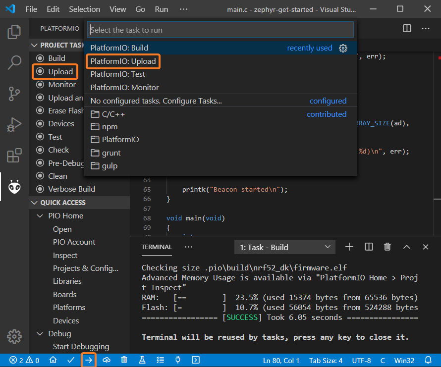

4. Connect the board to your computer and update the default monitor speed to `115200` in `platformio.ini` file:

   ```ini
   [env:nrf52_dk]
   platform = nordicnrf52
   board = nrf52_dk
   framework = zephyr
   monitor_speed = 115200
   ```

5. Open Serial Monitor to observe the output from the board:

   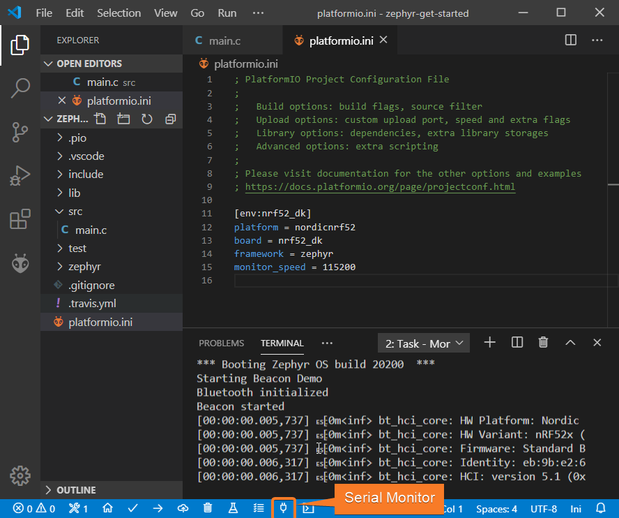

6. If everything went well, the board should be visible as a beacon:

   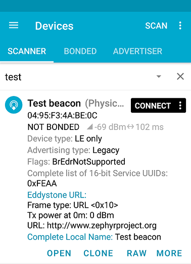

## Debugging the Firmware {#debugging-the-firmware}

Since [Nordic nRF52-DK](/hardware/boards/nordicnrf52/nrf52-dk) includes an onboard debug probe we can use [Debugging](../../../guides/debugging/index.md) without any configuration.

1. To start a debug session we can use the following options:

   - `Debug: Start debugging` from the top menu
   - `Start Debugging` option from Quick Access menu
   - Hotkey button `F5`:

   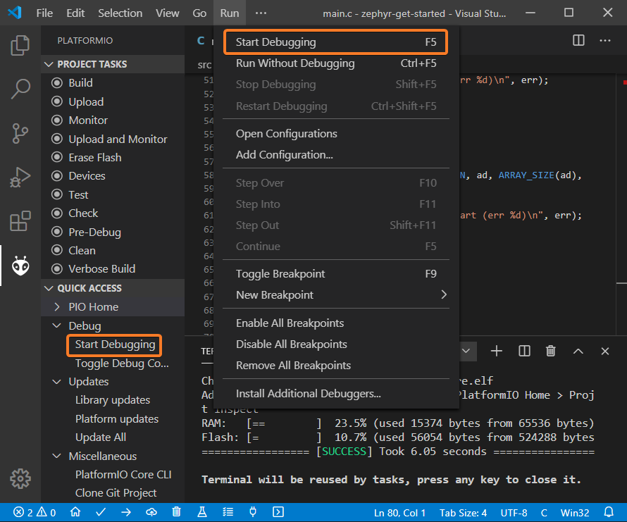

2. We can walk through the code using control buttons, set breakpoints, add variables to `Watch window`:

   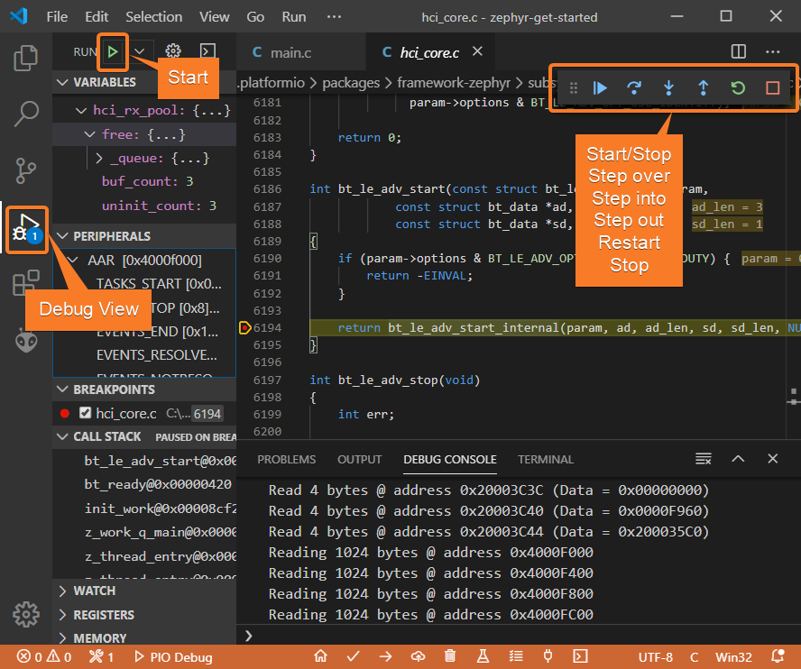

## Writing Unit Tests {#writing-unit-tests}

:::note

Functions `setUp` and `tearDown` are used to initialize and finalize test conditions. Implementations of these functions are not required for running tests but if you need to initialize some variables before you run a test, you use the `setUp` function and if you need to clean up variables you use `tearDown` function.

:::

For the sake of simplicity, let's create a small library called `calculator`, implement several basic functions `add`, `sub`, `mul`, `div` and test them using [Unit Testing](../../../guides/unit-testing/index.md) solution.

1. PlatformIO uses a unit testing framework called `Unity`. `Unity` is not compatible with C library implemented in the framework. Let's enable standard version of newlib C library in `prj.conf` file using the following config:

   ```text
   CONFIG_NEWLIB_LIBC=y
   ```

2. Create a new folder `calculator` in the `lib` folder and add two new files `calculator.h` and `calculator.c` with the following contents:

   `calculator.h`:

   ```c
   #ifndef _CALCULATOR_H_
   #define _CALCULATOR_H_

   #ifdef __cplusplus
   extern "C" {
   #endif

   int add (int a, int b);
   int sub (int a, int b);
   int mul (int a, int b);
   int div (int a, int b);

   #ifdef __cplusplus
   }
   #endif

   #endif // _CALCULATOR_H_
   ```

   `calculator.c`:

   ```c
   #include "calculator.h"

   int add(int a, int b)
   {
       return a + b;
   }

   int sub(int a, int b)
   {
       return a - b;
   }

   int mul(int a, int b)
   {
       return a * b;
   }
   ```

3. Create a new file `test_calc.c` to the folder `test` and add basic tests for `calculator` library:

   ```c
   #include <calculator.h>
   #include <unity.h>

   void setUp(void)
   {
     // set stuff up here
   }

   void tearDown(void)
   {
     // clean stuff up here
   }

   void test_function_calculator_addition(void)
   {
     TEST_ASSERT_EQUAL(32, add(25, 7));
   }

   void test_function_calculator_subtraction(void)
   {
     TEST_ASSERT_EQUAL(20, sub(23, 3));
   }

   void test_function_calculator_multiplication(void)
   {
     TEST_ASSERT_EQUAL(50, mul(25, 2));
   }

   void test_function_calculator_division(void)
   {
     TEST_ASSERT_EQUAL(32, div(100, 3));
   }

   void main()
   {
     UNITY_BEGIN();

     RUN_TEST(test_function_calculator_addition);
     RUN_TEST(test_function_calculator_subtraction);
     RUN_TEST(test_function_calculator_multiplication);
     RUN_TEST(test_function_calculator_division);

     UNITY_END();
   }
   ```

4. Let's run tests on the board and check the results. There should be a problem with `test_function_calculator_division` test:

   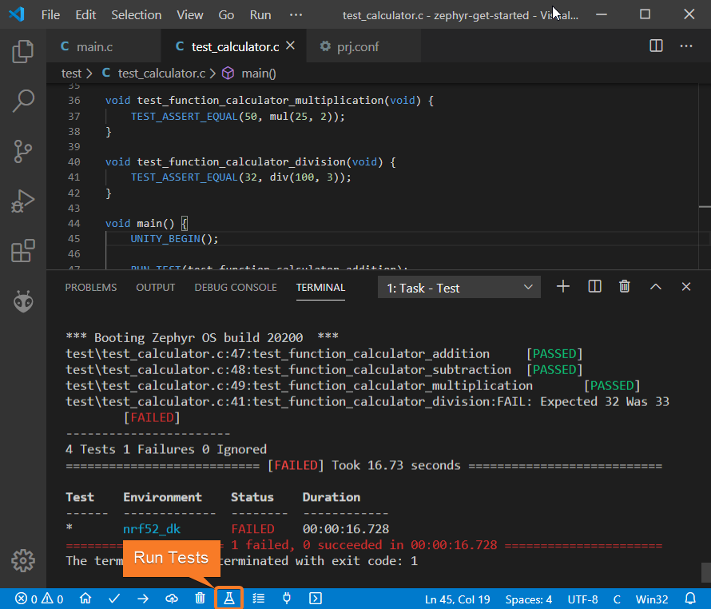

5. Let's fix the incorrect expected value, run tests again. After processing the results should be correct:

   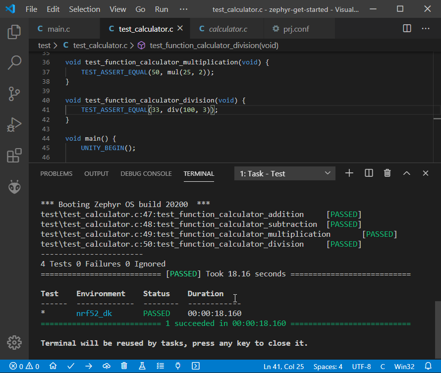

## Project Inspection {#project-inspection}

For illustrative purposes, let's imagine we need to find a function with the biggest memory footprint. Also, let's introduce a bug to our project so [Static Code Analysis](../../../guides/static-code-analysis/index.md) can report it.

1. Open `PlatformIO Home` and navigate to `Inspect` section, select the current project and press `Inspect` button:

   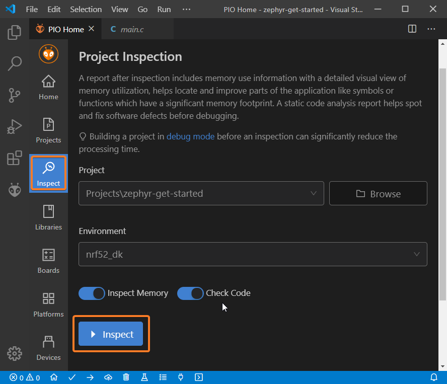

2. Project statistics:

   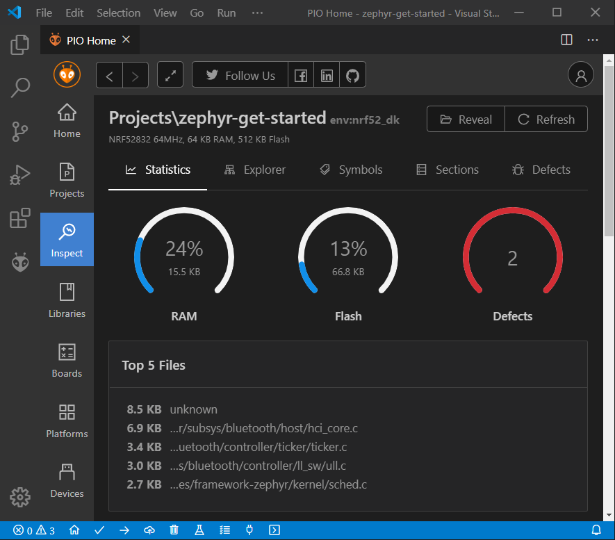

3. The biggest function:

   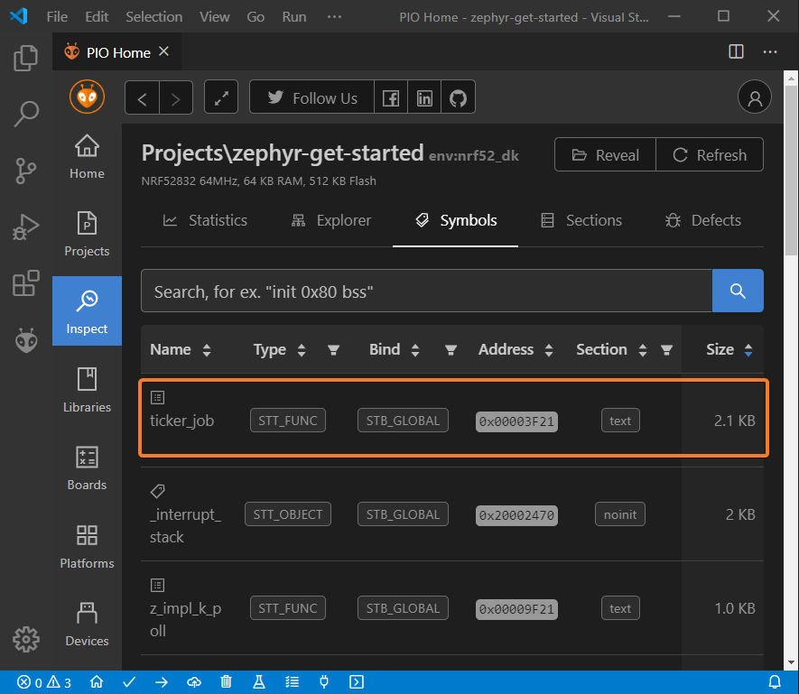

4. Possible bugs:

   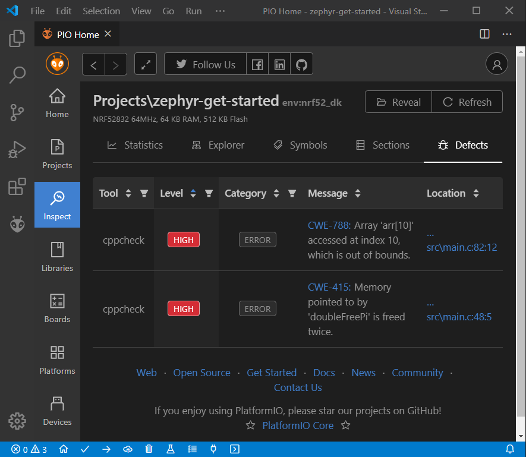

## Conclusion {#conclusion}

Now we have a project template for Nordic [Nordic nRF52-DK](/hardware/boards/nordicnrf52/nrf52-dk) board that we can use as a boilerplate for the next projects.
