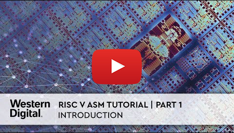

# RISC-V ASM Video Tutorial {#risc-v-asm-video-tutorial}

An introduction to using [SiFive](/hardware/platforms/sifive) and Assembly language on the SiFive [HiFive1](/hardware/boards/sifive/hifive1) by Martin Fink, Chief Technology Officer at Western Digital.

## Source Files {#source-files}

A demo source code is published on Github: [https://github.com/martin-robert-fink/superBlink.git](https://github.com/martin-robert-fink/superBlink.git)

It is already pre-configured PlatformIO project:

- Clone it or [download](https://github.com/martin-robert-fink/superBlink/archive/master.zip)
- Open in [PlatformIO IDE for VSCode](../../../guides/ide/vscode.md)
- Happy coding and debugging!

## Video Collection {#video-collection}

- [Part 1 of 12 | Introduction](https://www.youtube.com/watch?v=KLybwrpfQ3I&index=1&list=PL6noQ0vZDAdh_aGvqKvxd0brXImHXMuLY)
- [Part 2 of 12 | Setting Up](https://www.youtube.com/watch?v=daGHhrkF41U&list=PL6noQ0vZDAdh_aGvqKvxd0brXImHXMuLY&index=2)
- [Part 3 of 12 | Tour PlatformIO](https://www.youtube.com/watch?v=k3tpNwXEWhU&list=PL6noQ0vZDAdh_aGvqKvxd0brXImHXMuLY&index=3)
- [Part 4 of 12 | C Code Wrapper](https://www.youtube.com/watch?v=MnWI9qplfvA&list=PL6noQ0vZDAdh_aGvqKvxd0brXImHXMuLY&index=4)
- [Part 5 of 12 | HiFive Docs](https://www.youtube.com/watch?v=nqXRzUFnM9w&list=PL6noQ0vZDAdh_aGvqKvxd0brXImHXMuLY&index=5)
- [Part 6 of 12 | Understanding GPIO](https://www.youtube.com/watch?v=tthKXGxAUjY&list=PL6noQ0vZDAdh_aGvqKvxd0brXImHXMuLY&index=6)
- [Part 7 of 12 | setupGPIO](https://www.youtube.com/watch?v=90udyEHBiwg&list=PL6noQ0vZDAdh_aGvqKvxd0brXImHXMuLY&index=7)
- [Part 8 of 12 | Debug setupGPIO](https://www.youtube.com/watch?v=Xmes__VpfiA&list=PL6noQ0vZDAdh_aGvqKvxd0brXImHXMuLY&index=8)
- [Part 9 of 12 | setLED](https://www.youtube.com/watch?v=PMLqqRHpbsQ&list=PL6noQ0vZDAdh_aGvqKvxd0brXImHXMuLY&index=9)
- [Part 10 of 12 | Debug setLED](https://www.youtube.com/watch?v=6K1FZK1Kc5w&list=PL6noQ0vZDAdh_aGvqKvxd0brXImHXMuLY&index=10)
- [Part 11 of 12 | Delay](https://www.youtube.com/watch?v=edzX3c2r0YQ&list=PL6noQ0vZDAdh_aGvqKvxd0brXImHXMuLY&index=11)
- [Part 12 of 12 | Final and Conclusion](https://www.youtube.com/watch?v=C16UE8oTZY0&list=PL6noQ0vZDAdh_aGvqKvxd0brXImHXMuLY&index=12)
