<a id="tutorial-stm32cube-debugging-unit-testing"></a>

# STM32Cube HAL and Nucleo-F401RE: debugging and unit testing {#stm32cube-hal-and-nucleo-f401re-debugging-and-unit-testing}

The goal of this tutorial is to demonstrate how simple it is to use [PlatformIO IDE for VSCode](../../../guides/ide/vscode.md) to develop, run and debug a basic blink project with [STM32Cube](/hardware/frameworks/stm32cube) framework for `STM32 Nucleo-F401RE` board.

- **Level:** Intermediate
- **Platforms:** Windows, Mac OS X, Linux

**Requirements:**

- Downloaded and installed [PlatformIO IDE for VSCode](../../../guides/ide/vscode.md)
- Install drivers for [ST-LINK](../../../hardware/debug-probes/stlink.md) debug tool
- [ST Nucleo F401RE](/hardware/boards/ststm32/nucleo-f401re) development board

## Setting Up the Project {#setting-up-the-project}

At first step, we need to create a new project using PlatformIO Home Page (to open this page just press Home icon on the toolbar):

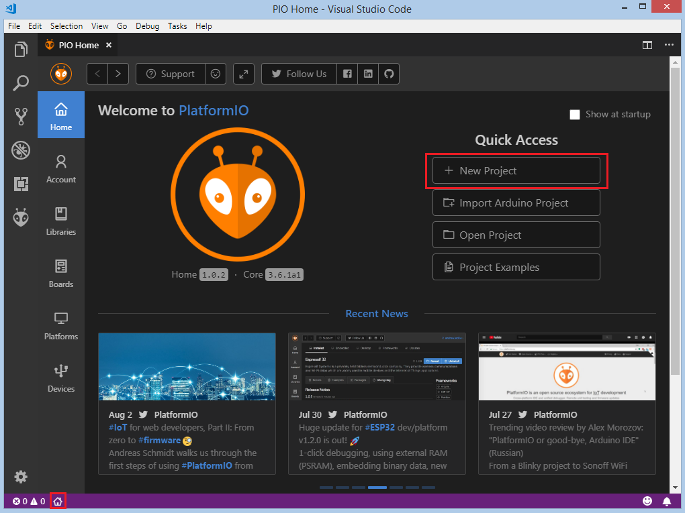

On the next step, we need to select `ST Nucleo-F401RE` as a development board, [STM32Cube](/hardware/frameworks/stm32cube) as a framework and a path to the project location (or use the default one):

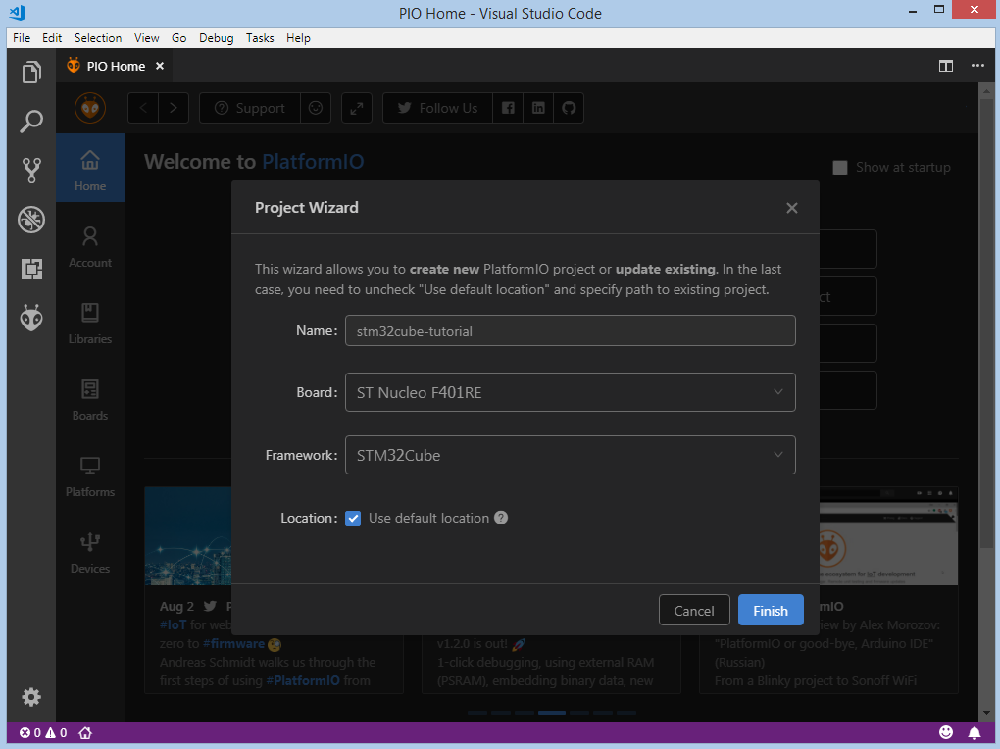

Processing the selected project may take some amount of time (PlatformIO will download and install all required packages) and after these steps, we have a fully configured project that is ready for developing code with [STM32Cube](/hardware/frameworks/stm32cube) framework.

## Adding Code to the Generated Project {#adding-code-to-the-generated-project}

Let's add some actual code to the project. Firstly, we create two main files `main.c` and `main.h` in the [src_dir](../../../reference/platformio-ini/platformio/src-dir.md) folder. Right click on the `src` in the project window:

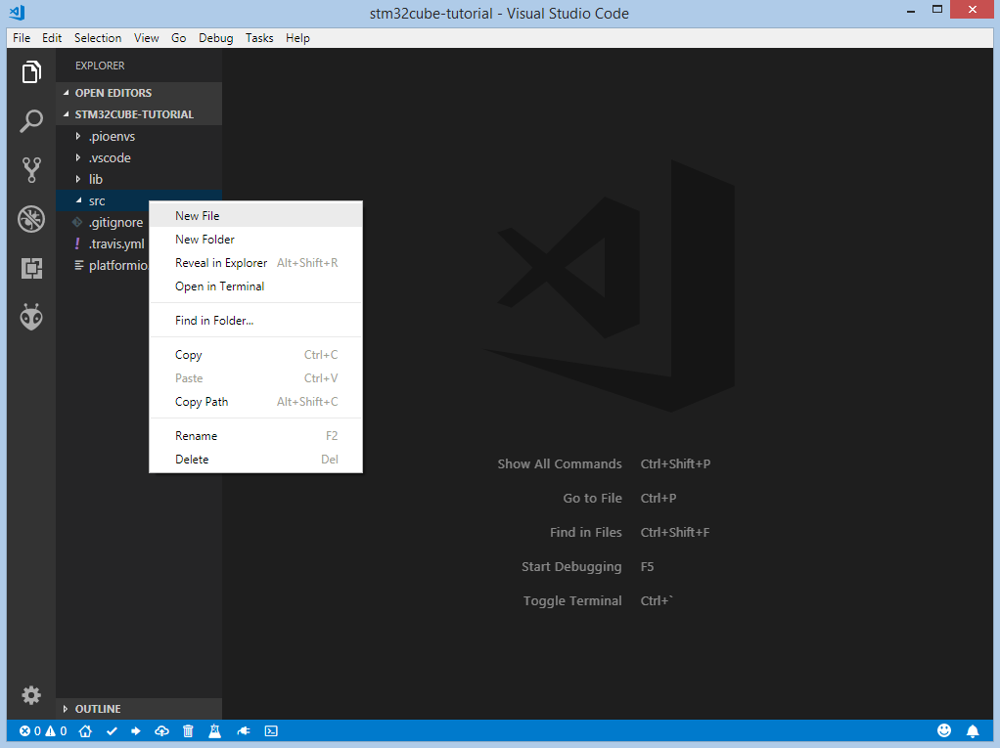

Add next content to `main.h`:

```cpp
#ifndef MAIN_H
#define MAIN_H

#include "stm32f4xx_hal.h"

#define LED_PIN                                GPIO_PIN_5
#define LED_GPIO_PORT                          GPIOA
#define LED_GPIO_CLK_ENABLE()                  __HAL_RCC_GPIOA_CLK_ENABLE()

#endif // MAIN_H
```

Add this code to `main.c`:

```cpp
#include "main.h"

void LED_Init();

int main(void)
{
  HAL_Init();
  LED_Init();

  while (1)
  {
    HAL_GPIO_TogglePin(LED_GPIO_PORT, LED_PIN);
    HAL_Delay(1000);
  }
}

void LED_Init()
{
  LED_GPIO_CLK_ENABLE();
  GPIO_InitTypeDef GPIO_InitStruct;
  GPIO_InitStruct.Pin = LED_PIN;
  GPIO_InitStruct.Mode = GPIO_MODE_OUTPUT_PP;
  GPIO_InitStruct.Pull = GPIO_PULLUP;
  GPIO_InitStruct.Speed = GPIO_SPEED_HIGH;
  HAL_GPIO_Init(LED_GPIO_PORT, &GPIO_InitStruct);
}

void SysTick_Handler(void)
{
  HAL_IncTick();
}
```

After this step, we created a basic blink project that is ready for compiling and uploading.

## Compiling and Uploading the Firmware {#compiling-and-uploading-the-firmware}

Now we can build the project. To compile firmware we can use next options: Build option on the `Project Tasks` menu, Build button on [PlatformIO Toolbar](../../../guides/ide/vscode.md#ide-vscode-toolbar), using Command Palette `View: Command Palette > PlatformIO: Build`, using Task Menu `Tasks: Run Task... > PlatformIO: Build` or via hotkeys `cmd-alt-b / ctrl-alt-b`:

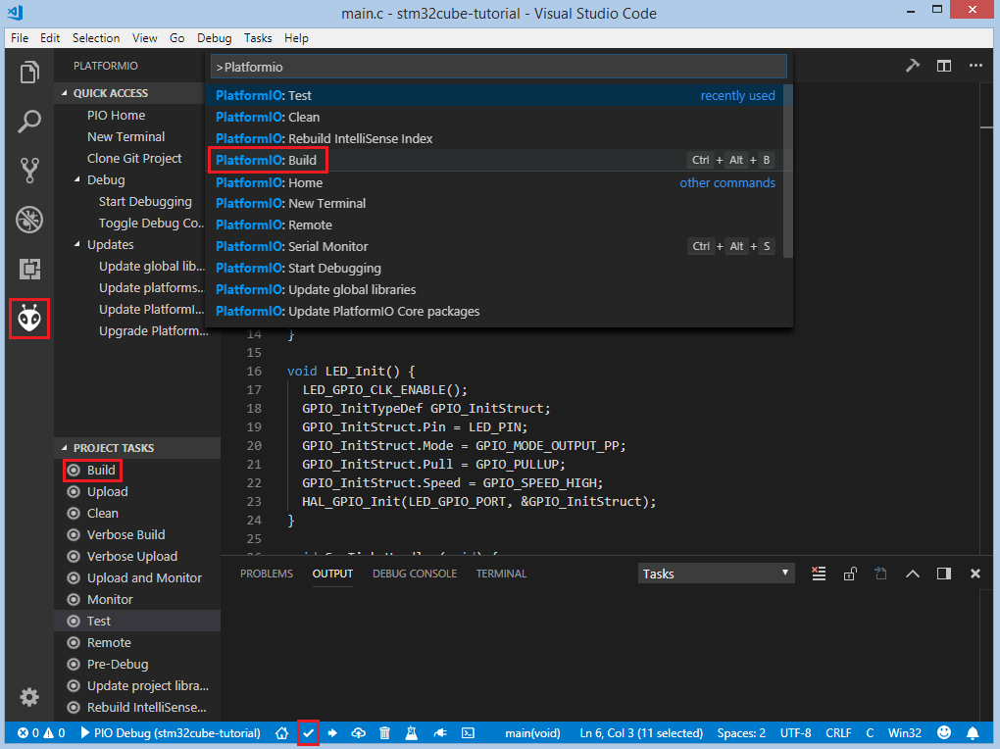

If everything went well, we should see the successful result in the terminal window:

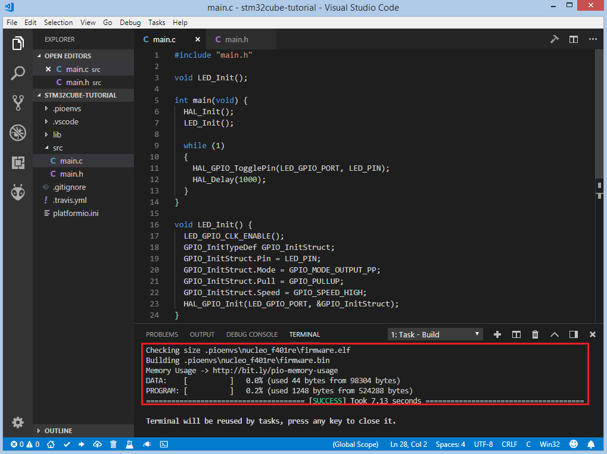

To upload the firmware to the board we can use next options: Upload option on the `Project Tasks` menu, Upload button on [PlatformIO Toolbar](../../../guides/ide/vscode.md#ide-vscode-toolbar), using Command Palette `View: Command Palette > PlatformIO: Upload`, using Task Menu `Tasks: Run Task... > PlatformIO: Upload` or via hotkeys `cmd-alt-u / ctrl-alt-u`:

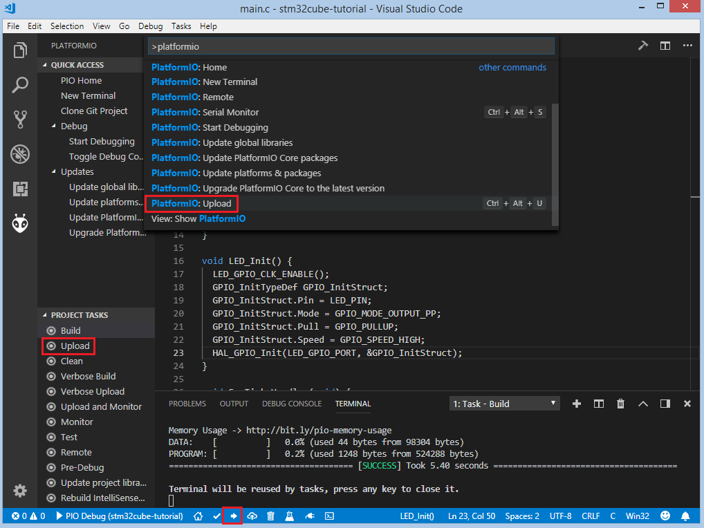

After successful uploading, the green LED2 should start blinking.

## Debugging the Firmware {#debugging-the-firmware}

[Debugging](../../../guides/debugging/index.md) offers the easiest way to debug your board. To start debugging session you can use `Start debugging` option in `PlatformIO Quick Access` menu, `Debug: Start debugging` from the top menu or hotkey button `F5`:

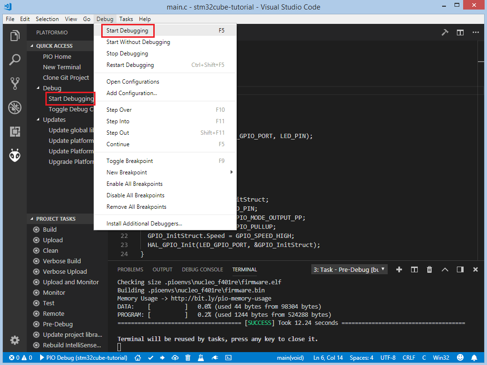

We need to wait some time while PlatformIO is initializing debug session and when the first line after the main function is highlighted we are ready to debug:

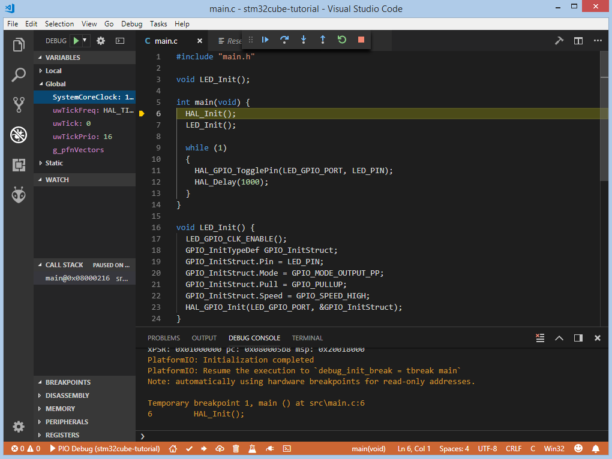

We can walk through the code using control buttons, set breakpoints, see peripheral registers, add variables to `Watch window`:

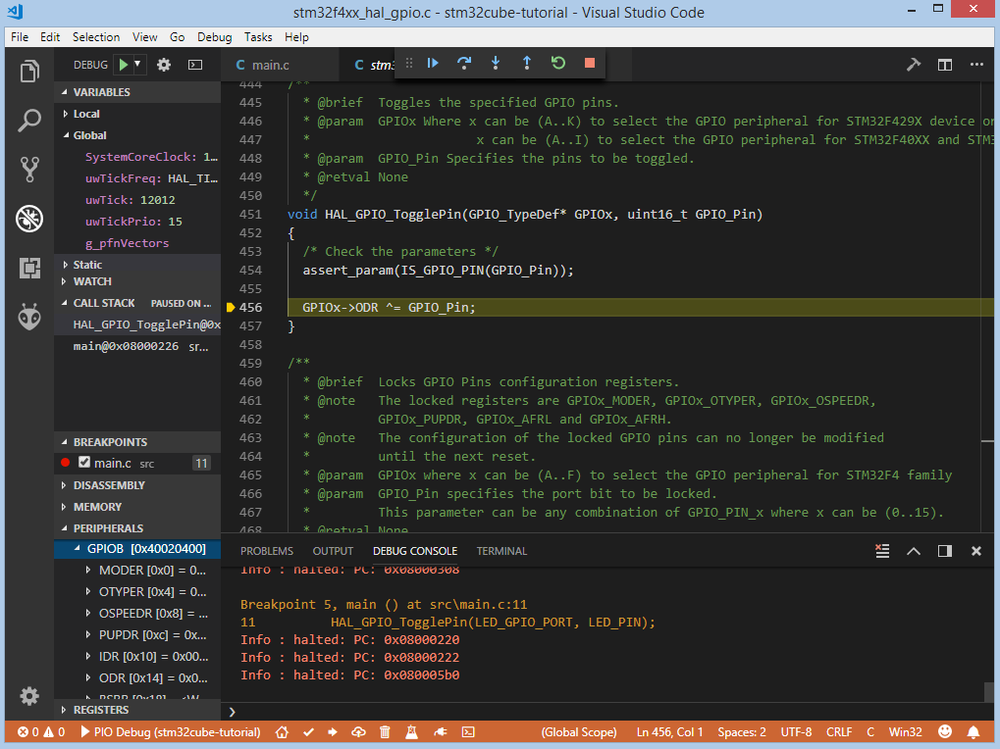

## Writing Unit Tests {#writing-unit-tests}

Now let's write some tests using the [Unit Testing](../../../guides/unit-testing/index.md) solution that can help us test code directly on the target board. We will use the [Unity](../../../guides/unit-testing/frameworks/unity.md) testing framework. Since there is no default configuration for the [STM32Cube](/hardware/frameworks/stm32cube) framework, we will provide a [Custom unity_config.h](../../../guides/unit-testing/frameworks/unity.md#unit-testing-frameworks-unity-custom-config).

Also, we need to create a new folder `test` where the tests and custom [Unity](../../../guides/unit-testing/frameworks/unity.md) configuration (described next) will be located:

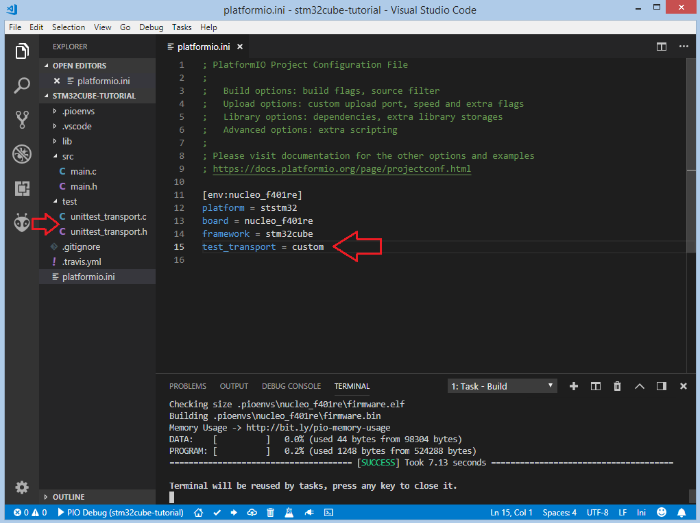

We will use `USART2` on `ST Nucleo-F401RE` board because it's directly connected to the STLink debug interface and in OS it can be visible as a Virtual Com Port, so we don't need any additional USB-UART converter. To implement the custom [Unity](../../../guides/unit-testing/frameworks/unity.md) configuration we need to create two files `unity_config.h` and `unity_config.c` and put them in the [test_dir](../../../reference/platformio-ini/platformio/test-dir.md) in the root folder of our project.

Implementation of `unity_config.h`:

```cpp
#ifndef UNITY_CONFIG_H
#define UNITY_CONFIG_H

#ifndef NULL
#ifndef __cplusplus
#define NULL (void*)0
#else
#define NULL 0
#endif
#endif

#ifdef __cplusplus
extern "C"
{
#endif

void unityOutputStart();
void unityOutputChar(char);
void unityOutputFlush();
void unityOutputComplete();

#define UNITY_OUTPUT_START()    unityOutputStart()
#define UNITY_OUTPUT_CHAR(c)    unityOutputChar(c)
#define UNITY_OUTPUT_FLUSH()    unityOutputFlush()
#define UNITY_OUTPUT_COMPLETE() unityOutputComplete()

#ifdef __cplusplus
}
#endif /* extern "C" */

#endif /* UNITY_CONFIG_H */
```

Implementation of `unity_config.c`:

```cpp
#include "unity_config.h"
#include "stm32f4xx_hal.h"

#define USARTx USART2
#define USARTx_CLK_ENABLE() __HAL_RCC_USART2_CLK_ENABLE()
#define USARTx_CLK_DISABLE() __HAL_RCC_USART2_CLK_DISABLE()
#define USARTx_RX_GPIO_CLK_ENABLE() __HAL_RCC_GPIOA_CLK_ENABLE()
#define USARTx_TX_GPIO_CLK_ENABLE() __HAL_RCC_GPIOA_CLK_ENABLE()
#define USARTx_RX_GPIO_CLK_DISABLE() __HAL_RCC_GPIOA_CLK_DISABLE()
#define USARTx_TX_GPIO_CLK_DISABLE() __HAL_RCC_GPIOA_CLK_DISABLE()

#define USARTx_FORCE_RESET() __HAL_RCC_USART2_FORCE_RESET()
#define USARTx_RELEASE_RESET() __HAL_RCC_USART2_RELEASE_RESET()

#define USARTx_TX_PIN GPIO_PIN_2
#define USARTx_TX_GPIO_PORT GPIOA
#define USARTx_TX_AF GPIO_AF7_USART2
#define USARTx_RX_PIN GPIO_PIN_3
#define USARTx_RX_GPIO_PORT GPIOA
#define USARTx_RX_AF GPIO_AF7_USART2

static UART_HandleTypeDef UartHandle;

void unityOutputStart()
{
  GPIO_InitTypeDef GPIO_InitStruct;

  USARTx_TX_GPIO_CLK_ENABLE();
  USARTx_RX_GPIO_CLK_ENABLE();

  USARTx_CLK_ENABLE();

  GPIO_InitStruct.Pin = USARTx_TX_PIN;
  GPIO_InitStruct.Mode = GPIO_MODE_AF_PP;
  GPIO_InitStruct.Pull = GPIO_PULLUP;
  GPIO_InitStruct.Speed = GPIO_SPEED_FAST;
  GPIO_InitStruct.Alternate = USARTx_TX_AF;

  HAL_GPIO_Init(USARTx_TX_GPIO_PORT, &GPIO_InitStruct);

  GPIO_InitStruct.Pin = USARTx_RX_PIN;
  GPIO_InitStruct.Alternate = USARTx_RX_AF;

  HAL_GPIO_Init(USARTx_RX_GPIO_PORT, &GPIO_InitStruct);
  UartHandle.Instance = USARTx;

  UartHandle.Init.BaudRate = 115200;
  UartHandle.Init.WordLength = UART_WORDLENGTH_8B;
  UartHandle.Init.StopBits = UART_STOPBITS_1;
  UartHandle.Init.Parity = UART_PARITY_NONE;
  UartHandle.Init.HwFlowCtl = UART_HWCONTROL_NONE;
  UartHandle.Init.Mode = UART_MODE_TX_RX;
  UartHandle.Init.OverSampling = UART_OVERSAMPLING_16;

  if (HAL_UART_Init(&UartHandle) != HAL_OK)
  {
    while (1)
    {
    }
  }
}

void unityOutputChar(char c)
{
  HAL_UART_Transmit(&UartHandle, (uint8_t *)(&c), 1, 1000);
}

void unityOutputFlush() {}

void unityOutputComplete()
{
  USARTx_CLK_DISABLE();
  USARTx_RX_GPIO_CLK_DISABLE();
  USARTx_TX_GPIO_CLK_DISABLE();
}
```

Now we need to add some test cases. Tests can be added to a single C file that may include multiple tests. First of all, we need to add three default functions: `setUp`, `tearDown` and `main`. `setUp` and `tearDown` are used to initialize and finalize test conditions. Implementations of these functions are not required for running tests but if you need to initialize some variables before you run a test, you use the `setUp` function and if you need to clean up variables you use `tearDown` function. In our example, we will use these functions to accordingly initialize and deinitialize LED.  `main` function acts as a simple program where we describe our test plan.

Let's add a new file `test_main.c` to the folder `test`. Next basic tests for blinking routine will be implemented in this file:

- `test_led_builtin_pin_number` ensures that `LED_PIN` has the correct value
- `test_led_state_high`  tests functions `HAL_GPIO_WritePin` and `HAL_GPIO_ReadPin` with `GPIO_PIN_SET` value
- `test_led_state_low`  tests functions `HAL_GPIO_WritePin` and `HAL_GPIO_ReadPin` with `GPIO_PIN_RESET` value

:::note

- 2 sec delay is required  since the board doesn't support software resetting  via `Serial.DTR/RTS`

:::

```cpp
#include "../src/main.h"
#include <unity.h>

void setUp(void)
{
  LED_GPIO_CLK_ENABLE();
  GPIO_InitTypeDef GPIO_InitStruct;
  GPIO_InitStruct.Pin = LED_PIN;
  GPIO_InitStruct.Mode = GPIO_MODE_OUTPUT_PP;
  GPIO_InitStruct.Pull = GPIO_PULLUP;
  GPIO_InitStruct.Speed = GPIO_SPEED_HIGH;
  HAL_GPIO_Init(LED_GPIO_PORT, &GPIO_InitStruct);
}

void tearDown(void)
{
  HAL_GPIO_DeInit(LED_GPIO_PORT, LED_PIN);
}

void test_led_builtin_pin_number(void)
{
  TEST_ASSERT_EQUAL(GPIO_PIN_5, LED_PIN);
}

void test_led_state_high(void)
{
  HAL_GPIO_WritePin(LED_GPIO_PORT, LED_PIN, GPIO_PIN_SET);
  TEST_ASSERT_EQUAL(GPIO_PIN_SET, HAL_GPIO_ReadPin(LED_GPIO_PORT, LED_PIN));
}

void test_led_state_low(void)
{
  HAL_GPIO_WritePin(LED_GPIO_PORT, LED_PIN, GPIO_PIN_RESET);
  TEST_ASSERT_EQUAL(GPIO_PIN_RESET, HAL_GPIO_ReadPin(LED_GPIO_PORT, LED_PIN));
}

int main()
{
  HAL_Init();      // initialize the HAL library
  HAL_Delay(2000); // service delay

  UNITY_BEGIN();
  RUN_TEST(test_led_builtin_pin_number);

  for (unsigned int i = 0; i < 5; i++)
  {
    RUN_TEST(test_led_state_high);
    HAL_Delay(500);
    RUN_TEST(test_led_state_low);
    HAL_Delay(500);
  }

  UNITY_END(); // stop unit testing

  while (1)
  {
  }
}

void SysTick_Handler(void)
{
  HAL_IncTick();
}
```

Now we are ready to upload tests to the board. To do this we can use `Test` option from the Project Tasks menu, `Tasks: Run Task... > PlatformIO Test` option from the top menu or Test button on [PlatformIO Toolbar](../../../guides/ide/vscode.md#ide-vscode-toolbar):

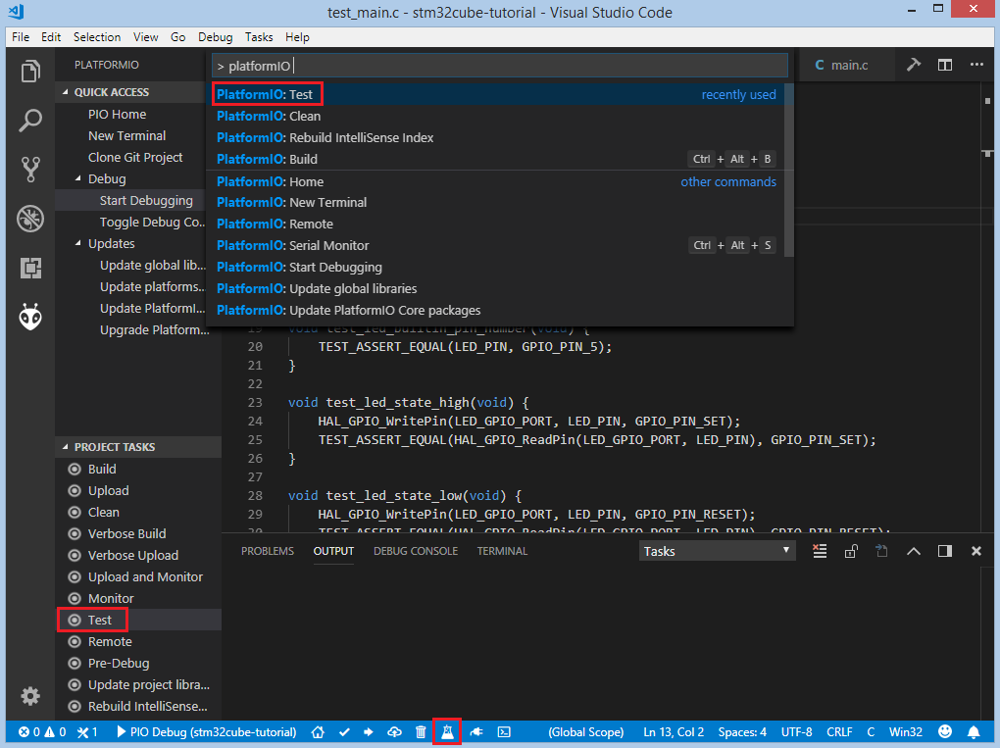

After processing we should see a detailed report about the testing results:

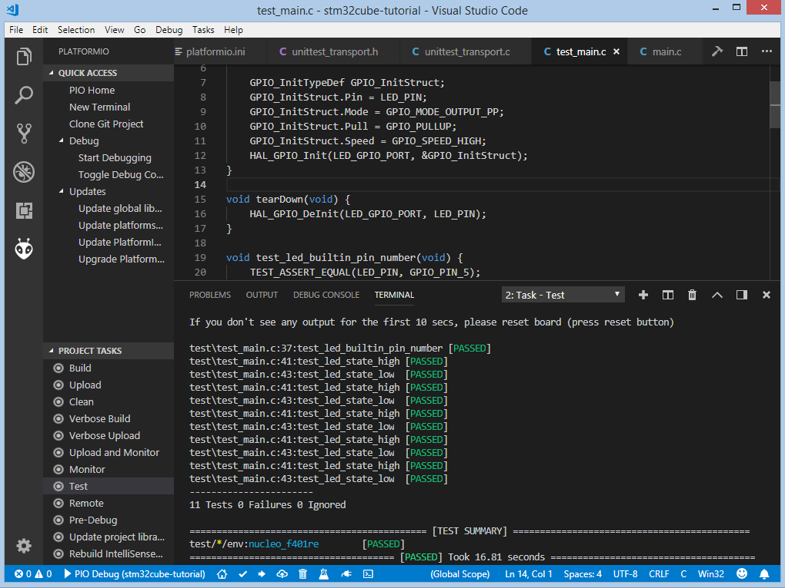

Congratulations! As we can see from the report, all our tests went successfully!

## Conclusion {#conclusion}

Now we have a decent template that we can improve for our next more complex projects.

## Project Source Code {#project-source-code}

The source code of this tutorial is available at [https://github.com/platformio/platformio-examples/tree/develop/unit-testing/stm32cube](https://github.com/platformio/platformio-examples/tree/develop/unit-testing/stm32cube)
