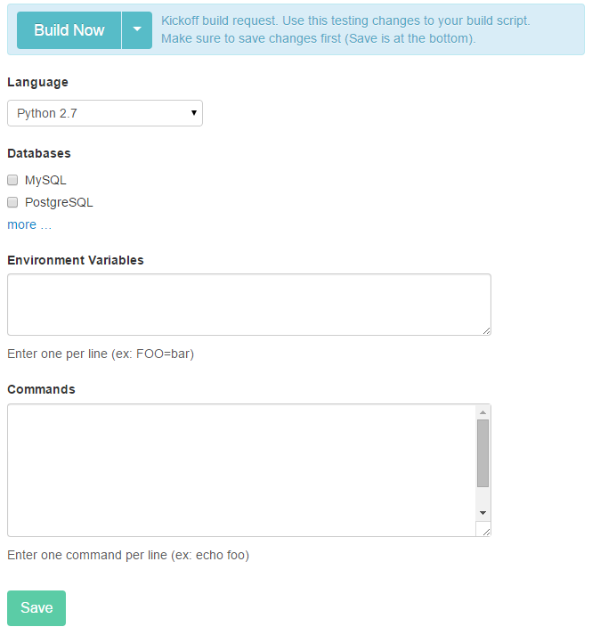
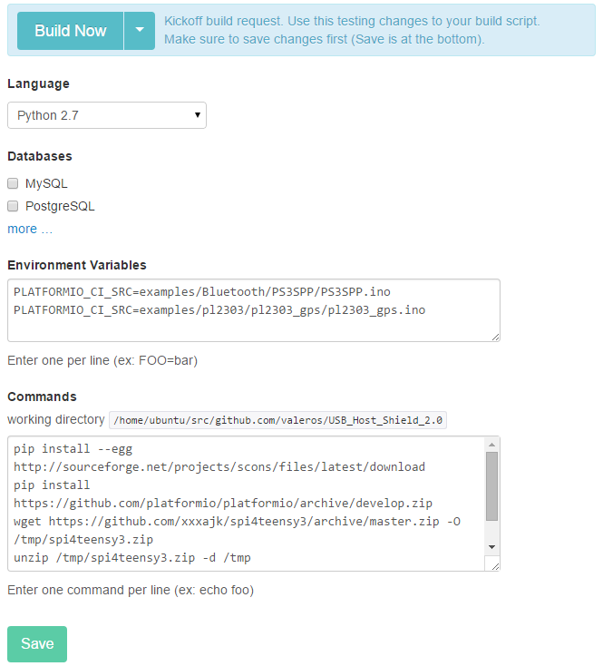

# Drone

[Drone](https://drone.io)  is a hosted continuous integration service. It enables you to conveniently set up projects to automatically build, test, and deploy as you make changes to your code to [GitHub](http://en.wikipedia.org/wiki/GitHub) and [BitBucket](http://en.wikipedia.org/wiki/Bitbucket) repositories.

Drone is configured by modifying settings in your project control panel.

Drone automatically detects when a commit has been made and pushed to a repository that is using Drone, and each time this happens, it will try to build the project using [pio ci](../../reference/cli/pio-ci.md) command. This includes commits to all branches, not just to the master branch. Drone will also build and run pull requests. When that process has completed, it will notify a developer in the way it has been configured to do so — for example, by sending an email containing the build results (showing success or failure). It can be configured to build project on a range of different [Development Platforms](../../hardware/platforms/index.md).

## Integration {#integration}

There are two possible ways of running PlatformIO in CI services:

### Using [pio run](../../reference/cli/pio-run.md) command {#using-cmd-run-command}

This variant is default choice for native PlatformIO projects (Please fill all fields for your project in the Drone control panel):

*Commands*:

```bash
pip install -U platformio
pio run -e <ID_1> -e <ID_2> -e <ID_N>
```

### Using [pio ci](../../reference/cli/pio-ci.md) command {#using-cmd-ci-command}

This variant is more convenient when project is written as a library (when there are examples or testing code) as it has additional options for specifying extra libraries and boards from command line interface:

*Environment Variables*:

```bash
PLATFORMIO_CI_SRC=path/to/source/file.c
PLATFORMIO_CI_SRC=path/to/source/file.ino
PLATFORMIO_CI_SRC=path/to/source/directory
```

*Commands*:

```bash
pip install -U platformio
pio ci --board=<ID_1> --board=<ID_2> --board=<ID_N>
```



## Examples {#examples}

1. Integration for [USB_Host_Shield_2.0](https://github.com/felis/USB_Host_Shield_2.0) project. The `circle.yml` configuration file:

*Environment Variables*:

```bash
PLATFORMIO_CI_SRC=examples/Bluetooth/PS3SPP/PS3SPP.ino
PLATFORMIO_CI_SRC=examples/pl2303/pl2303_gps/pl2303_gps.ino
```

*Commands*:

```bash
pip install -U platformio
wget https://github.com/xxxajk/spi4teensy3/archive/master.zip -O /tmp/spi4teensy3.zip
unzip /tmp/spi4teensy3.zip -d /tmp
pio ci --lib="." --lib="/tmp/spi4teensy3-master" --board=uno --board=teensy31 --board=due
```


