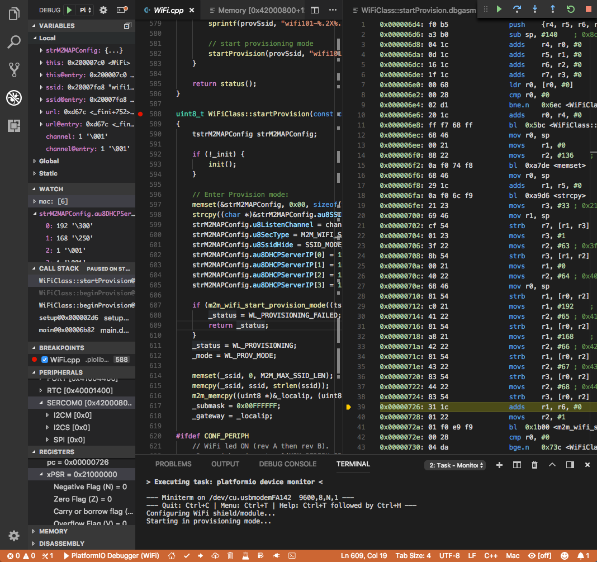

# Debugging

PlatformIO debugs firmware on the target with almost no configuration. It
knows, for each board and debug probe, which debug server to start and how to
configure it, so you only choose the probe and start debugging. It works on
Windows, macOS and Linux, with 900+ boards, on-board and external debug
probes, and simulators.

## Start debugging {#start-debugging}

1. If the board has no on-board debug probe, connect an external one and set
   it with [`debug_tool`](../../reference/platformio-ini/env/debug-tool.md):

   ```ini
   [env:myenv]
   platform = ...
   board = ...
   debug_tool = jlink
   ```

   The boards and their compatible probes are listed [below](#debugging-platforms)
   and on each [board](/hardware/boards) page.

2. Start a debug session:

   - in [PlatformIO IDE for VS Code](../ide/vscode.md): **Run** >
     **Start Debugging**, or <kbd>F5</kbd>;
   - from the command line: [`pio debug --interface gdb`](../../reference/cli/pio-debug.md).

PlatformIO builds the project in the [debug configuration](../projects/build-configurations.md),
uploads it, starts the debug server and stops at the first line of `main()`.

[](../ide/vscode.md)

PlatformIO IDE for VS Code provides the most complete debugging experience:
local, global and static variables; conditional breakpoints; expressions and
watchpoints; CPU and peripheral registers; a memory viewer; disassembly;
multi-thread (RTOS) support; and restarting a session without rebuilding. The
debugger also works with [Eclipse](../ide/eclipse.md),
[Sublime Text](../ide/sublimetext.md) and other GDB-capable
[IDEs](../ide/index.md).

## Tutorials {#tutorials}

- [Arduino on ESP32-DevKitC](../../get-started/tutorials/espressif32/arduino-debugging-unit-testing.md)
- [ESP-IDF on ESP32-DevKitC](../../get-started/tutorials/espressif32/espidf-debugging-unit-testing-analysis.md)
- [STM32Cube HAL on Nucleo-F401RE](../../get-started/tutorials/ststm32/stm32cube-debugging-unit-testing.md)
- [Arduino on Nordic nRF52-DK](../../get-started/tutorials/nordicnrf52/arduino-debugging-unit-testing.md)
- [Zephyr on Nordic nRF52-DK](../../get-started/tutorials/nordicnrf52/zephyr-debugging-unit-testing-inspect.md)
- Community: [Arduino in-circuit debugging with PlatformIO](https://medium.com/@manuel.bl/arduino-in-circuit-debugging-with-platformio-9f699da57ddc),
  [the PlatformIO debugger on the ESP32 with an ESP-Prog](https://www.hackster.io/brian-lough/use-the-platformio-debugger-on-the-esp32-using-an-esp-prog-f633b6)

## Configuration {#configuration}

Most projects need only `debug_tool`. To change how a session starts, use the
[debug options](../../reference/platformio-ini/env/debug-options.md):

| Option | Purpose |
| --- | --- |
| [`debug_tool`](../../reference/platformio-ini/env/debug-tool.md) | The debug probe or simulator |
| [`debug_build_flags`](../../reference/platformio-ini/env/debug-build-flags.md) | Compiler flags of the [debug build](../projects/build-configurations.md) |
| [`debug_init_break`](../../reference/platformio-ini/env/debug-init-break.md) | Where the session stops first |
| [`debug_init_cmds`](../../reference/platformio-ini/env/debug-init-cmds.md) | GDB commands that initialize the session |
| [`debug_extra_cmds`](../../reference/platformio-ini/env/debug-extra-cmds.md) | Additional GDB commands |
| [`debug_load_cmds`](../../reference/platformio-ini/env/debug-load-cmds.md) | GDB commands that load the firmware |
| [`debug_load_mode`](../../reference/platformio-ini/env/debug-load-mode.md) | When to load the firmware |
| [`debug_server`](../../reference/platformio-ini/env/debug-server.md) | A custom debug server |
| [`debug_port`](../../reference/platformio-ini/env/debug-port.md) | The port of the debug server or probe |
| [`debug_speed`](../../reference/platformio-ini/env/debug-speed.md) | The debug adapter speed |
| [`debug_svd_path`](../../reference/platformio-ini/env/debug-svd-path.md) | The SVD file for peripheral registers |
| [`debug_server_ready_pattern`](../../reference/platformio-ini/env/debug-server-ready-pattern.md) | When the debug server is ready |
| [`debug_test`](../../reference/platformio-ini/env/debug-test.md) | A unit test to debug |

<a id="debugging-tools"></a>

## Debug probes {#tools-debug-probes}

Select the probe with [`debug_tool`](../../reference/platformio-ini/env/debug-tool.md).

:::warning

Most probes need a driver on Windows, and udev rules on Linux. See the probe's
page for instructions.

:::

- [Atmel-ICE](../../hardware/debug-probes/atmel-ice.md)
- [avr-stub](../../hardware/debug-probes/avr-stub.md)
- [Black Magic Probe](../../hardware/debug-probes/blackmagic.md)
- [CMSIS-DAP](../../hardware/debug-probes/cmsis-dap.md)
- [JTAG-HS1](../../hardware/debug-probes/digilent-hs1.md)
- [JTAG-HS2](../../hardware/debug-probes/digilent-hs2.md)
- [ESP-Prog](../../hardware/debug-probes/esp-prog.md)
- [ESP USB Bridge](../../hardware/debug-probes/esp-usb-bridge.md)
- [FTDI Chip](../../hardware/debug-probes/ftdi.md)
- [oddWires IOT-Bus JTAG](../../hardware/debug-probes/iot-bus-jtag.md)
- [J-LINK](../../hardware/debug-probes/jlink.md)
- [Mini-Module FT2232H](../../hardware/debug-probes/minimodule.md)
- [MSP Debug](../../hardware/debug-probes/mspdebug.md)
- [Olimex ARM-USB-OCD](../../hardware/debug-probes/olimex-arm-usb-ocd.md)
- [Olimex ARM-USB-OCD-H](../../hardware/debug-probes/olimex-arm-usb-ocd-h.md)
- [Olimex ARM-USB-TINY-H](../../hardware/debug-probes/olimex-arm-usb-tiny-h.md)
- [Olimex ARM-USB-TINY](../../hardware/debug-probes/olimex-jtag-tiny.md)
- [OVPsim](../../hardware/debug-probes/ovpsim.md)
- [QEMU](../../hardware/debug-probes/qemu.md)
- [Raspberry Pi SWD](../../hardware/debug-probes/raspberrypi-swd.md)
- [Renode](../../hardware/debug-probes/renode.md)
- [simavr](../../hardware/debug-probes/simavr.md)
- [ST-LINK](../../hardware/debug-probes/stlink.md)
- [TI-ICDI](../../hardware/debug-probes/ti-icdi.md)
- [TIAO USB Multi-Protocol Adapter (TUMPA)](../../hardware/debug-probes/tumpa.md)
- [Verilator](../../hardware/debug-probes/verilator.md)
- [Whisper](../../hardware/debug-probes/whisper.md)
- [Custom](../../hardware/debug-probes/custom.md)

## Debug unit tests {#debug-unit-tests}

You can debug a [unit test](../unit-testing/index.md) instead of the main
firmware: set the test suite with
[`debug_test`](../../reference/platformio-ini/env/debug-test.md).

<a id="cli-guide"></a>

## Supported platforms, frameworks and boards {#supported}

The tables below are generated from the development platforms. The **Debug**
information of each board, including its compatible probes, is on the board's
page.

<!-- begin_platforms -->

<a id="debugging-platforms"></a>

## Platforms

| Name | Description |
|---|---|
| [Atmel AVR](../../hardware/platforms/atmelavr.mdx) | Atmel AVR 8-bit MCUs deliver a unique combination of performance, power efficiency and design flexibility. Optimized to speed time to market-and easily adapt to new ones-they are based on the industry's most code-efficient architecture for C and assembly programming |
| [Atmel SAM](../../hardware/platforms/atmelsam.md) | Atmel \| SMART offers Flash- based ARM products based on the ARM Cortex-M0+, Cortex-M3 and Cortex-M4 architectures, ranging from 8KB to 2MB of Flash including a rich peripheral and feature mix. |
| [CHIPS Alliance](../../hardware/platforms/chipsalliance.md) | The CHIPS Alliance develops high-quality, open source hardware designs relevant to silicon devices and FPGAs. |
| [Espressif 32](../../hardware/platforms/espressif32.mdx) | ESP32 is a series of low-cost, low-power system on a chip microcontrollers with integrated Wi-Fi and Bluetooth. ESP32 integrates an antenna switch, RF balun, power amplifier, low-noise receive amplifier, filters, and power management modules. |
| [Freescale Kinetis](../../hardware/platforms/freescalekinetis.md) | Freescale Kinetis Microcontrollers is family of multiple hardware- and software-compatible ARM Cortex-M0+, Cortex-M4 and Cortex-M7-based MCU series. Kinetis MCUs offer exceptional low-power performance, scalability and feature integration. |
| [Maxim 32](../../hardware/platforms/maxim32.md) | Maxim's microcontrollers provide low-power, efficient, and secure solutions for challenging embedded applications. Maxim's processors embed cutting-edge technologies to secure data and intellectual property, proven analog circuitry for real-world applications, and battery-conserving low power operation. |
| [Nordic nRF51](../../hardware/platforms/nordicnrf51.md) | The Nordic nRF51 Series is a family of highly flexible, multi-protocol, system-on-chip (SoC) devices for ultra-low power wireless applications. nRF51 Series devices support a range of protocol stacks including Bluetooth Smart (previously called Bluetooth low energy), ANT and proprietary 2.4GHz protocols such as Gazell. |
| [Nordic nRF52](../../hardware/platforms/nordicnrf52.mdx) | The nRF52 Series are built for speed to carry out increasingly complex tasks in the shortest possible time and return to sleep, conserving precious battery power. They have a Cortex-M4F processor which makes them quite capable Bluetooth Smart SoCs. |
| [NXP i.MX RT](../../hardware/platforms/nxpimxrt.md) | The i.MX RT series of crossover processors features the Arm Cortex-M core, real-time functionality and MCU usability at a cost-effective price. |
| [NXP LPC](../../hardware/platforms/nxplpc.md) | The NXP LPC is a family of 32-bit microcontroller integrated circuits by NXP Semiconductors. The LPC chips are grouped into related series that are based around the same 32-bit ARM processor core, such as the Cortex-M4F, Cortex-M3, Cortex-M0+, or Cortex-M0. Internally, each microcontroller consists of the processor core, static RAM memory, flash memory, debugging interface, and various peripherals. |
| [OpenHW Group](../../hardware/platforms/openhw.md) | OpenHW Group is a not-for-profit, global organization that provides an infrastructure for hosting high quality open-source HW developments in line with industry best practices. The OpenHW CV32E40P RISC-V core is the first open-source core for high-volume chips verified with the state-of-the-art process required for high-integrity, commercial SoCs. |
| [Raspberry Pi RP2040](../../hardware/platforms/raspberrypi.md) | RP2040 is a low-cost, high-performance microcontroller device with a large on-chip memory, symmetric dual-core processor complex, and rich peripheral. |
| [Renesas RA](../../hardware/platforms/renesas-ra.md) | Renesas Advanced (RA) 32-bit microcontrollers with the Arm Cortex-M33, -M23 and -M4 processor cores deliver key advantages compared to competitive Arm Cortex-M MCUs by providing stronger embedded security, superior CoreMark performance and ultra-low power operation. |
| [RISC-V GAP](../../hardware/platforms/riscv-gap.mdx) | GreenWaves GAP8 IoT application processor enables the cost-effective development, deployment and autonomous operation of intelligent sensing devices that capture, analyze, classify and act on the fusion of rich data sources such as images, sounds or vibrations. |
| [Shakti](../../hardware/platforms/shakti.md) | Shakti is an open-source initiative by the RISE group at IIT-Madras, which is not only building open source, production grade processors, but also associated components like interconnect fabrics, verification tools, storage controllers, peripheral IPs and SOC tools. |
| [SiFive](../../hardware/platforms/sifive.md) | SiFive brings the power of open source and software automation to the semiconductor industry, making it possible to develop new hardware faster and more affordably than ever before. |
| [Silicon Labs EFM32](../../hardware/platforms/siliconlabsefm32.md) | Silicon Labs EFM32 Gecko 32-bit microcontroller (MCU) family includes devices that offer flash memory configurations up to 256 kB, 32 kB of RAM and CPU speeds up to 48 MHz. Based on the powerful ARM Cortex-M core, the Gecko family features innovative low energy techniques, short wake-up time from energy saving modes and a wide selection of peripherals, making it ideal for battery operated applications and other systems requiring high performance and low-energy consumption. |
| [ST STM32](../../hardware/platforms/ststm32.mdx) | The STM32 family of 32-bit Flash MCUs based on the ARM Cortex-M processor is designed to offer new degrees of freedom to MCU users. It offers a 32-bit product range that combines very high performance, real-time capabilities, digital signal processing, and low-power, low-voltage operation, while maintaining full integration and ease of development. |
| [ST STM8](../../hardware/platforms/ststm8.md) | The STM8 is an 8-bit microcontroller family by STMicroelectronics an extended variant of the ST7 microcontroller architecture. STM8 microcontrollers are particularly low cost for a full-featured 8-bit microcontroller. |
| [Teensy](../../hardware/platforms/teensy.mdx) | Teensy is a complete USB-based microcontroller development system, in a very small footprint, capable of implementing many types of projects. All programming is done via the USB port. No special programmer is needed, only a standard USB cable and a PC or Macintosh with a USB port. |
| [TI MSP430](../../hardware/platforms/timsp430.md) | MSP430 microcontrollers (MCUs) from Texas Instruments (TI) are 16-bit, RISC-based, mixed-signal processors designed for ultra-low power. These MCUs offer the lowest power consumption and the perfect mix of integrated peripherals for thousands of applications. |
| [TI TIVA](../../hardware/platforms/titiva.md) | Texas Instruments TM4C12x MCUs offer the industrys most popular ARM Cortex-M4 core with scalable memory and package options, unparalleled connectivity peripherals, advanced application functions, industry-leading analog integration, and extensive software solutions. |

## Frameworks

| Name | Description |
|---|---|
| [Arduino](../../hardware/frameworks/arduino.mdx) | Arduino Wiring-based Framework allows writing cross-platform software to control devices attached to a wide range of Arduino boards to create all kinds of creative coding, interactive objects, spaces or physical experiences. |
| [CMSIS](../../hardware/frameworks/cmsis.md) | Vendor-independent hardware abstraction layer for the Cortex-M processor series |
| [Espressif IoT Development Framework](../../hardware/frameworks/espidf.mdx) | Espressif IoT Development Framework. Official development framework for ESP32 chip |
| [Freedom E SDK](../../hardware/frameworks/freedom-e-sdk.mdx) | Open Source Software for Developing on the SiFive Freedom E Platform |
| [FreeRTOS](../../hardware/frameworks/freertos.md) | FreeRTOS is a real-time operating system kernel for embedded devices that has been ported to 40 microcontroller platforms. |
| [Renesas Flexible Software Package](../../hardware/frameworks/fsp.md) | The Renesas Flexible Software Package (FSP) is an enhanced software package designed to provide easy-to-use, scalable, high-quality software for embedded system designs using Renesas RA family of Arm Microcontrollers. |
| [LibOpenCM3](../../hardware/frameworks/libopencm3.md) | The libopencm3 project aims to create an open-source firmware library for various ARM Cortex-M microcontrollers. |
| [Mbed](../../hardware/frameworks/mbed.mdx) | Arm Mbed OS is a platform operating system designed for the internet of things |
| [PULP OS](../../hardware/frameworks/pulp-os.md) | SDK for Greenwaves Technologies' GAP8 IoT Application Processor |
| [PULP Runtime Environment](../../hardware/frameworks/pulp-runtime.md) | Runtime Environment for Parallel Ultra Low Power platform |
| [PULP SDK](../../hardware/frameworks/pulp-sdk.md) | Software Development Kit for Parallel Ultra Low Power platform |
| [Shakti SDK](../../hardware/frameworks/shakti-sdk.md) | A software development kit for developing applications on Shakti class of processors |
| [Standard Peripheral Library](../../hardware/frameworks/spl.mdx) | Standard Peripheral Library for ST STM32 microcontrollers |
| [STM32Cube](../../hardware/frameworks/stm32cube.mdx) | STM32Cube embedded software libraries, including: The HAL hardware abstraction layer, enabling portability between different STM32 devices via standardized API calls; The Low-Layer (LL) APIs, a light-weight, optimized, expert oriented set of APIs designed for both performance and runtime efficiency |
| [WD-Firmware](../../hardware/frameworks/wd-riscv-sdk.md) | The WD Firmware package contains Firmware applications and Processor Support Package (PSP) for various cores, alongside demos which support all features. |
| [Zephyr](../../hardware/frameworks/zephyr.mdx) | Zephyr is a new generation, scalable, optimized, secure RTOS for multiple hardware architectures |

## Boards

### 1BitSquared

| Name | Platform | Debug | MCU | Frequency | Flash | RAM |
|---|---|---|---|---|---|---|
| [1Bitsy](../../hardware/boards/ststm32/1bitsy-stm32f415rgt.md) | [ST STM32](../../hardware/platforms/ststm32.mdx) | External | STM32F415RGT | 168MHz | 1MB | 128KB |

### 4D Systems

| Name | Platform | Debug | MCU | Frequency | Flash | RAM |
|---|---|---|---|---|---|---|
| [4D Systems GEN4-ESP32 16MB (ESP32S3-R8N16)](../../hardware/boards/espressif32/4d-systems-esp32s3-gen4-r8n16.md) | [Espressif 32](../../hardware/platforms/espressif32.mdx) | External | ESP32S3 | 240MHz | 16MB | 320KB |

### 96Boards

| Name | Platform | Debug | MCU | Frequency | Flash | RAM |
|---|---|---|---|---|---|---|
| [96Boards Argonkey (STEVAL-MKI187V1)](../../hardware/boards/ststm32/b96b-argonkey.md) | [ST STM32](../../hardware/platforms/ststm32.mdx) | External | STM32F412CG | 100MHz | 1MB | 256KB |
| [96Boards B96B-F446VE](../../hardware/boards/ststm32/b96b-f446ve.md) | [ST STM32](../../hardware/platforms/ststm32.mdx) | On-board | STM32F446VET6 | 168MHz | 512KB | 128KB |
| [96Boards Neonkey](../../hardware/boards/ststm32/b96b-aerocore2.md) | [ST STM32](../../hardware/platforms/ststm32.mdx) | External | STM32F427VIT6 | 168MHz | 1.99MB | 256KB |
| [96Boards Neonkey](../../hardware/boards/ststm32/b96b-neonkey.md) | [ST STM32](../../hardware/platforms/ststm32.mdx) | External | STM32F411CE | 100MHz | 512KB | 128KB |
| [96Boards Nitrogen](../../hardware/boards/nordicnrf52/96b-nitrogen.md) | [Nordic nRF52](../../hardware/platforms/nordicnrf52.mdx) | External | NRF52832 | 64MHz | 512KB | 64KB |

### ACSIP

| Name | Platform | Debug | MCU | Frequency | Flash | RAM |
|---|---|---|---|---|---|---|
| [ACSIP S76S](../../hardware/boards/ststm32/acsip-s76s.md) | [ST STM32](../../hardware/platforms/ststm32.mdx) | External | STM32L073RZ | 32MHz | 192KB | 20KB |

### AI Thinker

| Name | Platform | Debug | MCU | Frequency | Flash | RAM |
|---|---|---|---|---|---|---|
| [AI Thinker ESP32-CAM](../../hardware/boards/espressif32/esp32cam.md) | [Espressif 32](../../hardware/platforms/espressif32.mdx) | External | ESP32 | 240MHz | 4MB | 320KB |

### AZ-Delivery

| Name | Platform | Debug | MCU | Frequency | Flash | RAM |
|---|---|---|---|---|---|---|
| [AZ-Delivery ESP-32 Dev Kit C V4](../../hardware/boards/espressif32/az-delivery-devkit-v4.md) | [Espressif 32](../../hardware/platforms/espressif32.mdx) | External | ESP32 | 240MHz | 4MB | 520KB |

### Adafruit

| Name | Platform | Debug | MCU | Frequency | Flash | RAM |
|---|---|---|---|---|---|---|
| [Adafruit BLM Badge](../../hardware/boards/atmelsam/adafruit-blm-badge.md) | [Atmel SAM](../../hardware/platforms/atmelsam.md) | External | SAMD21E18A | 48MHz | 256KB | 32KB |
| [Adafruit Bluefruit Micro](../../hardware/boards/atmelavr/bluefruitmicro.md) | [Atmel AVR](../../hardware/platforms/atmelavr.mdx) | External | ATMEGA32U4 | 8MHz | 28KB | 2.50KB |
| [Adafruit Bluefruit nRF52832 Feather](../../hardware/boards/nordicnrf52/adafruit-feather-nrf52832.md) | [Nordic nRF52](../../hardware/platforms/nordicnrf52.mdx) | External | NRF52832 | 64MHz | 512KB | 64KB |
| [Adafruit CLUE nRF52840](../../hardware/boards/nordicnrf52/adafruit-clue-nrf52840.md) | [Nordic nRF52](../../hardware/platforms/nordicnrf52.mdx) | External | NRF52840 | 64MHz | 796KB | 243KB |
| [Adafruit Circuit Playground Classic](../../hardware/boards/atmelavr/circuitplay-classic.md) | [Atmel AVR](../../hardware/platforms/atmelavr.mdx) | External | ATMEGA32U4 | 8MHz | 28KB | 2.50KB |
| [Adafruit Circuit Playground Express](../../hardware/boards/atmelsam/adafruit-circuitplayground-m0.md) | [Atmel SAM](../../hardware/platforms/atmelsam.md) | External | SAMD21G18A | 48MHz | 256KB | 32KB |
| [Adafruit Crickit M0](../../hardware/boards/atmelsam/adafruit-crickit-m0.md) | [Atmel SAM](../../hardware/platforms/atmelsam.md) | External | SAMD21G18A | 48MHz | 256KB | 32KB |
| [Adafruit ESP32 Feather](../../hardware/boards/espressif32/featheresp32.md) | [Espressif 32](../../hardware/platforms/espressif32.mdx) | External | ESP32 | 240MHz | 4MB | 320KB |
| [Adafruit ESP32-S2 Feather Development Board](../../hardware/boards/espressif32/featheresp32-s2.md) | [Espressif 32](../../hardware/platforms/espressif32.mdx) | External | ESP32S2 | 240MHz | 4MB | 320KB |
| [Adafruit Feather 328P](../../hardware/boards/atmelavr/feather328p.md) | [Atmel AVR](../../hardware/platforms/atmelavr.mdx) | External | ATMEGA328P | 8MHz | 31.50KB | 2KB |
| [Adafruit Feather 32u4](../../hardware/boards/atmelavr/feather32u4.md) | [Atmel AVR](../../hardware/platforms/atmelavr.mdx) | External | ATMEGA32U4 | 8MHz | 28KB | 2.50KB |
| [Adafruit Feather Bluefruit Sense](../../hardware/boards/nordicnrf52/adafruit-feather-nrf52840-sense.md) | [Nordic nRF52](../../hardware/platforms/nordicnrf52.mdx) | External | NRF52840 | 64MHz | 796KB | 243KB |
| [Adafruit Feather ESP32 V2](../../hardware/boards/espressif32/adafruit-feather-esp32-v2.md) | [Espressif 32](../../hardware/platforms/espressif32.mdx) | External | ESP32 | 240MHz | 8MB | 320KB |
| [Adafruit Feather ESP32-C6](../../hardware/boards/espressif32/adafruit-feather-esp32c6.md) | [Espressif 32](../../hardware/platforms/espressif32.mdx) | External | ESP32C6 | 160MHz | 4MB | 320KB |
| [Adafruit Feather ESP32-S2](../../hardware/boards/espressif32/adafruit-feather-esp32s2.md) | [Espressif 32](../../hardware/platforms/espressif32.mdx) | External | ESP32S2 | 240MHz | 4MB | 320KB |
| [Adafruit Feather ESP32-S2 Reverse TFT](../../hardware/boards/espressif32/adafruit-feather-esp32s2-reversetft.md) | [Espressif 32](../../hardware/platforms/espressif32.mdx) | External | ESP32S2 | 240MHz | 4MB | 320KB |
| [Adafruit Feather ESP32-S2 TFT](../../hardware/boards/espressif32/adafruit-feather-esp32s2-tft.md) | [Espressif 32](../../hardware/platforms/espressif32.mdx) | External | ESP32S2 | 240MHz | 4MB | 320KB |
| [Adafruit Feather ESP32-S3 2MB PSRAM](../../hardware/boards/espressif32/adafruit-feather-esp32s3.md) | [Espressif 32](../../hardware/platforms/espressif32.mdx) | External | ESP32S3 | 240MHz | 4MB | 320KB |
| [Adafruit Feather ESP32-S3 No PSRAM](../../hardware/boards/espressif32/adafruit-feather-esp32s3-nopsram.md) | [Espressif 32](../../hardware/platforms/espressif32.mdx) | External | ESP32S3 | 240MHz | 8MB | 320KB |
| [Adafruit Feather ESP32-S3 Reverse TFT](../../hardware/boards/espressif32/adafruit-feather-esp32s3-reversetft.md) | [Espressif 32](../../hardware/platforms/espressif32.mdx) | External | ESP32S3 | 240MHz | 4MB | 320KB |
| [Adafruit Feather ESP32-S3 TFT](../../hardware/boards/espressif32/adafruit-feather-esp32s3-tft.md) | [Espressif 32](../../hardware/platforms/espressif32.mdx) | External | ESP32S3 | 240MHz | 4MB | 320KB |
| [Adafruit Feather M0](../../hardware/boards/atmelsam/adafruit-feather-m0.md) | [Atmel SAM](../../hardware/platforms/atmelsam.md) | External | SAMD21G18A | 48MHz | 256KB | 32KB |
| [Adafruit Feather M0 Express](../../hardware/boards/atmelsam/adafruit-feather-m0-express.md) | [Atmel SAM](../../hardware/platforms/atmelsam.md) | External | SAMD21G18A | 48MHz | 256KB | 32KB |
| [Adafruit Feather M4 CAN](../../hardware/boards/atmelsam/adafruit-feather-m4-can.md) | [Atmel SAM](../../hardware/platforms/atmelsam.md) | External | SAME51J19A | 120MHz | 496KB | 192KB |
| [Adafruit Feather M4 Express](../../hardware/boards/atmelsam/adafruit-feather-m4.md) | [Atmel SAM](../../hardware/platforms/atmelsam.md) | External | SAMD51J19A | 120MHz | 512KB | 192KB |
| [Adafruit Feather STM32F405](../../hardware/boards/ststm32/adafruit-feather-f405.md) | [ST STM32](../../hardware/platforms/ststm32.mdx) | External | STM32F405RGT6 | 168MHz | 1MB | 128KB |
| [Adafruit Feather nRF52840 Express](../../hardware/boards/nordicnrf52/adafruit-feather-nrf52840.md) | [Nordic nRF52](../../hardware/platforms/nordicnrf52.mdx) | External | NRF52840 | 64MHz | 796KB | 243KB |
| [Adafruit Flora](../../hardware/boards/atmelavr/flora8.md) | [Atmel AVR](../../hardware/platforms/atmelavr.mdx) | External | ATMEGA32U4 | 8MHz | 28KB | 2.50KB |
| [Adafruit FunHouse](../../hardware/boards/espressif32/adafruit-funhouse-esp32s2.md) | [Espressif 32](../../hardware/platforms/espressif32.mdx) | External | ESP32S2 | 240MHz | 4MB | 320KB |
| [Adafruit Gemma](../../hardware/boards/atmelavr/gemma.md) | [Atmel AVR](../../hardware/platforms/atmelavr.mdx) | External | ATTINY85 | 8MHz | 8KB | 512B |
| [Adafruit Gemma M0](../../hardware/boards/atmelsam/adafruit-gemma-m0.md) | [Atmel SAM](../../hardware/platforms/atmelsam.md) | External | SAMD21E18A | 48MHz | 256KB | 32KB |
| [Adafruit Grand Central M4](../../hardware/boards/atmelsam/adafruit-grandcentral-m4.md) | [Atmel SAM](../../hardware/platforms/atmelsam.md) | External | SAMD51P20A | 120MHz | 1MB | 256KB |
| [Adafruit Hallowing M0](../../hardware/boards/atmelsam/adafruit-hallowing.md) | [Atmel SAM](../../hardware/platforms/atmelsam.md) | External | SAMD21G18A | 48MHz | 256KB | 32KB |
| [Adafruit Hallowing M4](../../hardware/boards/atmelsam/adafruit-hallowing-m4.md) | [Atmel SAM](../../hardware/platforms/atmelsam.md) | External | SAMD51J19A | 120MHz | 496KB | 192KB |
| [Adafruit ItsyBitsy 3V/8MHz](../../hardware/boards/atmelavr/itsybitsy32u4-3v.md) | [Atmel AVR](../../hardware/platforms/atmelavr.mdx) | External | ATMEGA32U4 | 8MHz | 28KB | 2.50KB |
| [Adafruit ItsyBitsy 5V/16MHz](../../hardware/boards/atmelavr/itsybitsy32u4-5v.md) | [Atmel AVR](../../hardware/platforms/atmelavr.mdx) | External | ATMEGA32U4 | 16MHz | 28KB | 2.50KB |
| [Adafruit ItsyBitsy ESP32](../../hardware/boards/espressif32/adafruit-itsybitsy-esp32.md) | [Espressif 32](../../hardware/platforms/espressif32.mdx) | External | ESP32 | 240MHz | 8MB | 320KB |
| [Adafruit ItsyBitsy M0](../../hardware/boards/atmelsam/adafruit-itsybitsy-m0.md) | [Atmel SAM](../../hardware/platforms/atmelsam.md) | External | SAMD21G18A | 48MHz | 256KB | 32KB |
| [Adafruit ItsyBitsy M4](../../hardware/boards/atmelsam/adafruit-itsybitsy-m4.md) | [Atmel SAM](../../hardware/platforms/atmelsam.md) | External | SAMD51G19A | 120MHz | 512KB | 192KB |
| [Adafruit LED Glasses Driver nRF52840](../../hardware/boards/nordicnrf52/adafruit-ledglasses-nrf52840.md) | [Nordic nRF52](../../hardware/platforms/nordicnrf52.mdx) | External | NRF52840 | 64MHz | 796KB | 232KB |
| [Adafruit MONSTER M4SK](../../hardware/boards/atmelsam/adafruit-monster-m4sk.md) | [Atmel SAM](../../hardware/platforms/atmelsam.md) | External | SAMD51G19A | 120MHz | 496KB | 192KB |
| [Adafruit MagTag 2.9](../../hardware/boards/espressif32/adafruit-magtag29-esp32s2.md) | [Espressif 32](../../hardware/platforms/espressif32.mdx) | External | ESP32S2 | 240MHz | 4MB | 320KB |
| [Adafruit Matrix Portal M4](../../hardware/boards/atmelsam/adafruit-matrix-portal-m4.md) | [Atmel SAM](../../hardware/platforms/atmelsam.md) | External | SAMD51J19A | 120MHz | 496KB | 192KB |
| [Adafruit MatrixPortal ESP32-S3](../../hardware/boards/espressif32/adafruit-matrixportal-esp32s3.md) | [Espressif 32](../../hardware/platforms/espressif32.mdx) | External | ESP32S3 | 240MHz | 8MB | 320KB |
| [Adafruit Metro](../../hardware/boards/atmelavr/metro.md) | [Atmel AVR](../../hardware/platforms/atmelavr.mdx) | External | ATMEGA328P | 16MHz | 31.50KB | 2KB |
| [Adafruit Metro ESP32-S2](../../hardware/boards/espressif32/adafruit-metro-esp32s2.md) | [Espressif 32](../../hardware/platforms/espressif32.mdx) | External | ESP32S2 | 240MHz | 4MB | 320KB |
| [Adafruit Metro ESP32-S3](../../hardware/boards/espressif32/adafruit-metro-esp32s3.md) | [Espressif 32](../../hardware/platforms/espressif32.mdx) | External | ESP32S3 | 240MHz | 16MB | 320KB |
| [Adafruit Metro M0 Express](../../hardware/boards/atmelsam/adafruit-metro-m0.md) | [Atmel SAM](../../hardware/platforms/atmelsam.md) | External | SAMD21G18A | 48MHz | 256KB | 32KB |
| [Adafruit Metro M4](../../hardware/boards/atmelsam/adafruit-metro-m4.md) | [Atmel SAM](../../hardware/platforms/atmelsam.md) | External | SAMD51J19A | 120MHz | 512KB | 192KB |
| [Adafruit Metro M4 AirLift Lite](../../hardware/boards/atmelsam/adafruit-metro-m4-airliftlite.md) | [Atmel SAM](../../hardware/platforms/atmelsam.md) | External | SAMD51J19A | 120MHz | 512KB | 192KB |
| [Adafruit NeoKey Trinkey](../../hardware/boards/atmelsam/adafruit-neokeytrinkey-m0.md) | [Atmel SAM](../../hardware/platforms/atmelsam.md) | External | SAMD21E18A | 48MHz | 256KB | 32KB |
| [Adafruit NeoPixel Trinkey](../../hardware/boards/atmelsam/adafruit-neotrinkey-m0.md) | [Atmel SAM](../../hardware/platforms/atmelsam.md) | External | SAMD21E18A | 48MHz | 256KB | 32KB |
| [Adafruit Pro Trinket 3V/12MHz (FTDI)](../../hardware/boards/atmelavr/protrinket3ftdi.md) | [Atmel AVR](../../hardware/platforms/atmelavr.mdx) | External | ATMEGA328P | 12MHz | 28KB | 2KB |
| [Adafruit Pro Trinket 3V/12MHz (USB)](../../hardware/boards/atmelavr/protrinket3.md) | [Atmel AVR](../../hardware/platforms/atmelavr.mdx) | External | ATMEGA328P | 12MHz | 28KB | 2KB |
| [Adafruit Pro Trinket 5V/16MHz (FTDI)](../../hardware/boards/atmelavr/protrinket5ftdi.md) | [Atmel AVR](../../hardware/platforms/atmelavr.mdx) | External | ATMEGA328P | 16MHz | 28KB | 2KB |
| [Adafruit Pro Trinket 5V/16MHz (USB)](../../hardware/boards/atmelavr/protrinket5.md) | [Atmel AVR](../../hardware/platforms/atmelavr.mdx) | External | ATMEGA328P | 16MHz | 28KB | 2KB |
| [Adafruit ProxLight Trinkey](../../hardware/boards/atmelsam/adafruit-proxlighttrinkey-m0.md) | [Atmel SAM](../../hardware/platforms/atmelsam.md) | External | SAMD21E18A | 48MHz | 256KB | 32KB |
| [Adafruit PyGamer Advance M4](../../hardware/boards/atmelsam/adafruit-pygamer-advance-m4.md) | [Atmel SAM](../../hardware/platforms/atmelsam.md) | External | SAMD51J20A | 120MHz | 1MB | 256KB |
| [Adafruit PyGamer M4 Express](../../hardware/boards/atmelsam/adafruit-pygamer-m4.md) | [Atmel SAM](../../hardware/platforms/atmelsam.md) | External | SAMD51J19A | 120MHz | 512KB | 192KB |
| [Adafruit PyPortal M4](../../hardware/boards/atmelsam/adafruit-pyportal-m4.md) | [Atmel SAM](../../hardware/platforms/atmelsam.md) | External | SAMD51J20A | 120MHz | 1MB | 256KB |
| [Adafruit PyPortal M4 Titano](../../hardware/boards/atmelsam/adafruit-pyportal-m4-titano.md) | [Atmel SAM](../../hardware/platforms/atmelsam.md) | External | SAMD51J20A | 120MHz | 1MB | 256KB |
| [Adafruit QT Py ESP32](../../hardware/boards/espressif32/adafruit-qtpy-esp32.md) | [Espressif 32](../../hardware/platforms/espressif32.mdx) | External | ESP32 | 240MHz | 8MB | 320KB |
| [Adafruit QT Py ESP32-C3](../../hardware/boards/espressif32/adafruit-qtpy-esp32c3.md) | [Espressif 32](../../hardware/platforms/espressif32.mdx) | External | ESP32C3 | 160MHz | 4MB | 320KB |
| [Adafruit QT Py ESP32-S2](../../hardware/boards/espressif32/adafruit-qtpy-esp32s2.md) | [Espressif 32](../../hardware/platforms/espressif32.mdx) | External | ESP32S2 | 240MHz | 4MB | 320KB |
| [Adafruit QT Py ESP32-S3 (4M Flash 2M PSRAM)](../../hardware/boards/espressif32/adafruit-qtpy-esp32s3-n4r2.md) | [Espressif 32](../../hardware/platforms/espressif32.mdx) | External | ESP32S3 | 240MHz | 4MB | 320KB |
| [Adafruit QT Py ESP32-S3 No PSRAM](../../hardware/boards/espressif32/adafruit-qtpy-esp32s3-nopsram.md) | [Espressif 32](../../hardware/platforms/espressif32.mdx) | External | ESP32S3 | 240MHz | 8MB | 320KB |
| [Adafruit QT Py M0](../../hardware/boards/atmelsam/adafruit-qt-py-m0.md) | [Atmel SAM](../../hardware/platforms/atmelsam.md) | External | SAMD21E18A | 48MHz | 256KB | 32KB |
| [Adafruit Qualia ESP32-S3 RGB666](../../hardware/boards/espressif32/adafruit-qualia-s3-rgb666.md) | [Espressif 32](../../hardware/platforms/espressif32.mdx) | External | ESP32S3 | 240MHz | 16MB | 320KB |
| [Adafruit Rotary Trinkey](../../hardware/boards/atmelsam/adafruit-rotarytrinkey-m0.md) | [Atmel SAM](../../hardware/platforms/atmelsam.md) | External | SAMD21E18A | 48MHz | 256KB | 32KB |
| [Adafruit Slide Trinkey](../../hardware/boards/atmelsam/adafruit-slidetrinkey-m0.md) | [Atmel SAM](../../hardware/platforms/atmelsam.md) | External | SAMD21E18A | 48MHz | 256KB | 32KB |
| [Adafruit Trellis M4](../../hardware/boards/atmelsam/adafruit-trellis-m4.md) | [Atmel SAM](../../hardware/platforms/atmelsam.md) | External | SAMD51J19A | 120MHz | 512KB | 192KB |
| [Adafruit Trinket 3V/8MHz](../../hardware/boards/atmelavr/trinket3.md) | [Atmel AVR](../../hardware/platforms/atmelavr.mdx) | External | ATTINY85 | 8MHz | 8KB | 512B |
| [Adafruit Trinket 5V/16MHz](../../hardware/boards/atmelavr/trinket5.md) | [Atmel AVR](../../hardware/platforms/atmelavr.mdx) | External | ATTINY85 | 16MHz | 8KB | 512B |
| [Adafruit Trinket M0](../../hardware/boards/atmelsam/adafruit-trinket-m0.md) | [Atmel SAM](../../hardware/platforms/atmelsam.md) | External | SAMD21E18A | 48MHz | 256KB | 32KB |
| [Adafruit pIRkey](../../hardware/boards/atmelsam/adafruit-pirkey.md) | [Atmel SAM](../../hardware/platforms/atmelsam.md) | External | SAMD21E18A | 48MHz | 256KB | 32KB |
| [Adafruit pyBadge AirLift M4](../../hardware/boards/atmelsam/adafruit-pybadge-airlift-m4.md) | [Atmel SAM](../../hardware/platforms/atmelsam.md) | External | SAMD51J20A | 120MHz | 1008KB | 192KB |
| [Adafruit pyBadge M4 Express](../../hardware/boards/atmelsam/adafruit-pybadge-m4.md) | [Atmel SAM](../../hardware/platforms/atmelsam.md) | External | SAMD51J19A | 120MHz | 512KB | 192KB |
| [Adafruit pyCamera S3](../../hardware/boards/espressif32/adafruit-camera-esp32s3.md) | [Espressif 32](../../hardware/platforms/espressif32.mdx) | External | ESP32S3 | 240MHz | 4MB | 320KB |
| [Circuit Playground Bluefruit](../../hardware/boards/nordicnrf52/adafruit-cplaynrf52840.md) | [Nordic nRF52](../../hardware/platforms/nordicnrf52.mdx) | External | NRF52840 | 64MHz | 796KB | 243KB |
| [ItsyBitsy nRF52840 Express](../../hardware/boards/nordicnrf52/adafruit-itsybitsy-nrf52840.md) | [Nordic nRF52](../../hardware/platforms/nordicnrf52.mdx) | External | NRF52840 | 64MHz | 796KB | 243KB |
| [Metro nRF52840 Express](../../hardware/boards/nordicnrf52/adafruit-metro-nrf52840.md) | [Nordic nRF52](../../hardware/platforms/nordicnrf52.mdx) | External | NRF52840 | 64MHz | 796KB | 243KB |

### AfroFlight

| Name | Platform | Debug | MCU | Frequency | Flash | RAM |
|---|---|---|---|---|---|---|
| [AfroFlight Rev5 (8MHz)](../../hardware/boards/ststm32/afroflight-f103cb.md) | [ST STM32](../../hardware/platforms/ststm32.mdx) | External | STM32F103CBT6 | 72MHz | 128KB | 20KB |

### Ai-Thinker

| Name | Platform | Debug | MCU | Frequency | Flash | RAM |
|---|---|---|---|---|---|---|
| [Ai-Thinker ESP-C3-M1-I-Kit](../../hardware/boards/espressif32/esp32-c3-m1i-kit.md) | [Espressif 32](../../hardware/platforms/espressif32.mdx) | External | ESP32C3 | 160MHz | 4MB | 320KB |
| [Ai-Thinker NodeMCU-32S2 (ESP-12K)](../../hardware/boards/espressif32/nodemcu-32s2.md) | [Espressif 32](../../hardware/platforms/espressif32.mdx) | External | ESP32S2 | 240MHz | 4MB | 320KB |

### AirM2M

| Name | Platform | Debug | MCU | Frequency | Flash | RAM |
|---|---|---|---|---|---|---|
| [AirM2M CORE ESP32C3](../../hardware/boards/espressif32/airm2m-core-esp32c3.md) | [Espressif 32](../../hardware/platforms/espressif32.mdx) | External | ESP32C3 | 160MHz | 4MB | 320KB |

### Airbot

| Name | Platform | Debug | MCU | Frequency | Flash | RAM |
|---|---|---|---|---|---|---|
| [Wraith V1 ESC](../../hardware/boards/ststm32/wraith32-v1.md) | [ST STM32](../../hardware/platforms/ststm32.mdx) | External | STM32F051K6 | 48MHz | 32KB | 7.75KB |

### Aiyarafun

| Name | Platform | Debug | MCU | Frequency | Flash | RAM |
|---|---|---|---|---|---|---|
| [Node32s](../../hardware/boards/espressif32/node32s.md) | [Espressif 32](../../hardware/platforms/espressif32.mdx) | External | ESP32 | 240MHz | 4MB | 320KB |

### Alorium Technology

| Name | Platform | Debug | MCU | Frequency | Flash | RAM |
|---|---|---|---|---|---|---|
| [Alorium Hinj](../../hardware/boards/atmelavr/alorium-hinj.md) | [Atmel AVR](../../hardware/platforms/atmelavr.mdx) | External | ATMEGA328P | 16MHz | 31.50KB | 2KB |
| [Alorium Sno](../../hardware/boards/atmelavr/alorium-sno.md) | [Atmel AVR](../../hardware/platforms/atmelavr.mdx) | External | ATMEGA328P | 16MHz | 31.50KB | 2KB |
| [Alorium XLR8](../../hardware/boards/atmelavr/alorium-xlr8.md) | [Atmel AVR](../../hardware/platforms/atmelavr.mdx) | External | ATMEGA328P | 16MHz | 31.50KB | 2KB |

### Anarduino

| Name | Platform | Debug | MCU | Frequency | Flash | RAM |
|---|---|---|---|---|---|---|
| [Anarduino MiniWireless](../../hardware/boards/atmelavr/miniwireless.md) | [Atmel AVR](../../hardware/platforms/atmelavr.mdx) | External | ATMEGA328P | 16MHz | 31.50KB | 2KB |

### Anderson & friends

| Name | Platform | Debug | MCU | Frequency | Flash | RAM |
|---|---|---|---|---|---|---|
| [Lilka v2](../../hardware/boards/espressif32/lilka-v2.md) | [Espressif 32](../../hardware/platforms/espressif32.mdx) | External | ESP32S3 | 240MHz | 16MB | 320KB |

### Arduboy

| Name | Platform | Debug | MCU | Frequency | Flash | RAM |
|---|---|---|---|---|---|---|
| [Arduboy](../../hardware/boards/atmelavr/arduboy.md) | [Atmel AVR](../../hardware/platforms/atmelavr.mdx) | External | ATMEGA32U4 | 16MHz | 28KB | 2.50KB |
| [Arduboy DevKit](../../hardware/boards/atmelavr/arduboy-devkit.md) | [Atmel AVR](../../hardware/platforms/atmelavr.mdx) | External | ATMEGA32U4 | 16MHz | 28KB | 2.50KB |

### Arduino

| Name | Platform | Debug | MCU | Frequency | Flash | RAM |
|---|---|---|---|---|---|---|
| [Arduino BT ATmega168](../../hardware/boards/atmelavr/btatmega168.md) | [Atmel AVR](../../hardware/platforms/atmelavr.mdx) | External | ATMEGA168 | 16MHz | 14KB | 1KB |
| [Arduino BT ATmega328](../../hardware/boards/atmelavr/btatmega328.md) | [Atmel AVR](../../hardware/platforms/atmelavr.mdx) | External | ATMEGA328P | 16MHz | 28KB | 2KB |
| [Arduino Due (Programming Port)](../../hardware/boards/atmelsam/due.md) | [Atmel SAM](../../hardware/platforms/atmelsam.md) | External | AT91SAM3X8E | 84MHz | 512KB | 96KB |
| [Arduino Due (USB Native Port)](../../hardware/boards/atmelsam/dueusb.md) | [Atmel SAM](../../hardware/platforms/atmelsam.md) | External | AT91SAM3X8E | 84MHz | 512KB | 96KB |
| [Arduino Duemilanove or Diecimila ATmega168](../../hardware/boards/atmelavr/diecimilaatmega168.md) | [Atmel AVR](../../hardware/platforms/atmelavr.mdx) | External | ATMEGA168 | 16MHz | 14KB | 1KB |
| [Arduino Duemilanove or Diecimila ATmega328](../../hardware/boards/atmelavr/diecimilaatmega328.md) | [Atmel AVR](../../hardware/platforms/atmelavr.mdx) | External | ATMEGA328P | 16MHz | 30KB | 2KB |
| [Arduino Esplora](../../hardware/boards/atmelavr/esplora.md) | [Atmel AVR](../../hardware/platforms/atmelavr.mdx) | External | ATMEGA32U4 | 16MHz | 28KB | 2.50KB |
| [Arduino Ethernet](../../hardware/boards/atmelavr/ethernet.md) | [Atmel AVR](../../hardware/platforms/atmelavr.mdx) | External | ATMEGA328P | 16MHz | 31.50KB | 2KB |
| [Arduino Fio](../../hardware/boards/atmelavr/fio.md) | [Atmel AVR](../../hardware/platforms/atmelavr.mdx) | External | ATMEGA328P | 8MHz | 30KB | 2KB |
| [Arduino Giga R1 (M4 core)](../../hardware/boards/ststm32/giga-r1-m4.md) | [ST STM32](../../hardware/platforms/ststm32.mdx) | External | STM32H747XIH6 | 480MHz | 1MB | 287.35KB |
| [Arduino Giga R1 (M7 core)](../../hardware/boards/ststm32/giga-r1-m7.md) | [ST STM32](../../hardware/platforms/ststm32.mdx) | External | STM32H747XIH6 | 480MHz | 768KB | 511.35KB |
| [Arduino Industrial 101](../../hardware/boards/atmelavr/chiwawa.md) | [Atmel AVR](../../hardware/platforms/atmelavr.mdx) | External | ATMEGA32U4 | 16MHz | 28KB | 2.50KB |
| [Arduino Leonardo](../../hardware/boards/atmelavr/leonardo.md) | [Atmel AVR](../../hardware/platforms/atmelavr.mdx) | External | ATMEGA32U4 | 16MHz | 28KB | 2.50KB |
| [Arduino Leonardo ETH](../../hardware/boards/atmelavr/leonardoeth.md) | [Atmel AVR](../../hardware/platforms/atmelavr.mdx) | External | ATMEGA32U4 | 16MHz | 28KB | 2.50KB |
| [Arduino LilyPad ATmega168](../../hardware/boards/atmelavr/lilypadatmega168.md) | [Atmel AVR](../../hardware/platforms/atmelavr.mdx) | External | ATMEGA168 | 8MHz | 14KB | 1KB |
| [Arduino LilyPad ATmega328](../../hardware/boards/atmelavr/lilypadatmega328.md) | [Atmel AVR](../../hardware/platforms/atmelavr.mdx) | External | ATMEGA328P | 8MHz | 30KB | 2KB |
| [Arduino LilyPad USB](../../hardware/boards/atmelavr/lilypadusb.md) | [Atmel AVR](../../hardware/platforms/atmelavr.mdx) | External | ATMEGA32U4 | 8MHz | 28KB | 2.50KB |
| [Arduino M0](../../hardware/boards/atmelsam/mzerousb.md) | [Atmel SAM](../../hardware/platforms/atmelsam.md) | External | SAMD21G18A | 48MHz | 256KB | 32KB |
| [Arduino M0 Pro (Native USB Port)](../../hardware/boards/atmelsam/mzeroprousb.md) | [Atmel SAM](../../hardware/platforms/atmelsam.md) | External | SAMD21G18A | 48MHz | 256KB | 32KB |
| [Arduino M0 Pro (Programming/Debug Port)](../../hardware/boards/atmelsam/mzeropro.md) | [Atmel SAM](../../hardware/platforms/atmelsam.md) | On-board | SAMD21G18A | 48MHz | 256KB | 32KB |
| [Arduino MKR FOX 1200](../../hardware/boards/atmelsam/mkrfox1200.md) | [Atmel SAM](../../hardware/platforms/atmelsam.md) | External | SAMD21G18A | 48MHz | 256KB | 32KB |
| [Arduino MKR GSM 1400](../../hardware/boards/atmelsam/mkrgsm1400.md) | [Atmel SAM](../../hardware/platforms/atmelsam.md) | External | SAMD21G18A | 48MHz | 256KB | 32KB |
| [Arduino MKR NB 1500](../../hardware/boards/atmelsam/mkrnb1500.md) | [Atmel SAM](../../hardware/platforms/atmelsam.md) | External | SAMD21G18A | 48MHz | 256KB | 32KB |
| [Arduino MKR WAN 1300](../../hardware/boards/atmelsam/mkrwan1300.md) | [Atmel SAM](../../hardware/platforms/atmelsam.md) | External | SAMD21G18A | 48MHz | 256KB | 32KB |
| [Arduino MKR WAN 1310](../../hardware/boards/atmelsam/mkrwan1310.md) | [Atmel SAM](../../hardware/platforms/atmelsam.md) | External | SAMD21G18A | 48MHz | 256KB | 32KB |
| [Arduino MKR WiFi 1010](../../hardware/boards/atmelsam/mkrwifi1010.md) | [Atmel SAM](../../hardware/platforms/atmelsam.md) | External | SAMD21G18A | 48MHz | 256KB | 32KB |
| [Arduino MKR1000](../../hardware/boards/atmelsam/mkr1000usb.md) | [Atmel SAM](../../hardware/platforms/atmelsam.md) | External | SAMD21G18A | 48MHz | 256KB | 32KB |
| [Arduino MKRZERO](../../hardware/boards/atmelsam/mkrzero.md) | [Atmel SAM](../../hardware/platforms/atmelsam.md) | External | SAMD21G18A | 48MHz | 256KB | 32KB |
| [Arduino Mega ADK](../../hardware/boards/atmelavr/megaadk.md) | [Atmel AVR](../../hardware/platforms/atmelavr.mdx) | External | ATMEGA2560 | 16MHz | 248KB | 8KB |
| [Arduino Mega or Mega 2560 ATmega1280](../../hardware/boards/atmelavr/megaatmega1280.md) | [Atmel AVR](../../hardware/platforms/atmelavr.mdx) | External | ATMEGA1280 | 16MHz | 124KB | 8KB |
| [Arduino Mega or Mega 2560 ATmega2560 (Mega 2560)](../../hardware/boards/atmelavr/megaatmega2560.md) | [Atmel AVR](../../hardware/platforms/atmelavr.mdx) | External | ATMEGA2560 | 16MHz | 248KB | 8KB |
| [Arduino Micro](../../hardware/boards/atmelavr/micro.md) | [Atmel AVR](../../hardware/platforms/atmelavr.mdx) | External | ATMEGA32U4 | 16MHz | 28KB | 2.50KB |
| [Arduino Mini ATmega168](../../hardware/boards/atmelavr/miniatmega168.md) | [Atmel AVR](../../hardware/platforms/atmelavr.mdx) | External | ATMEGA168 | 16MHz | 14KB | 1KB |
| [Arduino Mini ATmega328](../../hardware/boards/atmelavr/miniatmega328.md) | [Atmel AVR](../../hardware/platforms/atmelavr.mdx) | External | ATMEGA328P | 16MHz | 28KB | 2KB |
| [Arduino NG or older ATmega168](../../hardware/boards/atmelavr/atmegangatmega168.md) | [Atmel AVR](../../hardware/platforms/atmelavr.mdx) | External | ATMEGA168 | 16MHz | 14KB | 1KB |
| [Arduino NG or older ATmega8](../../hardware/boards/atmelavr/atmegangatmega8.md) | [Atmel AVR](../../hardware/platforms/atmelavr.mdx) | External | ATMEGA8 | 16MHz | 7KB | 1KB |
| [Arduino Nano 33 BLE](../../hardware/boards/nordicnrf52/nano33ble.md) | [Nordic nRF52](../../hardware/platforms/nordicnrf52.mdx) | External | NRF52840 | 64MHz | 960KB | 256KB |
| [Arduino Nano ATmega168](../../hardware/boards/atmelavr/nanoatmega168.md) | [Atmel AVR](../../hardware/platforms/atmelavr.mdx) | External | ATMEGA168 | 16MHz | 14KB | 1KB |
| [Arduino Nano ATmega328](../../hardware/boards/atmelavr/nanoatmega328.md) | [Atmel AVR](../../hardware/platforms/atmelavr.mdx) | External | ATMEGA328P | 16MHz | 30KB | 2KB |
| [Arduino Nano ATmega328 (New Bootloader)](../../hardware/boards/atmelavr/nanoatmega328new.md) | [Atmel AVR](../../hardware/platforms/atmelavr.mdx) | External | ATMEGA328P | 16MHz | 30KB | 2KB |
| [Arduino Nano ESP32](../../hardware/boards/espressif32/arduino-nano-esp32.md) | [Espressif 32](../../hardware/platforms/espressif32.mdx) | External | ESP32S3 | 240MHz | 16MB | 320KB |
| [Arduino Nano R4](../../hardware/boards/renesas-ra/nano-r4.md) | [Renesas RA](../../hardware/platforms/renesas-ra.md) | External | RA4M1 | 48MHz | 256KB | 32KB |
| [Arduino Nano RP2040 Connect](../../hardware/boards/raspberrypi/nanorp2040connect.md) | [Raspberry Pi RP2040](../../hardware/platforms/raspberrypi.md) | External | RP2040 | 133MHz | 2MB | 264KB |
| [Arduino Nicla Sense ME](../../hardware/boards/nordicnrf52/nicla-sense-me.md) | [Nordic nRF52](../../hardware/platforms/nordicnrf52.mdx) | On-board | NRF52832 | 64MHz | 515.25KB | 62.78KB |
| [Arduino Nicla Vision](../../hardware/boards/ststm32/nicla-vision.md) | [ST STM32](../../hardware/platforms/ststm32.mdx) | External | STM32H747XIH6 | 480MHz | 768KB | 511.35KB |
| [Arduino Nicla Vision (M4 core)](../../hardware/boards/ststm32/nicla-vision-m4.md) | [ST STM32](../../hardware/platforms/ststm32.mdx) | External | STM32H747XIH6 | 480MHz | 1MB | 287.35KB |
| [Arduino Opta](../../hardware/boards/ststm32/opta.md) | [ST STM32](../../hardware/platforms/ststm32.mdx) | External | STM32H747XIH6 | 480MHz | 768KB | 511.35KB |
| [Arduino Opta (M4 core)](../../hardware/boards/ststm32/opta-m4.md) | [ST STM32](../../hardware/platforms/ststm32.mdx) | External | STM32H747XIH6 | 480MHz | 1MB | 287.35KB |
| [Arduino Portenta C33](../../hardware/boards/renesas-ra/portenta-c33.md) | [Renesas RA](../../hardware/platforms/renesas-ra.md) | External | R7FA6M5BH2CBG | 200MHz | 2MB | 511.35KB |
| [Arduino Portenta H7 (M4 core)](../../hardware/boards/ststm32/portenta-h7-m4.md) | [ST STM32](../../hardware/platforms/ststm32.mdx) | External | STM32H747XIH6 | 480MHz | 1MB | 287.35KB |
| [Arduino Portenta H7 (M7 core)](../../hardware/boards/ststm32/portenta-h7-m7.md) | [ST STM32](../../hardware/platforms/ststm32.mdx) | External | STM32H747XIH6 | 480MHz | 768KB | 511.35KB |
| [Arduino Pro or Pro Mini ATmega168 (3.3V, 8 MHz)](../../hardware/boards/atmelavr/pro8mhzatmega168.md) | [Atmel AVR](../../hardware/platforms/atmelavr.mdx) | External | ATMEGA168 | 8MHz | 14KB | 1KB |
| [Arduino Pro or Pro Mini ATmega168 (5V, 16 MHz)](../../hardware/boards/atmelavr/pro16mhzatmega168.md) | [Atmel AVR](../../hardware/platforms/atmelavr.mdx) | External | ATMEGA168 | 16MHz | 14KB | 1KB |
| [Arduino Pro or Pro Mini ATmega328 (3.3V, 8 MHz)](../../hardware/boards/atmelavr/pro8mhzatmega328.md) | [Atmel AVR](../../hardware/platforms/atmelavr.mdx) | External | ATMEGA328P | 8MHz | 30KB | 2KB |
| [Arduino Pro or Pro Mini ATmega328 (5V, 16 MHz)](../../hardware/boards/atmelavr/pro16mhzatmega328.md) | [Atmel AVR](../../hardware/platforms/atmelavr.mdx) | External | ATMEGA328P | 16MHz | 30KB | 2KB |
| [Arduino Robot Control](../../hardware/boards/atmelavr/robotcontrol.md) | [Atmel AVR](../../hardware/platforms/atmelavr.mdx) | External | ATMEGA32U4 | 16MHz | 28KB | 2.50KB |
| [Arduino Robot Motor](../../hardware/boards/atmelavr/robotmotor.md) | [Atmel AVR](../../hardware/platforms/atmelavr.mdx) | External | ATMEGA32U4 | 16MHz | 28KB | 2.50KB |
| [Arduino Tian](../../hardware/boards/atmelsam/tian.md) | [Atmel SAM](../../hardware/platforms/atmelsam.md) | External | SAMD21G18A | 48MHz | 256KB | 32KB |
| [Arduino Uno](../../hardware/boards/atmelavr/uno.md) | [Atmel AVR](../../hardware/platforms/atmelavr.mdx) | External | ATMEGA328P | 16MHz | 31.50KB | 2KB |
| [Arduino Uno Mini](../../hardware/boards/atmelavr/uno-mini.md) | [Atmel AVR](../../hardware/platforms/atmelavr.mdx) | External | ATMEGA328P | 16MHz | 31.50KB | 2KB |
| [Arduino Uno R4 Minima](../../hardware/boards/renesas-ra/uno-r4-minima.md) | [Renesas RA](../../hardware/platforms/renesas-ra.md) | External | RA4M1 | 48MHz | 256KB | 32KB |
| [Arduino Uno R4 WiFi](../../hardware/boards/renesas-ra/uno-r4-wifi.md) | [Renesas RA](../../hardware/platforms/renesas-ra.md) | On-board | RA4M1 | 48MHz | 256KB | 32KB |
| [Arduino Yun](../../hardware/boards/atmelavr/yun.md) | [Atmel AVR](../../hardware/platforms/atmelavr.mdx) | External | ATMEGA32U4 | 16MHz | 28KB | 2.50KB |
| [Arduino Yun Mini](../../hardware/boards/atmelavr/yunmini.md) | [Atmel AVR](../../hardware/platforms/atmelavr.mdx) | External | ATMEGA32U4 | 16MHz | 28KB | 2.50KB |
| [Arduino Zero (Programming/Debug Port)](../../hardware/boards/atmelsam/zero.md) | [Atmel SAM](../../hardware/platforms/atmelsam.md) | On-board | SAMD21G18A | 48MHz | 256KB | 32KB |
| [Arduino Zero (USB Native Port)](../../hardware/boards/atmelsam/zerousb.md) | [Atmel SAM](../../hardware/platforms/atmelsam.md) | External | SAMD21G18A | 48MHz | 256KB | 32KB |
| [MKR Vidor 4000](../../hardware/boards/atmelsam/mkrvidor4000.md) | [Atmel SAM](../../hardware/platforms/atmelsam.md) | External | SAMD21G18A | 48MHz | 256KB | 32KB |
| [NANO 33 IoT](../../hardware/boards/atmelsam/nano-33-iot.md) | [Atmel SAM](../../hardware/platforms/atmelsam.md) | External | SAMD21G18A | 48MHz | 256KB | 32KB |

### Armed

| Name | Platform | Debug | MCU | Frequency | Flash | RAM |
|---|---|---|---|---|---|---|
| [3D Printer Controller](../../hardware/boards/ststm32/armed-v1.md) | [ST STM32](../../hardware/platforms/ststm32.mdx) | External | STM32F407VET6 | 168MHz | 512KB | 128KB |

### Armstrap

| Name | Platform | Debug | MCU | Frequency | Flash | RAM |
|---|---|---|---|---|---|---|
| [Armstrap Eagle 1024](../../hardware/boards/ststm32/armstrap-eagle1024.md) | [ST STM32](../../hardware/platforms/ststm32.mdx) | On-board | STM32F417VGT6 | 168MHz | 1MB | 192KB |
| [Armstrap Eagle 2048](../../hardware/boards/ststm32/armstrap-eagle2048.md) | [ST STM32](../../hardware/platforms/ststm32.mdx) | On-board | STM32F427VIT6 | 168MHz | 1.99MB | 256KB |
| [Armstrap Eagle 512](../../hardware/boards/ststm32/armstrap-eagle512.md) | [ST STM32](../../hardware/platforms/ststm32.mdx) | On-board | STM32F407VET6 | 168MHz | 512KB | 128KB |

### ArtronShop

| Name | Platform | Debug | MCU | Frequency | Flash | RAM |
|---|---|---|---|---|---|---|
| [ArtronShop ATD1.47-S3](../../hardware/boards/espressif32/atd147-s3.md) | [Espressif 32](../../hardware/platforms/espressif32.mdx) | External | ESP32S3 | 240MHz | 8MB | 320KB |
| [ArtronShop IOXESP32](../../hardware/boards/espressif32/ioxesp32.md) | [Espressif 32](../../hardware/platforms/espressif32.mdx) | External | ESP32 | 240MHz | 4MB | 320KB |
| [ArtronShop IOXESP32PS](../../hardware/boards/espressif32/ioxesp32ps.md) | [Espressif 32](../../hardware/platforms/espressif32.mdx) | External | ESP32 | 240MHz | 4MB | 320KB |

### Atmel

| Name | Platform | Debug | MCU | Frequency | Flash | RAM |
|---|---|---|---|---|---|---|
| [Atmel ATSAMR21-XPRO](../../hardware/boards/atmelsam/samr21-xpro.md) | [Atmel SAM](../../hardware/platforms/atmelsam.md) | On-board | SAMR21G18A | 48MHz | 256KB | 32KB |
| [Atmel ATSAMW25-XPRO](../../hardware/boards/atmelsam/samd21g18a.md) | [Atmel SAM](../../hardware/platforms/atmelsam.md) | On-board | SAMD21G18A | 48MHz | 256KB | 32KB |
| [Atmel SAMC21-XPRO](../../hardware/boards/atmelsam/samc21-xpro.md) | [Atmel SAM](../../hardware/platforms/atmelsam.md) | On-board | SAMC21J18A | 48MHz | 256KB | 32KB |
| [Atmel SAMD21-XPRO](../../hardware/boards/atmelsam/samd21-xpro.md) | [Atmel SAM](../../hardware/platforms/atmelsam.md) | On-board | SAMD21J18A | 48MHz | 256KB | 32KB |
| [Generic ATtiny2313](../../hardware/boards/atmelavr/attiny2313.md) | [Atmel AVR](../../hardware/platforms/atmelavr.mdx) | External | ATTINY2313 | 8MHz | 2KB | 128B |
| [Generic ATtiny24](../../hardware/boards/atmelavr/attiny24.md) | [Atmel AVR](../../hardware/platforms/atmelavr.mdx) | External | ATTINY24 | 8MHz | 2KB | 128B |
| [Generic ATtiny25](../../hardware/boards/atmelavr/attiny25.md) | [Atmel AVR](../../hardware/platforms/atmelavr.mdx) | External | ATTINY25 | 8MHz | 2KB | 128B |
| [Generic ATtiny4313](../../hardware/boards/atmelavr/attiny4313.md) | [Atmel AVR](../../hardware/platforms/atmelavr.mdx) | External | ATTINY4313 | 8MHz | 4KB | 256B |
| [Generic ATtiny44](../../hardware/boards/atmelavr/attiny44.md) | [Atmel AVR](../../hardware/platforms/atmelavr.mdx) | External | ATTINY44 | 8MHz | 4KB | 256B |
| [Generic ATtiny45](../../hardware/boards/atmelavr/attiny45.md) | [Atmel AVR](../../hardware/platforms/atmelavr.mdx) | External | ATTINY45 | 8MHz | 4KB | 256B |
| [Generic ATtiny84](../../hardware/boards/atmelavr/attiny84.md) | [Atmel AVR](../../hardware/platforms/atmelavr.mdx) | External | ATTINY84 | 8MHz | 8KB | 512B |
| [Generic ATtiny85](../../hardware/boards/atmelavr/attiny85.md) | [Atmel AVR](../../hardware/platforms/atmelavr.mdx) | External | ATTINY85 | 8MHz | 8KB | 512B |
| [USBasp stick](../../hardware/boards/atmelavr/usbasp.md) | [Atmel AVR](../../hardware/platforms/atmelavr.mdx) | External | ATMEGA8 | 12MHz | 8KB | 1KB |

### Aventen

| Name | Platform | Debug | MCU | Frequency | Flash | RAM |
|---|---|---|---|---|---|---|
| [Aventen S3 Sync](../../hardware/boards/espressif32/aventen-s3-sync.md) | [Espressif 32](../../hardware/platforms/espressif32.mdx) | External | ESP32S3 | 240MHz | 16MB | 320KB |

### Avnet Silica

| Name | Platform | Debug | MCU | Frequency | Flash | RAM |
|---|---|---|---|---|---|---|
| [ST Sensor Node](../../hardware/boards/ststm32/silica-sensor-node.md) | [ST STM32](../../hardware/platforms/ststm32.mdx) | On-board | STM32L476JG | 80MHz | 1MB | 128KB |

### BBC

| Name | Platform | Debug | MCU | Frequency | Flash | RAM |
|---|---|---|---|---|---|---|
| [BBC micro:bit](../../hardware/boards/nordicnrf51/bbcmicrobit.md) | [Nordic nRF51](../../hardware/platforms/nordicnrf51.md) | On-board | NRF51822 | 16MHz | 256KB | 16KB |
| [BBC micro:bit V2](../../hardware/boards/nordicnrf52/bbcmicrobit-v2.md) | [Nordic nRF52](../../hardware/platforms/nordicnrf52.mdx) | On-board | NRF52833 | 64MHz | 512KB | 128KB |

### BPI Tech

| Name | Platform | Debug | MCU | Frequency | Flash | RAM |
|---|---|---|---|---|---|---|
| [BPI-Leaf-S3](../../hardware/boards/espressif32/bpi-leaf-s3.md) | [Espressif 32](../../hardware/platforms/espressif32.mdx) | External | ESP32S3 | 240MHz | 8MB | 320KB |

### BQ

| Name | Platform | Debug | MCU | Frequency | Flash | RAM |
|---|---|---|---|---|---|---|
| [BQ ZUM BT-328](../../hardware/boards/atmelavr/zumbt328.md) | [Atmel AVR](../../hardware/platforms/atmelavr.mdx) | External | ATMEGA328P | 16MHz | 28KB | 2KB |

### BSFrance

| Name | Platform | Debug | MCU | Frequency | Flash | RAM |
|---|---|---|---|---|---|---|
| [LoRa32u4II (868-915MHz)](../../hardware/boards/atmelavr/lora32u4ii.md) | [Atmel AVR](../../hardware/platforms/atmelavr.mdx) | External | ATMEGA32U4 | 8MHz | 28KB | 2.50KB |

### Big Tree Tech

| Name | Platform | Debug | MCU | Frequency | Flash | RAM |
|---|---|---|---|---|---|---|
| [Big Tree Tech EBB42 V1.1](../../hardware/boards/ststm32/btt-ebb42-v1-1.md) | [ST STM32](../../hardware/platforms/ststm32.mdx) | On-board | STM32G0B1RET6 | 64MHz | 128KB | 144KB |

### BitWizard

| Name | Platform | Debug | MCU | Frequency | Flash | RAM |
|---|---|---|---|---|---|---|
| [BitWizard Raspduino](../../hardware/boards/atmelavr/raspduino.md) | [Atmel AVR](../../hardware/platforms/atmelavr.mdx) | External | ATMEGA328P | 16MHz | 30KB | 2KB |

### Blinker

| Name | Platform | Debug | MCU | Frequency | Flash | RAM |
|---|---|---|---|---|---|---|
| [Blinker WiFiduino32S3](../../hardware/boards/espressif32/wifiduino32s3.md) | [Espressif 32](../../hardware/platforms/espressif32.mdx) | External | ESP32S3 | 240MHz | 8MB | 320KB |
| [Blinker WiFiduinoV2 (ESP32-C3)](../../hardware/boards/espressif32/wifiduino32c3.md) | [Espressif 32](../../hardware/platforms/espressif32.mdx) | External | ESP32C3 | 160MHz | 4MB | 320KB |

### Blues

| Name | Platform | Debug | MCU | Frequency | Flash | RAM |
|---|---|---|---|---|---|---|
| [Blues Cygnet](../../hardware/boards/ststm32/blues-cygnet.md) | [ST STM32](../../hardware/platforms/ststm32.mdx) | External | STM32L433CCT6 | 80MHz | 256KB | 64KB |
| [Blues Swan R5](../../hardware/boards/ststm32/blues-swan-r5.md) | [ST STM32](../../hardware/platforms/ststm32.mdx) | External | STM32L4R5ZIY6 | 120MHz | 2MB | 640KB |

### BluesWireless

| Name | Platform | Debug | MCU | Frequency | Flash | RAM |
|---|---|---|---|---|---|---|
| [BluesWireless Swan R5](../../hardware/boards/ststm32/bw-swan-r5.md) | [ST STM32](../../hardware/platforms/ststm32.mdx) | External | STM32L4R5ZIY6 | 120MHz | 2MB | 640KB |

### BluzDK

| Name | Platform | Debug | MCU | Frequency | Flash | RAM |
|---|---|---|---|---|---|---|
| [BluzDK](../../hardware/boards/nordicnrf51/bluz-dk.md) | [Nordic nRF51](../../hardware/platforms/nordicnrf51.md) | External | NRF51822 | 32MHz | 256KB | 32KB |

### Calliope

| Name | Platform | Debug | MCU | Frequency | Flash | RAM |
|---|---|---|---|---|---|---|
| [Calliope Mini v3](../../hardware/boards/nordicnrf52/calliopemini-v3.md) | [Nordic nRF52](../../hardware/platforms/nordicnrf52.mdx) | External | NRF52833 | 64MHz | 512KB | 128KB |
| [Calliope mini](../../hardware/boards/nordicnrf51/calliope-mini.md) | [Nordic nRF51](../../hardware/platforms/nordicnrf51.md) | On-board | NRF51822 | 16MHz | 256KB | 16KB |

### Connaxio

| Name | Platform | Debug | MCU | Frequency | Flash | RAM |
|---|---|---|---|---|---|---|
| [Connaxio's Espoir](../../hardware/boards/espressif32/connaxio-espoir.md) | [Espressif 32](../../hardware/platforms/espressif32.mdx) | External | ESP32 | 240MHz | 4MB | 320KB |

### Controllino

| Name | Platform | Debug | MCU | Frequency | Flash | RAM |
|---|---|---|---|---|---|---|
| [Controllino Maxi](../../hardware/boards/atmelavr/controllino-maxi.md) | [Atmel AVR](../../hardware/platforms/atmelavr.mdx) | External | ATMEGA2560 | 16MHz | 248KB | 8KB |
| [Controllino Maxi Automation](../../hardware/boards/atmelavr/controllino-maxi-automation.md) | [Atmel AVR](../../hardware/platforms/atmelavr.mdx) | External | ATMEGA2560 | 16MHz | 248KB | 8KB |
| [Controllino Mega](../../hardware/boards/atmelavr/controllino-mega.md) | [Atmel AVR](../../hardware/platforms/atmelavr.mdx) | External | ATMEGA2560 | 16MHz | 248KB | 8KB |
| [Controllino Mini](../../hardware/boards/atmelavr/controllino-mini.md) | [Atmel AVR](../../hardware/platforms/atmelavr.mdx) | External | ATMEGA328P | 16MHz | 31.50KB | 2KB |

### Cytron Technologies

| Name | Platform | Debug | MCU | Frequency | Flash | RAM |
|---|---|---|---|---|---|---|
| [Cytron Maker Feather AIoT S3](../../hardware/boards/espressif32/cytron-maker-feather-aiot-s3.md) | [Espressif 32](../../hardware/platforms/espressif32.mdx) | External | ESP32S3 | 240MHz | 8MB | 320KB |

### DFRobot

| Name | Platform | Debug | MCU | Frequency | Flash | RAM |
|---|---|---|---|---|---|---|
| [DFRobot Beetle ESP32-C3](../../hardware/boards/espressif32/dfrobot-beetle-esp32c3.md) | [Espressif 32](../../hardware/platforms/espressif32.mdx) | External | ESP32C3 | 160MHz | 4MB | 320KB |
| [DFRobot Edge101 IOT Controller](../../hardware/boards/espressif32/dfrobot-edge101.md) | [Espressif 32](../../hardware/platforms/espressif32.mdx) | External | ESP32 | 240MHz | 16MB | 320KB |
| [DFRobot Firebeetle 2 ESP32-E](../../hardware/boards/espressif32/dfrobot-firebeetle2-esp32e.md) | [Espressif 32](../../hardware/platforms/espressif32.mdx) | External | ESP32 | 240MHz | 4MB | 320KB |
| [DFRobot Firebeetle 2 ESP32-S3](../../hardware/boards/espressif32/dfrobot-firebeetle2-esp32s3.md) | [Espressif 32](../../hardware/platforms/espressif32.mdx) | External | ESP32S3 | 240MHz | 4MB | 320KB |
| [DFRobot Romeo ESP32-S3](../../hardware/boards/espressif32/dfrobot-romeo-esp32s3.md) | [Espressif 32](../../hardware/platforms/espressif32.mdx) | External | ESP32S3 | 240MHz | 16MB | 320KB |
| [FireBeetle-ESP32](../../hardware/boards/espressif32/firebeetle32.md) | [Espressif 32](../../hardware/platforms/espressif32.mdx) | External | ESP32 | 240MHz | 16MB | 520KB |

### DOIT

| Name | Platform | Debug | MCU | Frequency | Flash | RAM |
|---|---|---|---|---|---|---|
| [DOIT ESP32 DEVKIT V1](../../hardware/boards/espressif32/esp32doit-devkit-v1.md) | [Espressif 32](../../hardware/platforms/espressif32.mdx) | External | ESP32 | 240MHz | 4MB | 320KB |
| [DOIT ESPduino32](../../hardware/boards/espressif32/esp32doit-espduino.md) | [Espressif 32](../../hardware/platforms/espressif32.mdx) | External | ESP32 | 240MHz | 4MB | 320KB |

### DSTIKE

| Name | Platform | Debug | MCU | Frequency | Flash | RAM |
|---|---|---|---|---|---|---|
| [D-duino-32](../../hardware/boards/espressif32/d-duino-32.md) | [Espressif 32](../../hardware/platforms/espressif32.mdx) | External | ESP32 | 240MHz | 4MB | 320KB |

### Delta

| Name | Platform | Debug | MCU | Frequency | Flash | RAM |
|---|---|---|---|---|---|---|
| [Delta DFBM-NQ620](../../hardware/boards/nordicnrf52/delta-dfbm-nq620.md) | [Nordic nRF52](../../hardware/platforms/nordicnrf52.mdx) | On-board | NRF52832 | 64MHz | 512KB | 64KB |

### Department of Alchemy

| Name | Platform | Debug | MCU | Frequency | Flash | RAM |
|---|---|---|---|---|---|---|
| [Department of Alchemy MiniMain ESP32-S2](../../hardware/boards/espressif32/minimain-esp32s2.md) | [Espressif 32](../../hardware/platforms/espressif32.mdx) | External | ESP32S2 | 240MHz | 4MB | 320KB |

### DevEBox

| Name | Platform | Debug | MCU | Frequency | Flash | RAM |
|---|---|---|---|---|---|---|
| [DevEBox H743VITX](../../hardware/boards/ststm32/devebox-h743vitx.md) | [ST STM32](../../hardware/platforms/ststm32.mdx) | External | STM32H743VIT6 | 480MHz | 2MB | 512KB |
| [DevEBox H750VBTX](../../hardware/boards/ststm32/devebox-h750vbtx.md) | [ST STM32](../../hardware/platforms/ststm32.mdx) | External | STM32H750VBT6 | 480MHz | 512KB | 128KB |

### Digilent

| Name | Platform | Debug | MCU | Frequency | Flash | RAM |
|---|---|---|---|---|---|---|
| [Digilent Nexys A7](../../hardware/boards/openhw/nexys-a7.md) | [OpenHW Group](../../hardware/platforms/openhw.md) | On-board |  | 320MHz | 16MB | 1.16MB |
| [RVfpga: Digilent Nexys A7](../../hardware/boards/chipsalliance/swervolf-nexys.md) | [CHIPS Alliance](../../hardware/platforms/chipsalliance.md) | On-board |  | 320MHz | 16MB | 1.16MB |

### Digistump

| Name | Platform | Debug | MCU | Frequency | Flash | RAM |
|---|---|---|---|---|---|---|
| [Digispark USB](../../hardware/boards/atmelavr/digispark-tiny.md) | [Atmel AVR](../../hardware/platforms/atmelavr.mdx) | External | ATTINY85 | 16MHz | 5.87KB | 512B |
| [Digistump DigiX](../../hardware/boards/atmelsam/digix.md) | [Atmel SAM](../../hardware/platforms/atmelsam.md) | External | AT91SAM3X8E | 84MHz | 512KB | 96KB |

### Diymore

| Name | Platform | Debug | MCU | Frequency | Flash | RAM |
|---|---|---|---|---|---|---|
| [F407VG](../../hardware/boards/ststm32/diymore-f407vgt.md) | [ST STM32](../../hardware/platforms/ststm32.mdx) | External | STM32F407VGT6 | 168MHz | 1MB | 128KB |

### Dongsen Technology

| Name | Platform | Debug | MCU | Frequency | Flash | RAM |
|---|---|---|---|---|---|---|
| [Dongsen Tech Pocket 32](../../hardware/boards/espressif32/pocket-32.md) | [Espressif 32](../../hardware/platforms/espressif32.mdx) | External | ESP32 | 240MHz | 4MB | 320KB |

### DycodeX

| Name | Platform | Debug | MCU | Frequency | Flash | RAM |
|---|---|---|---|---|---|---|
| [ESPectro32](../../hardware/boards/espressif32/espectro32.md) | [Espressif 32](../../hardware/platforms/espressif32.mdx) | External | ESP32 | 240MHz | 4MB | 320KB |

### ESP32vn

| Name | Platform | Debug | MCU | Frequency | Flash | RAM |
|---|---|---|---|---|---|---|
| [ESP32vn IoT Uno](../../hardware/boards/espressif32/esp32vn-iot-uno.md) | [Espressif 32](../../hardware/platforms/espressif32.mdx) | External | ESP32 | 240MHz | 4MB | 320KB |

### Ebyte

| Name | Platform | Debug | MCU | Frequency | Flash | RAM |
|---|---|---|---|---|---|---|
| [Ebyte E77 Dev Board](../../hardware/boards/ststm32/ebyte-e77-dev.md) | [ST STM32](../../hardware/platforms/ststm32.mdx) | External | STM32WLE5CC | 48MHz | 256KB | 64KB |

### Econode

| Name | Platform | Debug | MCU | Frequency | Flash | RAM |
|---|---|---|---|---|---|---|
| [Econode-L082CZ](../../hardware/boards/ststm32/econode-l082cz.md) | [ST STM32](../../hardware/platforms/ststm32.mdx) | External | STM32L082CZY6 | 32MHz | 192KB | 20KB |

### Electronut Labs

| Name | Platform | Debug | MCU | Frequency | Flash | RAM |
|---|---|---|---|---|---|---|
| [Bluey nRF52832 IoT](../../hardware/boards/nordicnrf52/bluey.md) | [Nordic nRF52](../../hardware/platforms/nordicnrf52.mdx) | External | NRF52832 | 64MHz | 512KB | 64KB |
| [hackaBLE](../../hardware/boards/nordicnrf52/hackable.md) | [Nordic nRF52](../../hardware/platforms/nordicnrf52.mdx) | External | NRF52832 | 64MHz | 512KB | 64KB |

### ElectronutLabs

| Name | Platform | Debug | MCU | Frequency | Flash | RAM |
|---|---|---|---|---|---|---|
| [ElectronutLabs Blip](../../hardware/boards/nordicnrf52/electronut-blip.md) | [Nordic nRF52](../../hardware/platforms/nordicnrf52.mdx) | On-board | NRF52840 | 64MHz | 1MB | 256KB |
| [ElectronutLabs Papyr](../../hardware/boards/nordicnrf52/electronut-papyr.md) | [Nordic nRF52](../../hardware/platforms/nordicnrf52.mdx) | On-board | NRF52840 | 64MHz | 1MB | 256KB |

### Electrosmith

| Name | Platform | Debug | MCU | Frequency | Flash | RAM |
|---|---|---|---|---|---|---|
| [Electrosmith Daisy](../../hardware/boards/ststm32/electrosmith-daisy.md) | [ST STM32](../../hardware/platforms/ststm32.mdx) | External | STM32H750IBK6 | 400MHz | 128KB | 512KB |
| [Electrosmith Daisy Patch SM](../../hardware/boards/ststm32/electrosmith-daisy-patch-sm.md) | [ST STM32](../../hardware/platforms/ststm32.mdx) | External | STM32H750IBK6 | 400MHz | 128KB | 512KB |
| [Electrosmith Daisy Petal SM](../../hardware/boards/ststm32/electrosmith-daisy-petal-sm.md) | [ST STM32](../../hardware/platforms/ststm32.mdx) | External | STM32H750IBK6 | 400MHz | 128KB | 512KB |

### Elektor

| Name | Platform | Debug | MCU | Frequency | Flash | RAM |
|---|---|---|---|---|---|---|
| [Elektor LoRa Node Core F072C8 (128 kB)](../../hardware/boards/ststm32/elektor-f072cb.md) | [ST STM32](../../hardware/platforms/ststm32.mdx) | External | STM32F072C8T6 | 48MHz | 128KB | 16KB |
| [Elektor LoRa Node Core F072C8 (64 kB)](../../hardware/boards/ststm32/elektor-f072c8.md) | [ST STM32](../../hardware/platforms/ststm32.mdx) | External | STM32F072C8T6 | 48MHz | 64KB | 16KB |

### Elektrofuzzis

| Name | Platform | Debug | MCU | Frequency | Flash | RAM |
|---|---|---|---|---|---|---|
| [Elektrofuzzis ftSwarmControl USB-C](../../hardware/boards/espressif32/ftswarmcontrolusbc.md) | [Espressif 32](../../hardware/platforms/espressif32.mdx) | On-board | ESP32S3 | 240MHz | 4MB | 320KB |
| [Elektrofuzzis ftSwarmControl USBMicro](../../hardware/boards/espressif32/ftswarmcontrolusbmicro.md) | [Espressif 32](../../hardware/platforms/espressif32.mdx) | External | ESP32 | 240MHz | 4MB | 320KB |
| [Elektrofuzzis ftSwarmDuino](../../hardware/boards/espressif32/ftswarmduino.md) | [Espressif 32](../../hardware/platforms/espressif32.mdx) | On-board | ESP32S3 | 240MHz | 4MB | 320KB |
| [Elektrofuzzis ftSwarmJST](../../hardware/boards/espressif32/ftswarmjst.md) | [Espressif 32](../../hardware/platforms/espressif32.mdx) | External | ESP32 | 240MHz | 4MB | 320KB |
| [Elektrofuzzis ftSwarmPwrDrive](../../hardware/boards/espressif32/ftswarmpwrdrive.md) | [Espressif 32](../../hardware/platforms/espressif32.mdx) | On-board | ESP32S3 | 240MHz | 4MB | 320KB |
| [Elektrofuzzis ftSwarmXL](../../hardware/boards/espressif32/ftswarmxl.md) | [Espressif 32](../../hardware/platforms/espressif32.mdx) | On-board | ESP32S3 | 240MHz | 4MB | 320KB |
| [ftSwarmRC](../../hardware/boards/espressif32/ftswarmrc.md) | [Espressif 32](../../hardware/platforms/espressif32.mdx) | On-board | ESP32S3 | 240MHz | 4MB | 320KB |
| [ftSwarmRS](../../hardware/boards/espressif32/ftswarmrs.md) | [Espressif 32](../../hardware/platforms/espressif32.mdx) | On-board | ESP32S3 | 240MHz | 8MB | 320KB |

### Engduino

| Name | Platform | Debug | MCU | Frequency | Flash | RAM |
|---|---|---|---|---|---|---|
| [Engduino 3](../../hardware/boards/atmelavr/engduinov3.md) | [Atmel AVR](../../hardware/platforms/atmelavr.mdx) | External | ATMEGA32U4 | 8MHz | 28KB | 2.50KB |

### EnviroDIY

| Name | Platform | Debug | MCU | Frequency | Flash | RAM |
|---|---|---|---|---|---|---|
| [EnviroDIY Mayfly](../../hardware/boards/atmelavr/mayfly.md) | [Atmel AVR](../../hardware/platforms/atmelavr.mdx) | External | ATMEGA1284P | 8MHz | 127KB | 16KB |

### EspinalLab

| Name | Platform | Debug | MCU | Frequency | Flash | RAM |
|---|---|---|---|---|---|---|
| [EspinalLab ATMegaZero ESP32-S2](../../hardware/boards/espressif32/atmegazero-esp32s2.md) | [Espressif 32](../../hardware/platforms/espressif32.mdx) | External | ESP32S2 | 240MHz | 16MB | 320KB |

### Espotel

| Name | Platform | Debug | MCU | Frequency | Flash | RAM |
|---|---|---|---|---|---|---|
| [Espotel LoRa Module](../../hardware/boards/ststm32/elmo-f411re.md) | [ST STM32](../../hardware/platforms/ststm32.mdx) | External | STM32F411RET6 | 100MHz | 512KB | 128KB |

### Espressif

| Name | Platform | Debug | MCU | Frequency | Flash | RAM |
|---|---|---|---|---|---|---|
| [ESP32 Pico Kit](../../hardware/boards/espressif32/pico32.md) | [Espressif 32](../../hardware/platforms/espressif32.mdx) | External | ESP32 | 240MHz | 4MB | 320KB |
| [ESP32S3 CAM LCD](../../hardware/boards/espressif32/esp32s3camlcd.md) | [Espressif 32](../../hardware/platforms/espressif32.mdx) | External | ESP32S3 | 240MHz | 8MB | 320KB |
| [Espressif ESP-WROVER-KIT](../../hardware/boards/espressif32/esp-wrover-kit.md) | [Espressif 32](../../hardware/platforms/espressif32.mdx) | On-board | ESP32 | 240MHz | 4MB | 320KB |
| [Espressif ESP32 Dev Module](../../hardware/boards/espressif32/esp32dev.md) | [Espressif 32](../../hardware/platforms/espressif32.mdx) | External | ESP32 | 240MHz | 4MB | 320KB |
| [Espressif ESP32-C3-DevKitC-02](../../hardware/boards/espressif32/esp32-c3-devkitc-02.md) | [Espressif 32](../../hardware/platforms/espressif32.mdx) | External | ESP32C3 | 160MHz | 4MB | 320KB |
| [Espressif ESP32-C3-DevKitM-1](../../hardware/boards/espressif32/esp32-c3-devkitm-1.md) | [Espressif 32](../../hardware/platforms/espressif32.mdx) | External | ESP32C3 | 160MHz | 4MB | 320KB |
| [Espressif ESP32-C6-DevKitM-1](../../hardware/boards/espressif32/esp32-c6-devkitm-1.md) | [Espressif 32](../../hardware/platforms/espressif32.mdx) | External | ESP32C6 | 160MHz | 4MB | 320KB |
| [Espressif ESP32-S2-Kaluga-1 Kit](../../hardware/boards/espressif32/esp32-s2-kaluga-1.md) | [Espressif 32](../../hardware/platforms/espressif32.mdx) | On-board | ESP32S2 | 240MHz | 4MB | 320KB |
| [Espressif ESP32-S2-Saola-1](../../hardware/boards/espressif32/esp32-s2-saola-1.md) | [Espressif 32](../../hardware/platforms/espressif32.mdx) | External | ESP32S2 | 240MHz | 4MB | 320KB |
| [Espressif ESP32-S3-Box](../../hardware/boards/espressif32/esp32s3box.md) | [Espressif 32](../../hardware/platforms/espressif32.mdx) | External | ESP32S3 | 240MHz | 16MB | 320KB |
| [Espressif ESP32-S3-DevKitC-1-N8 (8 MB QD, No PSRAM)](../../hardware/boards/espressif32/esp32-s3-devkitc-1.md) | [Espressif 32](../../hardware/platforms/espressif32.mdx) | On-board | ESP32S3 | 240MHz | 8MB | 320KB |
| [Espressif ESP32-S3-DevKitM-1](../../hardware/boards/espressif32/esp32-s3-devkitm-1.md) | [Espressif 32](../../hardware/platforms/espressif32.mdx) | On-board | ESP32S3 | 240MHz | 8MB | 320KB |
| [Espressif ESP32-S3-USB-OTG](../../hardware/boards/espressif32/esp32s3usbotg.md) | [Espressif 32](../../hardware/platforms/espressif32.mdx) | On-board | ESP32S3 | 240MHz | 8MB | 320KB |

### FYSETC

| Name | Platform | Debug | MCU | Frequency | Flash | RAM |
|---|---|---|---|---|---|---|
| [FYSETC F6 V1.3](../../hardware/boards/atmelavr/fysetc-f6-13.md) | [Atmel AVR](../../hardware/platforms/atmelavr.mdx) | External | ATMEGA2560 | 16MHz | 252KB | 8KB |
| [FYSETC S6](../../hardware/boards/ststm32/fysetc-s6.md) | [ST STM32](../../hardware/platforms/ststm32.mdx) | External | STM32F446VET6 | 168MHz | 512KB | 128KB |

### Franzininho

| Name | Platform | Debug | MCU | Frequency | Flash | RAM |
|---|---|---|---|---|---|---|
| [Franzininho WiFi](../../hardware/boards/espressif32/franzininho-wifi-esp32s2.md) | [Espressif 32](../../hardware/platforms/espressif32.mdx) | External | ESP32S2 | 240MHz | 4MB | 320KB |
| [Franzininho WiFi Board](../../hardware/boards/espressif32/esp32-s2-franzininho.md) | [Espressif 32](../../hardware/platforms/espressif32.mdx) | External | ESP32S2 | 240MHz | 4MB | 320KB |
| [Franzininho WiFi MSC](../../hardware/boards/espressif32/franzininho-wifi-msc-esp32s2.md) | [Espressif 32](../../hardware/platforms/espressif32.mdx) | External | ESP32S2 | 240MHz | 4MB | 320KB |

### Fred

| Name | Platform | Debug | MCU | Frequency | Flash | RAM |
|---|---|---|---|---|---|---|
| [Frog Board ESP32](../../hardware/boards/espressif32/frogboard.md) | [Espressif 32](../../hardware/platforms/espressif32.mdx) | External | ESP32 | 240MHz | 4MB | 320KB |

### Freenove

| Name | Platform | Debug | MCU | Frequency | Flash | RAM |
|---|---|---|---|---|---|---|
| [Freenove ESP32-S3 WROOM N8R8 (8MB Flash / 8MB PSRAM)](../../hardware/boards/espressif32/freenove-esp32-s3-wroom.md) | [Espressif 32](../../hardware/platforms/espressif32.mdx) | On-board | ESP32S3 | 240MHz | 8MB | 320KB |
| [Freenove ESP32-Wrover](../../hardware/boards/espressif32/freenove-esp32-wrover.md) | [Espressif 32](../../hardware/platforms/espressif32.mdx) | External | ESP32 | 240MHz | 4MB | 320KB |

### Freescale

| Name | Platform | Debug | MCU | Frequency | Flash | RAM |
|---|---|---|---|---|---|---|
| [Ethernet IoT Starter Kit](../../hardware/boards/freescalekinetis/ibmethernetkit.md) | [Freescale Kinetis](../../hardware/platforms/freescalekinetis.md) | On-board | MK64FN1M0VLL12 | 120MHz | 1MB | 256KB |
| [Freescale Kinetis FRDM-K22F](../../hardware/boards/freescalekinetis/frdm-k22f.md) | [Freescale Kinetis](../../hardware/platforms/freescalekinetis.md) | On-board | MK22FN512VLH12 | 120MHz | 512KB | 128KB |
| [Freescale Kinetis FRDM-K64F](../../hardware/boards/freescalekinetis/frdm-k64f.md) | [Freescale Kinetis](../../hardware/platforms/freescalekinetis.md) | On-board | MK64FN1M0VLL12 | 120MHz | 1MB | 256KB |
| [Freescale Kinetis FRDM-K66F](../../hardware/boards/freescalekinetis/frdm-k66f.md) | [Freescale Kinetis](../../hardware/platforms/freescalekinetis.md) | On-board | MK66FN2M0VMD18 | 180MHz | 2MB | 256KB |
| [Freescale Kinetis FRDM-K82F](../../hardware/boards/freescalekinetis/frdm-k82f.md) | [Freescale Kinetis](../../hardware/platforms/freescalekinetis.md) | On-board | MK82FN256VLL15 | 150MHz | 256KB | 256KB |
| [Freescale Kinetis FRDM-KL25Z](../../hardware/boards/freescalekinetis/frdm-kl25z.md) | [Freescale Kinetis](../../hardware/platforms/freescalekinetis.md) | On-board | MKL25Z128VLK4 | 48MHz | 128KB | 16KB |
| [Freescale Kinetis FRDM-KL43Z](../../hardware/boards/freescalekinetis/frdm-kl43z.md) | [Freescale Kinetis](../../hardware/platforms/freescalekinetis.md) | On-board | MKL43Z256VLH4 | 48MHz | 256KB | 32KB |
| [Freescale Kinetis FRDM-KL46Z](../../hardware/boards/freescalekinetis/frdm-kl46z.md) | [Freescale Kinetis](../../hardware/platforms/freescalekinetis.md) | On-board | MKL46Z256VLL4 | 48MHz | 256KB | 32KB |
| [Freescale Kinetis FRDM-KW24D512](../../hardware/boards/freescalekinetis/frdm-kw24d.md) | [Freescale Kinetis](../../hardware/platforms/freescalekinetis.md) | External | MKW24D512 | 50MHz | 512KB | 64KB |
| [Freescale Kinetis FRDM-KW41Z](../../hardware/boards/freescalekinetis/frdm-kw41z.md) | [Freescale Kinetis](../../hardware/platforms/freescalekinetis.md) | On-board | MKW41Z512VHT4 | 48MHz | 512KB | 128KB |

### Geekble

| Name | Platform | Debug | MCU | Frequency | Flash | RAM |
|---|---|---|---|---|---|---|
| [Geekble nano ESP32-S3](../../hardware/boards/espressif32/geekble-nano-esp32s3.md) | [Espressif 32](../../hardware/platforms/espressif32.mdx) | External | ESP32S3 | 240MHz | 4MB | 320KB |

### Generic

| Name | Platform | Debug | MCU | Frequency | Flash | RAM |
|---|---|---|---|---|---|---|
| [BlackPill F103C8](../../hardware/boards/ststm32/blackpill-f103c8.md) | [ST STM32](../../hardware/platforms/ststm32.mdx) | External | STM32F103C8T6 | 72MHz | 64KB | 20KB |
| [BlackPill F103C8 (128k)](../../hardware/boards/ststm32/blackpill-f103c8-128.md) | [ST STM32](../../hardware/platforms/ststm32.mdx) | External | STM32F103C8T6 | 72MHz | 128KB | 20KB |
| [BluePill F103C6](../../hardware/boards/ststm32/bluepill-f103c6.md) | [ST STM32](../../hardware/platforms/ststm32.mdx) | External | STM32F103C6T6 | 72MHz | 32KB | 10KB |
| [BluePill F103C8](../../hardware/boards/ststm32/bluepill-f103c8.md) | [ST STM32](../../hardware/platforms/ststm32.mdx) | External | STM32F103C8T6 | 72MHz | 64KB | 20KB |
| [BluePill F103C8 (128k)](../../hardware/boards/ststm32/bluepill-f103c8-128k.md) | [ST STM32](../../hardware/platforms/ststm32.mdx) | External | STM32F103C8T6 | 72MHz | 128KB | 20KB |
| [Demo F030F4](../../hardware/boards/ststm32/demo-f030f4.md) | [ST STM32](../../hardware/platforms/ststm32.mdx) | External | STM32F030F4P6 | 48MHz | 16KB | 4KB |
| [FK407M1](../../hardware/boards/ststm32/fk407m1.md) | [ST STM32](../../hardware/platforms/ststm32.mdx) | External | STM32F407VET6 | 168MHz | 512KB | 128KB |
| [STM32F103C4 (6k RAM. 16k Flash)](../../hardware/boards/ststm32/genericstm32f103c4.md) | [ST STM32](../../hardware/platforms/ststm32.mdx) | External | STM32F103C4T6 | 72MHz | 16KB | 6KB |
| [STM32F103C6 (10k RAM. 32k Flash)](../../hardware/boards/ststm32/genericstm32f103c6.md) | [ST STM32](../../hardware/platforms/ststm32.mdx) | External | STM32F103C6T6 | 72MHz | 32KB | 10KB |
| [STM32F103C8 (20k RAM. 64k Flash)](../../hardware/boards/ststm32/genericstm32f103c8.md) | [ST STM32](../../hardware/platforms/ststm32.mdx) | External | STM32F103C8T6 | 72MHz | 64KB | 20KB |
| [STM32F103CB (20k RAM. 128k Flash)](../../hardware/boards/ststm32/genericstm32f103cb.md) | [ST STM32](../../hardware/platforms/ststm32.mdx) | External | STM32F103CBT6 | 72MHz | 128KB | 20KB |
| [STM32F103R4 (6k RAM. 16k Flash)](../../hardware/boards/ststm32/genericstm32f103r4.md) | [ST STM32](../../hardware/platforms/ststm32.mdx) | External | STM32F103R4T6 | 72MHz | 16KB | 6KB |
| [STM32F103R6 (10k RAM. 32k Flash)](../../hardware/boards/ststm32/genericstm32f103r6.md) | [ST STM32](../../hardware/platforms/ststm32.mdx) | External | STM32F103R6T6 | 72MHz | 32KB | 10KB |
| [STM32F103R8 (20k RAM. 64 Flash)](../../hardware/boards/ststm32/genericstm32f103r8.md) | [ST STM32](../../hardware/platforms/ststm32.mdx) | External | STM32F103R8T6 | 72MHz | 64KB | 20KB |
| [STM32F103RB (20k RAM. 128k Flash)](../../hardware/boards/ststm32/genericstm32f103rb.md) | [ST STM32](../../hardware/platforms/ststm32.mdx) | External | STM32F103RBT6 | 72MHz | 128KB | 20KB |
| [STM32F103RC (48k RAM. 256k Flash)](../../hardware/boards/ststm32/genericstm32f103rc.md) | [ST STM32](../../hardware/platforms/ststm32.mdx) | External | STM32F103RCT6 | 72MHz | 256KB | 48KB |
| [STM32F103RD (64k RAM. 384k Flash)](../../hardware/boards/ststm32/genericstm32f103rd.md) | [ST STM32](../../hardware/platforms/ststm32.mdx) | External | STM32F103RDT6 | 72MHz | 384KB | 64KB |
| [STM32F103RE (64k RAM. 512k Flash)](../../hardware/boards/ststm32/genericstm32f103re.md) | [ST STM32](../../hardware/platforms/ststm32.mdx) | External | STM32F103RET6 | 72MHz | 512KB | 64KB |
| [STM32F103RF (96k RAM. 768k Flash)](../../hardware/boards/ststm32/genericstm32f103rf.md) | [ST STM32](../../hardware/platforms/ststm32.mdx) | External | STM32F103RFT6 | 72MHz | 768KB | 96KB |
| [STM32F103RG (96k RAM. 1024k Flash)](../../hardware/boards/ststm32/genericstm32f103rg.md) | [ST STM32](../../hardware/platforms/ststm32.mdx) | External | STM32F103RGT6 | 72MHz | 1MB | 96KB |
| [STM32F103T4 (6k RAM. 16k Flash)](../../hardware/boards/ststm32/genericstm32f103t4.md) | [ST STM32](../../hardware/platforms/ststm32.mdx) | External | STM32F103T4U6 | 72MHz | 16KB | 6KB |
| [STM32F103T6 (10k RAM. 32k Flash)](../../hardware/boards/ststm32/genericstm32f103t6.md) | [ST STM32](../../hardware/platforms/ststm32.mdx) | External | STM32F103T6U6 | 72MHz | 32KB | 10KB |
| [STM32F103T8 (20k RAM. 64k Flash)](../../hardware/boards/ststm32/genericstm32f103t8.md) | [ST STM32](../../hardware/platforms/ststm32.mdx) | External | STM32F103T8U6 | 72MHz | 64KB | 20KB |
| [STM32F103TB (20k RAM. 128k Flash)](../../hardware/boards/ststm32/genericstm32f103tb.md) | [ST STM32](../../hardware/platforms/ststm32.mdx) | External | STM32F103TBU6 | 72MHz | 128KB | 20KB |
| [STM32F103V8 (20k RAM. 64k Flash)](../../hardware/boards/ststm32/genericstm32f103v8.md) | [ST STM32](../../hardware/platforms/ststm32.mdx) | External | STM32F103V8T6 | 72MHz | 64KB | 20KB |
| [STM32F103VB (20k RAM. 128k Flash)](../../hardware/boards/ststm32/genericstm32f103vb.md) | [ST STM32](../../hardware/platforms/ststm32.mdx) | External | STM32F103VBT6 | 72MHz | 128KB | 20KB |
| [STM32F103VC (48k RAM. 256k Flash)](../../hardware/boards/ststm32/genericstm32f103vc.md) | [ST STM32](../../hardware/platforms/ststm32.mdx) | External | STM32F103VCT6 | 72MHz | 256KB | 48KB |
| [STM32F103VD (64k RAM. 384k Flash)](../../hardware/boards/ststm32/genericstm32f103vd.md) | [ST STM32](../../hardware/platforms/ststm32.mdx) | External | STM32F103VDT6 | 72MHz | 384KB | 64KB |
| [STM32F103VE (64k RAM. 512k Flash)](../../hardware/boards/ststm32/genericstm32f103ve.md) | [ST STM32](../../hardware/platforms/ststm32.mdx) | External | STM32F103VET6 | 72MHz | 512KB | 64KB |
| [STM32F103VF (96k RAM. 768k Flash)](../../hardware/boards/ststm32/genericstm32f103vf.md) | [ST STM32](../../hardware/platforms/ststm32.mdx) | External | STM32F103VFT6 | 72MHz | 768KB | 96KB |
| [STM32F103VG (96k RAM. 1024k Flash)](../../hardware/boards/ststm32/genericstm32f103vg.md) | [ST STM32](../../hardware/platforms/ststm32.mdx) | External | STM32F103VGT6 | 72MHz | 1MB | 96KB |
| [STM32F103ZC (48k RAM. 256k Flash)](../../hardware/boards/ststm32/genericstm32f103zc.md) | [ST STM32](../../hardware/platforms/ststm32.mdx) | External | STM32F103ZCT6 | 72MHz | 256KB | 48KB |
| [STM32F103ZD (64k RAM. 384k Flash)](../../hardware/boards/ststm32/genericstm32f103zd.md) | [ST STM32](../../hardware/platforms/ststm32.mdx) | External | STM32F103ZDT6 | 72MHz | 384KB | 64KB |
| [STM32F103ZE (64k RAM. 512k Flash)](../../hardware/boards/ststm32/genericstm32f103ze.md) | [ST STM32](../../hardware/platforms/ststm32.mdx) | External | STM32F103ZET6 | 72MHz | 512KB | 64KB |
| [STM32F103ZF (96k RAM. 768k Flash)](../../hardware/boards/ststm32/genericstm32f103zf.md) | [ST STM32](../../hardware/platforms/ststm32.mdx) | External | STM32F103ZFT6 | 72MHz | 768KB | 96KB |
| [STM32F103ZG (96k RAM. 1024k Flash)](../../hardware/boards/ststm32/genericstm32f103zg.md) | [ST STM32](../../hardware/platforms/ststm32.mdx) | External | STM32F103ZGT6 | 72MHz | 1MB | 96KB |
| [STM32F303CB (32k RAM. 128k Flash)](../../hardware/boards/ststm32/genericstm32f303cb.md) | [ST STM32](../../hardware/platforms/ststm32.mdx) | External | STM32F303CBT6 | 72MHz | 128KB | 32KB |
| [STM32F373RC (32k RAM. 256k Flash)](../../hardware/boards/ststm32/genericstm32f373rc.md) | [ST STM32](../../hardware/platforms/ststm32.mdx) | External | STM32F373RCT6 | 72MHz | 256KB | 32KB |
| [STM32F401CB (64k RAM. 128k Flash)](../../hardware/boards/ststm32/genericstm32f401cb.md) | [ST STM32](../../hardware/platforms/ststm32.mdx) | External | STM32F401CBU6 | 84MHz | 128KB | 64KB |
| [STM32F401CC (64k RAM. 256k Flash)](../../hardware/boards/ststm32/genericstm32f401cc.md) | [ST STM32](../../hardware/platforms/ststm32.mdx) | External | STM32F401CCU6 | 84MHz | 256KB | 64KB |
| [STM32F401CD (96k RAM. 384k Flash)](../../hardware/boards/ststm32/genericstm32f401cd.md) | [ST STM32](../../hardware/platforms/ststm32.mdx) | External | STM32F401CDU6 | 84MHz | 384KB | 96KB |
| [STM32F401CE (96k RAM. 512k Flash)](../../hardware/boards/ststm32/genericstm32f401ce.md) | [ST STM32](../../hardware/platforms/ststm32.mdx) | External | STM32F401CEU6 | 84MHz | 512KB | 96KB |
| [STM32F401RB (64k RAM. 128k Flash)](../../hardware/boards/ststm32/genericstm32f401rb.md) | [ST STM32](../../hardware/platforms/ststm32.mdx) | External | STM32F401RBT6 | 84MHz | 128KB | 64KB |
| [STM32F401RC (64k RAM. 256k Flash)](../../hardware/boards/ststm32/genericstm32f401rc.md) | [ST STM32](../../hardware/platforms/ststm32.mdx) | External | STM32F401RCT6 | 84MHz | 256KB | 64KB |
| [STM32F401RD (96k RAM. 384k Flash)](../../hardware/boards/ststm32/genericstm32f401rd.md) | [ST STM32](../../hardware/platforms/ststm32.mdx) | External | STM32F401RDT6 | 84MHz | 384KB | 96KB |
| [STM32F401RE (96k RAM. 512k Flash)](../../hardware/boards/ststm32/genericstm32f401re.md) | [ST STM32](../../hardware/platforms/ststm32.mdx) | External | STM32F401RET6 | 84MHz | 512KB | 96KB |
| [STM32F405RG (128k RAM. 1024k Flash)](../../hardware/boards/ststm32/genericstm32f405rg.md) | [ST STM32](../../hardware/platforms/ststm32.mdx) | External | STM32F405RGT6 | 168MHz | 1MB | 128KB |
| [STM32F407IG (192k RAM. 1024k Flash)](../../hardware/boards/ststm32/genericstm32f407igt6.md) | [ST STM32](../../hardware/platforms/ststm32.mdx) | External | STM32F407IGT6 | 168MHz | 1MB | 128KB |
| [STM32F407VE (192k RAM. 512k Flash)](../../hardware/boards/ststm32/genericstm32f407vet6.md) | [ST STM32](../../hardware/platforms/ststm32.mdx) | External | STM32F407VET6 | 168MHz | 502.23KB | 128KB |
| [STM32F407VG (128k RAM. 1024k Flash)](../../hardware/boards/ststm32/genericstm32f407vgt6.md) | [ST STM32](../../hardware/platforms/ststm32.mdx) | External | STM32F407VGT6 | 168MHz | 1MB | 128KB |
| [STM32F410C8 (32k RAM. 64k Flash)](../../hardware/boards/ststm32/genericstm32f410c8.md) | [ST STM32](../../hardware/platforms/ststm32.mdx) | External | STM32F410C8T6 | 100MHz | 64KB | 32KB |
| [STM32F410CB (32k RAM. 128k Flash)](../../hardware/boards/ststm32/genericstm32f410cb.md) | [ST STM32](../../hardware/platforms/ststm32.mdx) | External | STM32F410CBT6 | 100MHz | 128KB | 32KB |
| [STM32F410R8 (32k RAM. 64k Flash)](../../hardware/boards/ststm32/genericstm32f410r8.md) | [ST STM32](../../hardware/platforms/ststm32.mdx) | External | STM32F410R8T6 | 100MHz | 64KB | 32KB |
| [STM32F410RB (32k RAM. 128k Flash)](../../hardware/boards/ststm32/genericstm32f410rb.md) | [ST STM32](../../hardware/platforms/ststm32.mdx) | External | STM32F410RBT6 | 100MHz | 128KB | 32KB |
| [STM32F411CC (128k RAM. 256k Flash)](../../hardware/boards/ststm32/genericstm32f411cc.md) | [ST STM32](../../hardware/platforms/ststm32.mdx) | External | STM32F411CCU6 | 100MHz | 256KB | 128KB |
| [STM32F411CE (128k RAM. 512k Flash)](../../hardware/boards/ststm32/genericstm32f411ce.md) | [ST STM32](../../hardware/platforms/ststm32.mdx) | External | STM32F411CEU6 | 100MHz | 512KB | 128KB |
| [STM32F411RC (128k RAM. 256k Flash)](../../hardware/boards/ststm32/genericstm32f411rc.md) | [ST STM32](../../hardware/platforms/ststm32.mdx) | External | STM32F411RCT6 | 100MHz | 256KB | 128KB |
| [STM32F411RE (128k RAM. 512k Flash)](../../hardware/boards/ststm32/genericstm32f411re.md) | [ST STM32](../../hardware/platforms/ststm32.mdx) | External | STM32F411RET6 | 100MHz | 512KB | 128KB |
| [STM32F412CE (256k RAM. 512k Flash)](../../hardware/boards/ststm32/genericstm32f412ce.md) | [ST STM32](../../hardware/platforms/ststm32.mdx) | External | STM32F412CEU6 | 100MHz | 512KB | 256KB |
| [STM32F412CG (256k RAM. 1024k Flash)](../../hardware/boards/ststm32/genericstm32f412cg.md) | [ST STM32](../../hardware/platforms/ststm32.mdx) | External | STM32F412CGU6 | 100MHz | 1MB | 256KB |
| [STM32F412RE (256k RAM. 512k Flash)](../../hardware/boards/ststm32/genericstm32f412re.md) | [ST STM32](../../hardware/platforms/ststm32.mdx) | External | STM32F412RET6 | 100MHz | 512KB | 256KB |
| [STM32F412RG (256k RAM. 1024k Flash)](../../hardware/boards/ststm32/genericstm32f412rg.md) | [ST STM32](../../hardware/platforms/ststm32.mdx) | External | STM32F412RGT6 | 100MHz | 1MB | 256KB |
| [STM32F413CG (320k RAM. 1024k Flash)](../../hardware/boards/ststm32/genericstm32f413cg.md) | [ST STM32](../../hardware/platforms/ststm32.mdx) | External | STM32F413CGU6 | 100MHz | 1MB | 320KB |
| [STM32F413CH (320k RAM. 1536k Flash)](../../hardware/boards/ststm32/genericstm32f413ch.md) | [ST STM32](../../hardware/platforms/ststm32.mdx) | External | STM32F413CHU6 | 100MHz | 1.50MB | 320KB |
| [STM32F413RG (320k RAM. 1024k Flash)](../../hardware/boards/ststm32/genericstm32f413rg.md) | [ST STM32](../../hardware/platforms/ststm32.mdx) | External | STM32F413RGT6 | 100MHz | 1MB | 320KB |
| [STM32F413RH (320k RAM. 1536k Flash)](../../hardware/boards/ststm32/genericstm32f413rh.md) | [ST STM32](../../hardware/platforms/ststm32.mdx) | External | STM32F413RHT6 | 100MHz | 1.50MB | 320KB |
| [STM32F415RG (128k RAM. 1024k Flash)](../../hardware/boards/ststm32/genericstm32f415rg.md) | [ST STM32](../../hardware/platforms/ststm32.mdx) | External | STM32F415RGT6 | 168MHz | 1MB | 128KB |
| [STM32F417VE (128k RAM. 512k Flash)](../../hardware/boards/ststm32/genericstm32f417ve.md) | [ST STM32](../../hardware/platforms/ststm32.mdx) | External | STM32F417VET6 | 168MHz | 512KB | 128KB |
| [STM32F417VG (128k RAM. 1024k Flash)](../../hardware/boards/ststm32/genericstm32f417vg.md) | [ST STM32](../../hardware/platforms/ststm32.mdx) | External | STM32F417VGT6 | 168MHz | 1MB | 128KB |
| [STM32F423CH (320k RAM. 1536k Flash)](../../hardware/boards/ststm32/genericstm32f423ch.md) | [ST STM32](../../hardware/platforms/ststm32.mdx) | External | STM32F423CHU6 | 100MHz | 1.50MB | 320KB |
| [STM32F423RH (320k RAM. 1536k Flash)](../../hardware/boards/ststm32/genericstm32f423rh.md) | [ST STM32](../../hardware/platforms/ststm32.mdx) | External | STM32F423RHT6 | 100MHz | 1.50MB | 320KB |
| [STM32F446RC (128k RAM. 256k Flash)](../../hardware/boards/ststm32/genericstm32f446rc.md) | [ST STM32](../../hardware/platforms/ststm32.mdx) | External | STM32F446RCT6 | 180MHz | 256KB | 128KB |
| [STM32F446RE (128k RAM. 512k Flash)](../../hardware/boards/ststm32/genericstm32f446re.md) | [ST STM32](../../hardware/platforms/ststm32.mdx) | External | STM32F446RET6 | 180MHz | 512KB | 128KB |
| [STM32F4Stamp F405](../../hardware/boards/ststm32/stm32f4stamp.md) | [ST STM32](../../hardware/platforms/ststm32.mdx) | External | STM32F405RGT6 | 168MHz | 1MB | 128KB |
| [STM32H750VBT6 (1024k RAM. 128k Flash)](../../hardware/boards/ststm32/genericstm32h750vb.md) | [ST STM32](../../hardware/platforms/ststm32.mdx) | External | STM32H750VBT6 | 480MHz | 128KB | 512KB |

### Gimasi

| Name | Platform | Debug | MCU | Frequency | Flash | RAM |
|---|---|---|---|---|---|---|
| [Tuino 096](../../hardware/boards/atmelsam/tuinozero96.md) | [Atmel SAM](../../hardware/platforms/atmelsam.md) | External | SAMD21G18A | 48MHz | 256KB | 32KB |

### GreenWaves Technologies

| Name | Platform | Debug | MCU | Frequency | Flash | RAM |
|---|---|---|---|---|---|---|
| [GAPuino GAP8](../../hardware/boards/riscv-gap/gapuino.md) | [RISC-V GAP](../../hardware/platforms/riscv-gap.mdx) | On-board | GAP8 | 250MHz | 64MB | 8MB |

### HONEYLemon

| Name | Platform | Debug | MCU | Frequency | Flash | RAM |
|---|---|---|---|---|---|---|
| [HONEYLemon](../../hardware/boards/espressif32/honeylemon.md) | [Espressif 32](../../hardware/platforms/espressif32.mdx) | External | ESP32 | 240MHz | 4MB | 320KB |

### HY

| Name | Platform | Debug | MCU | Frequency | Flash | RAM |
|---|---|---|---|---|---|---|
| [Tiny STM103T](../../hardware/boards/ststm32/hy-tinystm103tb.md) | [ST STM32](../../hardware/platforms/ststm32.mdx) | External | STM32F103TBU6 | 72MHz | 128KB | 20KB |

### Heltec

| Name | Platform | Debug | MCU | Frequency | Flash | RAM |
|---|---|---|---|---|---|---|
| [Heltec Capsule Sensor v3](../../hardware/boards/espressif32/heltec-capsule-sensor-v3.md) | [Espressif 32](../../hardware/platforms/espressif32.mdx) | External | ESP32S3 | 240MHz | 8MB | 320KB |
| [Heltec Vision Master E213](../../hardware/boards/espressif32/heltec-vision-master-e213.md) | [Espressif 32](../../hardware/platforms/espressif32.mdx) | External | ESP32S3 | 240MHz | 8MB | 320KB |
| [Heltec Vision Master E290](../../hardware/boards/espressif32/heltec-vision-master-e290.md) | [Espressif 32](../../hardware/platforms/espressif32.mdx) | External | ESP32S3 | 240MHz | 8MB | 320KB |
| [Heltec Vision Master T190](../../hardware/boards/espressif32/heltec-vision-master-t190.md) | [Espressif 32](../../hardware/platforms/espressif32.mdx) | External | ESP32S3 | 240MHz | 8MB | 320KB |
| [Heltec WiFi Kit 32 (V3)](../../hardware/boards/espressif32/heltec-wifi-kit-32-v3.md) | [Espressif 32](../../hardware/platforms/espressif32.mdx) | External | ESP32S3 | 240MHz | 8MB | 320KB |
| [Heltec WiFi LoRa 32 (V3)](../../hardware/boards/espressif32/heltec-wifi-lora-32-v3.md) | [Espressif 32](../../hardware/platforms/espressif32.mdx) | External | ESP32S3 | 240MHz | 8MB | 320KB |
| [Heltec WiFi LoRa 32 v4](../../hardware/boards/espressif32/heltec-wifi-lora-32-v4.md) | [Espressif 32](../../hardware/platforms/espressif32.mdx) | External | ESP32S3 | 240MHz | 16MB | 320KB |
| [Heltec Wireless Bridge](../../hardware/boards/espressif32/heltec-wireless-bridge.md) | [Espressif 32](../../hardware/platforms/espressif32.mdx) | External | ESP32 | 240MHz | 8MB | 320KB |
| [Heltec Wireless Paper](../../hardware/boards/espressif32/heltec-wireless-paper.md) | [Espressif 32](../../hardware/platforms/espressif32.mdx) | External | ESP32S3 | 240MHz | 8MB | 320KB |
| [Heltec Wireless Shell v3](../../hardware/boards/espressif32/heltec-wireless-shell-v3.md) | [Espressif 32](../../hardware/platforms/espressif32.mdx) | External | ESP32S3 | 240MHz | 8MB | 320KB |
| [Heltec Wireless Stick Lite v3](../../hardware/boards/espressif32/heltec-wireless-stick-lite-v3.md) | [Espressif 32](../../hardware/platforms/espressif32.mdx) | External | ESP32S3 | 240MHz | 8MB | 320KB |
| [Heltec Wireless Stick v3](../../hardware/boards/espressif32/heltec-wireless-stick-v3.md) | [Espressif 32](../../hardware/platforms/espressif32.mdx) | External | ESP32S3 | 240MHz | 8MB | 320KB |
| [Heltec Wireless Tracker](../../hardware/boards/espressif32/heltec-wireless-tracker.md) | [Espressif 32](../../hardware/platforms/espressif32.mdx) | External | ESP32S3 | 240MHz | 8MB | 320KB |

### Heltec Automation

| Name | Platform | Debug | MCU | Frequency | Flash | RAM |
|---|---|---|---|---|---|---|
| [Heltec WiFi LoRa 32](../../hardware/boards/espressif32/heltec-wifi-lora-32.md) | [Espressif 32](../../hardware/platforms/espressif32.mdx) | External | ESP32 | 240MHz | 4MB | 320KB |
| [Heltec WiFi LoRa 32 (V2)](../../hardware/boards/espressif32/heltec-wifi-lora-32-v2.md) | [Espressif 32](../../hardware/platforms/espressif32.mdx) | External | ESP32 | 240MHz | 8MB | 320KB |
| [Heltec Wireless Stick](../../hardware/boards/espressif32/heltec-wireless-stick.md) | [Espressif 32](../../hardware/platforms/espressif32.mdx) | External | ESP32 | 240MHz | 8MB | 320KB |

### Holyiot

| Name | Platform | Debug | MCU | Frequency | Flash | RAM |
|---|---|---|---|---|---|---|
| [Holyiot YJ-16019](../../hardware/boards/nordicnrf52/holyiot-yj16019.md) | [Nordic nRF52](../../hardware/platforms/nordicnrf52.mdx) | External | NRF52832 | 64MHz | 512KB | 64KB |

### Hornbill

| Name | Platform | Debug | MCU | Frequency | Flash | RAM |
|---|---|---|---|---|---|---|
| [Hornbill ESP32 Dev](../../hardware/boards/espressif32/hornbill32dev.md) | [Espressif 32](../../hardware/platforms/espressif32.mdx) | External | ESP32 | 240MHz | 4MB | 320KB |
| [Hornbill ESP32 Minima](../../hardware/boards/espressif32/hornbill32minima.md) | [Espressif 32](../../hardware/platforms/espressif32.mdx) | External | ESP32 | 240MHz | 4MB | 320KB |

### IoTaaP

| Name | Platform | Debug | MCU | Frequency | Flash | RAM |
|---|---|---|---|---|---|---|
| [IoTaaP Magnolia](../../hardware/boards/espressif32/iotaap-magnolia.md) | [Espressif 32](../../hardware/platforms/espressif32.mdx) | External | ESP32 | 240MHz | 4MB | 320KB |

### Kinetic Dynamics

| Name | Platform | Debug | MCU | Frequency | Flash | RAM |
|---|---|---|---|---|---|---|
| [Kinetic Dynamics Nebula S3](../../hardware/boards/espressif32/nebulas3.md) | [Espressif 32](../../hardware/platforms/espressif32.mdx) | External | ESP32S3 | 240MHz | 4MB | 320KB |

### LOGISENSES

| Name | Platform | Debug | MCU | Frequency | Flash | RAM |
|---|---|---|---|---|---|---|
| [LOGISENSES Senses Weizen](../../hardware/boards/espressif32/sensesiot-weizen.md) | [Espressif 32](../../hardware/platforms/espressif32.mdx) | External | ESP32 | 240MHz | 4MB | 320KB |

### Laird Connectivity

| Name | Platform | Debug | MCU | Frequency | Flash | RAM |
|---|---|---|---|---|---|---|
| [BL652 Development Kit](../../hardware/boards/nordicnrf52/laird-bl652-dvk.md) | [Nordic nRF52](../../hardware/platforms/nordicnrf52.mdx) | On-board | NRF52832 | 64MHz | 512KB | 64KB |
| [BL653 Development Kit](../../hardware/boards/nordicnrf52/laird-bl653-dvk.md) | [Nordic nRF52](../../hardware/platforms/nordicnrf52.mdx) | On-board | NRF52833 | 64MHz | 512KB | 128KB |
| [BL654 Development Kit](../../hardware/boards/nordicnrf52/laird-bl654-dvk.md) | [Nordic nRF52](../../hardware/platforms/nordicnrf52.mdx) | On-board | NRF52840 | 64MHz | 1MB | 256KB |
| [Laird Connectivity Pinnacle 100 DVK](../../hardware/boards/nordicnrf52/laird-pinnacle-100-dvk.md) | [Nordic nRF52](../../hardware/platforms/nordicnrf52.mdx) | External | NRF52840 | 64MHz | 1MB | 256KB |

### LeafLabs

| Name | Platform | Debug | MCU | Frequency | Flash | RAM |
|---|---|---|---|---|---|---|
| [Maple](../../hardware/boards/ststm32/maple.md) | [ST STM32](../../hardware/platforms/ststm32.mdx) | External | STM32F103RBT6 | 72MHz | 108KB | 17KB |
| [Maple (RET6)](../../hardware/boards/ststm32/maple-ret6.md) | [ST STM32](../../hardware/platforms/ststm32.mdx) | External | STM32F103RET6 | 72MHz | 256KB | 48KB |
| [Maple Mini Bootloader 2.0](../../hardware/boards/ststm32/maple-mini-b20.md) | [ST STM32](../../hardware/platforms/ststm32.mdx) | External | STM32F103CBT6 | 72MHz | 120KB | 20KB |
| [Maple Mini Original](../../hardware/boards/ststm32/maple-mini-origin.md) | [ST STM32](../../hardware/platforms/ststm32.mdx) | External | STM32F103CBT6 | 72MHz | 108KB | 20KB |

### Leafony Systems

| Name | Platform | Debug | MCU | Frequency | Flash | RAM |
|---|---|---|---|---|---|---|
| [Leafony Systems AP03](../../hardware/boards/ststm32/leafony-ap03.md) | [ST STM32](../../hardware/platforms/ststm32.mdx) | On-board | STM32L452RET6 | 80MHz | 512KB | 160KB |

### LightUp

| Name | Platform | Debug | MCU | Frequency | Flash | RAM |
|---|---|---|---|---|---|---|
| [LightUp](../../hardware/boards/atmelavr/lightup.md) | [Atmel AVR](../../hardware/platforms/atmelavr.mdx) | External | ATMEGA32U4 | 8MHz | 28KB | 2.50KB |

### LilyGo

| Name | Platform | Debug | MCU | Frequency | Flash | RAM |
|---|---|---|---|---|---|---|
| [LilyGo T-Display-S3](../../hardware/boards/espressif32/lilygo-t-display-s3.md) | [Espressif 32](../../hardware/platforms/espressif32.mdx) | External | ESP32S3 | 240MHz | 16MB | 320KB |
| [LilyGo T3-S3](../../hardware/boards/espressif32/lilygo-t3-s3.md) | [Espressif 32](../../hardware/platforms/espressif32.mdx) | External | ESP32S3 | 240MHz | 4MB | 320KB |
| [LilyGo T3-STM32](../../hardware/boards/ststm32/lilygo-t3-stm32-v1.md) | [ST STM32](../../hardware/platforms/ststm32.mdx) | External | STM32WLE5CCU7 | 48MHz | 256KB | 64KB |

### Linino

| Name | Platform | Debug | MCU | Frequency | Flash | RAM |
|---|---|---|---|---|---|---|
| [Linino One](../../hardware/boards/atmelavr/one.md) | [Atmel AVR](../../hardware/platforms/atmelavr.mdx) | External | ATMEGA32U4 | 16MHz | 28KB | 2.50KB |

### Lion:Bit

| Name | Platform | Debug | MCU | Frequency | Flash | RAM |
|---|---|---|---|---|---|---|
| [Lion:Bit Dev Board](../../hardware/boards/espressif32/lionbit.md) | [Espressif 32](../../hardware/platforms/espressif32.mdx) | External | ESP32 | 240MHz | 4MB | 320KB |
| [Lion:Bit S3 STEM Dev Board](../../hardware/boards/espressif32/lionbits3.md) | [Espressif 32](../../hardware/platforms/espressif32.mdx) | On-board | ESP32S3 | 240MHz | 4MB | 320KB |

### LowPowerLab

| Name | Platform | Debug | MCU | Frequency | Flash | RAM |
|---|---|---|---|---|---|---|
| [LowPowerLab MightyHat](../../hardware/boards/atmelavr/mightyhat.md) | [Atmel AVR](../../hardware/platforms/atmelavr.mdx) | External | ATMEGA328P | 16MHz | 31KB | 2KB |
| [LowPowerLab Moteino](../../hardware/boards/atmelavr/moteino.md) | [Atmel AVR](../../hardware/platforms/atmelavr.mdx) | External | ATMEGA328P | 16MHz | 31.50KB | 2KB |
| [LowPowerLab Moteino (8Mhz)](../../hardware/boards/atmelavr/moteino8mhz.md) | [Atmel AVR](../../hardware/platforms/atmelavr.mdx) | External | ATMEGA328P | 8MHz | 31.50KB | 2KB |
| [LowPowerLab MoteinoMEGA](../../hardware/boards/atmelavr/moteinomega.md) | [Atmel AVR](../../hardware/platforms/atmelavr.mdx) | External | ATMEGA1284P | 16MHz | 127KB | 16KB |
| [Moteino M0](../../hardware/boards/atmelsam/moteino-zero.md) | [Atmel SAM](../../hardware/platforms/atmelsam.md) | External | SAMD21G18A | 48MHz | 256KB | 32KB |

### M5Stack

| Name | Platform | Debug | MCU | Frequency | Flash | RAM |
|---|---|---|---|---|---|---|
| [M5Stack AtomS3](../../hardware/boards/espressif32/m5stack-atoms3.md) | [Espressif 32](../../hardware/platforms/espressif32.mdx) | External | ESP32S3 | 240MHz | 8MB | 320KB |
| [M5Stack Capsule](../../hardware/boards/espressif32/m5stack-capsule.md) | [Espressif 32](../../hardware/platforms/espressif32.mdx) | External | ESP32S3 | 240MHz | 4MB | 320KB |
| [M5Stack Cardputer](../../hardware/boards/espressif32/m5stack-cardputer.md) | [Espressif 32](../../hardware/platforms/espressif32.mdx) | External | ESP32S3 | 240MHz | 4MB | 320KB |
| [M5Stack CoreS3](../../hardware/boards/espressif32/m5stack-cores3.md) | [Espressif 32](../../hardware/platforms/espressif32.mdx) | External | ESP32S3 | 240MHz | 16MB | 320KB |
| [M5Stack Dial](../../hardware/boards/espressif32/m5stack-dial.md) | [Espressif 32](../../hardware/platforms/espressif32.mdx) | External | ESP32S3 | 240MHz | 4MB | 320KB |
| [M5Stack DinMeter](../../hardware/boards/espressif32/m5stack-dinmeter.md) | [Espressif 32](../../hardware/platforms/espressif32.mdx) | External | ESP32S3 | 240MHz | 4MB | 320KB |
| [M5Stack M5Paper](../../hardware/boards/espressif32/m5stack-paper.md) | [Espressif 32](../../hardware/platforms/espressif32.mdx) | External | ESP32 | 240MHz | 16MB | 4.31MB |
| [M5Stack NanoC6](../../hardware/boards/espressif32/m5stack-nanoc6.md) | [Espressif 32](../../hardware/platforms/espressif32.mdx) | External | ESP32C6 | 160MHz | 4MB | 320KB |
| [M5Stack PoE CAM](../../hardware/boards/espressif32/m5stack-poe-cam.md) | [Espressif 32](../../hardware/platforms/espressif32.mdx) | External | ESP32 | 240MHz | 4MB | 320KB |
| [M5Stack Stamp-C3](../../hardware/boards/espressif32/m5stack-stamp-c3.md) | [Espressif 32](../../hardware/platforms/espressif32.mdx) | External | ESP32C3 | 160MHz | 4MB | 320KB |
| [M5Stack StampS3](../../hardware/boards/espressif32/m5stack-stamps3.md) | [Espressif 32](../../hardware/platforms/espressif32.mdx) | External | ESP32S3 | 240MHz | 8MB | 320KB |
| [M5Stack StickC](../../hardware/boards/espressif32/m5stick-c.md) | [Espressif 32](../../hardware/platforms/espressif32.mdx) | External | ESP32 | 240MHz | 4MB | 320KB |
| [M5Stack StickC-Plus](../../hardware/boards/espressif32/m5stack-stickc-plus.md) | [Espressif 32](../../hardware/platforms/espressif32.mdx) | External | ESP32 | 240MHz | 4MB | 320KB |
| [M5Stack StickC-Plus2](../../hardware/boards/espressif32/m5stack-stickc-plus2.md) | [Espressif 32](../../hardware/platforms/espressif32.mdx) | External | ESP32 | 240MHz | 8MB | 320KB |
| [M5Stack Tough](../../hardware/boards/espressif32/m5stack-tough.md) | [Espressif 32](../../hardware/platforms/espressif32.mdx) | External | ESP32 | 240MHz | 16MB | 4.31MB |
| [M5Stack Unit CAM](../../hardware/boards/espressif32/m5stack-unit-cam.md) | [Espressif 32](../../hardware/platforms/espressif32.mdx) | External | ESP32 | 240MHz | 4MB | 320KB |
| [M5Stack Unit CamS3](../../hardware/boards/espressif32/m5stack-unit-cams3.md) | [Espressif 32](../../hardware/platforms/espressif32.mdx) | External | ESP32S3 | 240MHz | 16MB | 320KB |

### MECT SRL

| Name | Platform | Debug | MCU | Frequency | Flash | RAM |
|---|---|---|---|---|---|---|
| [Namino Arancio](../../hardware/boards/espressif32/namino-arancio.md) | [Espressif 32](../../hardware/platforms/espressif32.mdx) | External | ESP32S3 | 240MHz | 4MB | 320KB |
| [Namino Rosso](../../hardware/boards/espressif32/namino-rosso.md) | [Espressif 32](../../hardware/platforms/espressif32.mdx) | External | ESP32S3 | 240MHz | 4MB | 320KB |

### MH-ET Live

| Name | Platform | Debug | MCU | Frequency | Flash | RAM |
|---|---|---|---|---|---|---|
| [MH ET LIVE ESP32DevKIT](../../hardware/boards/espressif32/mhetesp32devkit.md) | [Espressif 32](../../hardware/platforms/espressif32.mdx) | External | ESP32 | 240MHz | 4MB | 320KB |
| [MH ET LIVE ESP32MiniKit](../../hardware/boards/espressif32/mhetesp32minikit.md) | [Espressif 32](../../hardware/platforms/espressif32.mdx) | External | ESP32 | 240MHz | 4MB | 320KB |

### MXChip

| Name | Platform | Debug | MCU | Frequency | Flash | RAM |
|---|---|---|---|---|---|---|
| [Microsoft Azure IoT Development Kit (MXChip AZ3166)](../../hardware/boards/ststm32/mxchip-az3166.md) | [ST STM32](../../hardware/platforms/ststm32.mdx) | On-board | STM32F412ZGT6 | 100MHz | 1MB | 256KB |

### MakerAsia

| Name | Platform | Debug | MCU | Frequency | Flash | RAM |
|---|---|---|---|---|---|---|
| [MakerAsia KB32-FT](../../hardware/boards/espressif32/kb32-ft.md) | [Espressif 32](../../hardware/platforms/espressif32.mdx) | External | ESP32 | 240MHz | 4MB | 320KB |

### Makerdiary

| Name | Platform | Debug | MCU | Frequency | Flash | RAM |
|---|---|---|---|---|---|---|
| [Makerdiary nRF52832-MDK](../../hardware/boards/nordicnrf52/nrf52832-mdk.md) | [Nordic nRF52](../../hardware/platforms/nordicnrf52.mdx) | On-board | NRF52832 | 64MHz | 512KB | 64KB |
| [Makerdiary nRF52840-MDK](../../hardware/boards/nordicnrf52/nrf52840-mdk.md) | [Nordic nRF52](../../hardware/platforms/nordicnrf52.mdx) | On-board | NRF52840 | 64MHz | 1MB | 256KB |

### Malyan

| Name | Platform | Debug | MCU | Frequency | Flash | RAM |
|---|---|---|---|---|---|---|
| [M200 V2](../../hardware/boards/ststm32/malyanm200-f070cb.md) | [ST STM32](../../hardware/platforms/ststm32.mdx) | External | STM32F070CBT6 | 48MHz | 120KB | 14.81KB |
| [M300](../../hardware/boards/ststm32/malyanm300-f070cb.md) | [ST STM32](../../hardware/platforms/ststm32.mdx) | External | STM32F070CBT6 | 48MHz | 120KB | 14.81KB |
| [Malyan M200 V1](../../hardware/boards/ststm32/malyanm200-f103cb.md) | [ST STM32](../../hardware/platforms/ststm32.mdx) | External | STM32F103CBT6 | 72MHz | 120KB | 20KB |

### Maxim

| Name | Platform | Debug | MCU | Frequency | Flash | RAM |
|---|---|---|---|---|---|---|
| [MAX32620FTHR](../../hardware/boards/maxim32/max32620fthr.md) | [Maxim 32](../../hardware/platforms/maxim32.md) | External | MAX32620FTHR | 96MHz | 2MB | 256KB |
| [Maxim ARM mbed Enabled Development Platform for MAX32600](../../hardware/boards/maxim32/max32600mbed.md) | [Maxim 32](../../hardware/platforms/maxim32.md) | On-board | MAX32600 | 24MHz | 256KB | 32KB |
| [Maxim Health Sensor Platform](../../hardware/boards/maxim32/max32620hsp.md) | [Maxim 32](../../hardware/platforms/maxim32.md) | External | MAX32620 | 96MHz | 2MB | 256KB |
| [Maxim Wireless Sensor Node Demonstrator](../../hardware/boards/maxim32/maxwsnenv.md) | [Maxim 32](../../hardware/platforms/maxim32.md) | External | MAX32610 | 24MHz | 256KB | 32KB |

### MediaTek Labs

| Name | Platform | Debug | MCU | Frequency | Flash | RAM |
|---|---|---|---|---|---|---|
| [LinkIt Smart 7688 Duo](../../hardware/boards/atmelavr/smart7688.md) | [Atmel AVR](../../hardware/platforms/atmelavr.mdx) | External | ATMEGA32U4 | 8MHz | 28KB | 2.50KB |

### Microchip

| Name | Platform | Debug | MCU | Frequency | Flash | RAM |
|---|---|---|---|---|---|---|
| [ATmega128/A](../../hardware/boards/atmelavr/atmega128.md) | [Atmel AVR](../../hardware/platforms/atmelavr.mdx) | External | ATMEGA128 | 16MHz | 128KB | 4KB |
| [ATmega1280](../../hardware/boards/atmelavr/atmega1280.md) | [Atmel AVR](../../hardware/platforms/atmelavr.mdx) | External | ATMEGA1280 | 16MHz | 128KB | 8KB |
| [ATmega1281](../../hardware/boards/atmelavr/atmega1281.md) | [Atmel AVR](../../hardware/platforms/atmelavr.mdx) | External | ATMEGA1281 | 16MHz | 128KB | 8KB |
| [ATmega1284](../../hardware/boards/atmelavr/atmega1284.md) | [Atmel AVR](../../hardware/platforms/atmelavr.mdx) | External | ATMEGA1284 | 16MHz | 128KB | 16KB |
| [ATmega1284P](../../hardware/boards/atmelavr/atmega1284p.md) | [Atmel AVR](../../hardware/platforms/atmelavr.mdx) | External | ATMEGA1284P | 16MHz | 128KB | 16KB |
| [ATmega16](../../hardware/boards/atmelavr/atmega16.md) | [Atmel AVR](../../hardware/platforms/atmelavr.mdx) | External | ATMEGA16 | 16MHz | 16KB | 1KB |
| [ATmega164P/PA](../../hardware/boards/atmelavr/atmega164p.md) | [Atmel AVR](../../hardware/platforms/atmelavr.mdx) | External | ATMEGA164P | 16MHz | 16KB | 1KB |
| [ATmega168/A](../../hardware/boards/atmelavr/atmega168.md) | [Atmel AVR](../../hardware/platforms/atmelavr.mdx) | External | ATMEGA168 | 16MHz | 16KB | 1KB |
| [ATmega168P/PA](../../hardware/boards/atmelavr/atmega168p.md) | [Atmel AVR](../../hardware/platforms/atmelavr.mdx) | External | ATMEGA168P | 16MHz | 16KB | 1KB |
| [ATmega2560](../../hardware/boards/atmelavr/atmega2560.md) | [Atmel AVR](../../hardware/platforms/atmelavr.mdx) | External | ATMEGA2560 | 16MHz | 256KB | 8KB |
| [ATmega324A](../../hardware/boards/atmelavr/atmega324a.md) | [Atmel AVR](../../hardware/platforms/atmelavr.mdx) | External | ATMEGA324A | 16MHz | 32KB | 2KB |
| [ATmega324P](../../hardware/boards/atmelavr/atmega324p.md) | [Atmel AVR](../../hardware/platforms/atmelavr.mdx) | External | ATMEGA324P | 16MHz | 32KB | 2KB |
| [ATmega324PA](../../hardware/boards/atmelavr/atmega324pa.md) | [Atmel AVR](../../hardware/platforms/atmelavr.mdx) | External | ATMEGA324PA | 16MHz | 32KB | 2KB |
| [ATmega328](../../hardware/boards/atmelavr/atmega328.md) | [Atmel AVR](../../hardware/platforms/atmelavr.mdx) | External | ATMEGA328 | 16MHz | 32KB | 2KB |
| [ATmega328P/PA](../../hardware/boards/atmelavr/atmega328p.md) | [Atmel AVR](../../hardware/platforms/atmelavr.mdx) | External | ATMEGA328P | 16MHz | 32KB | 2KB |
| [ATmega48/A](../../hardware/boards/atmelavr/atmega48.md) | [Atmel AVR](../../hardware/platforms/atmelavr.mdx) | External | ATMEGA48 | 16MHz | 4KB | 512B |
| [ATmega48P/PA](../../hardware/boards/atmelavr/atmega48p.md) | [Atmel AVR](../../hardware/platforms/atmelavr.mdx) | External | ATMEGA48P | 16MHz | 4KB | 512B |
| [ATmega644P/PA](../../hardware/boards/atmelavr/atmega644p.md) | [Atmel AVR](../../hardware/platforms/atmelavr.mdx) | External | ATMEGA644P | 16MHz | 64KB | 4KB |
| [ATmega8/A](../../hardware/boards/atmelavr/atmega8.md) | [Atmel AVR](../../hardware/platforms/atmelavr.mdx) | External | ATMEGA8 | 16MHz | 8KB | 1KB |
| [ATmega88/A](../../hardware/boards/atmelavr/atmega88.md) | [Atmel AVR](../../hardware/platforms/atmelavr.mdx) | External | ATMEGA88 | 16MHz | 8KB | 1KB |
| [ATmega88P/PA](../../hardware/boards/atmelavr/atmega88p.md) | [Atmel AVR](../../hardware/platforms/atmelavr.mdx) | External | ATMEGA88P | 16MHz | 8KB | 1KB |
| [ATtiny13](../../hardware/boards/atmelavr/attiny13.md) | [Atmel AVR](../../hardware/platforms/atmelavr.mdx) | External | ATTINY13 | 9MHz | 1KB | 64B |
| [ATtiny13A](../../hardware/boards/atmelavr/attiny13a.md) | [Atmel AVR](../../hardware/platforms/atmelavr.mdx) | External | ATTINY13A | 9MHz | 1KB | 64B |

### Microduino

| Name | Platform | Debug | MCU | Frequency | Flash | RAM |
|---|---|---|---|---|---|---|
| [Microduino Core (Atmega168PA@16M,5V)](../../hardware/boards/atmelavr/168pa16m.md) | [Atmel AVR](../../hardware/platforms/atmelavr.mdx) | External | ATMEGA168P | 16MHz | 15.50KB | 1KB |
| [Microduino Core (Atmega168PA@8M,3.3V)](../../hardware/boards/atmelavr/168pa8m.md) | [Atmel AVR](../../hardware/platforms/atmelavr.mdx) | External | ATMEGA168P | 8MHz | 15.50KB | 1KB |
| [Microduino Core (Atmega328P@16M,5V)](../../hardware/boards/atmelavr/328p16m.md) | [Atmel AVR](../../hardware/platforms/atmelavr.mdx) | External | ATMEGA328P | 16MHz | 31.50KB | 2KB |
| [Microduino Core (Atmega328P@8M,3.3V)](../../hardware/boards/atmelavr/328p8m.md) | [Atmel AVR](../../hardware/platforms/atmelavr.mdx) | External | ATMEGA328P | 8MHz | 31.50KB | 2KB |
| [Microduino Core STM32 to Flash](../../hardware/boards/ststm32/microduino32-flash.md) | [ST STM32](../../hardware/platforms/ststm32.mdx) | External | STM32F103CBT6 | 72MHz | 105.47KB | 20KB |
| [Microduino Core USB (ATmega32U4@16M,5V)](../../hardware/boards/atmelavr/32u416m.md) | [Atmel AVR](../../hardware/platforms/atmelavr.mdx) | External | ATMEGA32U4 | 16MHz | 28KB | 2.50KB |
| [Microduino Core+ (ATmega1284P@16M,5V)](../../hardware/boards/atmelavr/1284p16m.md) | [Atmel AVR](../../hardware/platforms/atmelavr.mdx) | External | ATMEGA1284P | 16MHz | 127KB | 16KB |
| [Microduino Core+ (ATmega1284P@8M,3.3V)](../../hardware/boards/atmelavr/1284p8m.md) | [Atmel AVR](../../hardware/platforms/atmelavr.mdx) | External | ATMEGA1284P | 8MHz | 127KB | 16KB |
| [Microduino Core+ (Atmega644PA@16M,5V)](../../hardware/boards/atmelavr/644pa16m.md) | [Atmel AVR](../../hardware/platforms/atmelavr.mdx) | External | ATMEGA644P | 16MHz | 63KB | 4KB |
| [Microduino Core+ (Atmega644PA@8M,3.3V)](../../hardware/boards/atmelavr/644pa8m.md) | [Atmel AVR](../../hardware/platforms/atmelavr.mdx) | External | ATMEGA644P | 8MHz | 63KB | 4KB |

### Midatronics

| Name | Platform | Debug | MCU | Frequency | Flash | RAM |
|---|---|---|---|---|---|---|
| [MKR Sharky](../../hardware/boards/ststm32/mkr-sharky.md) | [ST STM32](../../hardware/platforms/ststm32.mdx) | External | STM32WB55CG | 64MHz | 512KB | 192KB |

### MikroElektronika

| Name | Platform | Debug | MCU | Frequency | Flash | RAM |
|---|---|---|---|---|---|---|
| [Hexiwear](../../hardware/boards/freescalekinetis/hexiwear.md) | [Freescale Kinetis](../../hardware/platforms/freescalekinetis.md) | External | MK64FN1M0VDC12 | 120MHz | 1MB | 256KB |

### MotorGo

| Name | Platform | Debug | MCU | Frequency | Flash | RAM |
|---|---|---|---|---|---|---|
| [MotorGo Mini 1 (ESP32-S3)](../../hardware/boards/espressif32/motorgo-mini-1.md) | [Espressif 32](../../hardware/platforms/espressif32.mdx) | External | ESP32S3 | 240MHz | 4MB | 320KB |

### MultiTech

| Name | Platform | Debug | MCU | Frequency | Flash | RAM |
|---|---|---|---|---|---|---|
| [MTS Dragonfly](../../hardware/boards/ststm32/mts-dragonfly-f411re.md) | [ST STM32](../../hardware/platforms/ststm32.mdx) | External | STM32F411RET6 | 100MHz | 512KB | 128KB |
| [MultiTech mDot](../../hardware/boards/ststm32/mts-mdot-f405rg.md) | [ST STM32](../../hardware/platforms/ststm32.mdx) | External | STM32F411RET6 | 100MHz | 512KB | 128KB |
| [MultiTech mDot F411](../../hardware/boards/ststm32/mts-mdot-f411re.md) | [ST STM32](../../hardware/platforms/ststm32.mdx) | External | STM32F411RET6 | 100MHz | 512KB | 128KB |
| [MultiTech xDot](../../hardware/boards/ststm32/xdot-l151cc.md) | [ST STM32](../../hardware/platforms/ststm32.mdx) | External | STM32L151CCU6 | 32MHz | 256KB | 32KB |

### Munich Labs

| Name | Platform | Debug | MCU | Frequency | Flash | RAM |
|---|---|---|---|---|---|---|
| [Munich Labs RedPill ESP32-S3](../../hardware/boards/espressif32/redpill-esp32s3.md) | [Espressif 32](../../hardware/platforms/espressif32.mdx) | External | ESP32S3 | 240MHz | 8MB | 320KB |

### NXP

| Name | Platform | Debug | MCU | Frequency | Flash | RAM |
|---|---|---|---|---|---|---|
| [LPCXpresso11U68](../../hardware/boards/nxplpc/lpc11u68.md) | [NXP LPC](../../hardware/platforms/nxplpc.md) | On-board | LPC11U68 | 50MHz | 256KB | 36KB |
| [NXP LPCXpresso54114](../../hardware/boards/nxplpc/lpc54114.md) | [NXP LPC](../../hardware/platforms/nxplpc.md) | On-board | LPC54114J256BD64 | 100MHz | 256KB | 192KB |
| [NXP LPCXpresso54608](../../hardware/boards/nxplpc/lpc546xx.md) | [NXP LPC](../../hardware/platforms/nxplpc.md) | On-board | LPC54608ET512 | 180MHz | 512KB | 200KB |
| [NXP LPCXpresso55S16](../../hardware/boards/nxplpc/lpcxpresso55s16.md) | [NXP LPC](../../hardware/platforms/nxplpc.md) | On-board | LPC55S16 | 150MHz | 256KB | 96KB |
| [NXP i.MX RT1010 Evaluation Kit](../../hardware/boards/nxpimxrt/mimxrt1010-evk.md) | [NXP i.MX RT](../../hardware/platforms/nxpimxrt.md) | On-board | MIMXRT1011DAE5A | 500MHz | 64KB | 128KB |
| [NXP i.MX RT1015 Evaluation Kit](../../hardware/boards/nxpimxrt/mimxrt1015-evk.md) | [NXP i.MX RT](../../hardware/platforms/nxpimxrt.md) | On-board | MIMXRT1015DAF5A | 500MHz | 96KB | 128KB |
| [NXP i.MX RT1020 Evaluation Kit](../../hardware/boards/nxpimxrt/mimxrt1020-evk.md) | [NXP i.MX RT](../../hardware/platforms/nxpimxrt.md) | On-board | MIMXRT1021DAG5A | 500MHz | 8MB | 32MB |
| [NXP i.MX RT1050 Evaluation Kit](../../hardware/boards/nxpimxrt/mimxrt1050-evk.md) | [NXP i.MX RT](../../hardware/platforms/nxpimxrt.md) | On-board | MIMXRT1052DVL6B | 600MHz | 8MB | 32MB |
| [NXP i.MX RT1060 Evaluation Kit](../../hardware/boards/nxpimxrt/mimxrt1060-evk.md) | [NXP i.MX RT](../../hardware/platforms/nxpimxrt.md) | On-board | MIMXRT1062DVL6A | 600MHz | 8MB | 32MB |
| [NXP i.MX RT1064 Evaluation Kit](../../hardware/boards/nxpimxrt/mimxrt1064-evk.md) | [NXP i.MX RT](../../hardware/platforms/nxpimxrt.md) | On-board | MIMXRT1064DVL6A | 600MHz | 8MB | 32MB |
| [NXP mbed LPC1768](../../hardware/boards/nxplpc/lpc1768.md) | [NXP LPC](../../hardware/platforms/nxplpc.md) | On-board | LPC1768 | 96MHz | 512KB | 64KB |

### Netduino

| Name | Platform | Debug | MCU | Frequency | Flash | RAM |
|---|---|---|---|---|---|---|
| [N2+](../../hardware/boards/ststm32/netduino2plus.md) | [ST STM32](../../hardware/platforms/ststm32.mdx) | External | STM32F405RGT6 | 168MHz | 1MB | 128KB |

### NodeMCU

| Name | Platform | Debug | MCU | Frequency | Flash | RAM |
|---|---|---|---|---|---|---|
| [NodeMCU-32S](../../hardware/boards/espressif32/nodemcu-32s.md) | [Espressif 32](../../hardware/platforms/espressif32.mdx) | External | ESP32 | 240MHz | 4MB | 320KB |

### Nordic

| Name | Platform | Debug | MCU | Frequency | Flash | RAM |
|---|---|---|---|---|---|---|
| [Nordic Beacon Kit (PCA20006)](../../hardware/boards/nordicnrf51/nrf51-beacon.md) | [Nordic nRF51](../../hardware/platforms/nordicnrf51.md) | On-board | NRF51822 | 32MHz | 256KB | 32KB |
| [Nordic Thingy:52 (nRF52-PCA20020)](../../hardware/boards/nordicnrf52/thingy-52.md) | [Nordic nRF52](../../hardware/platforms/nordicnrf52.mdx) | External | NRF52832 | 64MHz | 512KB | 64KB |
| [Nordic nRF51 Dongle (PCA10031)](../../hardware/boards/nordicnrf51/nrf51-dongle.md) | [Nordic nRF51](../../hardware/platforms/nordicnrf51.md) | On-board | NRF51822 | 32MHz | 256KB | 32KB |
| [Nordic nRF51X22 Development Kit(PCA1000X)](../../hardware/boards/nordicnrf51/nrf51-dk.md) | [Nordic nRF51](../../hardware/platforms/nordicnrf51.md) | On-board | NRF51822 | 32MHz | 256KB | 32KB |
| [Nordic nRF52-DK](../../hardware/boards/nordicnrf52/nrf52-dk.md) | [Nordic nRF52](../../hardware/platforms/nordicnrf52.mdx) | On-board | NRF52832 | 64MHz | 512KB | 64KB |
| [Nordic nRF52833-DK](../../hardware/boards/nordicnrf52/nrf52833-dk.md) | [Nordic nRF52](../../hardware/platforms/nordicnrf52.mdx) | On-board | NRF52833 | 64MHz | 512KB | 128KB |
| [Nordic nRF52840-DK](../../hardware/boards/nordicnrf52/nrf52840-dk.md) | [Nordic nRF52](../../hardware/platforms/nordicnrf52.mdx) | On-board | NRF52840 | 64MHz | 1MB | 256KB |
| [Nordic nRF52840-DK (Adafruit BSP)](../../hardware/boards/nordicnrf52/nrf52840-dk-adafruit.md) | [Nordic nRF52](../../hardware/platforms/nordicnrf52.mdx) | On-board | NRF52840 | 64MHz | 796KB | 243KB |

### OLIMEX

| Name | Platform | Debug | MCU | Frequency | Flash | RAM |
|---|---|---|---|---|---|---|
| [OLIMEX ESP32-DevKit-LiPo](../../hardware/boards/espressif32/esp32-devkitlipo.md) | [Espressif 32](../../hardware/platforms/espressif32.mdx) | External | ESP32 | 240MHz | 4MB | 320KB |
| [OLIMEX ESP32-EVB](../../hardware/boards/espressif32/esp32-evb.md) | [Espressif 32](../../hardware/platforms/espressif32.mdx) | External | ESP32 | 240MHz | 4MB | 320KB |
| [OLIMEX ESP32-GATEWAY](../../hardware/boards/espressif32/esp32-gateway.md) | [Espressif 32](../../hardware/platforms/espressif32.mdx) | External | ESP32 | 240MHz | 4MB | 320KB |

### OSHChip

| Name | Platform | Debug | MCU | Frequency | Flash | RAM |
|---|---|---|---|---|---|---|
| [OSHChip](../../hardware/boards/nordicnrf51/oshchip.md) | [Nordic nRF51](../../hardware/platforms/nordicnrf51.md) | External | NRF51822 | 32MHz | 256KB | 32KB |

### Olimex

| Name | Platform | Debug | MCU | Frequency | Flash | RAM |
|---|---|---|---|---|---|---|
| [OLIMEXINO-STM32](../../hardware/boards/ststm32/olimexino.md) | [ST STM32](../../hardware/platforms/ststm32.mdx) | External | STM32F103RBT6 | 72MHz | 128KB | 20KB |
| [Olimex OLIMEXINO-STM32F3](../../hardware/boards/ststm32/olimexino-stm32f3.md) | [ST STM32](../../hardware/platforms/ststm32.mdx) | External | STM32F303RCT6 | 72MHz | 256KB | 40KB |
| [Olimex STM32-H103](../../hardware/boards/ststm32/olimex-f103.md) | [ST STM32](../../hardware/platforms/ststm32.mdx) | External | STM32F103RBT6 | 72MHz | 128KB | 20KB |
| [Olimex STM32-P405](../../hardware/boards/ststm32/olimex-p405.md) | [ST STM32](../../hardware/platforms/ststm32.mdx) | External | STM32F405RGT6 | 168MHz | 1MB | 128KB |
| [STM32-E407](../../hardware/boards/ststm32/olimex-e407.md) | [ST STM32](../../hardware/platforms/ststm32.mdx) | External | STM32F407ZGT6 | 168MHz | 1MB | 128KB |
| [STM32-H407](../../hardware/boards/ststm32/olimex-h407.md) | [ST STM32](../../hardware/platforms/ststm32.mdx) | External | STM32F407ZGT6 | 168MHz | 1MB | 128KB |

### OpenEnergyMonitor

| Name | Platform | Debug | MCU | Frequency | Flash | RAM |
|---|---|---|---|---|---|---|
| [OpenEnergyMonitor emonPi](../../hardware/boards/atmelavr/emonpi.md) | [Atmel AVR](../../hardware/platforms/atmelavr.mdx) | External | ATMEGA328P | 16MHz | 30KB | 2KB |

### PHYTEC

| Name | Platform | Debug | MCU | Frequency | Flash | RAM |
|---|---|---|---|---|---|---|
| [PHYTEC reel board](../../hardware/boards/nordicnrf52/reel-board.md) | [Nordic nRF52](../../hardware/platforms/nordicnrf52.mdx) | On-board | NRF52840 | 64MHz | 1MB | 256KB |
| [PHYTEC reel board v2](../../hardware/boards/nordicnrf52/reel-board-v2.md) | [Nordic nRF52](../../hardware/platforms/nordicnrf52.mdx) | On-board | NRF52840 | 64MHz | 1MB | 256KB |

### PYBStick

| Name | Platform | Debug | MCU | Frequency | Flash | RAM |
|---|---|---|---|---|---|---|
| [PYBSTICK26 Duino](../../hardware/boards/ststm32/pybstick26-duino.md) | [ST STM32](../../hardware/platforms/ststm32.mdx) | External | STM32F072RB | 48MHz | 128KB | 16KB |
| [PYBStick 26 Pro](../../hardware/boards/ststm32/pybstick26-pro.md) | [ST STM32](../../hardware/platforms/ststm32.mdx) | External | STM32F412RE | 100MHz | 512KB | 256KB |
| [PYBStick Lite 26](../../hardware/boards/ststm32/pybstick26-lite.md) | [ST STM32](../../hardware/platforms/ststm32.mdx) | External | STM32F401CEU6 | 84MHz | 512KB | 96KB |
| [PYBStick Standard 26](../../hardware/boards/ststm32/pybstick26-std.md) | [ST STM32](../../hardware/platforms/ststm32.mdx) | External | STM32F411CEU6 | 100MHz | 512KB | 128KB |

### PanStamp

| Name | Platform | Debug | MCU | Frequency | Flash | RAM |
|---|---|---|---|---|---|---|
| [PanStamp AVR](../../hardware/boards/atmelavr/panstampavr.md) | [Atmel AVR](../../hardware/platforms/atmelavr.mdx) | External | ATMEGA328P | 8MHz | 31.50KB | 2KB |

### Particle

| Name | Platform | Debug | MCU | Frequency | Flash | RAM |
|---|---|---|---|---|---|---|
| [Particle Argon](../../hardware/boards/nordicnrf52/particle-argon.md) | [Nordic nRF52](../../hardware/platforms/nordicnrf52.mdx) | External | NRF52840 | 64MHz | 796KB | 243KB |
| [Particle Boron](../../hardware/boards/nordicnrf52/particle-boron.md) | [Nordic nRF52](../../hardware/platforms/nordicnrf52.mdx) | External | NRF52840 | 64MHz | 796KB | 243KB |
| [Particle Xenon](../../hardware/boards/nordicnrf52/particle-xenon.md) | [Nordic nRF52](../../hardware/platforms/nordicnrf52.mdx) | External | NRF52840 | 64MHz | 796KB | 243KB |

### Piconomix

| Name | Platform | Debug | MCU | Frequency | Flash | RAM |
|---|---|---|---|---|---|---|
| [Piconomix PX-HER0](../../hardware/boards/ststm32/piconomix-px-her0.md) | [ST STM32](../../hardware/platforms/ststm32.mdx) | External | STM32L072RB | 32MHz | 128KB | 20KB |

### Pololu Corporation

| Name | Platform | Debug | MCU | Frequency | Flash | RAM |
|---|---|---|---|---|---|---|
| [Pololu A-Star 32U4](../../hardware/boards/atmelavr/a-star32u4.md) | [Atmel AVR](../../hardware/platforms/atmelavr.mdx) | External | ATMEGA32U4 | 16MHz | 28KB | 2.50KB |

### PowerFeather

| Name | Platform | Debug | MCU | Frequency | Flash | RAM |
|---|---|---|---|---|---|---|
| [ESP32-S3 PowerFeather](../../hardware/boards/espressif32/esp32s3-powerfeather.md) | [Espressif 32](../../hardware/platforms/espressif32.mdx) | External | ESP32S3 | 240MHz | 8MB | 320KB |

### PrntrBoard

| Name | Platform | Debug | MCU | Frequency | Flash | RAM |
|---|---|---|---|---|---|---|
| [PrntrBoard V2](../../hardware/boards/ststm32/prntr-v2.md) | [ST STM32](../../hardware/platforms/ststm32.mdx) | External | STM32F407VET6 | 168MHz | 512KB | 128KB |

### Prusa 3D

| Name | Platform | Debug | MCU | Frequency | Flash | RAM |
|---|---|---|---|---|---|---|
| [Original Prusa i3 MK3 Multi Material 2.0 Upgrade](../../hardware/boards/atmelavr/prusa-mm-control.md) | [Atmel AVR](../../hardware/platforms/atmelavr.mdx) | External | ATMEGA32U4 | 16MHz | 28KB | 2.50KB |
| [Prusa RAMBo](../../hardware/boards/atmelavr/prusa-rambo.md) | [Atmel AVR](../../hardware/platforms/atmelavr.mdx) | External | ATMEGA2560 | 16MHz | 252KB | 8KB |

### Punch Through

| Name | Platform | Debug | MCU | Frequency | Flash | RAM |
|---|---|---|---|---|---|---|
| [LightBlue Bean](../../hardware/boards/atmelavr/lightblue-bean.md) | [Atmel AVR](../../hardware/platforms/atmelavr.mdx) | External | ATMEGA328P | 8MHz | 31.50KB | 2KB |
| [LightBlue Bean+](../../hardware/boards/atmelavr/lightblue-beanplus.md) | [Atmel AVR](../../hardware/platforms/atmelavr.mdx) | External | ATMEGA328P | 16MHz | 31.50KB | 2KB |

### Pycom Ltd.

| Name | Platform | Debug | MCU | Frequency | Flash | RAM |
|---|---|---|---|---|---|---|
| [Pycom LoPy](../../hardware/boards/espressif32/lopy.md) | [Espressif 32](../../hardware/platforms/espressif32.mdx) | External | ESP32 | 240MHz | 4MB | 320KB |
| [Pycom LoPy4](../../hardware/boards/espressif32/lopy4.md) | [Espressif 32](../../hardware/platforms/espressif32.mdx) | External | ESP32 | 240MHz | 4MB | 1.25MB |
| [Pycom WiPy3](../../hardware/boards/espressif32/wipy3.md) | [Espressif 32](../../hardware/platforms/espressif32.mdx) | External | ESP32 | 240MHz | 4MB | 1.25MB |

### Quirkbot

| Name | Platform | Debug | MCU | Frequency | Flash | RAM |
|---|---|---|---|---|---|---|
| [Quirkbot](../../hardware/boards/atmelavr/quirkbot.md) | [Atmel AVR](../../hardware/platforms/atmelavr.mdx) | External | ATMEGA32U4 | 8MHz | 28KB | 2.50KB |

### RAK

| Name | Platform | Debug | MCU | Frequency | Flash | RAM |
|---|---|---|---|---|---|---|
| [RAK811 LoRa Tracker](../../hardware/boards/ststm32/rak811-tracker.md) | [ST STM32](../../hardware/platforms/ststm32.mdx) | External | STM32L151RBT6 | 32MHz | 128KB | 16KB |
| [RAK811 LoRa Tracker](../../hardware/boards/ststm32/rak811-tracker-32.md) | [ST STM32](../../hardware/platforms/ststm32.mdx) | External | STM32L151RBT6 | 32MHz | 128KB | 32KB |

### RUMBA

| Name | Platform | Debug | MCU | Frequency | Flash | RAM |
|---|---|---|---|---|---|---|
| [3D Printer control board](../../hardware/boards/ststm32/rumba32-f446ve.md) | [ST STM32](../../hardware/platforms/ststm32.mdx) | External | STM32F446RET6 | 180MHz | 512KB | 128KB |

### RYMCU

| Name | Platform | Debug | MCU | Frequency | Flash | RAM |
|---|---|---|---|---|---|---|
| [RYMCU ESP32-C3-DevKitM-1](../../hardware/boards/espressif32/rymcu-esp32-c3-devkitm-1.md) | [Espressif 32](../../hardware/platforms/espressif32.mdx) | External | ESP32C3 | 160MHz | 4MB | 320KB |
| [RYMCU ESP32-DevKitC](../../hardware/boards/espressif32/rymcu-esp32-devkitc.md) | [Espressif 32](../../hardware/platforms/espressif32.mdx) | External | ESP32 | 240MHz | 4MB | 320KB |
| [RYMCU ESP32-S3-DevKitC-1-N8R2 (8 MB QD, 2 MB PSRAM)](../../hardware/boards/espressif32/rymcu-esp32-s3-devkitc-1.md) | [Espressif 32](../../hardware/platforms/espressif32.mdx) | On-board | ESP32S3 | 240MHz | 8MB | 320KB |
| [RYMCU Nebula Pi F103VE (64k RAM. 512k Flash)](../../hardware/boards/ststm32/rymcu-nebulapi-f103ve.md) | [ST STM32](../../hardware/platforms/ststm32.mdx) | External | STM32F103VET6 | 72MHz | 512KB | 64KB |
| [RYMCU STM32F407VE (192k RAM. 512k Flash)](../../hardware/boards/ststm32/rymcu-f407ve.md) | [ST STM32](../../hardware/platforms/ststm32.mdx) | External | STM32F407VET6 | 168MHz | 502.23KB | 128KB |

### Raspberry Pi

| Name | Platform | Debug | MCU | Frequency | Flash | RAM |
|---|---|---|---|---|---|---|
| [Raspberry Pi Pico](../../hardware/boards/raspberrypi/pico.md) | [Raspberry Pi RP2040](../../hardware/platforms/raspberrypi.md) | External | RP2040 | 133MHz | 2MB | 264KB |

### Raytac

| Name | Platform | Debug | MCU | Frequency | Flash | RAM |
|---|---|---|---|---|---|---|
| [Raytac MDBT50Q-RX Dongle](../../hardware/boards/nordicnrf52/raytac-mdbt50q-rx.md) | [Nordic nRF52](../../hardware/platforms/nordicnrf52.mdx) | External | NRF52840 | 64MHz | 796KB | 243KB |

### RedBearLab

| Name | Platform | Debug | MCU | Frequency | Flash | RAM |
|---|---|---|---|---|---|---|
| [RedBearLab BLE Nano 1.5](../../hardware/boards/nordicnrf51/redbearlabblenano.md) | [Nordic nRF51](../../hardware/platforms/nordicnrf51.md) | On-board | NRF51822 | 16MHz | 256KB | 32KB |
| [RedBearLab BLE Nano 2](../../hardware/boards/nordicnrf52/redbear-blenano2.md) | [Nordic nRF52](../../hardware/platforms/nordicnrf52.mdx) | On-board | NRF52832 | 64MHz | 512KB | 64KB |
| [RedBearLab Blend](../../hardware/boards/atmelavr/blend.md) | [Atmel AVR](../../hardware/platforms/atmelavr.mdx) | External | ATMEGA32U4 | 16MHz | 28KB | 2.50KB |
| [RedBearLab Blend 2](../../hardware/boards/nordicnrf52/redbear-blend2.md) | [Nordic nRF52](../../hardware/platforms/nordicnrf52.mdx) | On-board | NRF52832 | 64MHz | 512KB | 64KB |
| [RedBearLab Blend Micro 3.3V/16MHz (overclock)](../../hardware/boards/atmelavr/blendmicro16.md) | [Atmel AVR](../../hardware/platforms/atmelavr.mdx) | External | ATMEGA32U4 | 16MHz | 28KB | 2.50KB |
| [RedBearLab Blend Micro 3.3V/8MHz](../../hardware/boards/atmelavr/blendmicro8.md) | [Atmel AVR](../../hardware/platforms/atmelavr.mdx) | External | ATMEGA32U4 | 8MHz | 28KB | 2.50KB |
| [RedBearLab nRF51822](../../hardware/boards/nordicnrf51/redbearlab.md) | [Nordic nRF51](../../hardware/platforms/nordicnrf51.md) | On-board | NRF51822 | 16MHz | 256KB | 16KB |

### RemRam

| Name | Platform | Debug | MCU | Frequency | Flash | RAM |
|---|---|---|---|---|---|---|
| [3D printer controller](../../hardware/boards/ststm32/remram-v1.md) | [ST STM32](../../hardware/platforms/ststm32.mdx) | On-board | STM32F765VIT6 | 216MHz | 2MB | 512KB |

### RepRap

| Name | Platform | Debug | MCU | Frequency | Flash | RAM |
|---|---|---|---|---|---|---|
| [RepRap RAMBo](../../hardware/boards/atmelavr/reprap-rambo.md) | [Atmel AVR](../../hardware/platforms/atmelavr.mdx) | External | ATMEGA2560 | 16MHz | 252KB | 8KB |

### ReprapWorld

| Name | Platform | Debug | MCU | Frequency | Flash | RAM |
|---|---|---|---|---|---|---|
| [Minitronics v2.0](../../hardware/boards/atmelsam/minitronics20.md) | [Atmel SAM](../../hardware/platforms/atmelsam.md) | External | SAMD21J18A | 48MHz | 256KB | 32KB |

### RobotDyn

| Name | Platform | Debug | MCU | Frequency | Flash | RAM |
|---|---|---|---|---|---|---|
| [BlackPill F303CC](../../hardware/boards/ststm32/robotdyn-blackpill-f303cc.md) | [ST STM32](../../hardware/platforms/ststm32.mdx) | External | STM32F303CCT6 | 72MHz | 256KB | 40KB |

### RoboticsBrno

| Name | Platform | Debug | MCU | Frequency | Flash | RAM |
|---|---|---|---|---|---|---|
| [ALKS ESP32](../../hardware/boards/espressif32/alksesp32.md) | [Espressif 32](../../hardware/platforms/espressif32.mdx) | External | ESP32 | 240MHz | 4MB | 320KB |

### RushUp

| Name | Platform | Debug | MCU | Frequency | Flash | RAM |
|---|---|---|---|---|---|---|
| [RushUp Cloud-JAM](../../hardware/boards/ststm32/cloud-jam.md) | [ST STM32](../../hardware/platforms/ststm32.mdx) | On-board | STM32F401RET6 | 84MHz | 512KB | 96KB |
| [RushUp Cloud-JAM L4](../../hardware/boards/ststm32/cloud-jam-l4.md) | [ST STM32](../../hardware/platforms/ststm32.mdx) | On-board | STM32L476RGT6 | 80MHz | 1MB | 128KB |

### Ruuvi

| Name | Platform | Debug | MCU | Frequency | Flash | RAM |
|---|---|---|---|---|---|---|
| [Ruuvi Tag](../../hardware/boards/nordicnrf52/ruuvitag.md) | [Nordic nRF52](../../hardware/platforms/nordicnrf52.mdx) | External | NRF52832 | 64MHz | 512KB | 64KB |

### SEGGER

| Name | Platform | Debug | MCU | Frequency | Flash | RAM |
|---|---|---|---|---|---|---|
| [SEGGER IP Switch Board](../../hardware/boards/freescalekinetis/segger-ip-switch.md) | [Freescale Kinetis](../../hardware/platforms/freescalekinetis.md) | External | MK66FN2M0VMD18 | 180MHz | 2MB | 256KB |

### SG-O

| Name | Platform | Debug | MCU | Frequency | Flash | RAM |
|---|---|---|---|---|---|---|
| [SG-O AirMon](../../hardware/boards/espressif32/sg-o-airmon.md) | [Espressif 32](../../hardware/platforms/espressif32.mdx) | External | ESP32 | 240MHz | 4MB | 320KB |

### SODAQ

| Name | Platform | Debug | MCU | Frequency | Flash | RAM |
|---|---|---|---|---|---|---|
| [SODAQ Autonomo](../../hardware/boards/atmelsam/sodaq-autonomo.md) | [Atmel SAM](../../hardware/platforms/atmelsam.md) | External | SAMD21J18A | 48MHz | 256KB | 32KB |
| [SODAQ ExpLoRer](../../hardware/boards/atmelsam/sodaq-explorer.md) | [Atmel SAM](../../hardware/platforms/atmelsam.md) | External | SAMD21J18A | 48MHz | 256KB | 32KB |
| [SODAQ GaLoRa](../../hardware/boards/atmelavr/sodaq-galora.md) | [Atmel AVR](../../hardware/platforms/atmelavr.mdx) | External | ATMEGA1284P | 8MHz | 127KB | 16KB |
| [SODAQ Mbili](../../hardware/boards/atmelavr/sodaq-mbili.md) | [Atmel AVR](../../hardware/platforms/atmelavr.mdx) | External | ATMEGA1284P | 8MHz | 127KB | 16KB |
| [SODAQ Moja](../../hardware/boards/atmelavr/sodaq-moja.md) | [Atmel AVR](../../hardware/platforms/atmelavr.mdx) | External | ATMEGA328P | 8MHz | 31.50KB | 2KB |
| [SODAQ Ndogo](../../hardware/boards/atmelavr/sodaq-ndogo.md) | [Atmel AVR](../../hardware/platforms/atmelavr.mdx) | External | ATMEGA1284P | 8MHz | 127KB | 16KB |
| [SODAQ ONE](../../hardware/boards/atmelsam/sodaq-one.md) | [Atmel SAM](../../hardware/platforms/atmelsam.md) | External | SAMD21G18A | 48MHz | 256KB | 32KB |
| [SODAQ SARA](../../hardware/boards/atmelsam/sodaq-sara.md) | [Atmel SAM](../../hardware/platforms/atmelsam.md) | External | SAMD21J18A | 48MHz | 256KB | 32KB |
| [SODAQ SFF](../../hardware/boards/atmelsam/sodaq-sff.md) | [Atmel SAM](../../hardware/platforms/atmelsam.md) | External | SAMD21G18A | 48MHz | 256KB | 32KB |
| [SODAQ Tatu](../../hardware/boards/atmelavr/sodaq-tatu.md) | [Atmel AVR](../../hardware/platforms/atmelavr.mdx) | External | ATMEGA1284P | 8MHz | 127KB | 16KB |

### SQFMI

| Name | Platform | Debug | MCU | Frequency | Flash | RAM |
|---|---|---|---|---|---|---|
| [SQFMI Watchy v2.0](../../hardware/boards/espressif32/watchy.md) | [Espressif 32](../../hardware/platforms/espressif32.mdx) | External | ESP32 | 240MHz | 4MB | 320KB |

### ST

| Name | Platform | Debug | MCU | Frequency | Flash | RAM |
|---|---|---|---|---|---|---|
| [32F412GDISCOVERY](../../hardware/boards/ststm32/disco-f412zg.md) | [ST STM32](../../hardware/platforms/ststm32.mdx) | On-board | STM32F412ZGT6 | 100MHz | 1MB | 256KB |
| [32F723EDISCOVERY](../../hardware/boards/ststm32/disco-f723ie.md) | [ST STM32](../../hardware/platforms/ststm32.mdx) | On-board | STM32F723IEK6 | 216MHz | 512KB | 192KB |
| [3DP001V1 Evaluation board for 3D printer](../../hardware/boards/ststm32/st3dp001-eval.md) | [ST STM32](../../hardware/platforms/ststm32.mdx) | On-board | STM32F401VET6 | 84MHz | 512KB | 96KB |
| [Black STM32F407VE](../../hardware/boards/ststm32/black-f407ve.md) | [ST STM32](../../hardware/platforms/ststm32.mdx) | External | STM32F407VET6 | 168MHz | 512KB | 128KB |
| [Black STM32F407VG](../../hardware/boards/ststm32/black-f407vg.md) | [ST STM32](../../hardware/platforms/ststm32.mdx) | External | STM32F407VGT6 | 168MHz | 512KB | 128KB |
| [Black STM32F407ZE](../../hardware/boards/ststm32/black-f407ze.md) | [ST STM32](../../hardware/platforms/ststm32.mdx) | External | STM32F407ZET6 | 168MHz | 512KB | 128KB |
| [Black STM32F407ZG](../../hardware/boards/ststm32/black-f407zg.md) | [ST STM32](../../hardware/platforms/ststm32.mdx) | External | STM32F407ZGT6 | 168MHz | 1MB | 128KB |
| [Blue STM32F407VE Mini](../../hardware/boards/ststm32/blue-f407ve-mini.md) | [ST STM32](../../hardware/platforms/ststm32.mdx) | External | STM32F407VET6 | 168MHz | 512KB | 128KB |
| [Core board F401RCT6](../../hardware/boards/ststm32/coreboard-f401rc.md) | [ST STM32](../../hardware/platforms/ststm32.mdx) | External | STM32F401RCT6 | 84MHz | 256KB | 64KB |
| [Nucleo G070RB](../../hardware/boards/ststm32/nucleo-g070rb.md) | [ST STM32](../../hardware/platforms/ststm32.mdx) | On-board | STM32G070RBT6 | 64MHz | 128KB | 36KB |
| [Nucleo G071RB](../../hardware/boards/ststm32/nucleo-g071rb.md) | [ST STM32](../../hardware/platforms/ststm32.mdx) | On-board | STM32G071RBT6 | 64MHz | 128KB | 36KB |
| [Nucleo G431KB](../../hardware/boards/ststm32/nucleo-g431kb.md) | [ST STM32](../../hardware/platforms/ststm32.mdx) | On-board | STM32G431KBT6 | 170MHz | 128KB | 32KB |
| [Nucleo G431RB](../../hardware/boards/ststm32/nucleo-g431rb.md) | [ST STM32](../../hardware/platforms/ststm32.mdx) | On-board | STM32G431RBT6 | 170MHz | 128KB | 32KB |
| [Nucleo G474RE](../../hardware/boards/ststm32/nucleo-g474re.md) | [ST STM32](../../hardware/platforms/ststm32.mdx) | On-board | STM32G474RET6 | 170MHz | 512KB | 128KB |
| [Nucleo G491RE](../../hardware/boards/ststm32/nucleo-g491re.md) | [ST STM32](../../hardware/platforms/ststm32.mdx) | On-board | STM32G491RET6 | 170MHz | 512KB | 112KB |
| [P-Nucleo WB55RG](../../hardware/boards/ststm32/nucleo-wb55rg-p.md) | [ST STM32](../../hardware/platforms/ststm32.mdx) | On-board | STM32WB55RG | 64MHz | 512KB | 192KB |
| [RHF76 052](../../hardware/boards/ststm32/rhf76-052.md) | [ST STM32](../../hardware/platforms/ststm32.mdx) | External | STM32L051C8T6 | 32MHz | 64KB | 8KB |
| [ST 32F3348DISCOVERY](../../hardware/boards/ststm32/disco-f334c8.md) | [ST STM32](../../hardware/platforms/ststm32.mdx) | On-board | STM32F334C8T6 | 72MHz | 64KB | 12KB |
| [ST 32F401CDISCOVERY](../../hardware/boards/ststm32/disco-f401vc.md) | [ST STM32](../../hardware/platforms/ststm32.mdx) | On-board | STM32F401VCT6 | 84MHz | 256KB | 64KB |
| [ST 32F411EDISCOVERY](../../hardware/boards/ststm32/disco-f411ve.md) | [ST STM32](../../hardware/platforms/ststm32.mdx) | On-board | STM32F411VET6 | 100MHz | 512KB | 128KB |
| [ST 32F413HDISCOVERY](../../hardware/boards/ststm32/disco-f413zh.md) | [ST STM32](../../hardware/platforms/ststm32.mdx) | On-board | STM32F413ZHT6 | 100MHz | 1.50MB | 320KB |
| [ST 32F429IDISCOVERY](../../hardware/boards/ststm32/disco-f429zi.md) | [ST STM32](../../hardware/platforms/ststm32.mdx) | On-board | STM32F429ZIT6 | 180MHz | 2MB | 256KB |
| [ST 32F469IDISCOVERY](../../hardware/boards/ststm32/disco-f469ni.md) | [ST STM32](../../hardware/platforms/ststm32.mdx) | On-board | STM32F469NIH6 | 180MHz | 2MB | 384KB |
| [ST 32F746GDISCOVERY](../../hardware/boards/ststm32/disco-f746ng.md) | [ST STM32](../../hardware/platforms/ststm32.mdx) | On-board | STM32F746NGH6 | 216MHz | 1MB | 320KB |
| [ST 32F769IDISCOVERY](../../hardware/boards/ststm32/disco-f769ni.md) | [ST STM32](../../hardware/platforms/ststm32.mdx) | On-board | STM32F769NIH6 | 216MHz | 2MB | 512KB |
| [ST 32L0538DISCOVERY](../../hardware/boards/ststm32/disco-l053c8.md) | [ST STM32](../../hardware/platforms/ststm32.mdx) | On-board | STM32L053C8T6 | 32MHz | 64KB | 8KB |
| [ST 32L100DISCOVERY](../../hardware/boards/ststm32/disco-l100rc.md) | [ST STM32](../../hardware/platforms/ststm32.mdx) | On-board | STM32L100RCT6 | 32MHz | 256KB | 16KB |
| [ST 32L476GDISCOVERY](../../hardware/boards/ststm32/disco-l476vg.md) | [ST STM32](../../hardware/platforms/ststm32.mdx) | On-board | STM32L476VGT6 | 80MHz | 1MB | 128KB |
| [ST 32L496GDISCOVERY](../../hardware/boards/ststm32/disco-l496ag.md) | [ST STM32](../../hardware/platforms/ststm32.mdx) | On-board | STM32L496AGI6 | 80MHz | 1MB | 320KB |
| [ST B-G431B-ESC1 Discovery](../../hardware/boards/ststm32/disco-b-g431b-esc1.md) | [ST STM32](../../hardware/platforms/ststm32.mdx) | On-board | STM32G431CBU6 | 170MHz | 128KB | 32KB |
| [ST B-L475E-IOT01A Discovery kit](../../hardware/boards/ststm32/disco-l475vg-iot01a.md) | [ST STM32](../../hardware/platforms/ststm32.mdx) | On-board | STM32L475VGT6 | 80MHz | 1MB | 96KB |
| [ST B-U585I-IOT02A Discovery](../../hardware/boards/ststm32/disco-b-u585i-iot02a.md) | [ST STM32](../../hardware/platforms/ststm32.mdx) | On-board | STM32U585AII6Q | 160MHz | 2MB | 256KB |
| [ST DISCO-L072CZ-LRWAN1](../../hardware/boards/ststm32/disco-l072cz-lrwan1.md) | [ST STM32](../../hardware/platforms/ststm32.mdx) | On-board | STM32L072CZ | 32MHz | 192KB | 20KB |
| [ST Discovery F072RB](../../hardware/boards/ststm32/disco-f072rb.md) | [ST STM32](../../hardware/platforms/ststm32.mdx) | On-board | STM32F072RBT6 | 48MHz | 128KB | 16KB |
| [ST NUCLEO-G031K8](../../hardware/boards/ststm32/nucleo-g031k8.md) | [ST STM32](../../hardware/platforms/ststm32.mdx) | On-board | STM32G031K8 | 64MHz | 64KB | 8KB |
| [ST Nucleo C031C6](../../hardware/boards/ststm32/nucleo-c031c6.md) | [ST STM32](../../hardware/platforms/ststm32.mdx) | On-board | STM32C031C6T6 | 48MHz | 32KB | 12KB |
| [ST Nucleo C071RB](../../hardware/boards/ststm32/nucleo-c071rb.md) | [ST STM32](../../hardware/platforms/ststm32.mdx) | On-board | STM32C071RBT6 | 48MHz | 128KB | 24KB |
| [ST Nucleo C092RC](../../hardware/boards/ststm32/nucleo-c092rc.md) | [ST STM32](../../hardware/platforms/ststm32.mdx) | On-board | STM32C092RCT6 | 48MHz | 256KB | 30KB |
| [ST Nucleo F030R8](../../hardware/boards/ststm32/nucleo-f030r8.md) | [ST STM32](../../hardware/platforms/ststm32.mdx) | On-board | STM32F030R8T6 | 48MHz | 64KB | 8KB |
| [ST Nucleo F031K6](../../hardware/boards/ststm32/nucleo-f031k6.md) | [ST STM32](../../hardware/platforms/ststm32.mdx) | On-board | STM32F031K6T6 | 48MHz | 32KB | 4KB |
| [ST Nucleo F042K6](../../hardware/boards/ststm32/nucleo-f042k6.md) | [ST STM32](../../hardware/platforms/ststm32.mdx) | On-board | STM32F042K6T6 | 48MHz | 32KB | 6KB |
| [ST Nucleo F070RB](../../hardware/boards/ststm32/nucleo-f070rb.md) | [ST STM32](../../hardware/platforms/ststm32.mdx) | On-board | STM32F070RBT6 | 48MHz | 128KB | 16KB |
| [ST Nucleo F072RB](../../hardware/boards/ststm32/nucleo-f072rb.md) | [ST STM32](../../hardware/platforms/ststm32.mdx) | On-board | STM32F072RBT6 | 48MHz | 128KB | 16KB |
| [ST Nucleo F091RC](../../hardware/boards/ststm32/nucleo-f091rc.md) | [ST STM32](../../hardware/platforms/ststm32.mdx) | On-board | STM32F091RCT6 | 48MHz | 256KB | 32KB |
| [ST Nucleo F103RB](../../hardware/boards/ststm32/nucleo-f103rb.md) | [ST STM32](../../hardware/platforms/ststm32.mdx) | On-board | STM32F103RBT6 | 72MHz | 128KB | 20KB |
| [ST Nucleo F207ZG](../../hardware/boards/ststm32/nucleo-f207zg.md) | [ST STM32](../../hardware/platforms/ststm32.mdx) | On-board | STM32F207ZGT6 | 120MHz | 1MB | 128KB |
| [ST Nucleo F302R8](../../hardware/boards/ststm32/nucleo-f302r8.md) | [ST STM32](../../hardware/platforms/ststm32.mdx) | On-board | STM32F302R8T6 | 72MHz | 64KB | 16KB |
| [ST Nucleo F303K8](../../hardware/boards/ststm32/nucleo-f303k8.md) | [ST STM32](../../hardware/platforms/ststm32.mdx) | On-board | STM32F303K8T6 | 72MHz | 64KB | 12KB |
| [ST Nucleo F303RE](../../hardware/boards/ststm32/nucleo-f303re.md) | [ST STM32](../../hardware/platforms/ststm32.mdx) | On-board | STM32F303RET6 | 72MHz | 512KB | 64KB |
| [ST Nucleo F303ZE](../../hardware/boards/ststm32/nucleo-f303ze.md) | [ST STM32](../../hardware/platforms/ststm32.mdx) | On-board | STM32F303ZET6 | 72MHz | 512KB | 64KB |
| [ST Nucleo F334R8](../../hardware/boards/ststm32/nucleo-f334r8.md) | [ST STM32](../../hardware/platforms/ststm32.mdx) | On-board | STM32F334R8T6 | 72MHz | 64KB | 16KB |
| [ST Nucleo F401RE](../../hardware/boards/ststm32/nucleo-f401re.md) | [ST STM32](../../hardware/platforms/ststm32.mdx) | On-board | STM32F401RET6 | 84MHz | 512KB | 96KB |
| [ST Nucleo F410RB](../../hardware/boards/ststm32/nucleo-f410rb.md) | [ST STM32](../../hardware/platforms/ststm32.mdx) | On-board | STM32F410RBT6 | 100MHz | 128KB | 32KB |
| [ST Nucleo F411RE](../../hardware/boards/ststm32/nucleo-f411re.md) | [ST STM32](../../hardware/platforms/ststm32.mdx) | On-board | STM32F411RET6 | 100MHz | 512KB | 128KB |
| [ST Nucleo F412ZG](../../hardware/boards/ststm32/nucleo-f412zg.md) | [ST STM32](../../hardware/platforms/ststm32.mdx) | On-board | STM32F412ZGT6 | 100MHz | 1MB | 256KB |
| [ST Nucleo F413ZH](../../hardware/boards/ststm32/nucleo-f413zh.md) | [ST STM32](../../hardware/platforms/ststm32.mdx) | On-board | STM32F413ZHT6 | 100MHz | 1.50MB | 320KB |
| [ST Nucleo F429ZI](../../hardware/boards/ststm32/nucleo-f429zi.md) | [ST STM32](../../hardware/platforms/ststm32.mdx) | On-board | STM32F429ZIT6 | 180MHz | 2MB | 192KB |
| [ST Nucleo F439ZI](../../hardware/boards/ststm32/nucleo-f439zi.md) | [ST STM32](../../hardware/platforms/ststm32.mdx) | On-board | STM32F439ZIT6 | 180MHz | 2MB | 192KB |
| [ST Nucleo F446RE](../../hardware/boards/ststm32/nucleo-f446re.md) | [ST STM32](../../hardware/platforms/ststm32.mdx) | On-board | STM32F446RET6 | 180MHz | 512KB | 128KB |
| [ST Nucleo F446ZE](../../hardware/boards/ststm32/nucleo-f446ze.md) | [ST STM32](../../hardware/platforms/ststm32.mdx) | On-board | STM32F446ZET6 | 180MHz | 512KB | 128KB |
| [ST Nucleo F722ZE](../../hardware/boards/ststm32/nucleo-f722ze.md) | [ST STM32](../../hardware/platforms/ststm32.mdx) | On-board | STM32F722ZET6 | 216MHz | 512KB | 256KB |
| [ST Nucleo F746ZG](../../hardware/boards/ststm32/nucleo-f746zg.md) | [ST STM32](../../hardware/platforms/ststm32.mdx) | On-board | STM32F746ZGT6 | 216MHz | 1MB | 320KB |
| [ST Nucleo F756ZG](../../hardware/boards/ststm32/nucleo-f756zg.md) | [ST STM32](../../hardware/platforms/ststm32.mdx) | On-board | STM32F756ZG | 216MHz | 1MB | 320KB |
| [ST Nucleo F767ZI](../../hardware/boards/ststm32/nucleo-f767zi.md) | [ST STM32](../../hardware/platforms/ststm32.mdx) | On-board | STM32F767ZIT6 | 216MHz | 2MB | 512KB |
| [ST Nucleo G0B1RE](../../hardware/boards/ststm32/nucleo-g0b1re.md) | [ST STM32](../../hardware/platforms/ststm32.mdx) | On-board | STM32G0B1RET6 | 64MHz | 512KB | 144KB |
| [ST Nucleo H563ZI](../../hardware/boards/ststm32/nucleo-h563zi.md) | [ST STM32](../../hardware/platforms/ststm32.mdx) | External | STM32H563ZIT6U | 250MHz | 2MB | 640KB |
| [ST Nucleo H723ZG](../../hardware/boards/ststm32/nucleo-h723zg.md) | [ST STM32](../../hardware/platforms/ststm32.mdx) | On-board | STM32H723ZGT6 | 550MHz | 1MB | 320KB |
| [ST Nucleo H743ZI](../../hardware/boards/ststm32/nucleo-h743zi.md) | [ST STM32](../../hardware/platforms/ststm32.mdx) | On-board | STM32H743ZIT6 | 400MHz | 2MB | 512KB |
| [ST Nucleo H745ZI-Q](../../hardware/boards/ststm32/nucleo-h745zi-q.md) | [ST STM32](../../hardware/platforms/ststm32.mdx) | On-board | STM32H745ZIT6 | 480MHz | 1MB | 512KB |
| [ST Nucleo H753ZI](../../hardware/boards/ststm32/nucleo-h753zi.md) | [ST STM32](../../hardware/platforms/ststm32.mdx) | On-board | STM32H753ZIT6 | 400MHz | 2MB | 512KB |
| [ST Nucleo L010RB](../../hardware/boards/ststm32/nucleo-l010rb.md) | [ST STM32](../../hardware/platforms/ststm32.mdx) | On-board | STM32L010RBT6 | 32MHz | 128KB | 20KB |
| [ST Nucleo L011K4](../../hardware/boards/ststm32/nucleo-l011k4.md) | [ST STM32](../../hardware/platforms/ststm32.mdx) | On-board | STM32L011K4T6 | 32MHz | 16KB | 2KB |
| [ST Nucleo L031K6](../../hardware/boards/ststm32/nucleo-l031k6.md) | [ST STM32](../../hardware/platforms/ststm32.mdx) | On-board | STM32L031K6T6 | 32MHz | 32KB | 8KB |
| [ST Nucleo L053R8](../../hardware/boards/ststm32/nucleo-l053r8.md) | [ST STM32](../../hardware/platforms/ststm32.mdx) | On-board | STM32L053R8T6 | 32MHz | 64KB | 8KB |
| [ST Nucleo L073RZ](../../hardware/boards/ststm32/nucleo-l073rz.md) | [ST STM32](../../hardware/platforms/ststm32.mdx) | On-board | STM32L073RZ | 32MHz | 192KB | 20KB |
| [ST Nucleo L152RE](../../hardware/boards/ststm32/nucleo-l152re.md) | [ST STM32](../../hardware/platforms/ststm32.mdx) | On-board | STM32L152RET6 | 32MHz | 512KB | 80KB |
| [ST Nucleo L412KB](../../hardware/boards/ststm32/nucleo-l412kb.md) | [ST STM32](../../hardware/platforms/ststm32.mdx) | On-board | STM32L412KBU6 | 80MHz | 128KB | 40KB |
| [ST Nucleo L412RB-P](../../hardware/boards/ststm32/nucleo-l412rb-p.md) | [ST STM32](../../hardware/platforms/ststm32.mdx) | On-board | STM32L412RBT6P | 80MHz | 128KB | 40KB |
| [ST Nucleo L432KC](../../hardware/boards/ststm32/nucleo-l432kc.md) | [ST STM32](../../hardware/platforms/ststm32.mdx) | On-board | STM32L432KCU6 | 80MHz | 256KB | 64KB |
| [ST Nucleo L433RC-P](../../hardware/boards/ststm32/nucleo-l433rc-p.md) | [ST STM32](../../hardware/platforms/ststm32.mdx) | On-board | STM32L433RC | 80MHz | 256KB | 64KB |
| [ST Nucleo L452RE](../../hardware/boards/ststm32/nucleo-l452re.md) | [ST STM32](../../hardware/platforms/ststm32.mdx) | On-board | STM32L452RET6 | 80MHz | 512KB | 160KB |
| [ST Nucleo L476RG](../../hardware/boards/ststm32/nucleo-l476rg.md) | [ST STM32](../../hardware/platforms/ststm32.mdx) | On-board | STM32L476RGT6 | 80MHz | 1MB | 96KB |
| [ST Nucleo L486RG](../../hardware/boards/ststm32/nucleo-l486rg.md) | [ST STM32](../../hardware/platforms/ststm32.mdx) | On-board | STM32L486RGT6 | 80MHz | 1MB | 128KB |
| [ST Nucleo L496ZG](../../hardware/boards/ststm32/nucleo-l496zg.md) | [ST STM32](../../hardware/platforms/ststm32.mdx) | On-board | STM32L496ZGT6 | 80MHz | 1MB | 320KB |
| [ST Nucleo L496ZG-P](../../hardware/boards/ststm32/nucleo-l496zg-p.md) | [ST STM32](../../hardware/platforms/ststm32.mdx) | On-board | STM32L496ZGT6P | 80MHz | 1MB | 320KB |
| [ST Nucleo L4R5ZI](../../hardware/boards/ststm32/nucleo-l4r5zi.md) | [ST STM32](../../hardware/platforms/ststm32.mdx) | On-board | STM32L4R5ZIT6 | 120MHz | 2MB | 640KB |
| [ST Nucleo L552ZE-Q](../../hardware/boards/ststm32/nucleo-l552ze-q.md) | [ST STM32](../../hardware/platforms/ststm32.mdx) | On-board | STM32L552ZET6 | 80MHz | 512KB | 192KB |
| [ST Nucleo U575ZI-Q](../../hardware/boards/ststm32/nucleo-u575zi-q.md) | [ST STM32](../../hardware/platforms/ststm32.mdx) | On-board | STM32U575ZIT6Q | 160MHz | 2MB | 768KB |
| [ST Nucleo WL55JC](../../hardware/boards/ststm32/nucleo-wl55jc.md) | [ST STM32](../../hardware/platforms/ststm32.mdx) | On-board | STM32WL55JC | 48MHz | 256KB | 64KB |
| [ST STM32C0116-DK Discovery Kit](../../hardware/boards/ststm32/disco-c011f6.md) | [ST STM32](../../hardware/platforms/ststm32.mdx) | On-board | STM32C011F6U6 | 48MHz | 32KB | 6KB |
| [ST STM32C0316-DK Discovery Kit](../../hardware/boards/ststm32/disco-c031c6.md) | [ST STM32](../../hardware/platforms/ststm32.mdx) | On-board | STM32C031C6T6 | 48MHz | 32KB | 12KB |
| [ST STM32F0308DISCOVERY](../../hardware/boards/ststm32/disco-f030r8.md) | [ST STM32](../../hardware/platforms/ststm32.mdx) | On-board | STM32F030R8T6 | 48MHz | 64KB | 8KB |
| [ST STM32F0DISCOVERY](../../hardware/boards/ststm32/disco-f051r8.md) | [ST STM32](../../hardware/platforms/ststm32.mdx) | On-board | STM32F051R8T6 | 48MHz | 64KB | 8KB |
| [ST STM32F3DISCOVERY](../../hardware/boards/ststm32/disco-f303vc.md) | [ST STM32](../../hardware/platforms/ststm32.mdx) | On-board | STM32F303VCT6 | 72MHz | 256KB | 40KB |
| [ST STM32F4DISCOVERY](../../hardware/boards/ststm32/disco-f407vg.md) | [ST STM32](../../hardware/platforms/ststm32.mdx) | On-board | STM32F407VGT6 | 168MHz | 1MB | 128KB |
| [ST STM32G0316-DISCO](../../hardware/boards/ststm32/disco-g031j6.md) | [ST STM32](../../hardware/platforms/ststm32.mdx) | External | STM32G031J6 | 64MHz | 32KB | 8KB |
| [ST STM32G071B Discovery](../../hardware/boards/ststm32/disco-g071rb.md) | [ST STM32](../../hardware/platforms/ststm32.mdx) | On-board | STM32G071RBT6 | 64MHz | 128KB | 36KB |
| [ST STM32L073Z-EVAL](../../hardware/boards/ststm32/eval-l073z.md) | [ST STM32](../../hardware/platforms/ststm32.mdx) | On-board | STM32L073VZT6 | 32MHz | 192KB | 20KB |
| [ST STM32L4+ Discovery kit IoT node](../../hardware/boards/ststm32/disco-l4s5i-iot01a.md) | [ST STM32](../../hardware/platforms/ststm32.mdx) | On-board | STM32L4S5VIT6 | 80MHz | 2MB | 640KB |
| [ST STM32LDISCOVERY](../../hardware/boards/ststm32/disco-l152rb.md) | [ST STM32](../../hardware/platforms/ststm32.mdx) | On-board | STM32L152RBT6 | 32MHz | 128KB | 16KB |
| [ST STM32VLDISCOVERY](../../hardware/boards/ststm32/disco-f100rb.md) | [ST STM32](../../hardware/platforms/ststm32.mdx) | On-board | STM32F100RBT6 | 24MHz | 128KB | 8KB |
| [ST STM8S-DISCOVERY](../../hardware/boards/ststm8/stm8sdisco.md) | [ST STM8](../../hardware/platforms/ststm8.md) | On-board | STM8S105C6T6 | 16MHz | 32KB | 2KB |
| [ST STM8S003F3 chip](../../hardware/boards/ststm8/stm8s003f3.md) | [ST STM8](../../hardware/platforms/ststm8.md) | External | STM8S003F3P6 | 16MHz | 8KB | 1KB |
| [ST STM8S103F3 Breakout Board](../../hardware/boards/ststm8/stm8sblue.md) | [ST STM8](../../hardware/platforms/ststm8.md) | External | STM8S103F3P6 | 16MHz | 8KB | 1KB |
| [ST STM8S105K4T6 Breakout Board](../../hardware/boards/ststm8/stm8sblack.md) | [ST STM8](../../hardware/platforms/ststm8.md) | External | STM8S105K4T6 | 16MHz | 16KB | 2KB |
| [STEVAL-FCU001V1 Flight controller unit evaluation board](../../hardware/boards/ststm32/steval-fcu001v1.md) | [ST STM32](../../hardware/platforms/ststm32.mdx) | External | STM32F401CCU6 | 84MHz | 256KB | 64KB |
| [STM3210C-EVAL](../../hardware/boards/ststm32/eval-f107vc.md) | [ST STM32](../../hardware/platforms/ststm32.mdx) | External | STM32F107VCT6 | 72MHz | 256KB | 64KB |
| [STM32373C-EVAL](../../hardware/boards/ststm32/eval-f373vc.md) | [ST STM32](../../hardware/platforms/ststm32.mdx) | External | STM32F373VCT6 | 72MHz | 256KB | 32KB |
| [STM32F072-EVAL](../../hardware/boards/ststm32/eval-f072vb.md) | [ST STM32](../../hardware/platforms/ststm32.mdx) | External | STM32F072VBT6 | 48MHz | 128KB | 16KB |
| [STM32F7508-DK](../../hardware/boards/ststm32/disco-f750n8.md) | [ST STM32](../../hardware/platforms/ststm32.mdx) | On-board | STM32F750N8H6 | 216MHz | 64KB | 340KB |
| [STM32G431CB (32k RAM. 128k Flash)](../../hardware/boards/ststm32/genericstm32g431cb.md) | [ST STM32](../../hardware/platforms/ststm32.mdx) | External | STM32G431CBU6 | 170MHz | 128KB | 32KB |
| [STM32H735G-DK Discovery kit](../../hardware/boards/ststm32/disco-h735ig.md) | [ST STM32](../../hardware/platforms/ststm32.mdx) | On-board | STM32H735IGK6 | 550MHz | 1MB | 432KB |
| [STM32H747I-DISCO](../../hardware/boards/ststm32/disco-h747xi.md) | [ST STM32](../../hardware/platforms/ststm32.mdx) | On-board | STM32H747XIH6 | 400MHz | 2MB | 512KB |
| [SensorTile.box](../../hardware/boards/ststm32/steval-mksboxv1.md) | [ST STM32](../../hardware/platforms/ststm32.mdx) | External | STM32L4R9ZI | 120MHz | 2MB | 640KB |

### STMicroelectronics

| Name | Platform | Debug | MCU | Frequency | Flash | RAM |
|---|---|---|---|---|---|---|
| [NUCLEO-8S207K8](../../hardware/boards/ststm8/nucleo-8s207k8.md) | [ST STM8](../../hardware/platforms/ststm8.md) | On-board | STM8S207K8T6 | 16MHz | 64KB | 6KB |
| [NUCLEO-8S208RB](../../hardware/boards/ststm8/nucleo-8s208rb.md) | [ST STM8](../../hardware/platforms/ststm8.md) | On-board | STM8S208RBT6 | 16MHz | 128KB | 6KB |

### STorM32

| Name | Platform | Debug | MCU | Frequency | Flash | RAM |
|---|---|---|---|---|---|---|
| [STorM32 BGC v1.31 RC](../../hardware/boards/ststm32/storm32-v1-31-rc.md) | [ST STM32](../../hardware/platforms/ststm32.mdx) | External | STM32F103RCT6 | 72MHz | 256KB | 48KB |

### SainSmart

| Name | Platform | Debug | MCU | Frequency | Flash | RAM |
|---|---|---|---|---|---|---|
| [SainSmart Due (Programming Port)](../../hardware/boards/atmelsam/sainsmartdue.md) | [Atmel SAM](../../hardware/platforms/atmelsam.md) | External | AT91SAM3X8E | 84MHz | 512KB | 96KB |
| [SainSmart Due (USB Native Port)](../../hardware/boards/atmelsam/sainsmartdueusb.md) | [Atmel SAM](../../hardware/platforms/atmelsam.md) | External | AT91SAM3X8E | 84MHz | 512KB | 96KB |

### Sanguino

| Name | Platform | Debug | MCU | Frequency | Flash | RAM |
|---|---|---|---|---|---|---|
| [Sanguino ATmega1284p (16MHz)](../../hardware/boards/atmelavr/sanguino-atmega1284p.md) | [Atmel AVR](../../hardware/platforms/atmelavr.mdx) | External | ATMEGA1284P | 16MHz | 127KB | 16KB |
| [Sanguino ATmega1284p (8MHz)](../../hardware/boards/atmelavr/sanguino-atmega1284-8m.md) | [Atmel AVR](../../hardware/platforms/atmelavr.mdx) | External | ATMEGA1284P | 8MHz | 127KB | 16KB |
| [Sanguino ATmega644 or ATmega644A (16 MHz)](../../hardware/boards/atmelavr/sanguino-atmega644.md) | [Atmel AVR](../../hardware/platforms/atmelavr.mdx) | External | ATMEGA644 | 16MHz | 63KB | 4KB |
| [Sanguino ATmega644 or ATmega644A (8 MHz)](../../hardware/boards/atmelavr/sanguino-atmega644-8m.md) | [Atmel AVR](../../hardware/platforms/atmelavr.mdx) | External | ATMEGA644 | 8MHz | 63KB | 4KB |
| [Sanguino ATmega644P or ATmega644PA (16 MHz)](../../hardware/boards/atmelavr/sanguino-atmega644p.md) | [Atmel AVR](../../hardware/platforms/atmelavr.mdx) | External | ATMEGA644P | 16MHz | 63KB | 4KB |
| [Sanguino ATmega644P or ATmega644PA (8 MHz)](../../hardware/boards/atmelavr/sanguino-atmega644p-8m.md) | [Atmel AVR](../../hardware/platforms/atmelavr.mdx) | External | ATMEGA644P | 8MHz | 63KB | 4KB |

### Seeed

| Name | Platform | Debug | MCU | Frequency | Flash | RAM |
|---|---|---|---|---|---|---|
| [Seeeduino Femto M0](../../hardware/boards/atmelsam/seeed-femto.md) | [Atmel SAM](../../hardware/platforms/atmelsam.md) | External | SAMD21G18A | 48MHz | 256KB | 32KB |
| [Seeeduino LoRaWAN](../../hardware/boards/atmelsam/seeeduino-lorawan.md) | [Atmel SAM](../../hardware/platforms/atmelsam.md) | External | SAMD21G18A | 48MHz | 256KB | 32KB |
| [Seeeduino Wio Lite MG126](../../hardware/boards/atmelsam/seeed-wio-lite-mg126.md) | [Atmel SAM](../../hardware/platforms/atmelsam.md) | External | SAMD21G18A | 48MHz | 256KB | 32KB |
| [Seeeduino Wio Terminal](../../hardware/boards/atmelsam/seeed-wio-terminal.md) | [Atmel SAM](../../hardware/platforms/atmelsam.md) | External | SAMD51P19A | 120MHz | 496KB | 192KB |
| [Seeeduino XIAO](../../hardware/boards/atmelsam/seeed-xiao.md) | [Atmel SAM](../../hardware/platforms/atmelsam.md) | External | SAMD21G18A | 48MHz | 256KB | 32KB |
| [Seeeduino Zero](../../hardware/boards/atmelsam/seeed-zero.md) | [Atmel SAM](../../hardware/platforms/atmelsam.md) | External | SAMD21G18A | 48MHz | 256KB | 32KB |

### Seeed Studio

| Name | Platform | Debug | MCU | Frequency | Flash | RAM |
|---|---|---|---|---|---|---|
| [Seeed Studio Edgebox-ESP-100](../../hardware/boards/espressif32/edgebox-esp-100.md) | [Espressif 32](../../hardware/platforms/espressif32.mdx) | External | ESP32S3 | 240MHz | 16MB | 320KB |
| [Seeed Studio XIAO ESP32C3](../../hardware/boards/espressif32/seeed-xiao-esp32c3.md) | [Espressif 32](../../hardware/platforms/espressif32.mdx) | External | ESP32C3 | 160MHz | 4MB | 320KB |
| [Seeed Studio XIAO ESP32C6](../../hardware/boards/espressif32/seeed-xiao-esp32c6.md) | [Espressif 32](../../hardware/platforms/espressif32.mdx) | External | ESP32C6 | 160MHz | 4MB | 320KB |
| [Seeed Studio XIAO ESP32S3](../../hardware/boards/espressif32/seeed-xiao-esp32s3.md) | [Espressif 32](../../hardware/platforms/espressif32.mdx) | External | ESP32S3 | 240MHz | 8MB | 320KB |

### SeeedStudio

| Name | Platform | Debug | MCU | Frequency | Flash | RAM |
|---|---|---|---|---|---|---|
| [Seeed Arch Max](../../hardware/boards/ststm32/seeedarchmax.md) | [ST STM32](../../hardware/platforms/ststm32.mdx) | On-board | STM32F407VET6 | 168MHz | 512KB | 192KB |
| [Seeed Arch Pro](../../hardware/boards/nxplpc/seeedarchpro.md) | [NXP LPC](../../hardware/platforms/nxplpc.md) | On-board | LPC1768 | 96MHz | 512KB | 64KB |
| [Seeed Tiny BLE](../../hardware/boards/nordicnrf51/seeedtinyble.md) | [Nordic nRF51](../../hardware/platforms/nordicnrf51.md) | On-board | NRF51822 | 16MHz | 256KB | 16KB |
| [Seeed Wio 3G](../../hardware/boards/ststm32/wio-3g.md) | [ST STM32](../../hardware/platforms/ststm32.mdx) | On-board | STM32F439VI | 180MHz | 2MB | 256KB |
| [SeeedStudio LoRa E5 Dev Board](../../hardware/boards/ststm32/lora-e5-dev-board.md) | [ST STM32](../../hardware/platforms/ststm32.mdx) | External | STM32WLE5JC | 48MHz | 256KB | 64KB |
| [SeeedStudio LoRa-E5 mini](../../hardware/boards/ststm32/lora-e5-mini.md) | [ST STM32](../../hardware/platforms/ststm32.mdx) | External | STM32WLE5JC | 48MHz | 256KB | 64KB |
| [Seeeduino](../../hardware/boards/atmelavr/seeeduino.md) | [Atmel AVR](../../hardware/platforms/atmelavr.mdx) | External | ATMEGA328P | 16MHz | 31.50KB | 2KB |

### Semtech

| Name | Platform | Debug | MCU | Frequency | Flash | RAM |
|---|---|---|---|---|---|---|
| [NAMote72](../../hardware/boards/ststm32/mote-l152rc.md) | [ST STM32](../../hardware/platforms/ststm32.mdx) | External | STM32L152RC | 32MHz | 256KB | 32KB |

### SiFive

| Name | Platform | Debug | MCU | Frequency | Flash | RAM |
|---|---|---|---|---|---|---|
| [HiFive Unleashed](../../hardware/boards/sifive/hifive-unleashed.md) | [SiFive](../../hardware/platforms/sifive.md) | On-board | FU540 | 1500MHz | 32MB | 8GB |
| [HiFive1](../../hardware/boards/sifive/hifive1.md) | [SiFive](../../hardware/platforms/sifive.md) | On-board | FE310 | 320MHz | 16MB | 16KB |
| [HiFive1 Rev B](../../hardware/boards/sifive/hifive1-revb.md) | [SiFive](../../hardware/platforms/sifive.md) | On-board | FE310 | 320MHz | 16MB | 16KB |

### Sigma Delta Technologies

| Name | Platform | Debug | MCU | Frequency | Flash | RAM |
|---|---|---|---|---|---|---|
| [SDT52832B](../../hardware/boards/nordicnrf52/sdt52832b.md) | [Nordic nRF52](../../hardware/platforms/nordicnrf52.mdx) | External | NRF52832 | 64MHz | 512KB | 64KB |

### Sigma IC

| Name | Platform | Debug | MCU | Frequency | Flash | RAM |
|---|---|---|---|---|---|---|
| [Sigma IC AGAFIA SG0](../../hardware/boards/ststm32/agafia-sg0.md) | [ST STM32](../../hardware/platforms/ststm32.mdx) | External | STM32G071RBT6 | 64MHz | 128KB | 36KB |

### Silicognition

| Name | Platform | Debug | MCU | Frequency | Flash | RAM |
|---|---|---|---|---|---|---|
| [Silicognition wESP32](../../hardware/boards/espressif32/wesp32.md) | [Espressif 32](../../hardware/platforms/espressif32.mdx) | External | ESP32 | 240MHz | 4MB | 320KB |

### Silicon Labs

| Name | Platform | Debug | MCU | Frequency | Flash | RAM |
|---|---|---|---|---|---|---|
| [EFM32GG-STK3700 Giant Gecko](../../hardware/boards/siliconlabsefm32/efm32gg-stk3700.md) | [Silicon Labs EFM32](../../hardware/platforms/siliconlabsefm32.md) | On-board | EFM32GG990F1024 | 48MHz | 1MB | 128KB |
| [EFM32WG-STK3800 Wonder Gecko](../../hardware/boards/siliconlabsefm32/efm32wg-stk3800.md) | [Silicon Labs EFM32](../../hardware/platforms/siliconlabsefm32.md) | On-board | EFM32WG990F256 | 48MHz | 256KB | 32KB |
| [SLSTK3400A USB-enabled Happy Gecko](../../hardware/boards/siliconlabsefm32/efm32hg-stk3400.md) | [Silicon Labs EFM32](../../hardware/platforms/siliconlabsefm32.md) | On-board | EFM32HG322F64 | 25MHz | 64KB | 8KB |
| [SLSTK3701A Giant Gecko S1](../../hardware/boards/siliconlabsefm32/efm32gg11-stk3701.md) | [Silicon Labs EFM32](../../hardware/platforms/siliconlabsefm32.md) | On-board | EFM32GG11B820F2048GL192 | 48MHz | 2MB | 512KB |
| [Thunderboard Sense 2 Sensor-to-Cloud Advanced IoT](../../hardware/boards/siliconlabsefm32/tb-sense-12.md) | [Silicon Labs EFM32](../../hardware/platforms/siliconlabsefm32.md) | On-board | EFR32MG12P432F1024 | 40MHz | 1MB | 256KB |

### Smart Bee

| Name | Platform | Debug | MCU | Frequency | Flash | RAM |
|---|---|---|---|---|---|---|
| [Smart Bee Data Logger](../../hardware/boards/espressif32/bee-data-logger.md) | [Espressif 32](../../hardware/platforms/espressif32.mdx) | External | ESP32S3 | 240MHz | 8MB | 320KB |
| [Smart Bee Motion](../../hardware/boards/espressif32/bee-motion.md) | [Espressif 32](../../hardware/platforms/espressif32.mdx) | External | ESP32S2 | 240MHz | 4MB | 320KB |
| [Smart Bee Motion Mini](../../hardware/boards/espressif32/bee-motion-mini.md) | [Espressif 32](../../hardware/platforms/espressif32.mdx) | External | ESP32C3 | 160MHz | 4MB | 320KB |
| [Smart Bee Motion S3](../../hardware/boards/espressif32/bee-motion-s3.md) | [Espressif 32](../../hardware/platforms/espressif32.mdx) | External | ESP32S3 | 240MHz | 8MB | 320KB |
| [Smart Bee S3](../../hardware/boards/espressif32/bee-s3.md) | [Espressif 32](../../hardware/platforms/espressif32.mdx) | External | ESP32S3 | 240MHz | 8MB | 320KB |

### SparkFun

| Name | Platform | Debug | MCU | Frequency | Flash | RAM |
|---|---|---|---|---|---|---|
| [SparkFun 9DoF Razor IMU M0](../../hardware/boards/atmelsam/sparkfun-samd21-9dof.md) | [Atmel SAM](../../hardware/platforms/atmelsam.md) | External | SAMD21G18A | 48MHz | 256KB | 32KB |
| [SparkFun ATmega128RFA1 Dev Board](../../hardware/boards/atmelavr/sparkfun-satmega128rfa1.md) | [Atmel AVR](../../hardware/platforms/atmelavr.mdx) | External | ATMEGA128RFA1 | 16MHz | 124KB | 16KB |
| [SparkFun Digital Sandbox](../../hardware/boards/atmelavr/sparkfun-digitalsandbox.md) | [Atmel AVR](../../hardware/platforms/atmelavr.mdx) | External | ATMEGA328P | 8MHz | 31.50KB | 2KB |
| [SparkFun ESP32 IoT RedBoard](../../hardware/boards/espressif32/sparkfun-esp32-iot-redboard.md) | [Espressif 32](../../hardware/platforms/espressif32.mdx) | External | ESP32 | 240MHz | 4MB | 320KB |
| [SparkFun ESP32 Thing Plus C](../../hardware/boards/espressif32/sparkfun-esp32s2-thing-plus-c.md) | [Espressif 32](../../hardware/platforms/espressif32.mdx) | External | ESP32 | 240MHz | 16MB | 320KB |
| [SparkFun ESP32-S2 Thing Plus](../../hardware/boards/espressif32/sparkfun-esp32s2-thing-plus.md) | [Espressif 32](../../hardware/platforms/espressif32.mdx) | External | ESP32S2 | 240MHz | 4MB | 320KB |
| [SparkFun ESP32-S3 Thing Plus](../../hardware/boards/espressif32/sparkfun-esp32s3-thing-plus.md) | [Espressif 32](../../hardware/platforms/espressif32.mdx) | External | ESP32S3 | 240MHz | 4MB | 320KB |
| [SparkFun Fio V3 3.3V/8MHz](../../hardware/boards/atmelavr/sparkfun-fiov3.md) | [Atmel AVR](../../hardware/platforms/atmelavr.mdx) | External | ATMEGA32U4 | 8MHz | 28KB | 2.50KB |
| [SparkFun LoRa Gateway 1-Channel](../../hardware/boards/espressif32/sparkfun-lora-gateway-1-channel.md) | [Espressif 32](../../hardware/platforms/espressif32.mdx) | External | ESP32 | 240MHz | 4MB | 320KB |
| [SparkFun Makey Makey](../../hardware/boards/atmelavr/sparkfun-makeymakey.md) | [Atmel AVR](../../hardware/platforms/atmelavr.mdx) | External | ATMEGA32U4 | 16MHz | 28KB | 2.50KB |
| [SparkFun Mega Pro 3.3V/8MHz](../../hardware/boards/atmelavr/sparkfun-megapro8mhz.md) | [Atmel AVR](../../hardware/platforms/atmelavr.mdx) | External | ATMEGA2560 | 8MHz | 252KB | 8KB |
| [SparkFun Mega Pro 5V/16MHz](../../hardware/boards/atmelavr/sparkfun-megapro16mhz.md) | [Atmel AVR](../../hardware/platforms/atmelavr.mdx) | External | ATMEGA2560 | 16MHz | 248KB | 8KB |
| [SparkFun Mega Pro Mini 3.3V](../../hardware/boards/atmelavr/sparkfun-megamini.md) | [Atmel AVR](../../hardware/platforms/atmelavr.mdx) | External | ATMEGA2560 | 8MHz | 252KB | 8KB |
| [SparkFun MicroMod STM32F405](../../hardware/boards/ststm32/sparkfun-micromod-f405.md) | [ST STM32](../../hardware/platforms/ststm32.mdx) | External | STM32F405RGT6 | 168MHz | 1MB | 128KB |
| [SparkFun MicroMod Teensy](../../hardware/boards/teensy/teensymm.md) | [Teensy](../../hardware/platforms/teensy.mdx) | External | IMXRT1062 | 600MHz | 7.75MB | 512KB |
| [SparkFun MicroView](../../hardware/boards/atmelavr/uview.md) | [Atmel AVR](../../hardware/platforms/atmelavr.mdx) | External | ATMEGA328P | 16MHz | 31.50KB | 2KB |
| [SparkFun Pro Micro 3.3V/8MHz](../../hardware/boards/atmelavr/sparkfun-promicro8.md) | [Atmel AVR](../../hardware/platforms/atmelavr.mdx) | External | ATMEGA32U4 | 8MHz | 28KB | 2.50KB |
| [SparkFun Pro Micro 5V/16MHz](../../hardware/boards/atmelavr/sparkfun-promicro16.md) | [Atmel AVR](../../hardware/platforms/atmelavr.mdx) | External | ATMEGA32U4 | 16MHz | 28KB | 2.50KB |
| [SparkFun Qduino Mini](../../hardware/boards/atmelavr/sparkfun-qduinomini.md) | [Atmel AVR](../../hardware/platforms/atmelavr.mdx) | External | ATMEGA32U4 | 8MHz | 28KB | 2.50KB |
| [SparkFun Qwiic Micro](../../hardware/boards/atmelsam/sparkfun-qwiic-micro-samd21e.md) | [Atmel SAM](../../hardware/platforms/atmelsam.md) | External | SAMD21E18A | 48MHz | 256KB | 32KB |
| [SparkFun RED-V RedBoard](../../hardware/boards/sifive/sparkfun-redboard-v.md) | [SiFive](../../hardware/platforms/sifive.md) | On-board | FE310 | 320MHz | 16MB | 16KB |
| [SparkFun RED-V Thing Plus](../../hardware/boards/sifive/sparkfun-thing-plus-v.md) | [SiFive](../../hardware/platforms/sifive.md) | On-board | FE310 | 320MHz | 16MB | 16KB |
| [SparkFun RedBoard](../../hardware/boards/atmelavr/sparkfun-redboard.md) | [Atmel AVR](../../hardware/platforms/atmelavr.mdx) | External | ATMEGA328P | 16MHz | 31.50KB | 2KB |
| [SparkFun RedBoard Turbo](../../hardware/boards/atmelsam/sparkfun-redboard-turbo.md) | [Atmel SAM](../../hardware/platforms/atmelsam.md) | External | SAMD21G18A | 48MHz | 256KB | 32KB |
| [SparkFun SAMD21 Dev Breakout](../../hardware/boards/atmelsam/sparkfun-samd21-dev-usb.md) | [Atmel SAM](../../hardware/platforms/atmelsam.md) | External | SAMD21G18A | 48MHz | 256KB | 32KB |
| [SparkFun SAMD21 Mini Breakout](../../hardware/boards/atmelsam/sparkfun-samd21-mini-usb.md) | [Atmel SAM](../../hardware/platforms/atmelsam.md) | External | SAMD21G18A | 48MHz | 256KB | 32KB |
| [SparkFun SAMD21 Pro RF](../../hardware/boards/atmelsam/sparkfun-samd21-prorf.md) | [Atmel SAM](../../hardware/platforms/atmelsam.md) | External | SAMD21G18A | 48MHz | 256KB | 32KB |
| [SparkFun SAMD51 MicroMod](../../hardware/boards/atmelsam/sparkfun-samd51-micromod.md) | [Atmel SAM](../../hardware/platforms/atmelsam.md) | External | SAMD51J20A | 120MHz | 496KB | 192KB |
| [SparkFun SAMD51 Thing Plus](../../hardware/boards/atmelsam/sparkfun-samd51-thing-plus.md) | [Atmel SAM](../../hardware/platforms/atmelsam.md) | External | SAMD51J20A | 120MHz | 496KB | 192KB |
| [SparkFun Serial 7-Segment Display](../../hardware/boards/atmelavr/sparkfun-serial7seg.md) | [Atmel AVR](../../hardware/platforms/atmelavr.mdx) | External | ATMEGA328P | 8MHz | 31.50KB | 2KB |

### SparkFun Electronics

| Name | Platform | Debug | MCU | Frequency | Flash | RAM |
|---|---|---|---|---|---|---|
| [SparkFun ESP32 Thing](../../hardware/boards/espressif32/esp32thing.md) | [Espressif 32](../../hardware/platforms/espressif32.mdx) | External | ESP32 | 240MHz | 4MB | 320KB |
| [SparkFun ESP32 Thing Plus](../../hardware/boards/espressif32/esp32thing-plus.md) | [Espressif 32](../../hardware/platforms/espressif32.mdx) | External | ESP32 | 240MHz | 16MB | 320KB |

### SpellFoundry

| Name | Platform | Debug | MCU | Frequency | Flash | RAM |
|---|---|---|---|---|---|---|
| [SpellFoundry Sleepy Pi 2](../../hardware/boards/atmelavr/sleepypi.md) | [Atmel AVR](../../hardware/platforms/atmelavr.mdx) | External | ATMEGA328P | 8MHz | 30KB | 2KB |

### T3 Foundation

| Name | Platform | Debug | MCU | Frequency | Flash | RAM |
|---|---|---|---|---|---|---|
| [Deneyap Kart](../../hardware/boards/espressif32/deneyapkart.md) | [Espressif 32](../../hardware/platforms/espressif32.mdx) | External | ESP32 | 240MHz | 4MB | 320KB |
| [Deneyap Kart 1A](../../hardware/boards/espressif32/deneyapkart1a.md) | [Espressif 32](../../hardware/platforms/espressif32.mdx) | External | ESP32 | 240MHz | 4MB | 320KB |
| [Deneyap Kart 1A v2](../../hardware/boards/espressif32/deneyapkart1av2.md) | [Espressif 32](../../hardware/platforms/espressif32.mdx) | External | ESP32S3 | 240MHz | 4MB | 320KB |
| [Deneyap Kart G](../../hardware/boards/espressif32/deneyapkartg.md) | [Espressif 32](../../hardware/platforms/espressif32.mdx) | External | ESP32C3 | 160MHz | 4MB | 320KB |
| [Deneyap Mini](../../hardware/boards/espressif32/deneyapmini.md) | [Espressif 32](../../hardware/platforms/espressif32.mdx) | External | ESP32S2 | 240MHz | 4MB | 320KB |
| [Deneyap Mini v2](../../hardware/boards/espressif32/deneyapminiv2.md) | [Espressif 32](../../hardware/platforms/espressif32.mdx) | External | ESP32S2 | 240MHz | 4MB | 320KB |

### TAMC

| Name | Platform | Debug | MCU | Frequency | Flash | RAM |
|---|---|---|---|---|---|---|
| [TAMC DPU ESP32](../../hardware/boards/espressif32/dpu-esp32.md) | [Espressif 32](../../hardware/platforms/espressif32.mdx) | External | ESP32 | 240MHz | 8MB | 320KB |
| [TAMC Termod S3](../../hardware/boards/espressif32/tamc-termod-s3.md) | [Espressif 32](../../hardware/platforms/espressif32.mdx) | External | ESP32S3 | 240MHz | 8MB | 320KB |

### TI

| Name | Platform | Debug | MCU | Frequency | Flash | RAM |
|---|---|---|---|---|---|---|
| [TI FraunchPad MSP-EXP430FR5739LP](../../hardware/boards/timsp430/lpmsp430fr5739.md) | [TI MSP430](../../hardware/platforms/timsp430.md) | On-board | MSP430FR5739 | 16MHz | 15.37KB | 1KB |
| [TI LaunchPad (Stellaris) w/ lm4f120 (80MHz)](../../hardware/boards/titiva/lplm4f120h5qr.md) | [TI TIVA](../../hardware/platforms/titiva.md) | On-board | LPLM4F120H5QR | 80MHz | 256KB | 32KB |
| [TI LaunchPad (Tiva C) w/ tm4c123 (80MHz)](../../hardware/boards/titiva/lptm4c123gh6pm.md) | [TI TIVA](../../hardware/platforms/titiva.md) | On-board | LPTM4C123GH6PM | 80MHz | 256KB | 32KB |
| [TI LaunchPad (Tiva C) w/ tm4c129 (120MHz)](../../hardware/boards/titiva/lptm4c1294ncpdt.md) | [TI TIVA](../../hardware/platforms/titiva.md) | On-board | LPTM4C1294NCPDT | 120MHz | 1MB | 256KB |
| [TI LaunchPad MSP-EXP430F5529LP](../../hardware/boards/timsp430/lpmsp430f5529.md) | [TI MSP430](../../hardware/platforms/timsp430.md) | On-board | MSP430F5529 | 25MHz | 47KB | 8KB |
| [TI LaunchPad MSP-EXP430FR2311LP](../../hardware/boards/timsp430/lpmsp430fr2311.md) | [TI MSP430](../../hardware/platforms/timsp430.md) | On-board | MSP430FR2311 | 16MHz | 3.75KB | 1KB |
| [TI LaunchPad MSP-EXP430FR2355LP](../../hardware/boards/timsp430/lpmsp430fr2355.md) | [TI MSP430](../../hardware/platforms/timsp430.md) | On-board | MSP430FR2355 | 16MHz | 32KB | 4KB |
| [TI LaunchPad MSP-EXP430FR2433LP](../../hardware/boards/timsp430/lpmsp430fr2433.md) | [TI MSP430](../../hardware/platforms/timsp430.md) | On-board | MSP430FR2433 | 8MHz | 15KB | 4KB |
| [TI LaunchPad MSP-EXP430FR2476LP](../../hardware/boards/timsp430/lpmsp430fr2476.md) | [TI MSP430](../../hardware/platforms/timsp430.md) | On-board | MSP430FR2476 | 16MHz | 64KB | 8KB |
| [TI LaunchPad MSP-EXP430FR4133LP](../../hardware/boards/timsp430/lpmsp430fr4133.md) | [TI MSP430](../../hardware/platforms/timsp430.md) | On-board | MSP430FR4133 | 8MHz | 15KB | 2KB |
| [TI LaunchPad MSP-EXP430FR5969LP](../../hardware/boards/timsp430/lpmsp430fr5969.md) | [TI MSP430](../../hardware/platforms/timsp430.md) | On-board | MSP430FR5969 | 8MHz | 47KB | 2KB |
| [TI LaunchPad MSP-EXP430FR5994LP](../../hardware/boards/timsp430/lpmsp430fr5994.md) | [TI MSP430](../../hardware/platforms/timsp430.md) | On-board | MSP430FR5994 | 16MHz | 256KB | 4KB |
| [TI LaunchPad MSP-EXP430FR6989LP](../../hardware/boards/timsp430/lpmsp430fr6989.md) | [TI MSP430](../../hardware/platforms/timsp430.md) | On-board | MSP430FR6989 | 8MHz | 47KB | 2KB |
| [TI LaunchPad MSP-EXP430G2 w/ MSP430G2231](../../hardware/boards/timsp430/lpmsp430g2231.md) | [TI MSP430](../../hardware/platforms/timsp430.md) | On-board | MSP430G2231 | 1MHz | 2KB | 256B |
| [TI LaunchPad MSP-EXP430G2 w/ MSP430G2452](../../hardware/boards/timsp430/lpmsp430g2452.md) | [TI MSP430](../../hardware/platforms/timsp430.md) | On-board | MSP430G2452 | 16MHz | 8KB | 256B |
| [TI LaunchPad MSP-EXP430G2553LP](../../hardware/boards/timsp430/lpmsp430g2553.md) | [TI MSP430](../../hardware/platforms/timsp430.md) | On-board | MSP430G2553 | 16MHz | 16KB | 512B |

### TTGO

| Name | Platform | Debug | MCU | Frequency | Flash | RAM |
|---|---|---|---|---|---|---|
| [TTGO LoRa32-OLED V1](../../hardware/boards/espressif32/ttgo-lora32-v1.md) | [Espressif 32](../../hardware/platforms/espressif32.mdx) | External | ESP32 | 240MHz | 4MB | 320KB |
| [TTGO LoRa32-OLED V2](../../hardware/boards/espressif32/ttgo-lora32-v2.md) | [Espressif 32](../../hardware/platforms/espressif32.mdx) | External | ESP32 | 240MHz | 4MB | 320KB |
| [TTGO LoRa32-OLED v2.1.6](../../hardware/boards/espressif32/ttgo-lora32-v21.md) | [Espressif 32](../../hardware/platforms/espressif32.mdx) | External | ESP32 | 240MHz | 4MB | 320KB |
| [TTGO T-Beam](../../hardware/boards/espressif32/ttgo-t-beam.md) | [Espressif 32](../../hardware/platforms/espressif32.mdx) | External | ESP32 | 240MHz | 4MB | 1.25MB |
| [TTGO T-OI PLUS RISC-V ESP32-C3](../../hardware/boards/espressif32/ttgo-t-oi-plus.md) | [Espressif 32](../../hardware/platforms/espressif32.mdx) | External | ESP32C3 | 160MHz | 4MB | 320KB |
| [TTGO T1](../../hardware/boards/espressif32/ttgo-t1.md) | [Espressif 32](../../hardware/platforms/espressif32.mdx) | External | ESP32 | 240MHz | 4MB | 320KB |
| [TTGO T7 V1.4 Mini32](../../hardware/boards/espressif32/ttgo-t7-v14-mini32.md) | [Espressif 32](../../hardware/platforms/espressif32.mdx) | External | ESP32 | 240MHz | 4MB | 1.25MB |

### Taida Century

| Name | Platform | Debug | MCU | Frequency | Flash | RAM |
|---|---|---|---|---|---|---|
| [Taida Century nRF52 mini board](../../hardware/boards/nordicnrf52/stct-nrf52-minidev.md) | [Nordic nRF52](../../hardware/platforms/nordicnrf52.mdx) | External | NRF52832 | 64MHz | 512KB | 64KB |

### TauLabs

| Name | Platform | Debug | MCU | Frequency | Flash | RAM |
|---|---|---|---|---|---|---|
| [Sparky V1 F303](../../hardware/boards/ststm32/sparky-v1.md) | [ST STM32](../../hardware/platforms/ststm32.mdx) | External | STM32F303CCT6 | 72MHz | 256KB | 40KB |

### Teensy

| Name | Platform | Debug | MCU | Frequency | Flash | RAM |
|---|---|---|---|---|---|---|
| [Teensy 3.1 / 3.2](../../hardware/boards/teensy/teensy31.md) | [Teensy](../../hardware/platforms/teensy.mdx) | External | MK20DX256 | 72MHz | 256KB | 64KB |
| [Teensy 3.5](../../hardware/boards/teensy/teensy35.md) | [Teensy](../../hardware/platforms/teensy.mdx) | External | MK64FX512 | 120MHz | 512KB | 255.99KB |
| [Teensy 3.6](../../hardware/boards/teensy/teensy36.md) | [Teensy](../../hardware/platforms/teensy.mdx) | External | MK66FX1M0 | 180MHz | 1MB | 256KB |
| [Teensy 4.0](../../hardware/boards/teensy/teensy40.md) | [Teensy](../../hardware/platforms/teensy.mdx) | External | IMXRT1062 | 600MHz | 1.94MB | 512KB |
| [Teensy 4.1](../../hardware/boards/teensy/teensy41.md) | [Teensy](../../hardware/platforms/teensy.mdx) | External | IMXRT1062 | 600MHz | 7.75MB | 512KB |
| [Teensy LC](../../hardware/boards/teensy/teensylc.md) | [Teensy](../../hardware/platforms/teensy.mdx) | External | MKL26Z64 | 48MHz | 62KB | 8KB |

### ThaiEasyElec

| Name | Platform | Debug | MCU | Frequency | Flash | RAM |
|---|---|---|---|---|---|---|
| [ESPino32](../../hardware/boards/espressif32/espino32.md) | [Espressif 32](../../hardware/platforms/espressif32.mdx) | External | ESP32 | 240MHz | 4MB | 320KB |

### The Things Network

| Name | Platform | Debug | MCU | Frequency | Flash | RAM |
|---|---|---|---|---|---|---|
| [The Things Uno](../../hardware/boards/atmelavr/the-things-uno.md) | [Atmel AVR](../../hardware/platforms/atmelavr.mdx) | External | ATMEGA32U4 | 16MHz | 28KB | 2.50KB |

### ThingPulse

| Name | Platform | Debug | MCU | Frequency | Flash | RAM |
|---|---|---|---|---|---|---|
| [ThingPulse ePulse Feather](../../hardware/boards/espressif32/thingpulse-epulse-feather.md) | [Espressif 32](../../hardware/platforms/espressif32.mdx) | External | ESP32 | 240MHz | 8MB | 320KB |
| [ThingPulse ePulse Feather C6](../../hardware/boards/espressif32/thingpulse-epulse-feather-c6.md) | [Espressif 32](../../hardware/platforms/espressif32.mdx) | External | ESP32C6 | 160MHz | 4MB | 320KB |

### ThunderPack

| Name | Platform | Debug | MCU | Frequency | Flash | RAM |
|---|---|---|---|---|---|---|
| [ThunderPack v1.0](../../hardware/boards/ststm32/thunder-pack.md) | [ST STM32](../../hardware/platforms/ststm32.mdx) | External | STM32L072KZ | 32MHz | 192KB | 20KB |
| [ThunderPack v1.1+](../../hardware/boards/ststm32/thunder-pack-f411.md) | [ST STM32](../../hardware/platforms/ststm32.mdx) | External | STM32F411CEU6 | 100MHz | 512KB | 128KB |

### Till Harbaum

| Name | Platform | Debug | MCU | Frequency | Flash | RAM |
|---|---|---|---|---|---|---|
| [ftDuino](../../hardware/boards/atmelavr/ftduino.md) | [Atmel AVR](../../hardware/platforms/atmelavr.mdx) | External | ATMEGA32U4 | 16MHz | 28KB | 2.50KB |

### TinyCircuits

| Name | Platform | Debug | MCU | Frequency | Flash | RAM |
|---|---|---|---|---|---|---|
| [TinyCircuits TinyDuino Processor Board](../../hardware/boards/atmelavr/tinyduino.md) | [Atmel AVR](../../hardware/platforms/atmelavr.mdx) | External | ATMEGA328P | 8MHz | 30KB | 2KB |
| [TinyCircuits TinyLily Mini Processor](../../hardware/boards/atmelavr/tinylily.md) | [Atmel AVR](../../hardware/platforms/atmelavr.mdx) | External | ATMEGA328P | 8MHz | 30KB | 2KB |

### Tlera Corporation

| Name | Platform | Debug | MCU | Frequency | Flash | RAM |
|---|---|---|---|---|---|---|
| [Cicada-L082CZ](../../hardware/boards/ststm32/cicada-l082cz.md) | [ST STM32](../../hardware/platforms/ststm32.mdx) | External | STM32L082CZY6 | 32MHz | 192KB | 20KB |
| [Cricket-L082CZ](../../hardware/boards/ststm32/cricket-l082cz.md) | [ST STM32](../../hardware/platforms/ststm32.mdx) | External | STM32L082CZY6 | 32MHz | 192KB | 20KB |
| [Gnat-L082CZ](../../hardware/boards/ststm32/gnat-l082cz.md) | [ST STM32](../../hardware/platforms/ststm32.mdx) | External | STM32L082CZY6 | 32MHz | 192KB | 20KB |
| [Grasshopper-L082CZ](../../hardware/boards/ststm32/grasshopper-l082cz.md) | [ST STM32](../../hardware/platforms/ststm32.mdx) | External | STM32L082CZY6 | 32MHz | 192KB | 20KB |

### Trueverit

| Name | Platform | Debug | MCU | Frequency | Flash | RAM |
|---|---|---|---|---|---|---|
| [Trueverit ESP32 Universal IoT Driver](../../hardware/boards/espressif32/trueverit-iot-driver.md) | [Espressif 32](../../hardware/platforms/espressif32.mdx) | External | ESP32 | 240MHz | 4MB | 320KB |
| [Trueverit ESP32 Universal IoT Driver MK II](../../hardware/boards/espressif32/trueverit-iot-driver-mk2.md) | [Espressif 32](../../hardware/platforms/espressif32.mdx) | External | ESP32 | 240MHz | 4MB | 320KB |
| [Trueverit ESP32 Universal IoT Driver MK III](../../hardware/boards/espressif32/trueverit-iot-driver-mk3.md) | [Espressif 32](../../hardware/platforms/espressif32.mdx) | External | ESP32 | 240MHz | 4MB | 320KB |

### Unexpected Maker

| Name | Platform | Debug | MCU | Frequency | Flash | RAM |
|---|---|---|---|---|---|---|
| [Unexpected Maker FeatherS2](../../hardware/boards/espressif32/um-feathers2.md) | [Espressif 32](../../hardware/platforms/espressif32.mdx) | External | ESP32S2 | 240MHz | 16MB | 320KB |
| [Unexpected Maker FeatherS2 Neo](../../hardware/boards/espressif32/um-feathers2-neo.md) | [Espressif 32](../../hardware/platforms/espressif32.mdx) | External | ESP32S2 | 240MHz | 4MB | 320KB |
| [Unexpected Maker FeatherS3](../../hardware/boards/espressif32/um-feathers3.md) | [Espressif 32](../../hardware/platforms/espressif32.mdx) | External | ESP32S3 | 240MHz | 16MB | 320KB |
| [Unexpected Maker NanoS3](../../hardware/boards/espressif32/um-nanos3.md) | [Espressif 32](../../hardware/platforms/espressif32.mdx) | External | ESP32S3 | 240MHz | 8MB | 320KB |
| [Unexpected Maker PROS3](../../hardware/boards/espressif32/um-pros3.md) | [Espressif 32](../../hardware/platforms/espressif32.mdx) | External | ESP32S3 | 240MHz | 16MB | 320KB |
| [Unexpected Maker RMP](../../hardware/boards/espressif32/um-rmp.md) | [Espressif 32](../../hardware/platforms/espressif32.mdx) | External | ESP32S2 | 240MHz | 4MB | 320KB |
| [Unexpected Maker TinyS2](../../hardware/boards/espressif32/um-tinys2.md) | [Espressif 32](../../hardware/platforms/espressif32.mdx) | External | ESP32S2 | 240MHz | 4MB | 320KB |
| [Unexpected Maker TinyS3](../../hardware/boards/espressif32/um-tinys3.md) | [Espressif 32](../../hardware/platforms/espressif32.mdx) | External | ESP32S3 | 240MHz | 8MB | 320KB |

### University of Sheffield

| Name | Platform | Debug | MCU | Frequency | Flash | RAM |
|---|---|---|---|---|---|---|
| [unPhone 7](../../hardware/boards/espressif32/unphone7.md) | [Espressif 32](../../hardware/platforms/espressif32.mdx) | External | ESP32 | 240MHz | 4MB | 320KB |
| [unPhone 8](../../hardware/boards/espressif32/unphone8.md) | [Espressif 32](../../hardware/platforms/espressif32.mdx) | External | ESP32S3 | 240MHz | 7.94MB | 2.31MB |
| [unPhone 9](../../hardware/boards/espressif32/unphone9.md) | [Espressif 32](../../hardware/platforms/espressif32.mdx) | External | ESP32S3 | 240MHz | 7.94MB | 8.31MB |

### Unknown

| Name | Platform | Debug | MCU | Frequency | Flash | RAM |
|---|---|---|---|---|---|---|
| [ESP32 FM DevKit](../../hardware/boards/espressif32/fm-devkit.md) | [Espressif 32](../../hardware/platforms/espressif32.mdx) | External | ESP32 | 240MHz | 4MB | 320KB |

### VAE

| Name | Platform | Debug | MCU | Frequency | Flash | RAM |
|---|---|---|---|---|---|---|
| [VAkE v1.0](../../hardware/boards/ststm32/vake-v1.md) | [ST STM32](../../hardware/platforms/ststm32.mdx) | External | STM32F446RET6 | 180MHz | 512KB | 128KB |

### VCCGND

| Name | Platform | Debug | MCU | Frequency | Flash | RAM |
|---|---|---|---|---|---|---|
| [VCCGND F103ZET6 Mini](../../hardware/boards/ststm32/vccgnd-f103zet6.md) | [ST STM32](../../hardware/platforms/ststm32.mdx) | External | STM32F103ZET6 | 72MHz | 512KB | 64KB |
| [VCCGND F407ZGT6 Mini](../../hardware/boards/ststm32/vccgnd-f407zg-mini.md) | [ST STM32](../../hardware/platforms/ststm32.mdx) | External | STM32F407ZGT6 | 168MHz | 1MB | 128KB |

### VNG

| Name | Platform | Debug | MCU | Frequency | Flash | RAM |
|---|---|---|---|---|---|---|
| [VNG VBLUNO51](../../hardware/boards/nordicnrf51/vbluno51.md) | [Nordic nRF51](../../hardware/platforms/nordicnrf51.md) | On-board | NRF51822 | 16MHz | 128KB | 32KB |
| [VNG VBLUno52](../../hardware/boards/nordicnrf52/vbluno52.md) | [Nordic nRF52](../../hardware/platforms/nordicnrf52.mdx) | On-board | NRF52832 | 64MHz | 512KB | 64KB |

### Valetron Systems

| Name | Platform | Debug | MCU | Frequency | Flash | RAM |
|---|---|---|---|---|---|---|
| [Valetron Systems VALTRACK-V4MVF](../../hardware/boards/espressif32/valtrack-v4-mfw-esp32-c3.md) | [Espressif 32](../../hardware/platforms/espressif32.mdx) | External | ESP32C3 | 160MHz | 4MB | 320KB |
| [Valetron Systems VALTRACK-V4VTS](../../hardware/boards/espressif32/valtrack-v4-vts-esp32-c3.md) | [Espressif 32](../../hardware/platforms/espressif32.mdx) | External | ESP32C3 | 160MHz | 4MB | 320KB |

### VintLabs

| Name | Platform | Debug | MCU | Frequency | Flash | RAM |
|---|---|---|---|---|---|---|
| [VintLabs ESP32 Devkit](../../hardware/boards/espressif32/vintlabs-devkit-v1.md) | [Espressif 32](../../hardware/platforms/espressif32.mdx) | External | ESP32 | 240MHz | 4MB | 320KB |

### WE

| Name | Platform | Debug | MCU | Frequency | Flash | RAM |
|---|---|---|---|---|---|---|
| [WE Oceanus-I EV](../../hardware/boards/ststm32/we-oceanus1-ev.md) | [ST STM32](../../hardware/platforms/ststm32.mdx) | External | STM32WLE5CCU6 | 48MHz | 256KB | 64KB |
| [WE Oceanus-I Module](../../hardware/boards/ststm32/we-oceanus1.md) | [ST STM32](../../hardware/platforms/ststm32.mdx) | External | STM32WLE5CCU6 | 48MHz | 256KB | 64KB |

### WEMOS

| Name | Platform | Debug | MCU | Frequency | Flash | RAM |
|---|---|---|---|---|---|---|
| [WEMOS D1 MINI ESP32](../../hardware/boards/espressif32/wemos-d1-mini32.md) | [Espressif 32](../../hardware/platforms/espressif32.mdx) | External | ESP32 | 240MHz | 4MB | 320KB |
| [WEMOS D1 R32](../../hardware/boards/espressif32/wemos-d1-uno32.md) | [Espressif 32](../../hardware/platforms/espressif32.mdx) | External | ESP32 | 240MHz | 4MB | 320KB |
| [WEMOS LOLIN C3 Mini](../../hardware/boards/espressif32/lolin-c3-mini.md) | [Espressif 32](../../hardware/platforms/espressif32.mdx) | External | ESP32C3 | 160MHz | 4MB | 320KB |
| [WEMOS LOLIN D32](../../hardware/boards/espressif32/lolin-d32.md) | [Espressif 32](../../hardware/platforms/espressif32.mdx) | External | ESP32 | 240MHz | 4MB | 320KB |
| [WEMOS LOLIN D32 PRO](../../hardware/boards/espressif32/lolin-d32-pro.md) | [Espressif 32](../../hardware/platforms/espressif32.mdx) | External | ESP32 | 240MHz | 4MB | 320KB |
| [WEMOS LOLIN S2 Mini](../../hardware/boards/espressif32/lolin-s2-mini.md) | [Espressif 32](../../hardware/platforms/espressif32.mdx) | External | ESP32S2 | 240MHz | 4MB | 320KB |
| [WEMOS LOLIN S2 PICO](../../hardware/boards/espressif32/lolin-s2-pico.md) | [Espressif 32](../../hardware/platforms/espressif32.mdx) | External | ESP32S2 | 240MHz | 4MB | 320KB |
| [WEMOS LOLIN S3](../../hardware/boards/espressif32/lolin-s3.md) | [Espressif 32](../../hardware/platforms/espressif32.mdx) | External | ESP32S3 | 240MHz | 16MB | 320KB |
| [WEMOS LOLIN S3 Mini](../../hardware/boards/espressif32/lolin-s3-mini.md) | [Espressif 32](../../hardware/platforms/espressif32.mdx) | External | ESP32S3 | 240MHz | 4MB | 320KB |
| [WEMOS LOLIN S3 PRO](../../hardware/boards/espressif32/lolin-s3-pro.md) | [Espressif 32](../../hardware/platforms/espressif32.mdx) | External | ESP32S3 | 240MHz | 16MB | 320KB |
| [WEMOS LOLIN32](../../hardware/boards/espressif32/lolin32.md) | [Espressif 32](../../hardware/platforms/espressif32.mdx) | External | ESP32 | 240MHz | 4MB | 320KB |
| [WEMOS LOLIN32 Lite](../../hardware/boards/espressif32/lolin32-lite.md) | [Espressif 32](../../hardware/platforms/espressif32.mdx) | External | ESP32 | 240MHz | 4MB | 320KB |
| [WeMos WiFi and Bluetooth Battery](../../hardware/boards/espressif32/wemosbat.md) | [Espressif 32](../../hardware/platforms/espressif32.mdx) | External | ESP32 | 240MHz | 4MB | 320KB |

### Waveshare

| Name | Platform | Debug | MCU | Frequency | Flash | RAM |
|---|---|---|---|---|---|---|
| [Waveshare BLE400](../../hardware/boards/nordicnrf51/waveshare-ble400.md) | [Nordic nRF51](../../hardware/platforms/nordicnrf51.md) | External | NRF51822 | 32MHz | 256KB | 32KB |
| [Waveshare ESP32-C3-Zero](../../hardware/boards/espressif32/waveshare-esp32c3-zero.md) | [Espressif 32](../../hardware/platforms/espressif32.mdx) | External | ESP32C3 | 160MHz | 4MB | 320KB |
| [Waveshare ESP32-C6-Zero](../../hardware/boards/espressif32/waveshare-esp32-c6-zero.md) | [Espressif 32](../../hardware/platforms/espressif32.mdx) | External | ESP32C6 | 160MHz | 4MB | 320KB |
| [Waveshare ESP32-S3-LCD-1.46](../../hardware/boards/espressif32/waveshare-esp32-s3-lcd-146.md) | [Espressif 32](../../hardware/platforms/espressif32.mdx) | External | ESP32S3 | 240MHz | 16MB | 320KB |
| [Waveshare ESP32-S3-LCD-1.47](../../hardware/boards/espressif32/waveshare-esp32-s3-lcd-147.md) | [Espressif 32](../../hardware/platforms/espressif32.mdx) | External | ESP32S3 | 240MHz | 16MB | 320KB |
| [Waveshare ESP32-S3-LCD-1.69](../../hardware/boards/espressif32/waveshare-esp32-s3-lcd-169.md) | [Espressif 32](../../hardware/platforms/espressif32.mdx) | External | ESP32S3 | 240MHz | 16MB | 320KB |
| [Waveshare ESP32-S3-LCD-1.85](../../hardware/boards/espressif32/waveshare-esp32-s3-lcd-185.md) | [Espressif 32](../../hardware/platforms/espressif32.mdx) | External | ESP32S3 | 240MHz | 16MB | 320KB |
| [Waveshare ESP32-S3-RGB-Matrix](../../hardware/boards/espressif32/waveshare-esp32-s3-rgb-matrix.md) | [Espressif 32](../../hardware/platforms/espressif32.mdx) | External | ESP32S3 | 240MHz | 32MB | 320KB |
| [Waveshare ESP32-S3-Relay-6CH](../../hardware/boards/espressif32/waveshare-esp32-s3-relay-6ch.md) | [Espressif 32](../../hardware/platforms/espressif32.mdx) | External | ESP32S3 | 240MHz | 8MB | 320KB |
| [Waveshare ESP32-S3-Touch-AMOLED-1.43](../../hardware/boards/espressif32/waveshare-esp32-s3-touch-amoled-143.md) | [Espressif 32](../../hardware/platforms/espressif32.mdx) | External | ESP32S3 | 240MHz | 16MB | 320KB |
| [Waveshare ESP32-S3-Touch-AMOLED-1.64](../../hardware/boards/espressif32/waveshare-esp32-s3-touch-amoled-164.md) | [Espressif 32](../../hardware/platforms/espressif32.mdx) | External | ESP32S3 | 240MHz | 16MB | 320KB |
| [Waveshare ESP32-S3-Touch-AMOLED-1.8](../../hardware/boards/espressif32/waveshare-esp32-s3-touch-amoled-18.md) | [Espressif 32](../../hardware/platforms/espressif32.mdx) | External | ESP32S3 | 240MHz | 16MB | 320KB |
| [Waveshare ESP32-S3-Touch-AMOLED-1.91](../../hardware/boards/espressif32/waveshare-esp32-s3-touch-amoled-191.md) | [Espressif 32](../../hardware/platforms/espressif32.mdx) | External | ESP32S3 | 240MHz | 16MB | 320KB |
| [Waveshare ESP32-S3-Touch-AMOLED-2.06](../../hardware/boards/espressif32/waveshare-esp32-s3-touch-amoled-206.md) | [Espressif 32](../../hardware/platforms/espressif32.mdx) | External | ESP32S3 | 240MHz | 32MB | 320KB |
| [Waveshare ESP32-S3-Touch-AMOLED-2.41](../../hardware/boards/espressif32/waveshare-esp32-s3-touch-amoled-241.md) | [Espressif 32](../../hardware/platforms/espressif32.mdx) | External | ESP32S3 | 240MHz | 16MB | 320KB |
| [Waveshare ESP32-S3-Touch-LCD-1.28 (16 MB QD, 2MB PSRAM)](../../hardware/boards/espressif32/waveshare-esp32s3-touch-lcd-128.md) | [Espressif 32](../../hardware/platforms/espressif32.mdx) | External | ESP32S3 | 240MHz | 16MB | 320KB |
| [Waveshare ESP32-S3-Touch-LCD-1.46](../../hardware/boards/espressif32/waveshare-esp32-s3-touch-lcd-146.md) | [Espressif 32](../../hardware/platforms/espressif32.mdx) | External | ESP32S3 | 240MHz | 16MB | 320KB |
| [Waveshare ESP32-S3-Touch-LCD-1.69](../../hardware/boards/espressif32/waveshare-esp32-s3-touch-lcd-169.md) | [Espressif 32](../../hardware/platforms/espressif32.mdx) | External | ESP32S3 | 240MHz | 16MB | 320KB |
| [Waveshare ESP32-S3-Touch-LCD-1.85](../../hardware/boards/espressif32/waveshare-esp32-s3-touch-lcd-185.md) | [Espressif 32](../../hardware/platforms/espressif32.mdx) | External | ESP32S3 | 240MHz | 16MB | 320KB |
| [Waveshare ESP32-S3-Touch-LCD-1.85-BOX](../../hardware/boards/espressif32/waveshare-esp32-s3-touch-lcd-185-box.md) | [Espressif 32](../../hardware/platforms/espressif32.mdx) | External | ESP32S3 | 240MHz | 16MB | 320KB |
| [Waveshare ESP32-S3-Touch-LCD-2.1](../../hardware/boards/espressif32/waveshare-esp32-s3-touch-lcd-21.md) | [Espressif 32](../../hardware/platforms/espressif32.mdx) | External | ESP32S3 | 240MHz | 16MB | 320KB |
| [Waveshare ESP32-S3-Touch-LCD-2.8](../../hardware/boards/espressif32/waveshare-esp32-s3-touch-lcd-28.md) | [Espressif 32](../../hardware/platforms/espressif32.mdx) | External | ESP32S3 | 240MHz | 16MB | 320KB |
| [Waveshare ESP32-S3-Touch-LCD-4](../../hardware/boards/espressif32/waveshare-esp32-s3-touch-lcd-4.md) | [Espressif 32](../../hardware/platforms/espressif32.mdx) | External | ESP32S3 | 240MHz | 16MB | 320KB |
| [Waveshare ESP32-S3-Touch-LCD-4.3](../../hardware/boards/espressif32/waveshare-esp32-s3-touch-lcd-43.md) | [Espressif 32](../../hardware/platforms/espressif32.mdx) | External | ESP32S3 | 240MHz | 8MB | 320KB |
| [Waveshare ESP32-S3-Touch-LCD-4.3B](../../hardware/boards/espressif32/waveshare-esp32-s3-touch-lcd-43b.md) | [Espressif 32](../../hardware/platforms/espressif32.mdx) | External | ESP32S3 | 240MHz | 16MB | 320KB |
| [Waveshare ESP32-S3-Touch-LCD-4.3C](../../hardware/boards/espressif32/waveshare-esp32-s3-touch-lcd-43c.md) | [Espressif 32](../../hardware/platforms/espressif32.mdx) | External | ESP32S3 | 240MHz | 16MB | 320KB |
| [Waveshare ESP32-S3-Touch-LCD-5](../../hardware/boards/espressif32/waveshare-esp32-s3-touch-lcd-5.md) | [Espressif 32](../../hardware/platforms/espressif32.mdx) | External | ESP32S3 | 240MHz | 16MB | 320KB |
| [Waveshare ESP32-S3-Touch-LCD-5B](../../hardware/boards/espressif32/waveshare-esp32-s3-touch-lcd-5b.md) | [Espressif 32](../../hardware/platforms/espressif32.mdx) | External | ESP32S3 | 240MHz | 16MB | 320KB |
| [Waveshare ESP32-S3-Touch-LCD-7](../../hardware/boards/espressif32/waveshare-esp32-s3-touch-lcd-7.md) | [Espressif 32](../../hardware/platforms/espressif32.mdx) | External | ESP32S3 | 240MHz | 8MB | 320KB |
| [Waveshare ESP32-S3-Touch-LCD-7C-BOX](../../hardware/boards/espressif32/waveshare-esp32-s3-touch-lcd-7c.md) | [Espressif 32](../../hardware/platforms/espressif32.mdx) | External | ESP32S3 | 240MHz | 32MB | 320KB |
| [Waveshare ESP32-S3-Zero](../../hardware/boards/espressif32/waveshare-esp32-s3-zero.md) | [Espressif 32](../../hardware/platforms/espressif32.mdx) | External | ESP32S3 | 240MHz | 4MB | 320KB |
| [Waveshare Open103Z](../../hardware/boards/ststm32/waveshare-open103z.md) | [ST STM32](../../hardware/platforms/ststm32.mdx) | External | STM32F103ZET6 | 72MHz | 512KB | 64KB |

### WeAct Studio

| Name | Platform | Debug | MCU | Frequency | Flash | RAM |
|---|---|---|---|---|---|---|
| [WeAct Studio BlackPill V2.0 (STM32F401CC)](../../hardware/boards/ststm32/blackpill-f401cc.md) | [ST STM32](../../hardware/platforms/ststm32.mdx) | External | STM32F401CCU6 | 84MHz | 256KB | 64KB |
| [WeAct Studio BlackPill V2.0 (STM32F411CE)](../../hardware/boards/ststm32/blackpill-f411ce.md) | [ST STM32](../../hardware/platforms/ststm32.mdx) | External | STM32F411CEU6 | 100MHz | 512KB | 128KB |
| [WeAct Studio BlackPill V3.0 (STM32F401CE)](../../hardware/boards/ststm32/blackpill-f401ce.md) | [ST STM32](../../hardware/platforms/ststm32.mdx) | External | STM32F401CEU6 | 84MHz | 512KB | 96KB |
| [WeAct Studio ESP32C3CoreBoard](../../hardware/boards/espressif32/weactstudio-esp32c3coreboard.md) | [Espressif 32](../../hardware/platforms/espressif32.mdx) | External | ESP32C3 | 160MHz | 384KB | 400KB |
| [WeAct Studio MiniSTM32H743VITX](../../hardware/boards/ststm32/weact-mini-h743vitx.md) | [ST STM32](../../hardware/platforms/ststm32.mdx) | External | STM32H743VIT6 | 480MHz | 2MB | 512KB |
| [WeAct Studio MiniSTM32H750VBTX](../../hardware/boards/ststm32/weact-mini-h750vbtx.md) | [ST STM32](../../hardware/platforms/ststm32.mdx) | External | STM32H750VBT6 | 480MHz | 512KB | 128KB |
| [WeAct Studio STM32G474 CoreBoard](../../hardware/boards/ststm32/weact-g474ceu6.md) | [ST STM32](../../hardware/platforms/ststm32.mdx) | External | STM32G474CEU6 | 170MHz | 512KB | 128KB |

### Wicked Device

| Name | Platform | Debug | MCU | Frequency | Flash | RAM |
|---|---|---|---|---|---|---|
| [Wicked Device WildFire V2](../../hardware/boards/atmelavr/wildfirev2.md) | [Atmel AVR](../../hardware/platforms/atmelavr.mdx) | External | ATMEGA1284P | 16MHz | 120.00KB | 16KB |
| [Wicked Device WildFire V3](../../hardware/boards/atmelavr/wildfirev3.md) | [Atmel AVR](../../hardware/platforms/atmelavr.mdx) | External | ATMEGA1284P | 16MHz | 127KB | 16KB |

### Wireless-Tag

| Name | Platform | Debug | MCU | Frequency | Flash | RAM |
|---|---|---|---|---|---|---|
| [Wireless-Tag WT32-ETH01 Ethernet Module](../../hardware/boards/espressif32/wt32-eth01.md) | [Espressif 32](../../hardware/platforms/espressif32.mdx) | External | ESP32 | 240MHz | 4MB | 320KB |

### Wisen

| Name | Platform | Debug | MCU | Frequency | Flash | RAM |
|---|---|---|---|---|---|---|
| [Talk2 Whisper Node](../../hardware/boards/atmelavr/whispernode.md) | [Atmel AVR](../../hardware/platforms/atmelavr.mdx) | External | ATMEGA328P | 16MHz | 31.50KB | 2KB |

### Xilinx

| Name | Platform | Debug | MCU | Frequency | Flash | RAM |
|---|---|---|---|---|---|---|
| [Artix-7 35T Arty FPGA Evaluation Kit](../../hardware/boards/shakti/artix7-35t.md) | [Shakti](../../hardware/platforms/shakti.md) | On-board | E-CLASS | 50MHz | 0B | 128KB |
| [Arty A7-100: Artix-7 FPGA Development Board](../../hardware/boards/shakti/artix7-100t.md) | [Shakti](../../hardware/platforms/shakti.md) | On-board | C-CLASS | 50MHz | 0B | 128MB |
| [Arty FPGA Dev Kit](../../hardware/boards/sifive/e310-arty.md) | [SiFive](../../hardware/platforms/sifive.md) | On-board | FE310 | 450MHz | 16MB | 256MB |
| [Parashu on Artix-7 100T Arty FPGA Evaluation Kit](../../hardware/boards/shakti/parashu.md) | [Shakti](../../hardware/platforms/shakti.md) | On-board | E-CLASS | 50MHz | 0B | 128KB |
| [Pinaka on Artix-7 35T Arty FPGA Evaluation Kit](../../hardware/boards/shakti/pinaka.md) | [Shakti](../../hardware/platforms/shakti.md) | On-board | E-CLASS | 50MHz | 0B | 128KB |
| [Vajra on Arty A7-100: Artix-7 FPGA Development Board](../../hardware/boards/shakti/vajra.md) | [Shakti](../../hardware/platforms/shakti.md) | On-board | C-CLASS | 50MHz | 0B | 128MB |

### XinaBox

| Name | Platform | Debug | MCU | Frequency | Flash | RAM |
|---|---|---|---|---|---|---|
| [XinaBox CW02](../../hardware/boards/espressif32/xinabox-cw02.md) | [Espressif 32](../../hardware/platforms/espressif32.mdx) | External | ESP32 | 240MHz | 4MB | 320KB |

### cezerio

| Name | Platform | Debug | MCU | Frequency | Flash | RAM |
|---|---|---|---|---|---|---|
| [cezerio dev ESP32C6](../../hardware/boards/espressif32/cezerio-dev-esp32c6.md) | [Espressif 32](../../hardware/platforms/espressif32.mdx) | External | ESP32C6 | 160MHz | 4MB | 320KB |
| [cezerio mini dev ESP32C6](../../hardware/boards/espressif32/cezerio-mini-dev-esp32c6.md) | [Espressif 32](../../hardware/platforms/espressif32.mdx) | External | ESP32C6 | 160MHz | 4MB | 320KB |

### decaWave

| Name | Platform | Debug | MCU | Frequency | Flash | RAM |
|---|---|---|---|---|---|---|
| [decaWave DWM1001 Module Development Board](../../hardware/boards/nordicnrf52/dwm1001-dev.md) | [Nordic nRF52](../../hardware/platforms/nordicnrf52.mdx) | On-board | NRF52832 | 64MHz | 512KB | 64KB |

### microS2

| Name | Platform | Debug | MCU | Frequency | Flash | RAM |
|---|---|---|---|---|---|---|
| [microS2](../../hardware/boards/espressif32/micros2.md) | [Espressif 32](../../hardware/platforms/espressif32.mdx) | External | ESP32S2 | 240MHz | 16MB | 320KB |

### ng-beacon

| Name | Platform | Debug | MCU | Frequency | Flash | RAM |
|---|---|---|---|---|---|---|
| [ng-beacon](../../hardware/boards/nordicnrf51/ng-beacon.md) | [Nordic nRF51](../../hardware/platforms/nordicnrf51.md) | External | NRF51822 | 16MHz | 256KB | 32KB |

### nicai-systems

| Name | Platform | Debug | MCU | Frequency | Flash | RAM |
|---|---|---|---|---|---|---|
| [nicai-systems BOB3 coding bot](../../hardware/boards/atmelavr/bob3.md) | [Atmel AVR](../../hardware/platforms/atmelavr.mdx) | External | ATMEGA88 | 8MHz | 8KB | 1KB |
| [nicai-systems NIBO 2 robot](../../hardware/boards/atmelavr/nibo2.md) | [Atmel AVR](../../hardware/platforms/atmelavr.mdx) | External | ATMEGA128 | 16MHz | 128KB | 4KB |
| [nicai-systems NIBO burger robot](../../hardware/boards/atmelavr/niboburger.md) | [Atmel AVR](../../hardware/platforms/atmelavr.mdx) | External | ATMEGA16 | 15MHz | 16KB | 1KB |
| [nicai-systems NIBO burger robot with Tuning Kit](../../hardware/boards/atmelavr/niboburger-1284.md) | [Atmel AVR](../../hardware/platforms/atmelavr.mdx) | External | ATMEGA1284P | 20MHz | 128KB | 16KB |
| [nicai-systems NIBObee robot](../../hardware/boards/atmelavr/nibobee.md) | [Atmel AVR](../../hardware/platforms/atmelavr.mdx) | External | ATMEGA16 | 15MHz | 16KB | 1KB |
| [nicai-systems NIBObee robot with Tuning Kit](../../hardware/boards/atmelavr/nibobee-1284.md) | [Atmel AVR](../../hardware/platforms/atmelavr.mdx) | External | ATMEGA1284P | 20MHz | 128KB | 16KB |

### oddWires

| Name | Platform | Debug | MCU | Frequency | Flash | RAM |
|---|---|---|---|---|---|---|
| [oddWires IoT-Bus Io](../../hardware/boards/espressif32/iotbusio.md) | [Espressif 32](../../hardware/platforms/espressif32.mdx) | External | ESP32 | 240MHz | 4MB | 320KB |
| [oddWires IoT-Bus Proteus](../../hardware/boards/espressif32/iotbusproteus.md) | [Espressif 32](../../hardware/platforms/espressif32.mdx) | External | ESP32 | 240MHz | 4MB | 320KB |

### rhomb.io

| Name | Platform | Debug | MCU | Frequency | Flash | RAM |
|---|---|---|---|---|---|---|
| [L476DMW1K](../../hardware/boards/ststm32/rhombio-l476dmw1k.md) | [ST STM32](../../hardware/platforms/ststm32.mdx) | On-board | STM32L476VGT6 | 80MHz | 1MB | 128KB |

### sakura.io

| Name | Platform | Debug | MCU | Frequency | Flash | RAM |
|---|---|---|---|---|---|---|
| [sakura.io Evaluation Board](../../hardware/boards/ststm32/sakuraio-evb-01.md) | [ST STM32](../../hardware/platforms/ststm32.mdx) | On-board | STM32F411RET6 | 100MHz | 1MB | 128KB |

### sduino

| Name | Platform | Debug | MCU | Frequency | Flash | RAM |
|---|---|---|---|---|---|---|
| [sduino MB (STM8S208MBT6B)](../../hardware/boards/ststm8/mb208.md) | [ST STM8](../../hardware/platforms/ststm8.md) | External | STM8S208MBT6 | 16MHz | 128KB | 6KB |
| [sduino UNO (STM8S105K6)](../../hardware/boards/ststm8/s8uno.md) | [ST STM8](../../hardware/platforms/ststm8.md) | External | STM8S105K6T6 | 16MHz | 32KB | 2KB |

### senseBox

| Name | Platform | Debug | MCU | Frequency | Flash | RAM |
|---|---|---|---|---|---|---|
| [senseBox MCU-S2 ESP32-S2](../../hardware/boards/espressif32/sensebox-mcu-esp32s2.md) | [Espressif 32](../../hardware/platforms/espressif32.mdx) | External | ESP32S2 | 240MHz | 4MB | 320KB |

### sino:bit

| Name | Platform | Debug | MCU | Frequency | Flash | RAM |
|---|---|---|---|---|---|---|
| [Sino:Bit](../../hardware/boards/nordicnrf51/sinobit.md) | [Nordic nRF51](../../hardware/platforms/nordicnrf51.md) | External | NRF51822 | 32MHz | 256KB | 32KB |

### u-blox

| Name | Platform | Debug | MCU | Frequency | Flash | RAM |
|---|---|---|---|---|---|---|
| [Mbed Connect Cloud](../../hardware/boards/ststm32/mbed-connect-odin.md) | [ST STM32](../../hardware/platforms/ststm32.mdx) | On-board | STM32F439ZIY6 | 168MHz | 2MB | 256KB |
| [u-blox BMD-345-EVAL](../../hardware/boards/nordicnrf52/ublox-bmd345eval-nrf52840.md) | [Nordic nRF52](../../hardware/platforms/nordicnrf52.mdx) | On-board | NRF52840 | 64MHz | 1MB | 256KB |
| [u-blox C030-N211 IoT Starter Kit](../../hardware/boards/ststm32/ublox-c030-n211.md) | [ST STM32](../../hardware/platforms/ststm32.mdx) | External | STM32F437VG | 180MHz | 1MB | 256KB |
| [u-blox C030-R410M IoT](../../hardware/boards/ststm32/ublox-c030-r410m.md) | [ST STM32](../../hardware/platforms/ststm32.mdx) | On-board | STM32F437VG | 180MHz | 1MB | 256KB |
| [u-blox C030-U201 IoT Starter Kit](../../hardware/boards/ststm32/ublox-c030-u201.md) | [ST STM32](../../hardware/platforms/ststm32.mdx) | External | STM32F437VG | 180MHz | 1MB | 256KB |
| [u-blox EVK-NINA-B1](../../hardware/boards/nordicnrf52/ublox-evk-nina-b1.md) | [Nordic nRF52](../../hardware/platforms/nordicnrf52.mdx) | On-board | NRF52832 | 64MHz | 512KB | 64KB |
| [u-blox EVK-ODIN-W2](../../hardware/boards/ststm32/ublox-evk-odin-w2.md) | [ST STM32](../../hardware/platforms/ststm32.mdx) | External | STM32F439ZIY6 | 168MHz | 2MB | 256KB |
| [u-blox ODIN-W2](../../hardware/boards/ststm32/mtb-ublox-odin-w2.md) | [ST STM32](../../hardware/platforms/ststm32.mdx) | On-board | STM32F439ZIY6 | 168MHz | 2MB | 256KB |

### uPesy

| Name | Platform | Debug | MCU | Frequency | Flash | RAM |
|---|---|---|---|---|---|---|
| [uPesy EDU ESP32](../../hardware/boards/espressif32/upesy-edu-esp32.md) | [Espressif 32](../../hardware/platforms/espressif32.mdx) | External | ESP32 | 240MHz | 4MB | 320KB |
| [uPesy ESP32 Wroom DevKit](../../hardware/boards/espressif32/upesy-wroom.md) | [Espressif 32](../../hardware/platforms/espressif32.mdx) | External | ESP32 | 240MHz | 4MB | 320KB |
| [uPesy ESP32 Wrover DevKit](../../hardware/boards/espressif32/upesy-wrover.md) | [Espressif 32](../../hardware/platforms/espressif32.mdx) | External | ESP32 | 240MHz | 16MB | 320KB |
| [uPesy ESP32C3 Basic](../../hardware/boards/espressif32/upesy-esp32c3-basic.md) | [Espressif 32](../../hardware/platforms/espressif32.mdx) | External | ESP32C3 | 160MHz | 4MB | 320KB |
| [uPesy ESP32C3 Mini](../../hardware/boards/espressif32/upesy-esp32c3-mini.md) | [Espressif 32](../../hardware/platforms/espressif32.mdx) | External | ESP32C3 | 160MHz | 4MB | 320KB |
| [uPesy ESP32S3 Basic](../../hardware/boards/espressif32/upesy-esp32s3-basic.md) | [Espressif 32](../../hardware/platforms/espressif32.mdx) | External | ESP32S3 | 240MHz | 16MB | 320KB |

### ubIQio

| Name | Platform | Debug | MCU | Frequency | Flash | RAM |
|---|---|---|---|---|---|---|
| [ubIQio Ardhat](../../hardware/boards/atmelavr/ardhat.md) | [Atmel AVR](../../hardware/platforms/atmelavr.mdx) | External | ATMEGA328P | 16MHz | 31.50KB | 2KB |
