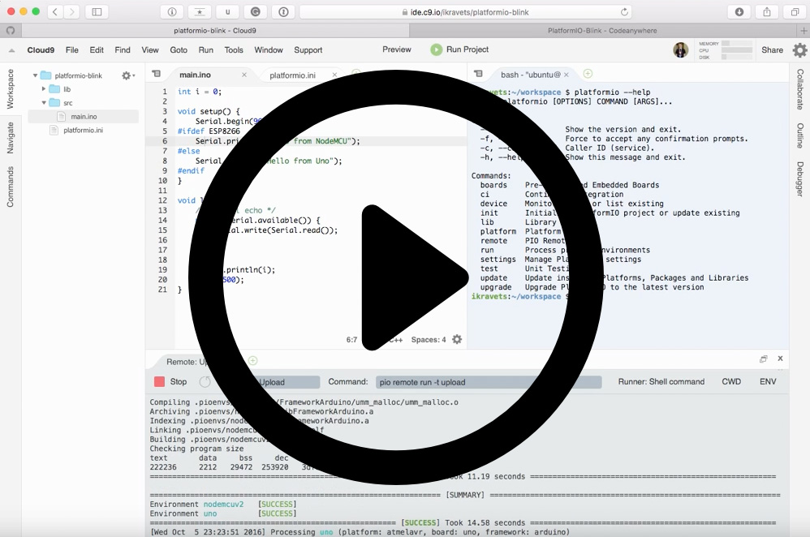
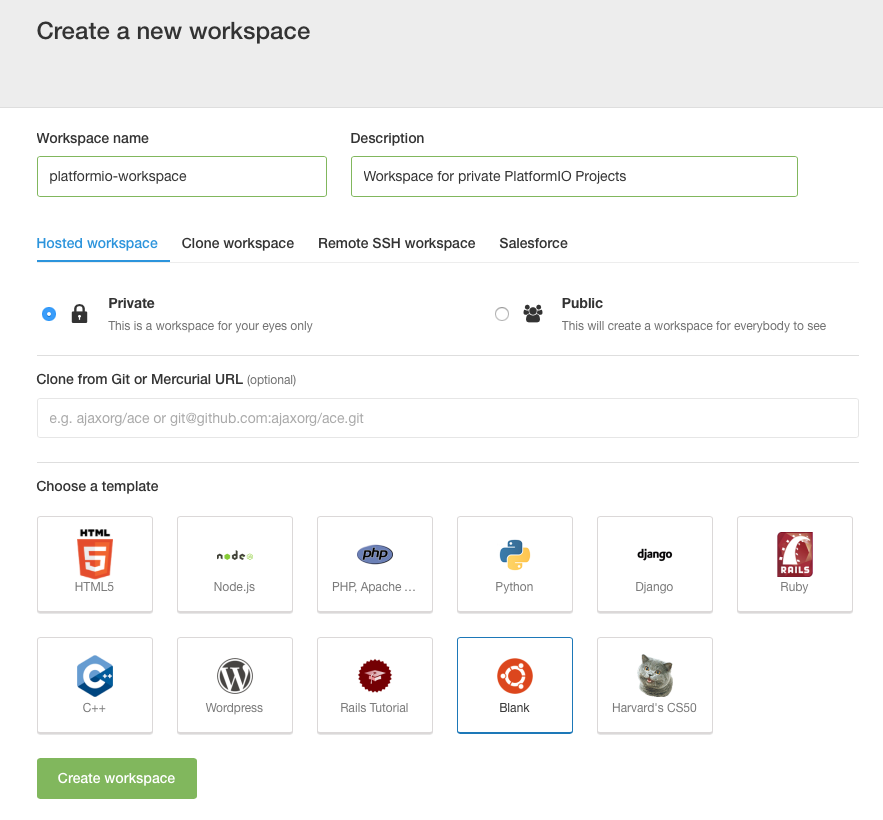
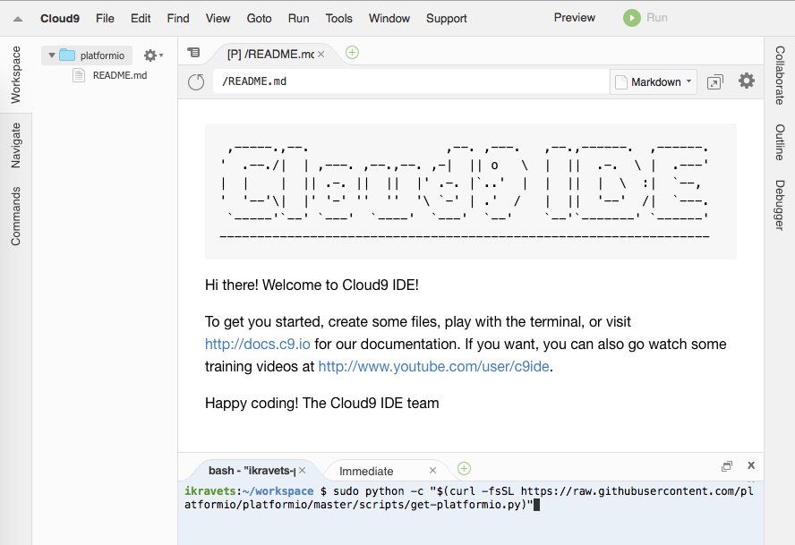
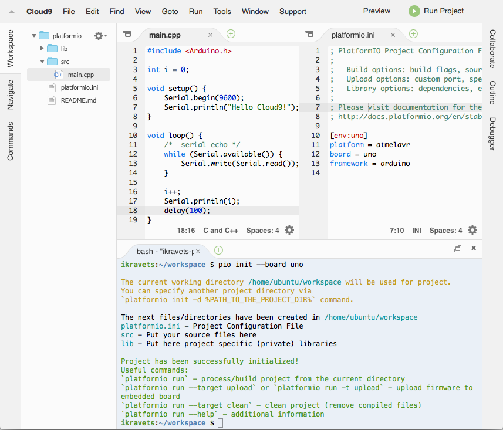
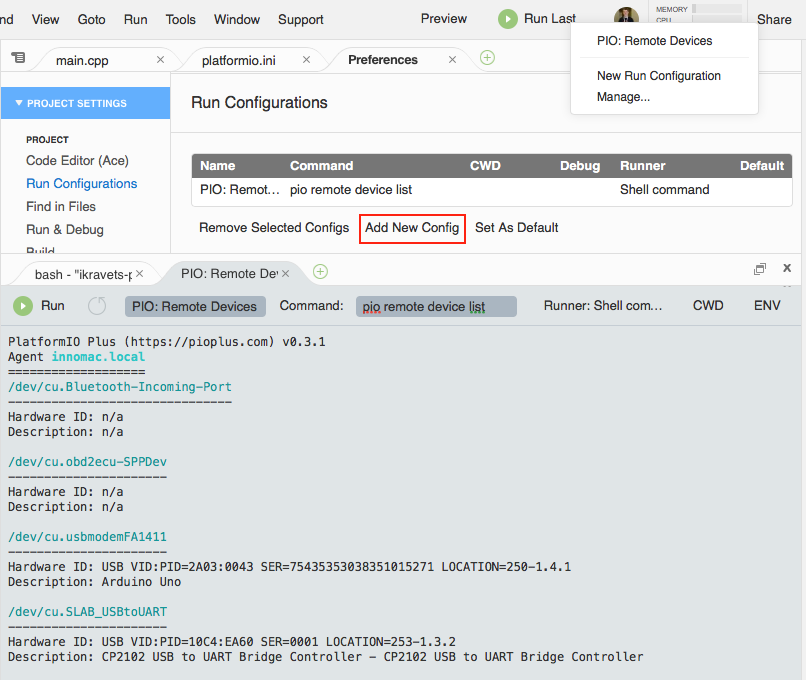
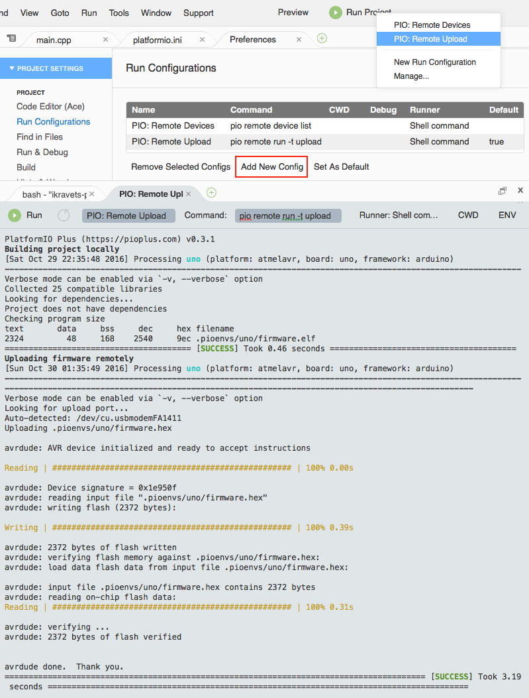
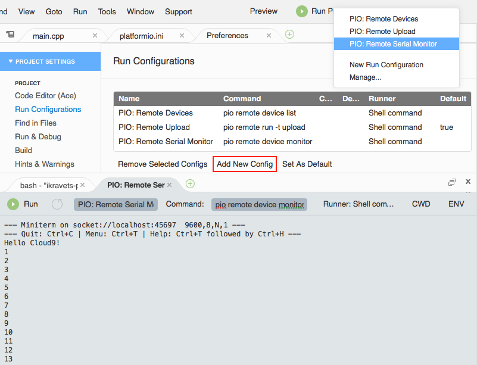

# Cloud9

:::warning

AWS Cloud9 is no longer available to new customers since July 2024. Existing customers can continue to use it.

:::

[Cloud9](https://c9.io/) combines a powerful online code editor with a full Ubuntu workspace in the cloud. Workspaces are powered by Docker Ubuntu containers that give you full freedom over your environment, including sudo rights. Do a git push, compile SASS, see server output, and Run apps easily with the built-in Terminal and Runners.

:::note

1. Read [Remote Development](../remote-development.md) guide first.
2. You need [PlatformIO Account](../../get-started/platformio-account.md) if you don't have it. Registration is FREE.
3. You should have a running [PlatformIO Remote Agent](../../reference/cli/pio-remote/agent.md) on a remote machine where hardware devices are connected physically or accessible for the remote operations. See **Remote Development** [Quick Start](../remote-development.md#pio-remote-quickstart) for details.

:::

## Demo {#demo}

[](https://www.youtube.com/watch?v=NX56_0Ea_K8)

## Integration {#integration}

1. [Sign in to Cloud9](https://c9.io/dashboard.html). A registration is FREE and gives you for FREE 1 private workspace (where you can host multiple PlatformIO Projects) and unlimited public workspaces.
2. Create a new workspace using **Blank** template



3. Install [PlatformIO Core (CLI)](../../get-started/platformio-core.md) using Cloud IDE Terminal. Paste a next command

```bash
sudo python -c "$(curl -fsSL https://raw.githubusercontent.com/platformio/platformio/develop/scripts/get-platformio.py)"
```



4. Log in to [PlatformIO Account](../../get-started/platformio-account.md) using [pio account login](../../reference/cli/pio-account/login.md) command.

## Quick start {#quick-start}

Let's create our first PlatformIO-based Cloud9 Project

1. Initialize new PlatformIO-based Project. Run a next command in Cloud IDE Terminal:

   ```bash
   pio project init --board <ID>

   # initialize project for Arduino Uno
   pio project init --board uno
   ```

   To get board `ID` please use [pio boards](../../reference/cli/pio-boards.md) command or [Embedded Boards Explorer](https://platformio.org/boards).

2. Create new source file named `main.cpp` in `src` folder using Project Tree (left side). Please make right click on `src` folder, then "New File" and insert a next content:

   ```c
   #include <Arduino.h>

   int i = 0;

   void setup() {
       Serial.begin(9600);
       Serial.println("Hello Cloud9!");
   }

   void loop() {
       /*  serial echo */
       while (Serial.available()) {
           Serial.write(Serial.read());
       }

       i++;
       Serial.println(i);
       delay(100);
   }
   ```



3. If you prefer to work with [PlatformIO Core (CLI)](../../get-started/platformio-core.md) CLI, then you can process project using Cloud IDE Terminal and the next commands:

   - [pio run](../../reference/cli/pio-run.md) - build project locally (using Cloud IDE's virtual machine)
   - [pio run -t clean](../../reference/cli/pio-run.md) - clean project
   - [pio remote run -t upload](../../reference/cli/pio-remote/run.md) - upload firmware (program) to a remote device
   - [pio remote device list](../../reference/cli/pio-remote/device.md#cmd-remote-device-list) - list available remote devices
   - [pio remote device monitor](../../reference/cli/pio-remote/device.md#cmd-remote-device-monitor) - Remote Serial Port Monitor

   If you are interested in better integration with Cloud9 and GUI, please read guide below where we will explain how to create custom Build System for PlatformIO and own Runners.

## PlatformIO build system {#platformio-build-system}

Cloud9 allows one to create own build system and use hotkey or command (Menu: Run > Build) to build a project.

Let's create PlatformIO Build System that will be used for C/C++/H/INO/PDE files by default. Click on `Menu: Run > Build System > New Build System` and replace all content with the next:

```javascript
{
    "cmd" : ["pio", "run", "-d", "$file"],
    "info" : "Building $project_path/$file_name",
    "selector": "^.*\\.(cpp|c|h|hpp|S|ini|ino|pde)$"
}
```

Save new Build System and give a name `PIOBuilder`. Now, you can select it as default Build System using `Menu: Run > Build System > PIOBuilder`.

## Remote device manager {#remote-device-manager}

Remote Device Manager works in pair with [Remote Development](../remote-development.md). You can list remote devices that are connected to host machine where [PlatformIO Remote Agent](../../reference/cli/pio-remote/agent.md) is started or are visible for it.

Let's create New Run Configuration (shortcut) that will be used for Remote Device Manager. Click on `Menu: Run > Run Configurations > Manage...`, then "Add New Config" and specify the next values:

- **First Blank Input**: a name of runner. Please set it to "PIO: Remote Devices"
- **Command**: set to `pio remote device list`
- **Runner**: set to "Shell command"



<a id="ide-cloud9-ota-updates"></a>

## Remote firmware uploading {#remote-firmware-uploading}

Remote Firmware Uploading works in pair with [Remote Development](../remote-development.md). You can deploy firmware (program) to any devices which are visible for [PlatformIO Remote Agent](../../reference/cli/pio-remote/agent.md).

Let's create New Run Configuration (shortcut) that will be used for Remote Firmware Uploading. Click on `Menu: Run > Run Configurations > Manage...`, then "Add New Config" and specify the next values:

- **First Blank Input**: a name of runner. Please set it to "PIO: Remote Upload"
- **Command**: set to `pio remote run -t upload`
- **Runner**: set to "Shell command"



## Remote serial port monitor {#remote-serial-port-monitor}

Remote Serial Port Monitor works in pair with [Remote Development](../remote-development.md). You can read or send data to any device that is connected to host machine where [PlatformIO Remote Agent](../../reference/cli/pio-remote/agent.md) is started. To list active agents please use this command [pio remote agent list](../../reference/cli/pio-remote/agent.md#cmd-remote-agent-list).

Let's create New Run Configuration (shortcut) that will be used for Remote Serial Port Monitor. Click on `Menu: Run > Run Configurations > Manage...`, then "Add New Config" and specify the next values:

- **First Blank Input**: a name of runner. Please set it to "PIO: Remote Serial Monitor"
- **Command**: set to `pio remote device monitor`
- **Runner**: set to "Shell command"



## Multi-Project workspace {#multi-project-workspace}

You can have multiple PlatformIO-based Projects in the same workspace. We recommend a next folders structure:

```text
├── project-A
│   ├── lib
│   │   └── README
│   ├── platformio.ini
│   └── src
│       └── main.ino
└── project-B
    ├── lib
    │   └── README
    ├── platformio.ini
    └── src
        ├── main.cpp
        └── main.h
```

In this case, you need to create 2 "New Run Configuration" for [Remote Firmware Uploading](#ide-cloud9-ota-updates) with using the next **commands**:

- `pio remote run --project-dir project-A -t upload` for Project-A
- `pio remote run -d project-B -t upload` for Project-B

See documentation for [`pio remote run --project-dir`](../../reference/cli/pio-remote/run.md#cmdoption-pio-remote-run-d) option.
