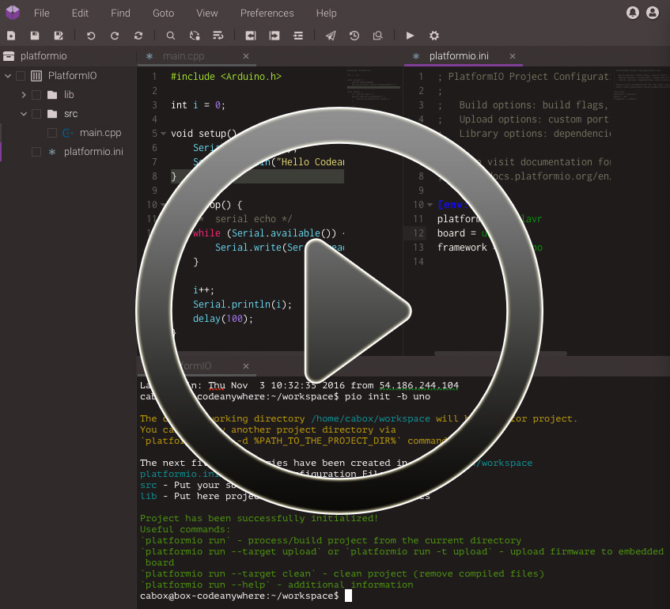
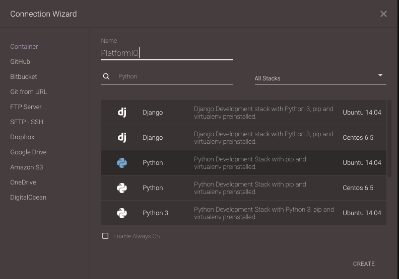
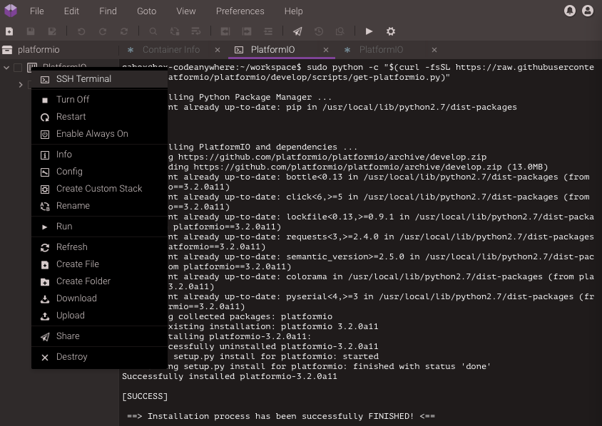
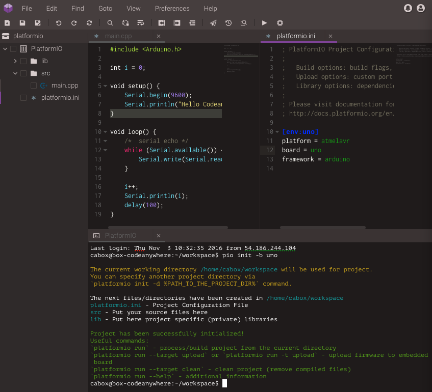
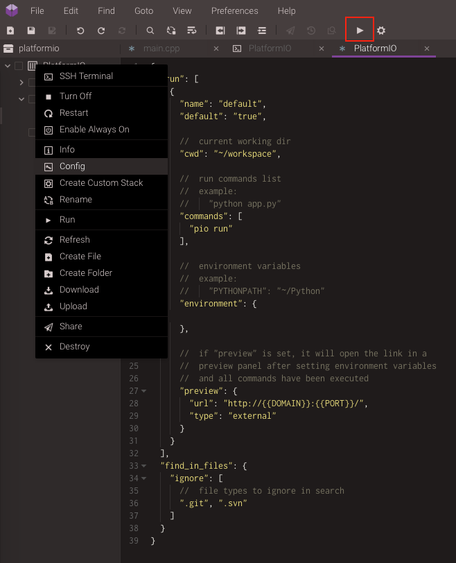
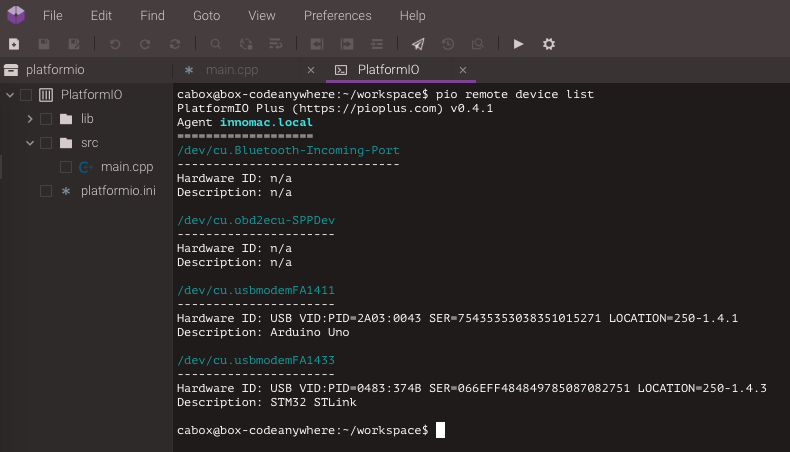
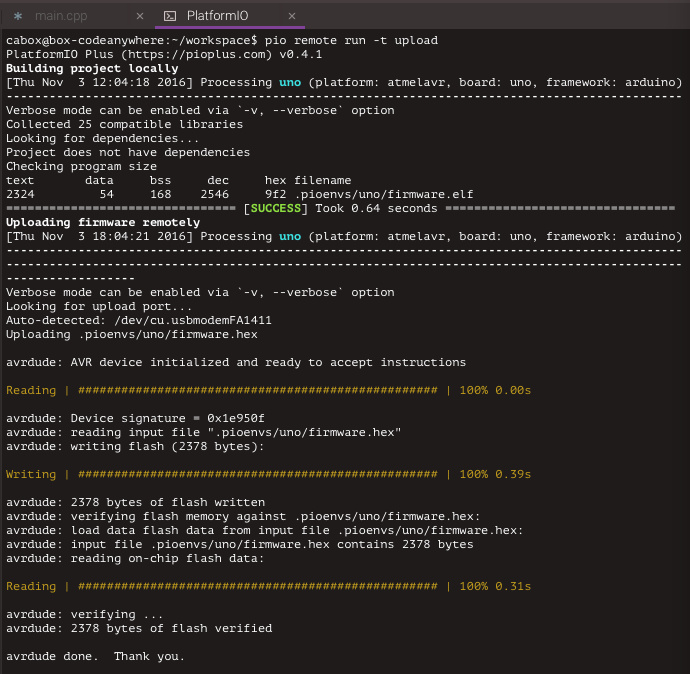
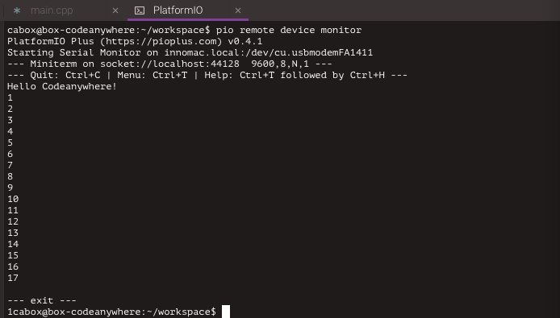

# Codeanywhere

[Codeanywhere](https://codeanywhere.com) is a Cross Platform Cloud IDE and it has all the features of Desktop IDE but with additional features only a cloud application can give you! Codeanywhere is very flexible and you can set up your workflow any way you want it. The elegant development environment will let you focus on building great applications quicker. All the features you will need for any coding task are built into Codeanywhere, making development more productive and fun.

:::note

1. Read [Remote Development](../remote-development.md) guide first.
2. You need [PlatformIO Account](../../get-started/platformio-account.md) if you don't have it. Registration is FREE.
3. You should have a running [PlatformIO Remote Agent](../../reference/cli/pio-remote/agent.md) on a remote machine where hardware devices are connected physically or accessible for the remote operations. See **Remote Development** [Quick Start](../remote-development.md#pio-remote-quickstart) for details.

:::

## Demo {#demo}

[](https://youtu.be/NX56_0Ea_K8?t=148)

## Integration {#integration}

1. [Sign in to Codeanywhere](https://codeanywhere.com). A registration is FREE and gives you unlimited private projects within the one Container.

2. Open [Dashboard Projects](https://codeanywhere.com/dashboard#project)

3. Create a new Project and open it. In Connection Wizard create new Container:

   - **Name** set to "PlatformIO"
   - **Stack** search for `Python` stack (not Python3) that is based on Ubuntu OS.
   - Click on "Create" button.



4. Open **SSH-Terminal** tab (right click on `Container (PlatformIO) > SSH Terminal`) and install [PlatformIO Core (CLI)](../../get-started/platformio-core.md) using a next command

```bash
sudo python -c "$(curl -fsSL https://raw.githubusercontent.com/platformio/platformio/develop/scripts/get-platformio.py)"
```



5. Log in to [PlatformIO Account](../../get-started/platformio-account.md) using [pio account login](../../reference/cli/pio-account/login.md) command.

## Quick start {#quick-start}

Let's create our first PlatformIO-based Codeanywhere Project

1. Initialize new PlatformIO-based Project. Run a next command in a Cloud IDE SSH Terminal:

   ```bash
   pio project init --board <ID>

   # initialize project for Arduino Uno
   pio project init --board uno
   ```

   To get board `ID` please use [pio boards](../../reference/cli/pio-boards.md) command or [Embedded Boards Explorer](https://platformio.org/boards).

   If you do not see created project, please refresh Project Tree using right-click on `Container Name (PlatformIO) > Refresh`.

2. Create new source file named `main.cpp` in `src` folder using Project Tree (left side). Please make right click on `src` folder, then "Create File" and insert a next content:

   ```c
   #include <Arduino.h>

   int i = 0;

   void setup() {
       Serial.begin(9600);
       Serial.println("Hello Codeanywhere!");
   }

   void loop() {
       /*  serial echo */
       while (Serial.available()) {
           Serial.write(Serial.read());
       }

       i++;
       Serial.println(i);
       delay(100);
   }
   ```



3. If you prefer to work with [PlatformIO Core (CLI)](../../get-started/platformio-core.md) CLI, then you can process project using Cloud IDE SSH Terminal and the next commands:

   - [pio run](../../reference/cli/pio-run.md) - build project locally (using Cloud IDE's virtual machine)
   - [pio run -t clean](../../reference/cli/pio-run.md) - clean project
   - [pio remote run -t upload](../../reference/cli/pio-remote/run.md) - upload firmware (program) to a remote device
   - [pio remote device list](../../reference/cli/pio-remote/device.md#cmd-remote-device-list) - list available remote devices
   - [pio remote device monitor](../../reference/cli/pio-remote/device.md#cmd-remote-device-monitor) - Remote Serial Port Monitor

4. We recommend to hide "Hidden Files". You can do that via `Cloud IDE Menu: View > Show Hidden Files`.

## Run button {#run-button}

Codeanywhere provides a quick "Run Project" button where you can specify own command. Let's add "PlatformIO Build Project" command:

1. Open "Project Config" via right click on `Container Name (PlatformIO) > Config`

2. Set `commands` field to

   ```javascript
   "commands": [
       "pio run"
   ]
   ```

3. Save configuration file.

Now, try to click on "Run Project" button. You can assign any PlatformIO command to this button.



## Remote device manager {#remote-device-manager}

Remote Device Manager works in pair with [Remote Development](../remote-development.md). You can list remote devices that are connected to host machine where [PlatformIO Remote Agent](../../reference/cli/pio-remote/agent.md) is started or are visible for it.

1. Open Cloud IDE SSH Terminal

2. Paste this command

   ```bash
   pio remote device list
   ```



## Remote firmware uploading {#remote-firmware-uploading}

Remote Firmware Uploading works in pair with [Remote Development](../remote-development.md). You can deploy firmware to any devices which are visible for [PlatformIO Remote Agent](../../reference/cli/pio-remote/agent.md).

1. Open Cloud IDE SSH Terminal

2. Paste this command

   ```bash
   pio remote run -t upload
   ```



## Remote serial port monitor {#remote-serial-port-monitor}

Remote Serial Port Monitor works in pair with [Remote Development](../remote-development.md). You can read or send data to any device that is connected to host machine where [PlatformIO Remote Agent](../../reference/cli/pio-remote/agent.md) is started. To list active agents please use this command [pio remote agent list](../../reference/cli/pio-remote/agent.md#cmd-remote-agent-list).

1. Open Cloud IDE SSH Terminal

2. Paste this command

   ```bash
   pio remote device monitor
   ```



## Multi-Project workspace {#multi-project-workspace}

You can have multiple PlatformIO-based Projects in the same workspace. We recommend a next folders structure:

```text
├── project-A
│   ├── lib
│   │   └── README
│   ├── platformio.ini
│   └── src
│       └── main.ino
└── project-B
    ├── lib
    │   └── README
    ├── platformio.ini
    └── src
        ├── main.cpp
        └── main.h
```

In this case, you need to use `-d, --project-dir` option for [pio run](../../reference/cli/pio-run.md) or [pio remote run](../../reference/cli/pio-remote/run.md) commands:

- `pio remote run --project-dir project-A -t upload` build Project-A

- <dl>

  <dt>

  `pio remote run --project-dir project-A -t upload` remote firmware uploading

  </dt>

  <dd>

  using Project-A

  </dd>

  </dl>

- <dl>

  <dt>

  `pio remote run -d project-B -t upload` remote firmware (program) uploading

  </dt>

  <dd>

  using Project-B

  </dd>

  </dl>

See documentation for [`pio remote run --project-dir`](../../reference/cli/pio-remote/run.md#cmdoption-pio-remote-run-d) option.
