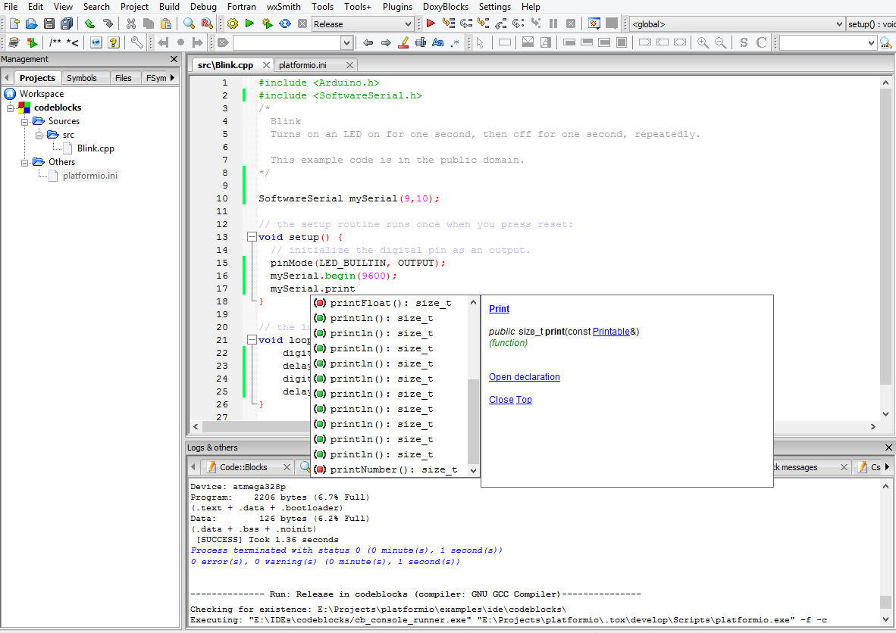

# CodeBlocks

Code::Blocks is a free, open-source cross-platform IDE that supports multiple compilers including GCC, Clang and Visual C++. It is developed in C++ using wxWidgets as the GUI toolkit. Using a plugin architecture, its capabilities and features are defined by the provided plugins. Currently, Code::Blocks is oriented towards C, C++, and Fortran.

CodeBlocks IDE can be downloaded from [here](http://www.codeblocks.org/downloads).



## Integration {#integration}

Integration process consists of these steps:

1. Open system Terminal and install [PlatformIO Core (CLI)](../../get-started/platformio-core.md)
2. Create new folder for your project and change directory (`cd`) to it
3. Generate a project using PlatformIO Core Project Generator ([`pio project init --ide`](../../reference/cli/pio-project/init.md#cmdoption-pio-project-init-ide))
4. Import project in IDE.

---

Choose board `ID` using [pio boards](../../reference/cli/pio-boards.md) or [Embedded Boards Explorer](https://platformio.org/boards) command and generate project via [`pio project init --ide`](../../reference/cli/pio-project/init.md#cmdoption-pio-project-init-ide) command:

```bash
pio project init --ide codeblocks --board <ID>

# For example, generate project for Arduino UNO
pio project init --ide codeblocks --board uno
```

Then:

1. Open this project via `Menu: File > Open...`
2. Add new files to `src` directory (`*.c, *.cpp, *.ino, etc.`) via `Menu: File > New > File...`
3. Build project using `Menu: Build > Build`
4. Upload firmware using `Menu: Build > Run`

:::warning

The libraries which are added, installed or used in the project after generating process won't be reflected in IDE. To fix it you need to reinitialize project using [pio project init](../../reference/cli/pio-project/init.md) (repeat it).

:::
