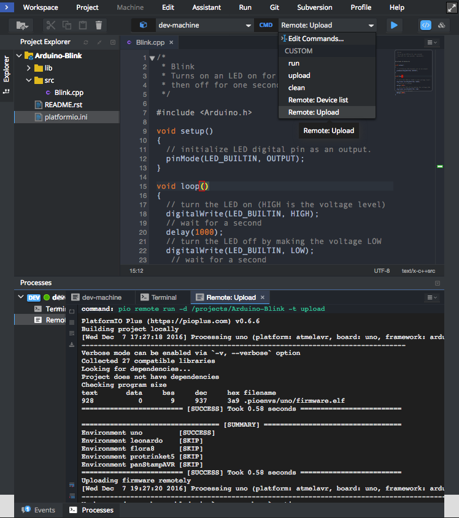
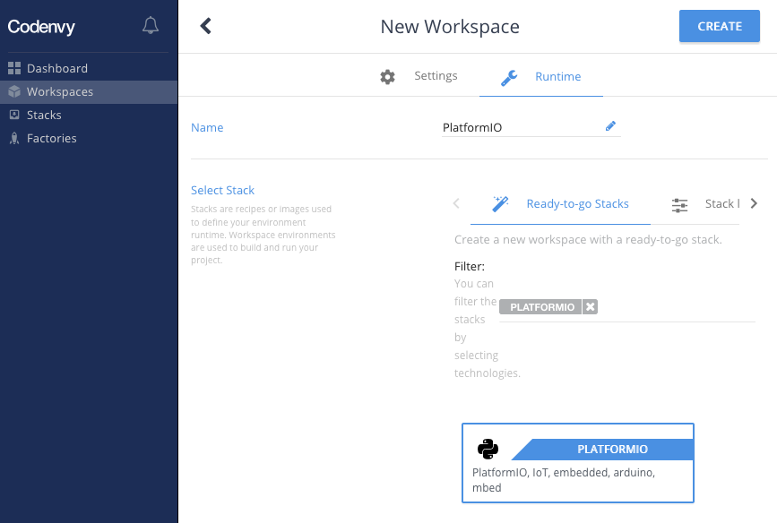
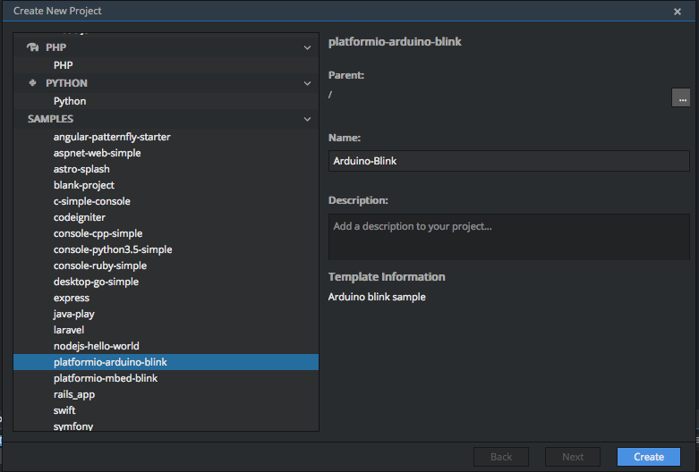
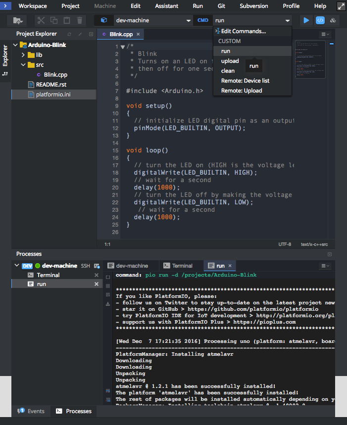

<a id="ide-eclipseche"></a>

# Eclipse Che {#eclipse-che}

[Eclipse Che](https://www.eclipse.org/che/) is an open-source Java based developer workspace server and cloud integrated development environment (IDE) which provides a remote development platform for multi-user purpose. The workspace server comes with a RESTful webservice and provides high flexibility. It also contains a SDK which can be used to create plug-ins for languages, frameworks or tools.

:::note

1. Read [Remote Development](../remote-development.md) guide first.
2. You need [PlatformIO Account](../../get-started/platformio-account.md) if you don't have it. Registration is FREE.
3. You should have a running [PlatformIO Remote Agent](../../reference/cli/pio-remote/agent.md) on a remote machine where hardware devices are connected physically or accessible for the remote operations. See **Remote Development** [Quick Start](../remote-development.md#pio-remote-quickstart) for details.

:::

## Demo {#demo}



## Integration {#integration}

1. [Sign in to Codenvy (based on Eclipse Che)](https://codenvy.com). A registration is FREE and gives you unlimited private projects.

2. Open [Workspaces](https://codenvy.io/dashboard/#/workspaces) tab

3. Click on "Add Workspace", then switch to "Runtime" tab.

   - **Name** set to "PlatformIO"
   - **Stack** search for `PLATFORMIO`
   - Click on "Create" button, then "Open".



4. Using opened Terminal, please log in to [PlatformIO Account](../../get-started/platformio-account.md) using [pio account login](../../reference/cli/pio-account/login.md) command.

## Quick start {#quick-start}

Let's create our first PlatformIO-based Codenvy Project

1. Click on `Menu: Workspace > Create New Project` and select `platformio-arduino-blink` sample. Set "Name" to "Arduino Blink" and press "Create".



2. Now you can use dropdown Commands menu and process project with "run" command



3. If you prefer to work with [PlatformIO Core (CLI)](../../get-started/platformio-core.md) CLI, then you can process project using Cloud IDE Terminal and the next commands:

   - [pio run](../../reference/cli/pio-run.md) - build project locally (using Cloud IDE's virtual machine)
   - [pio run -t clean](../../reference/cli/pio-run.md) - clean project
   - [pio remote run -t upload](../../reference/cli/pio-remote/run.md) - upload firmware (program) to a remote device
   - [pio remote device list](../../reference/cli/pio-remote/device.md#cmd-remote-device-list) - list available remote devices
   - [pio remote device monitor](../../reference/cli/pio-remote/device.md#cmd-remote-device-monitor) - Remote Serial Port Monitor

## Multi-Project workspace {#multi-project-workspace}

You can have multiple PlatformIO-based Projects in the same workspace. We recommend a next folders structure:

```text
├── project-A
│   ├── lib
│   │   └── README
│   ├── platformio.ini
│   └── src
│       └── main.ino
└── project-B
    ├── lib
    │   └── README
    ├── platformio.ini
    └── src
        ├── main.cpp
        └── main.h
```

In this case, you need to use `-d, --project-dir` option for [pio run](../../reference/cli/pio-run.md) or [pio remote run](../../reference/cli/pio-remote/run.md) commands:

- `pio remote run --project-dir project-A -t upload` build Project-A

- <dl>

  <dt>

  `pio remote run --project-dir project-A -t upload` remote firmware uploading

  </dt>

  <dd>

  using Project-A

  </dd>

  </dl>

- <dl>

  <dt>

  `pio remote run -d project-B -t upload` remote firmware (program) uploading

  </dt>

  <dd>

  using Project-B

  </dd>

  </dl>

See documentation for [`pio remote run --project-dir`](../../reference/cli/pio-remote/run.md#cmdoption-pio-remote-run-d) option.
