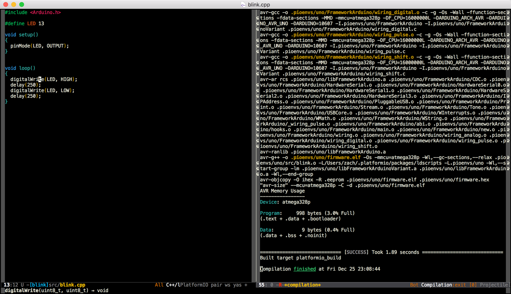

<a id="ide-emacs"></a>

# Emacs {#emacs}

GNU Emacs is an extensible, customizable text editor - and more. At its core is an interpreter for Emacs Lisp, a dialect of the [Lisp programming language](http://en.wikipedia.org/wiki/Lisp_programming_language) with extensions to support text editing.

Refer to the [Emacs Documentation](https://www.gnu.org/software/emacs/#Manuals) page for more detailed information.



## Integration {#integration}

Integration process consists of these steps:

1. Open system Terminal and install [PlatformIO Core (CLI)](../../get-started/platformio-core.md)
2. Create new folder for your project and change directory (`cd`) to it
3. Generate a project using PlatformIO Core Project Generator ([`pio project init --ide`](../../reference/cli/pio-project/init.md#cmdoption-pio-project-init-ide))
4. Open project in Emacs.

### Project Generator {#project-generator}

Choose board `ID` using [pio boards](../../reference/cli/pio-boards.md) or [Embedded Boards Explorer](https://platformio.org/boards) command and generate project via [`pio project init --ide`](../../reference/cli/pio-project/init.md#cmdoption-pio-project-init-ide) command:

```bash
pio project init --ide emacs --board <ID>
```

:::warning

The libraries which are added, installed or used in the project after generating process won't be reflected in IDE. To fix it you need to reinitialize project using [pio project init](../../reference/cli/pio-project/init.md) (repeat it).

:::

### PlatformIO-Mode {#platformio-mode}

An Emacs minor mode has been written to facilitate building and uploading from within Emacs. It can be installed from the MELPA repository using `M-x package-install`. See the MELPA [Getting Started](https://melpa.org/#/getting-started) page for more information.

Setup instructions and an example config can be found at the [Github page](https://github.com/ZachMassia/platformio-mode).

There are 6 predefined targets for building.

- `platformio_build`  - Build project without auto-uploading.        (`C-c i b`)
- `platformio_clean`  - Clean compiled objects.                      (`C-c i c`)
- `platformio_upload` - Build and upload (if no errors).             (`C-c i u`)
- `platformio_programmer_upload` - Build and upload using external programmer (if no errors, see [Upload using Programmer](/hardware/platforms/atmelavr#atmelavr-upload-via-programmer)). (`C-c i p`)
- `platformio_spiffs_upload`  - Upload files to file system SPIFFS (see [Using Filesystem](/hardware/platforms/espressif8266#platform-espressif-uploadfs)). (`C-c i s`)
- `platformio_update` - Update installed platforms and libraries.    (`C-c i d`)

### Code Completion and Navigation {#code-completion-and-navigation}

Please install the next:

- [C/C++/ObjC language server supporting cross references, hierarchies, completion and semantic highlighting](https://github.com/MaskRay/ccls)
- [Emacs client for ccls, a C/C++ language server](https://github.com/MaskRay/emacs-ccls).
