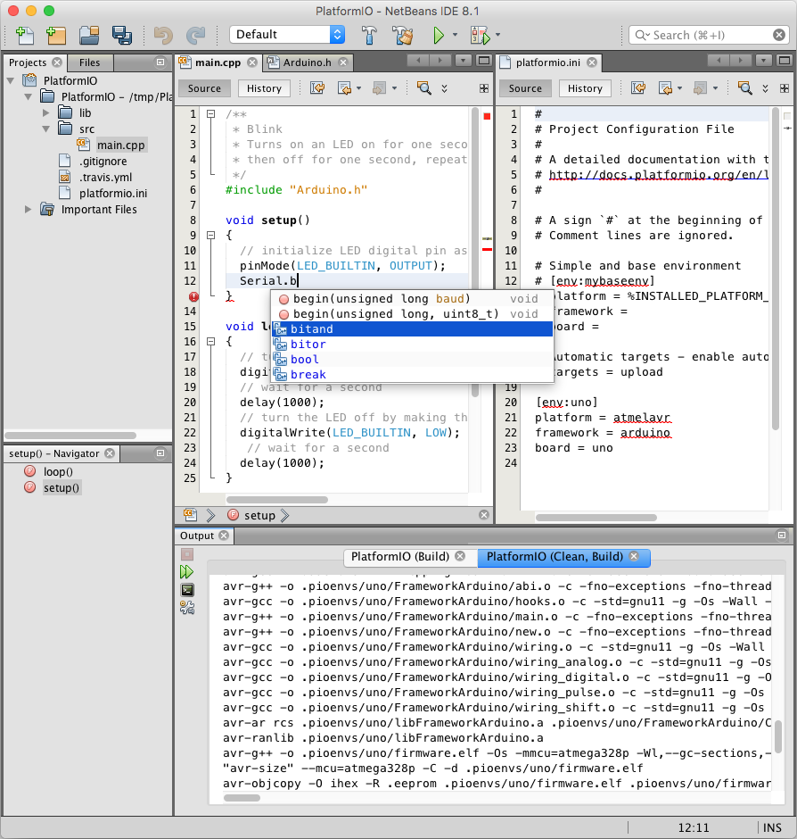

<a id="ide-netbeans"></a>

# NetBeans {#netbeans}

NetBeans is a Java-based integrated development environment (IDE). It provides out-of-the-box code analyzers and editors for working with the latest Java 8 technologies--Java SE 8, Java SE Embedded 8, and Java ME Embedded 8. The IDE also has a range of new tools for HTML5/JavaScript, in particular for Node.js, KnockoutJS, and AngularJS; enhancements that further improve its support for Maven and Java EE with PrimeFaces; and improvements to PHP and C/C++ support.

NetBeans IDE can be downloaded from [here](https://netbeans.org/downloads/). Just make sure you download the C/C++ version (or if you already use NetBeans, install the C/C++ development plugins).

:::warning

Note that the version of NetBeans IDE provided by some Linux package repositories may be a Flatpak version, which are known to have issues with accessing the PlatformIO CLI installed due to the container nature of this technology. It is recommended that you use the native version of the NetBeans IDE via the above link.

:::



## Integration {#integration}

Integration process consists of these steps:

1. Open system Terminal and install [PlatformIO Core (CLI)](../../get-started/platformio-core.md)
2. Create new folder for your project and change directory (`cd`) to it
3. Generate a project using PlatformIO Core Project Generator ([`pio project init --ide`](../../reference/cli/pio-project/init.md#cmdoption-pio-project-init-ide))
4. Import project in IDE.

---

Choose board `ID` using [pio boards](../../reference/cli/pio-boards.md) or [Embedded Boards Explorer](https://platformio.org/boards) command and generate project via [`pio project init --ide`](../../reference/cli/pio-project/init.md#cmdoption-pio-project-init-ide) command:

```bash
pio project init --ide netbeans --board <ID>

# For example, generate project for Arduino UNO
pio project init --ide netbeans --board uno
```

Then:

1. Open this project via `Menu: File > Open Project...`
2. Add new files to `src` directory (`*.c, *.cpp, *.ino, etc.`) via right-click on `src` folder in the "Projects" pane
3. Build project using `Menu: Run > Build Project`
4. Upload firmware using `Menu: Run > Run Project`

:::warning

The libraries which are added, installed or used in the project after generating process won't be reflected in IDE. To fix it you need to reinitialize project using [pio project init](../../reference/cli/pio-project/init.md) (repeat it).

:::

## Articles / Manuals {#articles-manuals}

- Feb 22, 2016 - **Grzegorz Hołdys** - [How to Integrate PlatformIO with Netbeans](http://www.instructables.com/id/How-to-Integrate-PlatformIO-With-Netbeans/)
