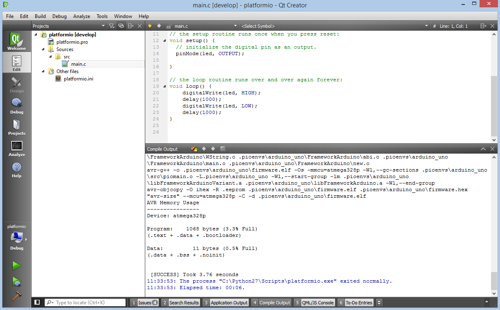

<a id="ide-qtcreator"></a>

# Qt Creator {#qt-creator}

The [Qt Creator](https://github.com/qtproject/qt-creator) is an open source cross-platform integrated development environment. The editor includes such features as syntax highlighting for various languages, project manager, integrated version control systems, rapid code navigation tools and code autocompletion.

Refer to the [Qt-creator Manual](http://doc.qt.io/qtcreator/) page for more detailed information.



## Integration {#integration}

Integration process consists of these steps:

1. Open system Terminal and install [PlatformIO Core (CLI)](../../get-started/platformio-core.md)
2. Create new folder for your project and change directory (`cd`) to it
3. Generate a project using PlatformIO Core Project Generator ([`pio project init --ide`](../../reference/cli/pio-project/init.md#cmdoption-pio-project-init-ide))
4. Import project in IDE.

### Project generator {#project-generator}

The generator will create a \[Qt Creator generic project\]([https://doc.qt.io/qtcreator/creator-project-generic.html](https://doc.qt.io/qtcreator/creator-project-generic.html)).

Choose board `ID` using [pio boards](../../reference/cli/pio-boards.md) or [Embedded Boards Explorer](https://platformio.org/boards) command and generate project via [`pio project init --ide`](../../reference/cli/pio-project/init.md#cmdoption-pio-project-init-ide) command:

```bash
pio project init --ide qtcreator --board <ID>

# For example, generate project for Arduino UNO
pio project init --ide qtcreator --board uno
```

Then:

1. Import project via `File > Open File or Project` and select `platformio.creator` from the folder where is located [`platformio.ini`](../../reference/platformio-ini/index.md)
2. Switch to `Edit` mode (left panel) and open source file from `src` directory (`*.c, *.cpp, *.ino, etc.`)
3. Build project: `Menu: Build > Build All`.

:::warning

The libraries which are added, installed or used in the project after generating process won't be reflected in IDE. To fix it you need to reinitialize project using [pio project init](../../reference/cli/pio-project/init.md) (repeat it).

:::
