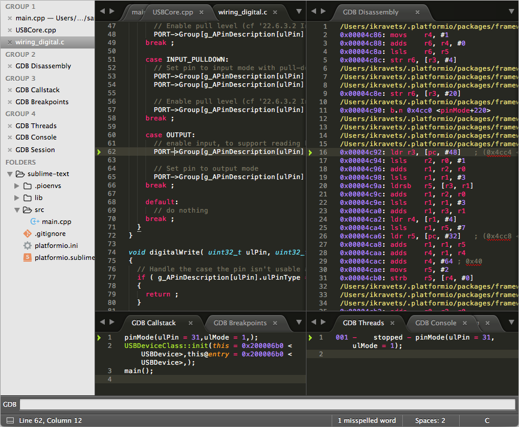
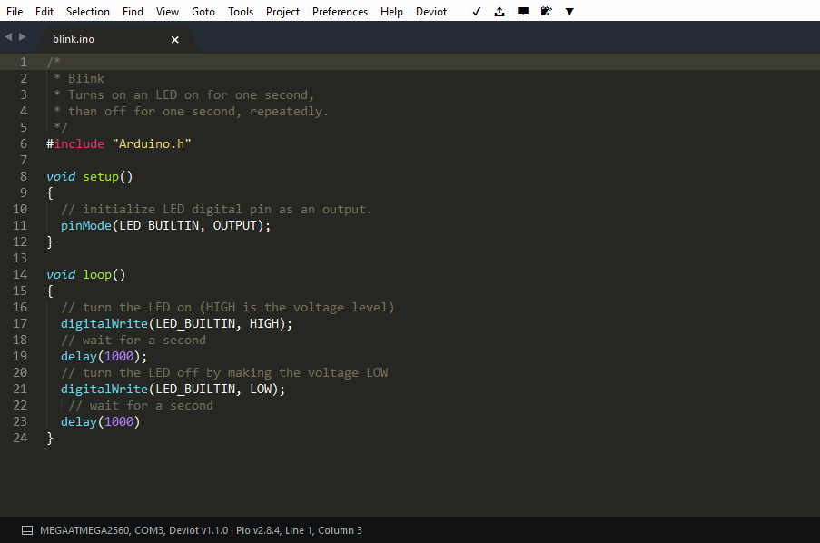
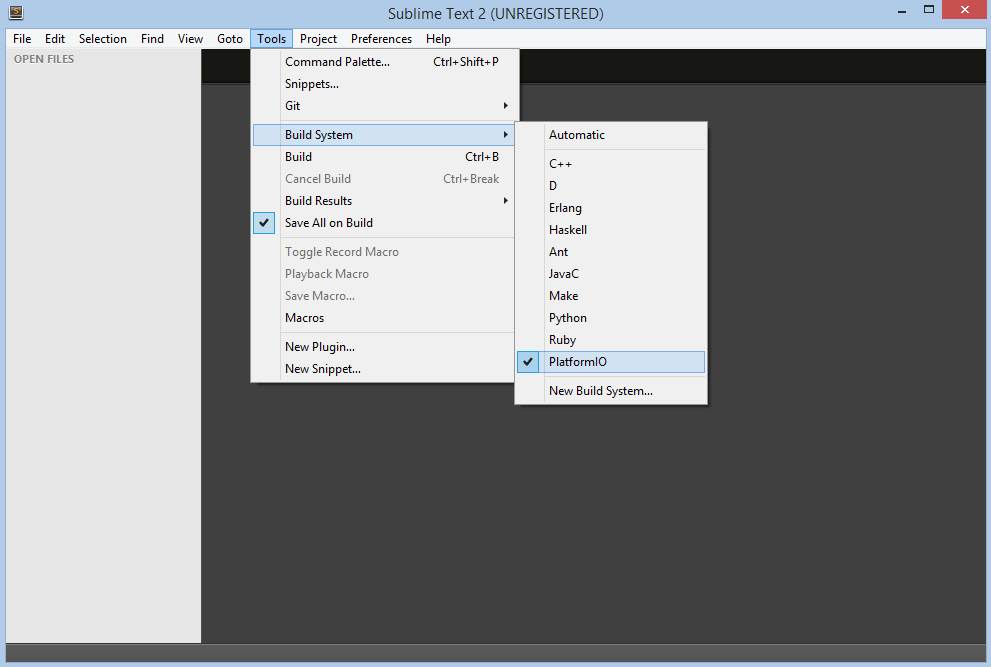
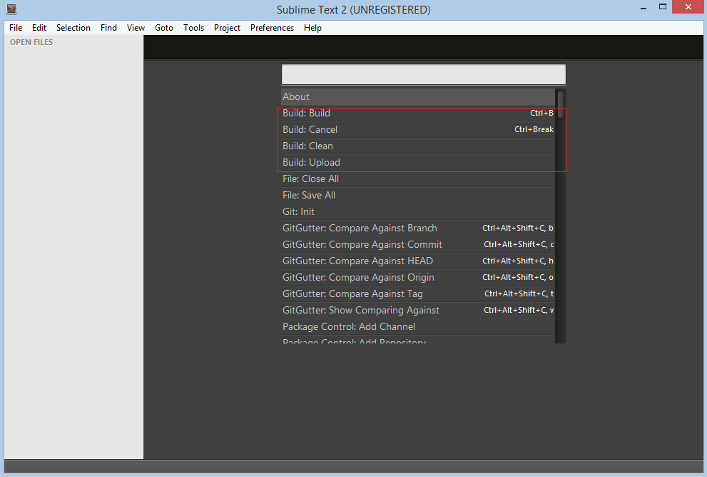
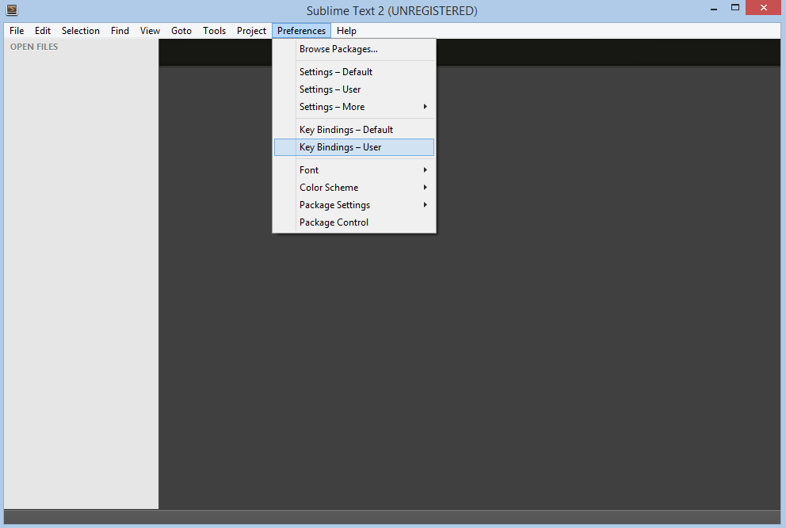

# Sublime Text

The [Sublime Text](http://www.sublimetext.com/) is a cross-platform text and source code editor, with a Python application programming interface (API). Sublime Text is proprietary software. Its functionality is extendable with plugins. Most of the extending packages have free-software licenses and are community-built and maintained. Sublime Text lacks graphical setting dialogues and is entirely configured by editing text files.

Refer to the [Sublime Text Documentation](http://docs.sublimetext.info/en/latest) page for more detailed information.



## Deviot plugin {#deviot-plugin}

We are glad to inform you about an awesome Sublime Text plugin for IoT development named [Deviot](https://github.com/gepd/Deviot). It is based on [PlatformIO Core (CLI)](../../get-started/platformio-core.md) and will automatically install it for you. Visit [official Deviot page](https://github.com/gepd/Deviot) for the further installation steps and documentation.

[](https://github.com/gepd/Deviot)

## Integration {#integration}

### Project generator {#project-generator}

Integration process consists of these steps:

1. Open system Terminal and install [PlatformIO Core (CLI)](../../get-started/platformio-core.md)
2. Create new folder for your project and change directory (`cd`) to it
3. Generate a project using PlatformIO Core Project Generator ([`pio project init --ide`](../../reference/cli/pio-project/init.md#cmdoption-pio-project-init-ide))
4. Import project in IDE.

---

Choose board `ID` using [pio boards](../../reference/cli/pio-boards.md) or [Embedded Boards Explorer](https://platformio.org/boards) command and generate project via [`pio project init --ide`](../../reference/cli/pio-project/init.md#cmdoption-pio-project-init-ide) command:

```bash
pio project init --ide sublimetext --board <ID>

# For example, generate project for Arduino UNO
pio project init --ide sublimetext --board uno
```

Then:

1. Import project via `Menu: Project > Open Project...` and select `platformio.sublime-project` from the folder where is located [`platformio.ini`](../../reference/platformio-ini/index.md)
2. Select PlatformIO as build system: `Menu: Tools > Build System > PlatformIO`
3. Open source file from `src` directory (`*.c, *.cpp, *.ino, etc.`)
4. Build project: `Menu: Tools > Build`.

Also, you can access to all pre-configured targets via `Menu: Tools > Builds With...` (ST3)

- `PlatformIO - Build` - Build project without auto-uploading
- `PlatformIO - Clean` - Clean compiled objects.
- `PlatformIO - Test` - [Unit Testing](../unit-testing/index.md)
- `PlatformIO - Upload` - Build and upload (if no errors)
- `PlatformIO - Upload using Programmer` see [Upload using Programmer](/hardware/platforms/atmelavr#atmelavr-upload-via-programmer)
- `PlatformIO - Upload SPIFFS image` see [Using Filesystem](/hardware/platforms/espressif8266#platform-espressif-uploadfs)

### Manual integration {#manual-integration}

:::note

Please verify that folder where is located `platformio` program is added to [PATH (wiki)](https://en.wikipedia.org/wiki/PATH_%28variable%29) environment variable.

:::

#### Initial configuration {#initial-configuration}

First of all, we need to create "New Build System" with name "PlatformIO" from `Menu: Tools > Build System > New Build System` and fill it like described below:

```bash
{
    "cmd": ["platformio", "-f", "-c", "sublimetext", "run"],
    "working_dir": "${project_path:${folder}}",
    "variants":
    [
        {
            "name": "Clean",
            "cmd": ["platformio", "-f", "-c", "sublimetext", "run", "--target", "clean"]
        },
        {
            "name": "Upload",
            "cmd": ["platformio", "-f", "-c", "sublimetext", "run", "--target", "upload"]
        }
    ]
}
```

Secondly, we need to select "PlatformIO" Build System from a list:



After that, we can use the necessary commands from `Menu: Tools > Command Palette` or with `Ctrl+Shift+P` (Windows/Linux) `Cmd+Shift+P` (Mac) shortcut.



##### Command Hotkeys {#command-hotkeys}

Sublime Text allows one to bind own hotkey per command. Let's setup them for PlatformIO commands using shortcut `Menu: Preferences > Key-Bindings - User`:



We are going to use these shortcuts:

- `F11` for clean project
- `F12` for upload firmware to target device

In this case, the final code will look like:

```text
[
    { "keys": ["f11"], "command": "build", "args": {"variant": "Clean"} },
    { "keys": ["f12"], "command": "build", "args": {"variant": "Upload"} }
]
```

#### First program in Sublime Text {#first-program-in-sublime-text}

Simple "Blink" project will consist from two files:

\1. Main "C" source file named `main.c` must be located in the `src` directory. Let's create new file named `main.c` using `Menu: File > New File` or shortcut `Ctrl+N` (Windows/Linux) `Cmd+N` (Mac) with the next contents:

```c
#include "Arduino.h"
#define WLED    13  // Most Arduino boards already have an LED attached to pin 13 on the board itself

void setup()
{
  pinMode(WLED, OUTPUT);  // set pin as output
}

void loop()
{
  digitalWrite(WLED, HIGH);  // set the LED on
  delay(1000);               // wait for a second
  digitalWrite(WLED, LOW);   // set the LED off
  delay(1000);               // wait for a second
}
```

\2. Project Configuration File named `platformio.ini` must be located in the project root directory. Copy the source code which is described below to it.

```ini
; PlatformIO Project Configuration File
;
;   Build options: build flags, source filter, extra scripting
;   Upload options: custom port, speed and extra flags
;   Library options: dependencies, extra library storages
;
; Please visit documentation for the other options and examples
; https://docs.platformio.org/en/latest/projectconf/index.html

[env:arduino_uno]
platform = atmelavr
framework = arduino
board = uno
```

#### Conclusion {#conclusion}

Taking everything into account, we can open project directory in Sublime Text using `Menu: File > Open Folder` and build it with shortcut `Ctrl+B` (Windows/Linux) or `Cmd+B` (Mac), clean project with shortcut `F11` and upload firmware to target with shortcut `F12`.

## Debugging {#debugging}

A debugging feature is provided by [Debugging](../debugging/index.md) and new debug configuration named "PlatformIO Debugger" is created. No need to do extra configuration steps!

1. Install [SublimeGDB](https://github.com/quarnster/SublimeGDB) package
2. Launch debugger with `F5`
3. Wait for a while, PlatformIO will prepare project for debugging and session will be started soon.
