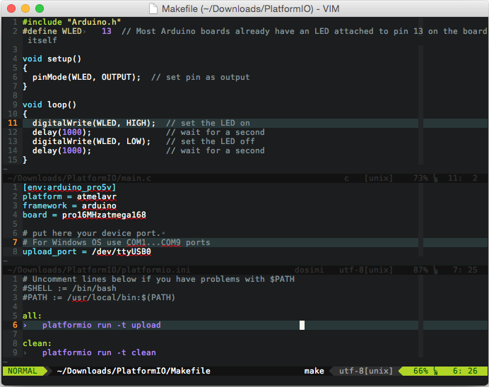

# Vim

[Vim](http://www.vim.org/) is an open-source, powerful and configurable text editor. Vim is designed for use both from a command-line interface and as a standalone application in a graphical user interface.



## Integration {#integration}

Integration process consists of these steps:

1. Open system Terminal and install [PlatformIO Core (CLI)](../../get-started/platformio-core.md)
2. Create new folder for your project and change directory (`cd`) to it
3. Generate a project using PlatformIO Core Project Generator ([`pio project init --ide`](../../reference/cli/pio-project/init.md#cmdoption-pio-project-init-ide))
4. Import project in IDE.

### Project generator {#project-generator}

Choose board `ID` using [pio boards](../../reference/cli/pio-boards.md) or [Embedded Boards Explorer](https://platformio.org/boards) command and generate project via [`pio project init --ide`](../../reference/cli/pio-project/init.md#cmdoption-pio-project-init-ide) command:

```bash
pio project init --ide vim --board <ID>
```

:::warning

The libraries which are added, installed or used in the project after generating process won't be reflected in IDE. To fix it you need to reinitialize project using [pio project init](../../reference/cli/pio-project/init.md) (repeat it).

:::

Recommended bundles:

- [C/C++/ObjC language server supporting cross references, hierarchies, completion and semantic highlighting](https://github.com/MaskRay/ccls)
- [Async language server protocol plugin for vim and neovim](https://github.com/prabirshrestha/vim-lsp)
- ["vim-pio" Plugin](https://github.com/normen/vim-pio)
- ["Neomake-PlatformIO" Plugin](https://github.com/coddingtonbear/neomake-platformio)

Put to the project directory `Makefile` wrapper with contents:

```make
# Uncomment lines below if you have problems with $PATH
#SHELL := /bin/bash
#PATH := /usr/local/bin:$(PATH)

all:
        pio -f -c vim run

upload:
        pio -f -c vim run --target upload

clean:
        pio -f -c vim run --target clean

program:
        pio -f -c vim run --target program

uploadfs:
        pio -f -c vim run --target uploadfs

update:
        pio -f -c vim update
```

Pre-defined targets:

- `Build` - Build project without auto-uploading
- `Clean` - Clean compiled objects.
- `Upload` - Build and upload (if no errors)
- `Upload using Programmer` see [Upload using Programmer](/hardware/platforms/atmelavr#atmelavr-upload-via-programmer)
- `Upload SPIFFS image` see [Using Filesystem](/hardware/platforms/espressif8266#platform-espressif-uploadfs)

Now, in VIM `cd /path/to/this/project` and press `Ctrl+B` or `Cmd+B` (Mac). *PlatformIO* should compile your source code from the `src` directory, make firmware and upload it.

:::note

If hotkey doesn't work for you, try to add this line `nnoremap <C-b> :make<CR>` to `~/.vimrc`

:::

## Articles / manuals {#articles-manuals}

- [コマンドラインでArduino開発 : vim + platformio (Arduino development at the command line: VIM + PlatformIO, Japanese)](http://qiita.com/caad1229/items/7b5fb47f034ae6e0baf2)
