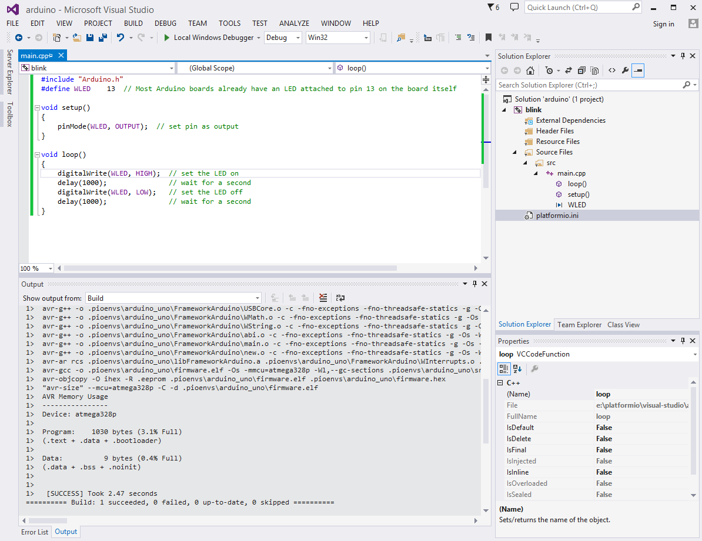
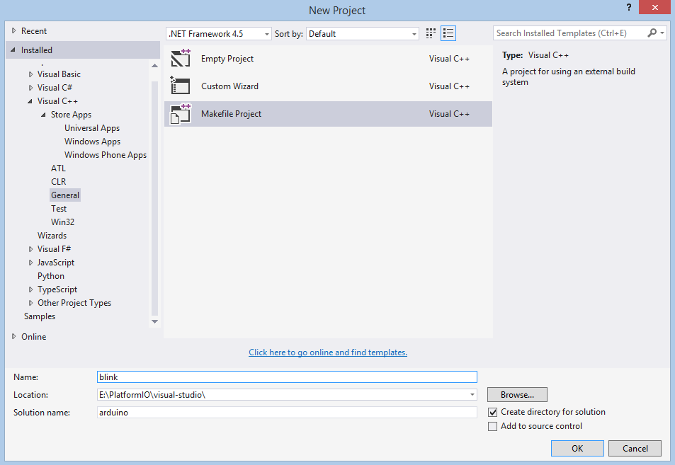
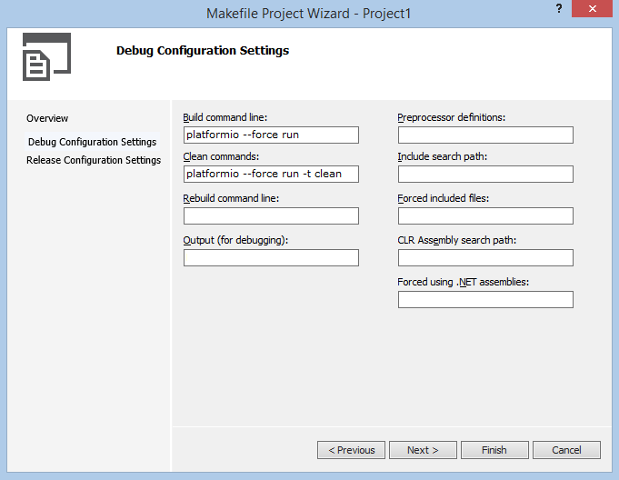
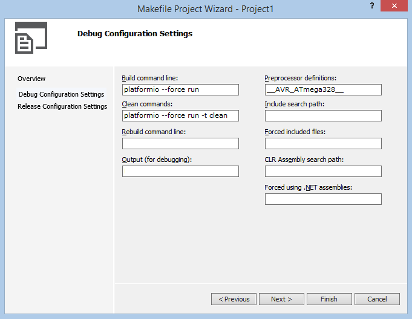
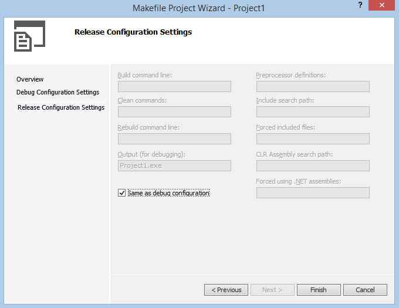
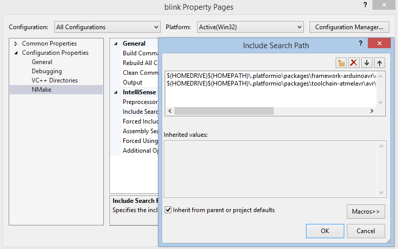
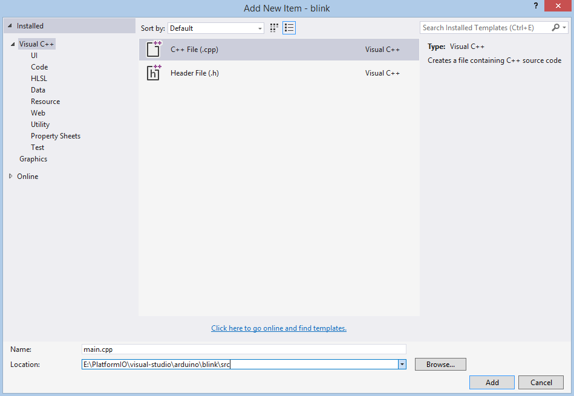
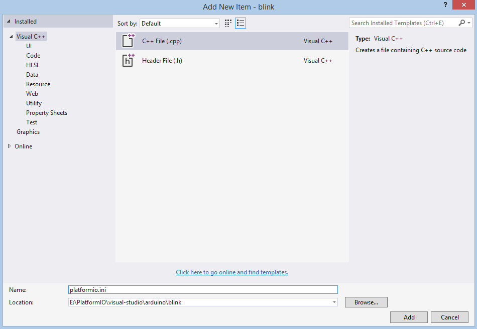
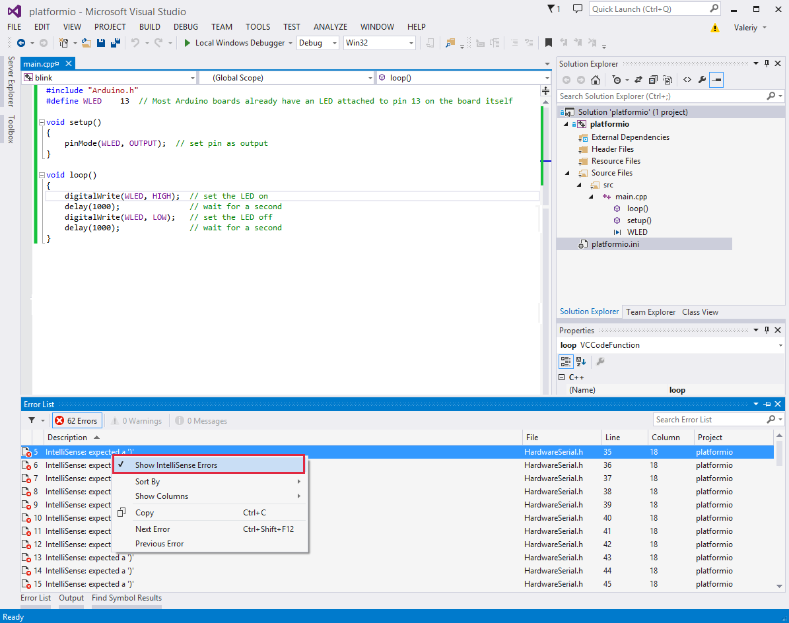

# Visual Studio

The [Microsoft Visual Studio (Free)](http://visualstudio.com/free) is an integrated development environment (IDE) from Microsoft. Visual Studio includes a code editor supporting IntelliSense (the code completion component) as well as code refactoring.

Refer to the [Visual Studio Documentation](https://msdn.microsoft.com/library/vstudio) page for more detailed information.



## Integration {#integration}

Integration process consists of these steps:

1. Open system Terminal and install [PlatformIO Core (CLI)](../../get-started/platformio-core.md)
2. Create new folder for your project and change directory (`cd`) to it
3. Generate a project using PlatformIO Core Project Generator ([`pio project init --ide`](../../reference/cli/pio-project/init.md#cmdoption-pio-project-init-ide))
4. Import project in IDE.

---

### Project generator {#project-generator}

Choose board `ID` using [pio boards](../../reference/cli/pio-boards.md) or [Embedded Boards Explorer](https://platformio.org/boards) command and generate project via [`pio project init --ide`](../../reference/cli/pio-project/init.md#cmdoption-pio-project-init-ide) command:

```bash
pio project init --ide visualstudio --board <ID>

# For example, generate project for Arduino UNO
pio project init --ide visualstudio --board uno
```

Then:

1. Import this project via `Menu: File > Open > Project/Solution` and specify root directory where is located [`platformio.ini`](../../reference/platformio-ini/index.md)
2. Open source file from `src` directory (`*.c, *.cpp, *.ino, etc.`)
3. Build project: `Menu: Build > Build Solution`.

:::warning

The libraries which are added, installed or used in the project after generating process won't be reflected in IDE. To fix it you need to reinitialize project using [pio project init](../../reference/cli/pio-project/init.md) (repeat it).

:::

### Manual integration {#manual-integration}

#### Setup new project {#setup-new-project}

First of all, let's create new project from Visual Studio Start Page: `Start > New Project` or using `Menu: File > New > Project`, then select project with `Makefile` type (`Visual C++ > General > Makefile Project`), fill `Project name`, `Solution name`, `Location` fields and press OK button.



Secondly, we need to configure project with PlatformIO Build System:



If we want to use native AVR programming, we have to specify additional preprocessor symbol ("Preprocessor definitions" field) about your MCU. For example, an Arduino Uno is based on the ATmega328 MCU. In this case We will add new definition  `__AVR_ATmega328__`.



Release Configuration is the same as Debug, so on the next step we check "Same as Debug Configuration" and click "Finish" button.



Thirdly, we need to add directories with header files using project properties (right click on the project name or `Alt-Enter` shortcut) and add two directories to `Configuration Properties > NMake > Include Search Path`:

```text
$(HOMEDRIVE)$(HOMEPATH)\.platformio\packages\toolchain-atmelavr\avr\include
$(HOMEDRIVE)$(HOMEPATH)\.platformio\packages\framework-arduinoavr\cores\arduino
```



#### First program in Visual Studio {#first-program-in-visual-studio}

Simple "Blink" project will consist from two files:

\1. Main "C++" source file named `main.cpp` must be located in the `src` directory. Let's create new file named `main.cpp` using `Menu: File > New File` or shortcut `Ctrl+N`:



Copy the source code which is described below to file `main.cpp`.

```cpp
#include "Arduino.h"

void setup()
{
  pinMode(LED_BUILTIN, OUTPUT);  // set pin as output
}

void loop()
{
  digitalWrite(LED_BUILTIN, HIGH);  // set the LED on
  delay(1000);               // wait for a second
  digitalWrite(LED_BUILTIN, LOW);   // set the LED off
  delay(1000);               // wait for a second
}
```

2. Project Configuration File named `platformio.ini` must be located in the project root directory.



Copy the source code which is described below to it.

```ini
; PlatformIO Project Configuration File
;
;   Build options: build flags, source filter, extra scripting
;   Upload options: custom port, speed and extra flags
;   Library options: dependencies, extra library storages
;
; Please visit documentation for the other options and examples
; https://docs.platformio.org/en/latest/projectconf/index.html

[env:arduino_uno]
platform = atmelavr
framework = arduino
board = uno
```

#### Conclusion {#conclusion}

Taking everything into account, we can build project with shortcut `Ctrl+Shift+B` or using `Menu: Build > Build Solution`.

## Known issues {#known-issues}

### IntelliSense errors {#intellisense-errors}

VS Studio does not allow one to specify for project other toolchain which will be used by IntelliSense. In this case, IntelliSense does not understand GCC-specific definitions.

However, these errors does not have any influence on PlatformIO Build System. It means that you can ignore them and rely on PlatformIO Build System messages which will be shown in output console after build.

Nevertheless, you can provide an IntelliSense-friendly definition of problematic GCC constructs and make sure that the GCC will ignore such definitions or disable IntelliSense error reporting at all. See details in [issue #543](https://github.com/platformio/platformio-core/issues/543)


