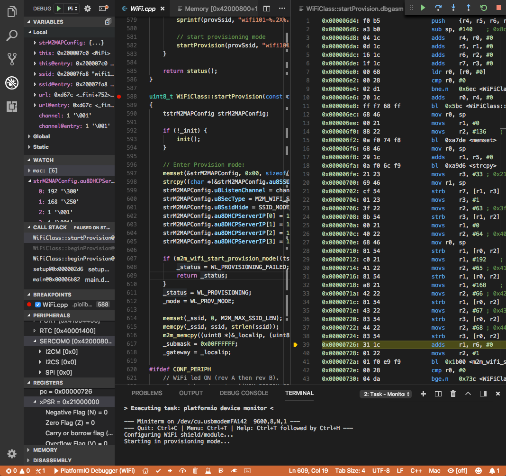
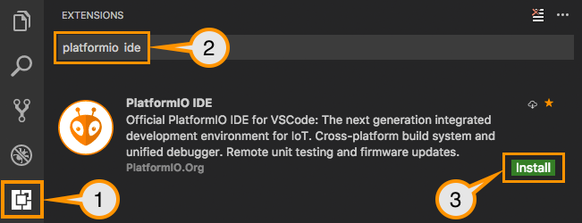
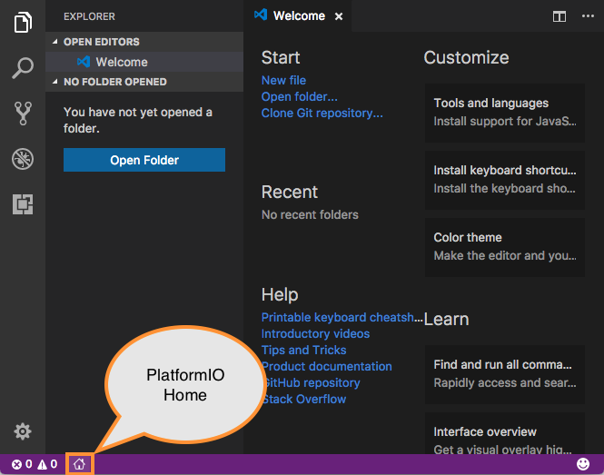
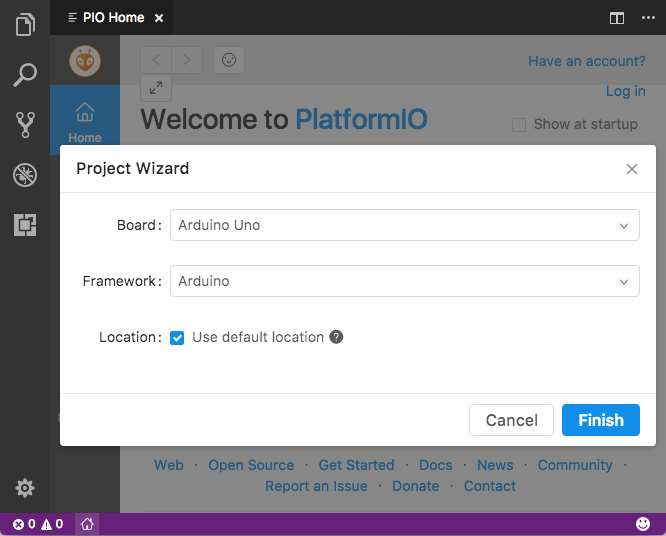
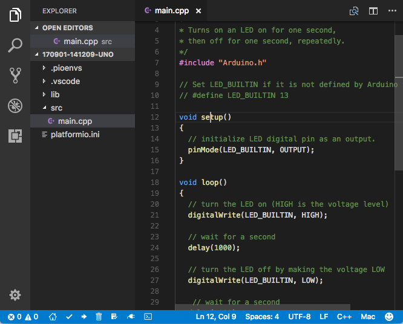
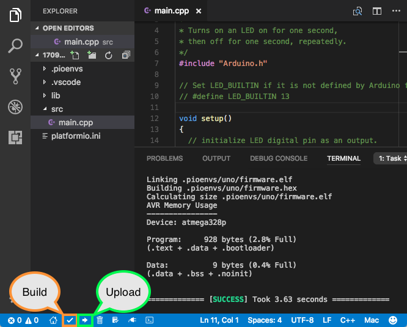
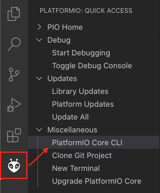
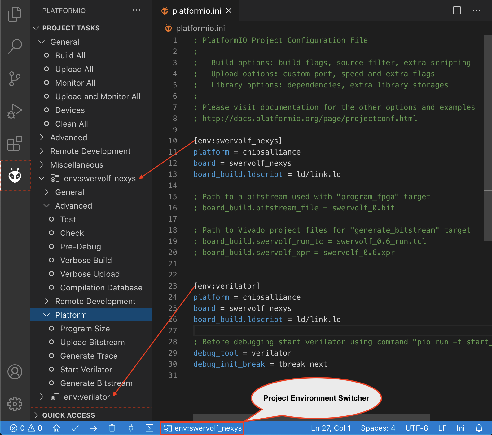
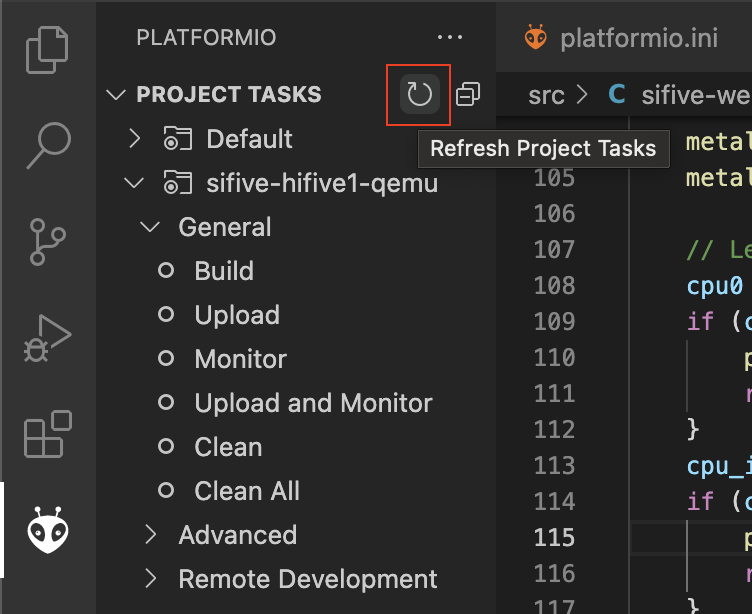
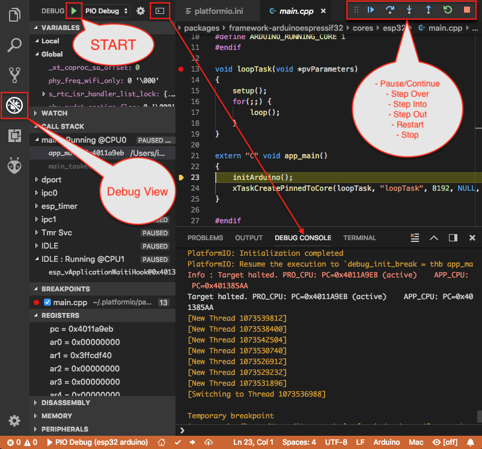

# PlatformIO IDE for VSCode

**Visual Studio Code** is a lightweight but powerful source code editor which runs on your desktop and is available for Windows, macOS and Linux. It comes with built-in support for JavaScript, TypeScript and Node.js and has a rich ecosystem of extensions for other languages (such as C++, C#, Python, PHP, Go) and runtimes (such as .NET and Unity)



## Installation {#installation}

:::note

Note that you do not need to install [PlatformIO Core (CLI)](../../get-started/platformio-core.md) separately if you are going to use PlatformIO IDE for VSCode. [PlatformIO Core (CLI)](../../get-started/platformio-core.md) is built into PlatformIO IDE and you will be able to use it within PlatformIO IDE Terminal.

**Git:** If you are going to use Git for installing upstream development platforms, cloning external projects, installing library dependencies from a repository, please ensure that `git --version` command works from a system terminal. Otherwise, please install a [Git client](https://git-scm.com/book/en/v2/Getting-Started-Installing-Git).

**Linux Users:** To ensure a smooth experience with PlatformIO, it is essential to have the [python3-venv](https://github.com/platformio/platformio-core-installer/issues/85) package installed on your system.

:::

0. [Download](https://code.visualstudio.com) and install official Microsoft Visual Studio Code. PlatformIO IDE is built on top of it
1. **Open** VSCode Package Manager
2. **Search** for the official `platformio ide` [extension](https://marketplace.visualstudio.com/items?itemName=platformio.platformio-ide)
3. **Install** PlatformIO IDE.



## Quick start {#quick-start}

This tutorial introduces you to the basics of PlatformIO IDE workflow and shows you a creation process of a simple "Blink" example. After finishing you will have a general understanding of how to work with projects in the IDE.

### Setting up the project {#setting-up-the-project}

1. Click on "PlatformIO Home" button on the bottom [PlatformIO Toolbar](#ide-vscode-toolbar)



2. Click on "New Project", select a board and create new PlatformIO Project



3. Open `main.cpp` file from `src` folder and replace its contents with the next:

:::warning

The code below works only in pair with Arduino-based boards. See [PlatformIO Project Examples](https://github.com/platformio/platformio-examples) repository for other pre-configured projects.

:::

```cpp
/**
 * Blink
 *
 * Turns on an LED on for one second,
 * then off for one second, repeatedly.
 */
#include "Arduino.h"

// Set LED_BUILTIN if it is not defined by Arduino framework
// #define LED_BUILTIN 13

void setup()
{
  // initialize LED digital pin as an output.
  pinMode(LED_BUILTIN, OUTPUT);
}

void loop()
{
  // turn the LED on (HIGH is the voltage level)
  digitalWrite(LED_BUILTIN, HIGH);

  // wait for a second
  delay(1000);

  // turn the LED off by making the voltage LOW
  digitalWrite(LED_BUILTIN, LOW);

   // wait for a second
  delay(1000);
}
```



4. Build your project with `ctrl+alt+b` hotkey (see all Key Bindings in "User Guide" section below) or using "Build" button on the [PlatformIO Toolbar](#ide-vscode-toolbar)



---

**Further for reading**

- [Tutorials and Examples](../../get-started/tutorials/index.md) (step-by-step tutorials with debugging and unit testing)
- Learn more about [PlatformIO Toolbar](#ide-vscode-toolbar) and other commands (Upload, Clean, Serial Monitor) below
- [Serial Port Monitor](#ide-vscode-serial-port-monitor)
- [`platformio.ini`](../../reference/platformio-ini/index.md) (change [upload_port](../../reference/platformio-ini/env/upload-port.md), configure [build_flags](../../reference/platformio-ini/env/build-flags.md), add library dependencies [lib_deps](../../reference/platformio-ini/env/lib-deps.md), etc.)

**Happy coding with PlatformIO!**

<a id="ide-vscode-toolbar"></a>

## PlatformIO toolbar {#platformio-toolbar}

PlatformIO IDE Toolbar is located in VSCode Status Bar (left corner) and contains quick access buttons for the popular commands. Each button contains hint (delay mouse on it).


1. [PlatformIO Home](../../get-started/platformio-home.md)
2. PlatformIO: Build
3. PlatformIO: Upload
4. PlatformIO: Clean
5. [Serial Port Monitor](../../reference/cli/pio-device/monitor.md)
6. [PlatformIO Core (CLI)](../../get-started/platformio-core.md)
7. Project environment switcher (if more than one environment is available). See [Section \[env\]](../../reference/platformio-ini/env/index.md) of [`platformio.ini`](../../reference/platformio-ini/index.md) .

You can override default buttons and create your own toolbar. See `platformio-ide.toolbar` in [Settings](#ide-vscode-settings).

<a id="ide-vscode-pio-core-cli"></a>

## PlatformIO core (CLI) {#platformio-core-cli}

There are 2 ways how to access [PlatformIO Core (CLI)](../../get-started/platformio-core.md):

1. "Terminal" icon on the [PlatformIO Toolbar](#ide-vscode-toolbar)

   

2. Left Activity Bar > PlatformIO (ant icon) > Quick Access > Miscellaneous > PlatformIO Core CLI

   

## Project tasks {#project-tasks}

### Task explorer {#task-explorer}

PlatformIO provides access to "Project Task" where you can control the build process of the environments declared in [`platformio.ini`](../../reference/platformio-ini/index.md). Project Task Explorer is located in the VSCode Activity Bar under the branded PlatformIO icon. You can also access it via "VSCode Menu > Open View... > PlatformIO".

:::tip

Note that you can drag/move "Project Task" into to the another view within VSCode, such as "Explorer".

:::



### Task Runner {#task-runner}

PlatformIO IDE provides built-in tasks through the menu `Terminal > Run Task...` (Build, Upload, Clean, Monitor, etc) and custom tasks per [`platformio.ini`](../../reference/platformio-ini/index.md) environment (`[env:***]`). The default behavior is to use Terminal Panels for presentation, one panel dedicated to each unique task.

The PlatformIO IDE provides its own Problems Matcher named `$platformio`. You can use it later if you decide to change base task settings.

You can override existing tasks with your own presentation options. For example, let's configure PlatformIO Task Runner to use a NEW Terminal panel for each "Build" command:

1. The menu item `Terminal > Run Task...` opens up a list of VSCode tasks for PlatformIO. In the line `PlatformIO: Build`, press the gear icon on the far right side of the list. This creates or opens the file `.vscode/tasks.json` with some template code.
2. Replace the template in `tasks.json` with this code

```json
{
    "version": "2.0.0",
    "tasks": [
        {
            "type": "PlatformIO",
            "task": "Monitor",
            "problemMatcher": [
                "$platformio"
            ],
            "presentation": {
                "panel": "new"
            }
        }
    ]
}
```

See more options in the [official VSCode documentation](https://code.visualstudio.com/docs/editor/tasks#_output-behavior).

<a id="ide-vscode-custom-task"></a>

### Custom tasks {#custom-tasks}

Please declare [Custom Targets](../scripting/custom-targets.md) and refresh Task Explorer:



## Multi-project workspaces {#multi-project-workspaces}

You can work with multiple project folders in Visual Studio Code with multi-root workspaces. This can be very helpful when you are working on several related projects at the same time. Read more in the documentation [Multi-root Workspaces](https://code.visualstudio.com/docs/editor/multi-root-workspaces).

## Serial & UDP plotter {#serial-udp-plotter}

See [Teleplot - Ridiculously-simple telemetry viewer](https://marketplace.visualstudio.com/items?itemName=alexnesnes.teleplot) community extension.

<a id="ide-vscode-serial-port-monitor"></a>

## Serial port monitor {#serial-port-monitor}

You can customize Serial Port Monitor using [Monitor options](../../reference/platformio-ini/env/monitor-options.md) in [`platformio.ini`](../../reference/platformio-ini/index.md):

- [monitor_port](../../reference/platformio-ini/env/monitor-port.md)
- [monitor_speed](../../reference/platformio-ini/env/monitor-speed.md)
- [monitor_parity](../../reference/platformio-ini/env/monitor-parity.md)
- [monitor_filters](../../reference/platformio-ini/env/monitor-filters.md)
- [monitor_rts](../../reference/platformio-ini/env/monitor-rts.md)
- [monitor_dtr](../../reference/platformio-ini/env/monitor-dtr.md)
- [monitor_eol](../../reference/platformio-ini/env/monitor-eol.md)
- [monitor_raw](../../reference/platformio-ini/env/monitor-raw.md)
- [monitor_echo](../../reference/platformio-ini/env/monitor-echo.md)

Example:

```ini
[env:esp32dev]
platform = platformio/espressif32
framework = arduino
board = esp32dev

; Custom Serial Monitor port
monitor_port = /dev/ttyUSB1

; Custom Serial Monitor speed (baud rate)
monitor_speed = 115200
```

## Debugging {#debugging}

Debugging in VSCode works in combination with [Debugging](../debugging/index.md). You should have [PlatformIO Account](../../get-started/platformio-account.md) to work with it.

VSCode has a separate activity view named "Debug" (accessed by the bug icon on the left toolbar). [Debugging](../debugging/index.md) extends it with more advanced debugging instruments and features:

- Local, Global, and Static Variable Explorer
- Conditional Breakpoints
- Expressions and Watchpoints
- Generic Registers
- Peripheral Registers
- Memory Viewer
- Disassembly
- Multi-thread support
- A hot restart of an active debugging session.

There are two pre-configured debugging configurations:

<dl>

<dt>

PIO Debug

</dt>

<dd>

**Default configuration**. PlatformIO runs the **Pre-Debug** task and builds the project using [Debug Configuration](../projects/build-configurations.md). Also, it checks for project changes.

</dd>

<dt>

PIO Debug (skip Pre-Debug)

</dt>

<dd>

PlatformIO skips the **Pre-Debug** stage and DOES NOT build or check the project for changes. If you do changes in project source files, they will not be reflected in debug sessions until you switch back to the "PIO Debug" configuration or manually run the "Pre-Debug" task.

This configuration is very useful for quick debug session. It is super fast by skipping several checks, letting you control project changes manually.

</dd>

</dl>

:::note

Note that [Debugging](../debugging/index.md) will use the first declared build environment in [`platformio.ini`](../../reference/platformio-ini/index.md) if the [default_envs](../../reference/platformio-ini/platformio/default-envs.md) option is not specified.

:::



### Variable format {#variable-format}

Currently, VSCode does not provide an UI or API to change the variable format. See the related [VSCode Issue #28025](https://github.com/Microsoft/vscode/issues/28025).

A temporary solution is to set the default numerical base in which the debugger displays numeric output in the Debug Console. (The Debug Console is visible during active debugging sessions). For example, to show variables in hexadecimal format, copy the code below and paste it into "Debug Console":

```text
set output-radix 16
```

Possible values, listed in decimal base, are: 8, 10, 16.

### Watchpoints {#watchpoints}

Read [GDB: Setting Watchpoints](https://sourceware.org/gdb/download/onlinedocs/gdb/Set-Watchpoints.html) first.

Currently, VSCode does not provide an API to change the value format of watchpoints. You can manually cast watchpoint expressions to display the value as specific pointer types:

- `$pc`, default decimal integer format
- `*0x10012000`, an address, default decimal integer format
- `(void*)$pc`, $pc register, hexadecimal format
- `*(void**)0x10012000`, an address, hexadecimal format

## Install shell commands {#install-shell-commands}

See PlatformIO Core [Install Shell Commands](../../get-started/install/shell-commands.md).

## Proxy server support {#proxy-server-support}

There are two options how to configure a proxy server:

1. Open [VSCode Settings](https://code.visualstudio.com/docs/getstarted/settings) and search for "Proxy". Please set "Http: Proxy" and disable "Http: Proxy Strict SSL".
2. Configure PlatformIO Core [Proxy Configuration](../../get-started/install/proxy-configuration.md).

<a id="ide-vscode-keybindings"></a>

## Key bindings {#key-bindings}

- `ctrl+alt+b` / `cmd-shift-b` / `ctrl-shift-b` Build Project
- `cmd-shift-d` / `ctrl-shift-d` Debug project
- `ctrl+alt+u` Upload Firmware
- `ctrl+alt+s` Open [Serial Port Monitor](../../reference/cli/pio-device/monitor.md)

You can override existing key bindings  or add a new in VSCode. See official documentation [Key Bindings for Visual Studio Code](https://code.visualstudio.com/docs/getstarted/keybindings).

<a id="ide-vscode-settings"></a>

## Settings {#settings}

[How to configure VSCode settings?](https://code.visualstudio.com/docs/getstarted/settings)

### `platformio-ide.activateProjectOnTextEditorChange` {#platformio-ide-activateprojectontexteditorchange}

Automatically activate project depending on an active opened text editor. The default value is `false`.

### `platformio-ide.autoOpenPlatformIOIniFile` {#platformio-ide-autoopenplatformioinifile}

Automatically open the [`platformio.ini`](../../reference/platformio-ini/index.md) file from a project when no other editors are opened. The default value is `true`.

### `platformio-ide.autoCloseSerialMonitor` {#platformio-ide-autocloseserialmonitor}

If true, automatically close [pio device monitor](../../reference/cli/pio-device/monitor.md) before uploading/testing. The default value is `true`.

### `platformio-ide.autoRebuildAutocompleteIndex` {#platformio-ide-autorebuildautocompleteindex}

If true, automatically rebuild the C/C++ Project Index when [`platformio.ini`](../../reference/platformio-ini/index.md) is changed or when new libraries are installed. The default value is `true`.

### `platformio-ide.showEditorTitleShortcuts` {#platformio-ide-showeditortitleshortcuts}

Show Build, Upload, Clean, and other buttons in the editor title bar. The default value is `true`.

### `platformio-ide.autoPreloadEnvTasks` {#platformio-ide-autopreloadenvtasks}

Automatically preload ALL project environment tasks. The default value is `false`.

### `platformio-ide.customPATH` {#platformio-ide-custompath}

Custom PATH for the `platformio` command. Paste here the result of `echo $PATH` (Unix) / `echo %PATH%` (Windows) command by typing into your system terminal if you prefer to use a custom version of [PlatformIO Core (CLI)](../../get-started/platformio-core.md). The default value is `null`, meaning PlatformIO looks for the `platformio` command in the system path.

### `platformio-ide.reopenSerialMonitorDelay` {#platformio-ide-reopenserialmonitordelay}

Configure the time in milliseconds before reopening the Serial Port Monitor. The default value is `0`, which means to reopen instantly.

### `platformio-ide.useBuiltinPython` {#platformio-ide-usebuiltinpython}

Use a portable Python 3 Interpreter if available. The default value is `true`.

### `platformio-ide.useBuiltinPIOCore` {#platformio-ide-usebuiltinpiocore}

If true, use the built-in [PlatformIO Core (CLI)](../../get-started/platformio-core.md). The default value is `true`.

### `platformio-ide.useDevelopmentPIOCore` {#platformio-ide-usedevelopmentpiocore}

If true, use the development version of [PlatformIO Core (CLI)](../../get-started/platformio-core.md). The default value is `false`.

### `platformio-ide.disablePIOHomeStartup` {#platformio-ide-disablepiohomestartup}

Disable showing PlatformIO Home at startup. The default value is `false`.

### `platformio-ide.pioHomeServerHttpHost` {#platformio-ide-piohomeserverhttphost}

PlatformIO Home server HTTP host.The default is `127.0.0.1`, but in case of dockerized environments `0.0.0.0`.

### `platformio-ide.pioHomeServerHttpPort` {#platformio-ide-piohomeserverhttpport}

PlatformIO Home server HTTP port. The default value `0` automatically assigns a free port in the range \[45000..45999\]).

### `platformio-ide.customPyPiIndexUrl` {#platformio-ide-custompypiindexurl}

Custom base URL of the Python Package Index (default `https://pypi.org/simple`).

### `platformio-ide.toolbar` {#platformio-ide-toolbar}

Configure your own [PlatformIO Toolbar](#ide-vscode-toolbar) with your own buttons and attach commands to them. There is no limitation to command scope. You can use [Built-in VSCode Commands](https://code.visualstudio.com/api/references/commands) or commands from your 3rd party favorite extensions.

The button can be text, an icon, or a mix of them. The list of supported icons is documented in [VSCode Icon Listing](https://code.visualstudio.com/api/references/icons-in-labels#icon-listing). You can have different toolbars per workspace thanks to the [User and Workspace Settings](https://code.visualstudio.com/docs/getstarted/settings).

**Example**

```javascript
{
  "platformio-ide.toolbar": [
    {
      "text": "$(arrow-right)",
      "tooltip": "Upload and Monitor the active environment",
      "commands": "platformio-ide.uploadAndMonitor"
    },
    {
      "text": "Outdated",
      "tooltip": "List outdated packages for the activate environment",
      "commands": [
        {
          "id": "workbench.action.tasks.runTask",
          "args": "PlatformIO: Outdated (${command:platformio-ide.activeEnvironment})"
        }
      ]
    },
    {
      "text": "$(list-selection)",
      "tooltip": "List devices",
      "commands": [
        {
          "id": "platformio-ide.runPIOCoreCommand",
          "args": "pio device list"
        }
      ]
    },
    {
      "text": "$(plug)",
      "commands": [
        {
          "id": "platformio-ide.runPIOCoreCommand",
          "args": "pio device monitor --filter time"
        }
      ]
    },
    {
      "text": "$(terminal)",
      "commands": [
        {
          "id": "workbench.action.terminal.sendSequence",
          "args": {
            "text": "echo 1\n"
          }
        }
      ]
    }
  ]
}
```

## Known issues {#known-issues}

### PackageManager is unable to install tool {#packagemanager-is-unable-to-install-tool}

This is a known bug in VSCode Terminal [issue #61](https://github.com/platformio/platformio-vscode-ide/issues/61).

A temporary solution is to install packages using a system terminal (not VSCode Terminal). Use "Solution 3: Run from Terminal" in FAQ > Package Manager > [\[Error 5\] Access is denied](../../resources/faq/troubleshooting.md#faq-package-manager-error-5). Afterwards, go back to using the VSCode Terminal.

## Changelog {#changelog}

Visit the [releases page](https://github.com/platformio/platformio-vscode-ide/releases).
