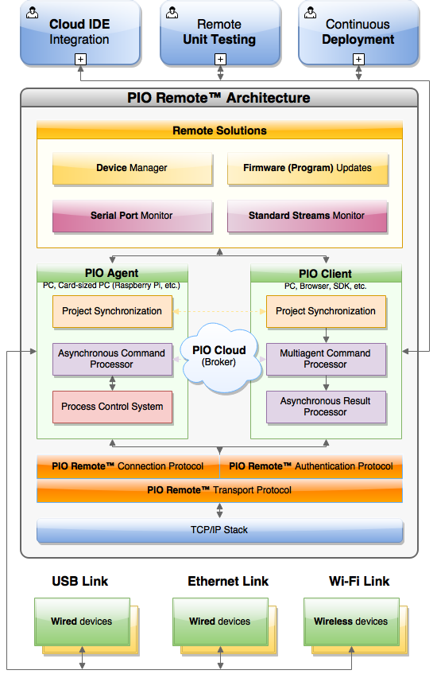

<a id="pioremote"></a>

# Remote development {#remote-development}

PlatformIO Remote lets you work with devices connected to another computer as
if they were connected to yours: list them, upload firmware, open a serial
monitor and run unit tests. You do not need SSH, a VPN, a static IP address or
open network ports.

You need a free [PlatformIO Account](../get-started/platformio-account.md).

## How it works {#technology}



- A **remote agent** runs on the computer the devices are connected to, for
  example a lab PC or a Raspberry Pi. Start it with
  [`pio remote agent start`](../reference/cli/pio-remote/agent.md). It
  connects to the PlatformIO Cloud and waits for commands.
- A **client** sends commands through the cloud: your computer with
  [`pio remote`](../reference/cli/pio-remote/index.md), a
  [cloud IDE](./ide/index.md#ide-cloud), or a [CI](./ci/index.md) job.

One agent can serve several clients, and one client can use several agents, so
you can work with hardware in different places and networks. Agents run on
Windows, macOS, Linux and Linux on ARMv6 and later.

The commands mirror the local ones, with `remote` added:

| Local | Remote |
| --- | --- |
| [`pio device list`](../reference/cli/pio-device/list.md) | [`pio remote device list`](../reference/cli/pio-remote/device.md#pio-remote-device-list) |
| [`pio device monitor`](../reference/cli/pio-device/monitor.md) | [`pio remote device monitor`](../reference/cli/pio-remote/device.md#pio-remote-device-monitor) |
| [`pio run -t upload`](../reference/cli/pio-run.md) | [`pio remote run -t upload`](../reference/cli/pio-remote/run.md) |
| [`pio test`](../reference/cli/pio-test.md) | [`pio remote test`](../reference/cli/pio-remote/test.md) |

By default the project is built on your computer, and only the firmware is
sent to the agent. Use `--force-remote` to build on the agent instead.

## Installation {#installation}

PlatformIO Remote is part of PlatformIO Core: it is available in the terminal
of [PlatformIO IDE](../get-started/platformio-ide.md), or
[install PlatformIO Core](../get-started/install/index.md) on the agent
computer, such as a Raspberry Pi.

<a id="pio-remote-quickstart"></a>

## Quick start {#quick-start}

1. On the computer with the devices, sign in and start the agent:

   ```bash
   pio account login
   pio remote agent start
   ```

   To let other PlatformIO users use your devices, add
   [`--share`](../reference/cli/pio-remote/agent.md#cmdoption-pio-remote-agent-start-s)
   with the email addresses of their PlatformIO accounts.

2. On your computer, sign in with the same account (or one the agent is shared
   with) and check that the agent's devices are visible:

   ```bash
   pio account login
   pio remote device list
   ```

   In CI or other non-interactive environments, set
   [`PLATFORMIO_AUTH_TOKEN`](../reference/environment-variables.md#envvar-PLATFORMIO_AUTH_TOKEN)
   instead of running `pio account login`.

3. In your project directory, upload the firmware to the remote board and open
   its serial monitor:

   ```bash
   pio remote run -t upload
   pio remote device monitor
   ```

:::note

With a cloud IDE, the browser and the cloud IDE's virtual machine are the
client. Run the agent on the computer the devices are connected to, not in the
cloud IDE's terminal.

:::

:::tip

Devices that support over-the-air updates do not need to be connected to the
agent computer, only reachable from it. Pass their network address as the
upload port, for example for [Espressif 8266](/hardware/platforms/espressif8266#platform-espressif-ota):
`pio remote run -t upload --upload-port myesp8266.local`.

:::

## Use cases {#use-cases}

| Use case | Description |
| --- | --- |
| Devices on a single-board computer | Program devices connected to a Raspberry Pi or similar from your usual development environment, without SSH or installing toolchains on it. |
| Cloud IDE | Program your devices from a [cloud IDE](./ide/index.md#ide-cloud). |
| Remote unit testing | Let a [CI](./ci/index.md) job run [unit tests](./unit-testing/runner.md#unit-testing-runner-remote) on real hardware: the CI service sends the tests to the agent, the agent runs them on the device and returns the results, and a failing test fails the build. |
| Board farm | Run the same tests on many devices, such as different hardware revisions, connected to one agent. |
| Remote serial monitor | Read a device's serial output without physical access to it. |
| Team sharing | Share devices with team members across your organization. |

## Command reference {#cli-guide}

See [`pio remote`](../reference/cli/pio-remote/index.md): `agent`, `device`,
`run`, `test` and `update`.
