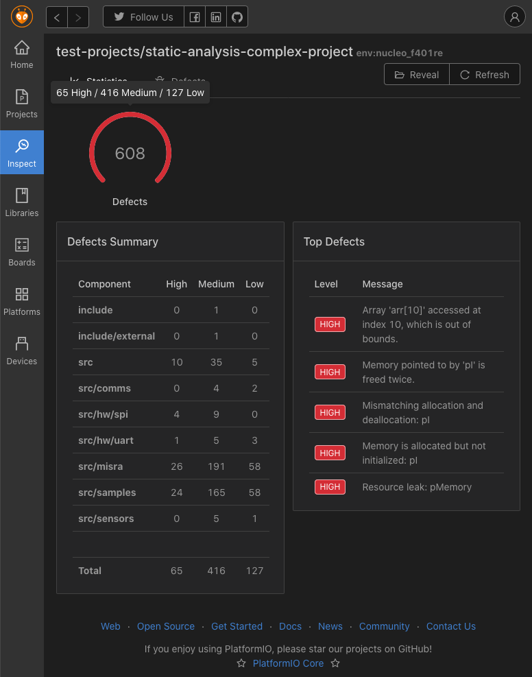
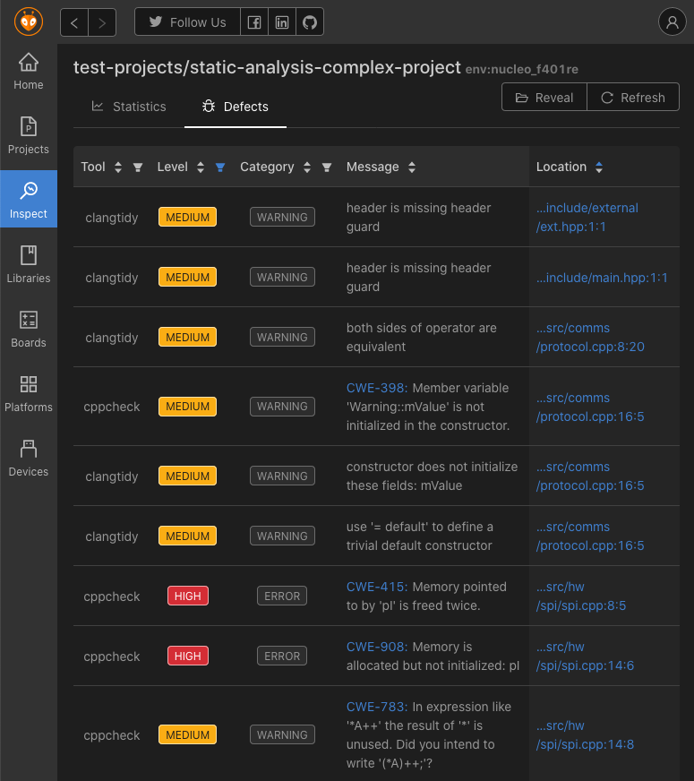

# Static code analysis

Static code analysis finds defects in C and C++ source code without running
it: possible null pointer dereferences, out-of-bounds indexing, reads of
uninitialized variables, suspicious assignments, unused code and more. It can
also check coding standards such as MISRA and CERT.

PlatformIO runs [Cppcheck](./tools/cppcheck.md) and
[Clang-Tidy](./tools/clang-tidy.md) on your project with the same include
paths and macros as the build, for any development platform, and reports the
results by [severity](./severity.md).

:::note

Make sure the project builds without errors before you analyze it.

:::

## Run an analysis {#run-an-analysis}

From the command line, run [`pio check`](../../reference/cli/pio-check.md) in
the project directory:

```bash
pio check
```

<a id="user-interface"></a>

In PlatformIO IDE, open [PlatformIO Home](../../get-started/platformio-home.md),
go to **Inspect**, select the project and enable code analysis. You can filter
the results and jump from a defect to the source line:





<a id="configuration"></a>

## Configuration {#check-configuration}

Configure the analysis per project environment with these
[`platformio.ini` options](../../reference/platformio-ini/env/check-options.md):

| Option | Purpose |
| --- | --- |
| [`check_tool`](../../reference/platformio-ini/env/check-tool.md) | The tools to run: `cppcheck`, `clangtidy`, or both |
| [`check_flags`](../../reference/platformio-ini/env/check-flags.md) | Extra flags for the tools |
| [`check_severity`](../../reference/platformio-ini/env/check-severity.md) | The [severities](./severity.md) to report |
| [`check_src_filters`](../../reference/platformio-ini/env/check-src-filters.md) | The files to analyze |
| [`check_skip_packages`](../../reference/platformio-ini/env/check-skip-packages.md) | Do not pass framework and toolchain include paths to the tools |

The [`pio check`](../../reference/cli/pio-check.md) options override these for
one run.

To use a specific version of a tool, set it with
[`platform_packages`](../../reference/platformio-ini/env/platform-packages.md).
Available versions are listed in the
[PlatformIO Registry](https://registry.platformio.org/):

```ini
[env:myenv]
platform = ...
board = ...
check_tool = cppcheck
platform_packages = tool-cppcheck@1.260.0
```

<a id="cli"></a>

## More {#more}

- [Defect severity](./severity.md)
- [Check tools](./tools/index.md): [Cppcheck](./tools/cppcheck.md) and
  [Clang-Tidy](./tools/clang-tidy.md)
