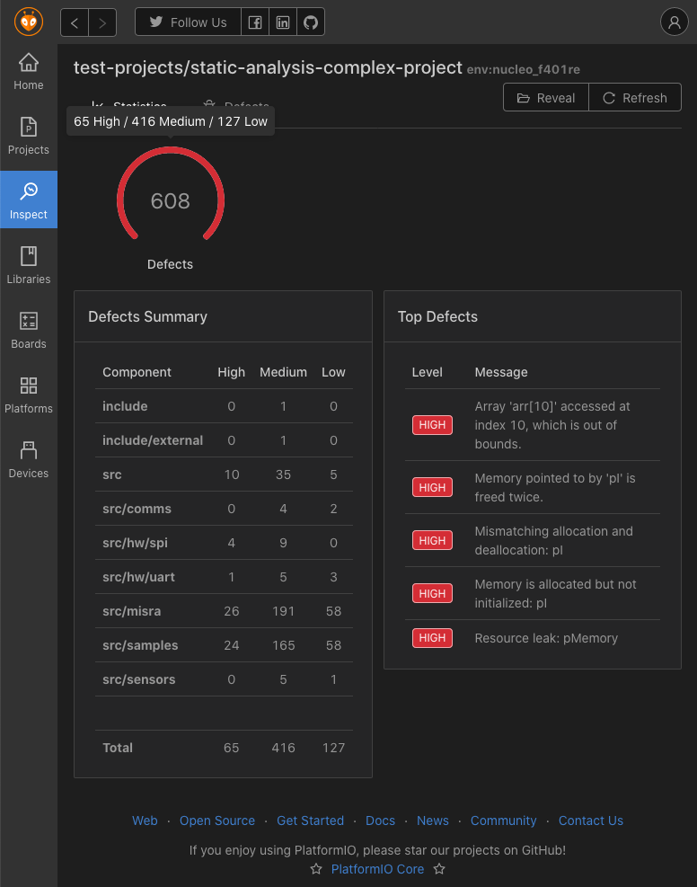
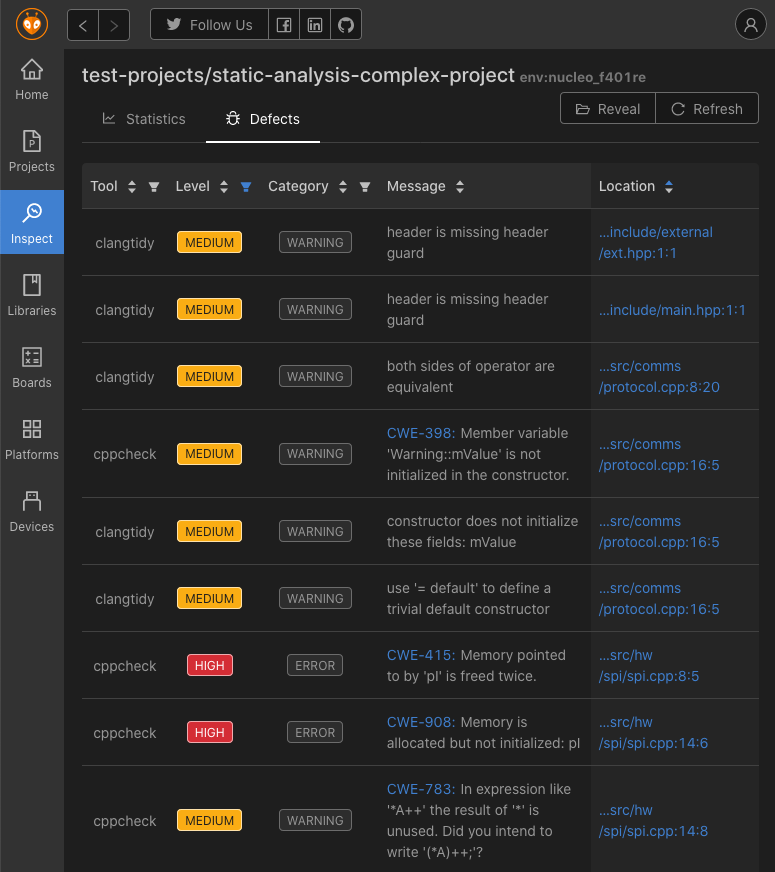

# User Interface {#user-interface}

There is the rich and friendly interface for **Static Code Analysis** in [PlatformIO Home](../../get-started/platformio-home.md). It allows you to filter messages or directly jump to an issue in a source code.

