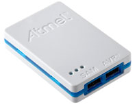

# Atmel-ICE

[](https://www.microchip.com/DevelopmentTools/ProductDetails/PartNo/atatmel-ice?PartNO=atatmel-ice&utm_source=platformio&utm_medium=docs)

Atmel-ICE is a powerful development tool for debugging and programming ARM® Cortex®-M based SAM and AVR microcontrollers with on-chip debug capability. See the [official documentation](https://www.microchip.com/DevelopmentTools/ProductDetails/PartNo/atatmel-ice?PartNO=atatmel-ice&utm_source=platformio&utm_medium=docs).

## Configuration {#configuration}

Select this probe with the [`debug_tool`](../../reference/platformio-ini/env/debug-tool.md) option in [`platformio.ini`](../../reference/platformio-ini/index.md):

```ini
[env:myenv]
platform = ...
board = ...
debug_tool = atmel-ice
```

To also upload firmware with this probe, set [`upload_protocol`](../../reference/platformio-ini/env/upload-protocol.md):

```ini
[env:myenv]
platform = ...
board = ...
debug_tool = atmel-ice
upload_protocol = atmel-ice
```

See also:

- [Debugging options](../../reference/platformio-ini/env/debug-options.md)
- [Upload options](../../reference/platformio-ini/env/upload-options.md)

## Drivers {#drivers}

| Operating system | Driver |
| --- | --- |
| Windows | When installing the Atmel-ICE on a computer running Microsoft Windows, the USB driver is loaded when the Atmel-ICE is first plugged in. |
| macOS | Not required. |
| Linux | Install the [udev rules](../../get-started/install/udev-rules.md). If you installed them before, update them to the latest version. |

<!-- begin_platforms -->

## Platforms

| Name | Description |
|---|---|
| [Atmel SAM](../platforms/atmelsam.md) | Atmel \| SMART offers Flash- based ARM products based on the ARM Cortex-M0+, Cortex-M3 and Cortex-M4 architectures, ranging from 8KB to 2MB of Flash including a rich peripheral and feature mix. |

## Frameworks

| Name | Description |
|---|---|
| [Arduino](../frameworks/arduino.mdx) | Arduino Wiring-based Framework allows writing cross-platform software to control devices attached to a wide range of Arduino boards to create all kinds of creative coding, interactive objects, spaces or physical experiences. |
| [Zephyr](../frameworks/zephyr.mdx) | Zephyr is a new generation, scalable, optimized, secure RTOS for multiple hardware architectures |

## Boards

| Name | Platform | Debug | MCU | Frequency | Flash | RAM |
|---|---|---|---|---|---|---|
| [Adafruit BLM Badge](../boards/atmelsam/adafruit-blm-badge.md) | [Atmel SAM](../platforms/atmelsam.md) | External | SAMD21E18A | 48MHz | 256KB | 32KB |
| [Adafruit Circuit Playground Express](../boards/atmelsam/adafruit-circuitplayground-m0.md) | [Atmel SAM](../platforms/atmelsam.md) | External | SAMD21G18A | 48MHz | 256KB | 32KB |
| [Adafruit Crickit M0](../boards/atmelsam/adafruit-crickit-m0.md) | [Atmel SAM](../platforms/atmelsam.md) | External | SAMD21G18A | 48MHz | 256KB | 32KB |
| [Adafruit Feather M0](../boards/atmelsam/adafruit-feather-m0.md) | [Atmel SAM](../platforms/atmelsam.md) | External | SAMD21G18A | 48MHz | 256KB | 32KB |
| [Adafruit Feather M0 Express](../boards/atmelsam/adafruit-feather-m0-express.md) | [Atmel SAM](../platforms/atmelsam.md) | External | SAMD21G18A | 48MHz | 256KB | 32KB |
| [Adafruit Feather M4 CAN](../boards/atmelsam/adafruit-feather-m4-can.md) | [Atmel SAM](../platforms/atmelsam.md) | External | SAME51J19A | 120MHz | 496KB | 192KB |
| [Adafruit Feather M4 Express](../boards/atmelsam/adafruit-feather-m4.md) | [Atmel SAM](../platforms/atmelsam.md) | External | SAMD51J19A | 120MHz | 512KB | 192KB |
| [Adafruit Gemma M0](../boards/atmelsam/adafruit-gemma-m0.md) | [Atmel SAM](../platforms/atmelsam.md) | External | SAMD21E18A | 48MHz | 256KB | 32KB |
| [Adafruit Grand Central M4](../boards/atmelsam/adafruit-grandcentral-m4.md) | [Atmel SAM](../platforms/atmelsam.md) | External | SAMD51P20A | 120MHz | 1MB | 256KB |
| [Adafruit Hallowing M0](../boards/atmelsam/adafruit-hallowing.md) | [Atmel SAM](../platforms/atmelsam.md) | External | SAMD21G18A | 48MHz | 256KB | 32KB |
| [Adafruit Hallowing M4](../boards/atmelsam/adafruit-hallowing-m4.md) | [Atmel SAM](../platforms/atmelsam.md) | External | SAMD51J19A | 120MHz | 496KB | 192KB |
| [Adafruit ItsyBitsy M0](../boards/atmelsam/adafruit-itsybitsy-m0.md) | [Atmel SAM](../platforms/atmelsam.md) | External | SAMD21G18A | 48MHz | 256KB | 32KB |
| [Adafruit ItsyBitsy M4](../boards/atmelsam/adafruit-itsybitsy-m4.md) | [Atmel SAM](../platforms/atmelsam.md) | External | SAMD51G19A | 120MHz | 512KB | 192KB |
| [Adafruit MONSTER M4SK](../boards/atmelsam/adafruit-monster-m4sk.md) | [Atmel SAM](../platforms/atmelsam.md) | External | SAMD51G19A | 120MHz | 496KB | 192KB |
| [Adafruit Matrix Portal M4](../boards/atmelsam/adafruit-matrix-portal-m4.md) | [Atmel SAM](../platforms/atmelsam.md) | External | SAMD51J19A | 120MHz | 496KB | 192KB |
| [Adafruit Metro M0 Express](../boards/atmelsam/adafruit-metro-m0.md) | [Atmel SAM](../platforms/atmelsam.md) | External | SAMD21G18A | 48MHz | 256KB | 32KB |
| [Adafruit Metro M4](../boards/atmelsam/adafruit-metro-m4.md) | [Atmel SAM](../platforms/atmelsam.md) | External | SAMD51J19A | 120MHz | 512KB | 192KB |
| [Adafruit Metro M4 AirLift Lite](../boards/atmelsam/adafruit-metro-m4-airliftlite.md) | [Atmel SAM](../platforms/atmelsam.md) | External | SAMD51J19A | 120MHz | 512KB | 192KB |
| [Adafruit NeoKey Trinkey](../boards/atmelsam/adafruit-neokeytrinkey-m0.md) | [Atmel SAM](../platforms/atmelsam.md) | External | SAMD21E18A | 48MHz | 256KB | 32KB |
| [Adafruit NeoPixel Trinkey](../boards/atmelsam/adafruit-neotrinkey-m0.md) | [Atmel SAM](../platforms/atmelsam.md) | External | SAMD21E18A | 48MHz | 256KB | 32KB |
| [Adafruit ProxLight Trinkey](../boards/atmelsam/adafruit-proxlighttrinkey-m0.md) | [Atmel SAM](../platforms/atmelsam.md) | External | SAMD21E18A | 48MHz | 256KB | 32KB |
| [Adafruit PyGamer Advance M4](../boards/atmelsam/adafruit-pygamer-advance-m4.md) | [Atmel SAM](../platforms/atmelsam.md) | External | SAMD51J20A | 120MHz | 1MB | 256KB |
| [Adafruit PyGamer M4 Express](../boards/atmelsam/adafruit-pygamer-m4.md) | [Atmel SAM](../platforms/atmelsam.md) | External | SAMD51J19A | 120MHz | 512KB | 192KB |
| [Adafruit PyPortal M4](../boards/atmelsam/adafruit-pyportal-m4.md) | [Atmel SAM](../platforms/atmelsam.md) | External | SAMD51J20A | 120MHz | 1MB | 256KB |
| [Adafruit PyPortal M4 Titano](../boards/atmelsam/adafruit-pyportal-m4-titano.md) | [Atmel SAM](../platforms/atmelsam.md) | External | SAMD51J20A | 120MHz | 1MB | 256KB |
| [Adafruit QT Py M0](../boards/atmelsam/adafruit-qt-py-m0.md) | [Atmel SAM](../platforms/atmelsam.md) | External | SAMD21E18A | 48MHz | 256KB | 32KB |
| [Adafruit Rotary Trinkey](../boards/atmelsam/adafruit-rotarytrinkey-m0.md) | [Atmel SAM](../platforms/atmelsam.md) | External | SAMD21E18A | 48MHz | 256KB | 32KB |
| [Adafruit Slide Trinkey](../boards/atmelsam/adafruit-slidetrinkey-m0.md) | [Atmel SAM](../platforms/atmelsam.md) | External | SAMD21E18A | 48MHz | 256KB | 32KB |
| [Adafruit Trellis M4](../boards/atmelsam/adafruit-trellis-m4.md) | [Atmel SAM](../platforms/atmelsam.md) | External | SAMD51J19A | 120MHz | 512KB | 192KB |
| [Adafruit Trinket M0](../boards/atmelsam/adafruit-trinket-m0.md) | [Atmel SAM](../platforms/atmelsam.md) | External | SAMD21E18A | 48MHz | 256KB | 32KB |
| [Adafruit pIRkey](../boards/atmelsam/adafruit-pirkey.md) | [Atmel SAM](../platforms/atmelsam.md) | External | SAMD21E18A | 48MHz | 256KB | 32KB |
| [Adafruit pyBadge AirLift M4](../boards/atmelsam/adafruit-pybadge-airlift-m4.md) | [Atmel SAM](../platforms/atmelsam.md) | External | SAMD51J20A | 120MHz | 1008KB | 192KB |
| [Adafruit pyBadge M4 Express](../boards/atmelsam/adafruit-pybadge-m4.md) | [Atmel SAM](../platforms/atmelsam.md) | External | SAMD51J19A | 120MHz | 512KB | 192KB |
| [Arduino Due (Programming Port)](../boards/atmelsam/due.md) | [Atmel SAM](../platforms/atmelsam.md) | External | AT91SAM3X8E | 84MHz | 512KB | 96KB |
| [Arduino Due (USB Native Port)](../boards/atmelsam/dueusb.md) | [Atmel SAM](../platforms/atmelsam.md) | External | AT91SAM3X8E | 84MHz | 512KB | 96KB |
| [Arduino M0](../boards/atmelsam/mzerousb.md) | [Atmel SAM](../platforms/atmelsam.md) | External | SAMD21G18A | 48MHz | 256KB | 32KB |
| [Arduino M0 Pro (Native USB Port)](../boards/atmelsam/mzeroprousb.md) | [Atmel SAM](../platforms/atmelsam.md) | External | SAMD21G18A | 48MHz | 256KB | 32KB |
| [Arduino M0 Pro (Programming/Debug Port)](../boards/atmelsam/mzeropro.md) | [Atmel SAM](../platforms/atmelsam.md) | On-board | SAMD21G18A | 48MHz | 256KB | 32KB |
| [Arduino MKR FOX 1200](../boards/atmelsam/mkrfox1200.md) | [Atmel SAM](../platforms/atmelsam.md) | External | SAMD21G18A | 48MHz | 256KB | 32KB |
| [Arduino MKR GSM 1400](../boards/atmelsam/mkrgsm1400.md) | [Atmel SAM](../platforms/atmelsam.md) | External | SAMD21G18A | 48MHz | 256KB | 32KB |
| [Arduino MKR NB 1500](../boards/atmelsam/mkrnb1500.md) | [Atmel SAM](../platforms/atmelsam.md) | External | SAMD21G18A | 48MHz | 256KB | 32KB |
| [Arduino MKR WAN 1300](../boards/atmelsam/mkrwan1300.md) | [Atmel SAM](../platforms/atmelsam.md) | External | SAMD21G18A | 48MHz | 256KB | 32KB |
| [Arduino MKR WAN 1310](../boards/atmelsam/mkrwan1310.md) | [Atmel SAM](../platforms/atmelsam.md) | External | SAMD21G18A | 48MHz | 256KB | 32KB |
| [Arduino MKR WiFi 1010](../boards/atmelsam/mkrwifi1010.md) | [Atmel SAM](../platforms/atmelsam.md) | External | SAMD21G18A | 48MHz | 256KB | 32KB |
| [Arduino MKR1000](../boards/atmelsam/mkr1000usb.md) | [Atmel SAM](../platforms/atmelsam.md) | External | SAMD21G18A | 48MHz | 256KB | 32KB |
| [Arduino MKRZERO](../boards/atmelsam/mkrzero.md) | [Atmel SAM](../platforms/atmelsam.md) | External | SAMD21G18A | 48MHz | 256KB | 32KB |
| [Arduino Tian](../boards/atmelsam/tian.md) | [Atmel SAM](../platforms/atmelsam.md) | External | SAMD21G18A | 48MHz | 256KB | 32KB |
| [Arduino Zero (Programming/Debug Port)](../boards/atmelsam/zero.md) | [Atmel SAM](../platforms/atmelsam.md) | On-board | SAMD21G18A | 48MHz | 256KB | 32KB |
| [Arduino Zero (USB Native Port)](../boards/atmelsam/zerousb.md) | [Atmel SAM](../platforms/atmelsam.md) | External | SAMD21G18A | 48MHz | 256KB | 32KB |
| [Atmel ATSAMR21-XPRO](../boards/atmelsam/samr21-xpro.md) | [Atmel SAM](../platforms/atmelsam.md) | On-board | SAMR21G18A | 48MHz | 256KB | 32KB |
| [Atmel ATSAMW25-XPRO](../boards/atmelsam/samd21g18a.md) | [Atmel SAM](../platforms/atmelsam.md) | On-board | SAMD21G18A | 48MHz | 256KB | 32KB |
| [Atmel SAMC21-XPRO](../boards/atmelsam/samc21-xpro.md) | [Atmel SAM](../platforms/atmelsam.md) | On-board | SAMC21J18A | 48MHz | 256KB | 32KB |
| [Atmel SAMD21-XPRO](../boards/atmelsam/samd21-xpro.md) | [Atmel SAM](../platforms/atmelsam.md) | On-board | SAMD21J18A | 48MHz | 256KB | 32KB |
| [Digistump DigiX](../boards/atmelsam/digix.md) | [Atmel SAM](../platforms/atmelsam.md) | External | AT91SAM3X8E | 84MHz | 512KB | 96KB |
| [MKR Vidor 4000](../boards/atmelsam/mkrvidor4000.md) | [Atmel SAM](../platforms/atmelsam.md) | External | SAMD21G18A | 48MHz | 256KB | 32KB |
| [Minitronics v2.0](../boards/atmelsam/minitronics20.md) | [Atmel SAM](../platforms/atmelsam.md) | External | SAMD21J18A | 48MHz | 256KB | 32KB |
| [Moteino M0](../boards/atmelsam/moteino-zero.md) | [Atmel SAM](../platforms/atmelsam.md) | External | SAMD21G18A | 48MHz | 256KB | 32KB |
| [NANO 33 IoT](../boards/atmelsam/nano-33-iot.md) | [Atmel SAM](../platforms/atmelsam.md) | External | SAMD21G18A | 48MHz | 256KB | 32KB |
| [SODAQ Autonomo](../boards/atmelsam/sodaq-autonomo.md) | [Atmel SAM](../platforms/atmelsam.md) | External | SAMD21J18A | 48MHz | 256KB | 32KB |
| [SODAQ ExpLoRer](../boards/atmelsam/sodaq-explorer.md) | [Atmel SAM](../platforms/atmelsam.md) | External | SAMD21J18A | 48MHz | 256KB | 32KB |
| [SODAQ ONE](../boards/atmelsam/sodaq-one.md) | [Atmel SAM](../platforms/atmelsam.md) | External | SAMD21G18A | 48MHz | 256KB | 32KB |
| [SODAQ SARA](../boards/atmelsam/sodaq-sara.md) | [Atmel SAM](../platforms/atmelsam.md) | External | SAMD21J18A | 48MHz | 256KB | 32KB |
| [SODAQ SFF](../boards/atmelsam/sodaq-sff.md) | [Atmel SAM](../platforms/atmelsam.md) | External | SAMD21G18A | 48MHz | 256KB | 32KB |
| [SainSmart Due (Programming Port)](../boards/atmelsam/sainsmartdue.md) | [Atmel SAM](../platforms/atmelsam.md) | External | AT91SAM3X8E | 84MHz | 512KB | 96KB |
| [SainSmart Due (USB Native Port)](../boards/atmelsam/sainsmartdueusb.md) | [Atmel SAM](../platforms/atmelsam.md) | External | AT91SAM3X8E | 84MHz | 512KB | 96KB |
| [Seeeduino Femto M0](../boards/atmelsam/seeed-femto.md) | [Atmel SAM](../platforms/atmelsam.md) | External | SAMD21G18A | 48MHz | 256KB | 32KB |
| [Seeeduino LoRaWAN](../boards/atmelsam/seeeduino-lorawan.md) | [Atmel SAM](../platforms/atmelsam.md) | External | SAMD21G18A | 48MHz | 256KB | 32KB |
| [Seeeduino Wio Lite MG126](../boards/atmelsam/seeed-wio-lite-mg126.md) | [Atmel SAM](../platforms/atmelsam.md) | External | SAMD21G18A | 48MHz | 256KB | 32KB |
| [Seeeduino Wio Terminal](../boards/atmelsam/seeed-wio-terminal.md) | [Atmel SAM](../platforms/atmelsam.md) | External | SAMD51P19A | 120MHz | 496KB | 192KB |
| [Seeeduino XIAO](../boards/atmelsam/seeed-xiao.md) | [Atmel SAM](../platforms/atmelsam.md) | External | SAMD21G18A | 48MHz | 256KB | 32KB |
| [Seeeduino Zero](../boards/atmelsam/seeed-zero.md) | [Atmel SAM](../platforms/atmelsam.md) | External | SAMD21G18A | 48MHz | 256KB | 32KB |
| [SparkFun 9DoF Razor IMU M0](../boards/atmelsam/sparkfun-samd21-9dof.md) | [Atmel SAM](../platforms/atmelsam.md) | External | SAMD21G18A | 48MHz | 256KB | 32KB |
| [SparkFun Qwiic Micro](../boards/atmelsam/sparkfun-qwiic-micro-samd21e.md) | [Atmel SAM](../platforms/atmelsam.md) | External | SAMD21E18A | 48MHz | 256KB | 32KB |
| [SparkFun RedBoard Turbo](../boards/atmelsam/sparkfun-redboard-turbo.md) | [Atmel SAM](../platforms/atmelsam.md) | External | SAMD21G18A | 48MHz | 256KB | 32KB |
| [SparkFun SAMD21 Dev Breakout](../boards/atmelsam/sparkfun-samd21-dev-usb.md) | [Atmel SAM](../platforms/atmelsam.md) | External | SAMD21G18A | 48MHz | 256KB | 32KB |
| [SparkFun SAMD21 Mini Breakout](../boards/atmelsam/sparkfun-samd21-mini-usb.md) | [Atmel SAM](../platforms/atmelsam.md) | External | SAMD21G18A | 48MHz | 256KB | 32KB |
| [SparkFun SAMD21 Pro RF](../boards/atmelsam/sparkfun-samd21-prorf.md) | [Atmel SAM](../platforms/atmelsam.md) | External | SAMD21G18A | 48MHz | 256KB | 32KB |
| [SparkFun SAMD51 MicroMod](../boards/atmelsam/sparkfun-samd51-micromod.md) | [Atmel SAM](../platforms/atmelsam.md) | External | SAMD51J20A | 120MHz | 496KB | 192KB |
| [SparkFun SAMD51 Thing Plus](../boards/atmelsam/sparkfun-samd51-thing-plus.md) | [Atmel SAM](../platforms/atmelsam.md) | External | SAMD51J20A | 120MHz | 496KB | 192KB |
| [Tuino 096](../boards/atmelsam/tuinozero96.md) | [Atmel SAM](../platforms/atmelsam.md) | External | SAMD21G18A | 48MHz | 256KB | 32KB |
