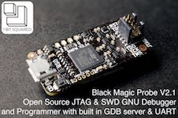
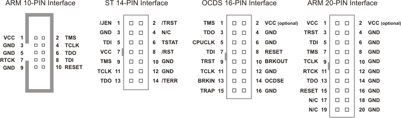
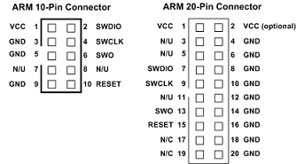

# Black magic probe

[](https://github.com/blacksphere/blackmagic/wiki?utm_source=platformio&utm_medium=docs)

The Black Magic Probe is a modern, in-application debugging tool for embedded microprocessors. It is able to control and examine the state of the target microprocessor using a JTAG or Serial Wire Debugging (SWD) port and on-chip debug logic provided by the microprocessor. The probe connects to a host computer using a standard USB interface. See the [official documentation](https://github.com/blacksphere/blackmagic/wiki?utm_source=platformio&utm_medium=docs).

Also, see [Custom](./custom.md) debugging configuration with Black Magic Probe.

## Configuration {#configuration}

Select this probe with the [`debug_tool`](../../reference/platformio-ini/env/debug-tool.md) option in [`platformio.ini`](../../reference/platformio-ini/index.md):

```ini
[env:myenv]
platform = ...
board = ...
debug_tool = blackmagic
debug_port = <CONFIGURE GDB PORT>

;
; Debug Port Examples
;

; Linux
debug_port = /dev/ttyACM0

; Windows for COM1-COM9
debug_port = COM3
; Windows for COM10-XXX
debug_port = \\.\COM13

; macOS
debug_port = /dev/cu.usbmodemE2C0C4C6
```

Black Magic Probe has 2 serial ports: UART and GDB. We will need "GDB" port. Use [PlatformIO Home](../../get-started/platformio-home.md) > Devices or [PlatformIO Core (CLI)](../../get-started/platformio-core.md) and [pio device list](../../reference/cli/pio-device/list.md) command to list available ports. If you do not see "Black Magic Probe GDB" port, please try both. More [details](https://github.com/blacksphere/blackmagic/wiki/Useful-GDB-commands#connecting-gdb-to-the-black-magic-probe).

To also upload firmware with this probe, set [`upload_protocol`](../../reference/platformio-ini/env/upload-protocol.md):

```ini
[env:myenv]
platform = ...
board = ...
debug_tool = blackmagic
debug_port = <CONFIGURE GDB PORT>

upload_port = <THE SAME AS DEBUG PORT>

; SWD interface
upload_protocol = blackmagic

; JTAG interface
upload_protocol = blackmagic-jtag
```

See also:

- [Debugging options](../../reference/platformio-ini/env/debug-options.md)
- [Upload options](../../reference/platformio-ini/env/upload-options.md)

## Drivers {#drivers}

Not required.

## Wiring connections {#wiring-connections}

### JTAG interface {#jtag-interface}



| Black Magic Probe 10-Pin Connector | Board JTAG Pin | Description |
|---|---|---|
| 1 | VCC | Positive Supply Voltage — Power supply for JTAG interface drivers |
| 3 | GND | Digital ground |
| 2 | TMS | Test Mode State |
| 4 | TCLK | JTAG Return Test Clock |
| 6 | TDO | Test Data Out |
| 8 | TDI | Test Data In |
| 10 | RESET | Connect this pin to the (active low) reset input of the target CPU |

### Serial wire mode interface (SWD) {#serial-wire-mode-interface-swd}



| Black Magic Probe 10-Pin Connector | Board SWD Pin | Description |
|---|---|---|
| 1 | VCC | Positive Supply Voltage — Power supply for JTAG interface drivers |
| 3 | GND | Digital ground |
| 2 | SWDIO | Data I/O |
| 4 | SWCLK | Clock |
| 10 | RESET | Connect this pin to the (active low) reset input of the target CPU |

<!-- begin_platforms -->

## Platforms

| Name | Description |
|---|---|
| [Atmel SAM](../platforms/atmelsam.md) | Atmel \| SMART offers Flash- based ARM products based on the ARM Cortex-M0+, Cortex-M3 and Cortex-M4 architectures, ranging from 8KB to 2MB of Flash including a rich peripheral and feature mix. |
| [Freescale Kinetis](../platforms/freescalekinetis.md) | Freescale Kinetis Microcontrollers is family of multiple hardware- and software-compatible ARM Cortex-M0+, Cortex-M4 and Cortex-M7-based MCU series. Kinetis MCUs offer exceptional low-power performance, scalability and feature integration. |
| [Nordic nRF51](../platforms/nordicnrf51.md) | The Nordic nRF51 Series is a family of highly flexible, multi-protocol, system-on-chip (SoC) devices for ultra-low power wireless applications. nRF51 Series devices support a range of protocol stacks including Bluetooth Smart (previously called Bluetooth low energy), ANT and proprietary 2.4GHz protocols such as Gazell. |
| [Nordic nRF52](../platforms/nordicnrf52.mdx) | The nRF52 Series are built for speed to carry out increasingly complex tasks in the shortest possible time and return to sleep, conserving precious battery power. They have a Cortex-M4F processor which makes them quite capable Bluetooth Smart SoCs. |
| [NXP i.MX RT](../platforms/nxpimxrt.md) | The i.MX RT series of crossover processors features the Arm Cortex-M core, real-time functionality and MCU usability at a cost-effective price. |
| [NXP LPC](../platforms/nxplpc.md) | The NXP LPC is a family of 32-bit microcontroller integrated circuits by NXP Semiconductors. The LPC chips are grouped into related series that are based around the same 32-bit ARM processor core, such as the Cortex-M4F, Cortex-M3, Cortex-M0+, or Cortex-M0. Internally, each microcontroller consists of the processor core, static RAM memory, flash memory, debugging interface, and various peripherals. |
| [Silicon Labs EFM32](../platforms/siliconlabsefm32.md) | Silicon Labs EFM32 Gecko 32-bit microcontroller (MCU) family includes devices that offer flash memory configurations up to 256 kB, 32 kB of RAM and CPU speeds up to 48 MHz. Based on the powerful ARM Cortex-M core, the Gecko family features innovative low energy techniques, short wake-up time from energy saving modes and a wide selection of peripherals, making it ideal for battery operated applications and other systems requiring high performance and low-energy consumption. |
| [ST STM32](../platforms/ststm32.mdx) | The STM32 family of 32-bit Flash MCUs based on the ARM Cortex-M processor is designed to offer new degrees of freedom to MCU users. It offers a 32-bit product range that combines very high performance, real-time capabilities, digital signal processing, and low-power, low-voltage operation, while maintaining full integration and ease of development. |

## Frameworks

| Name | Description |
|---|---|
| [Arduino](../frameworks/arduino.mdx) | Arduino Wiring-based Framework allows writing cross-platform software to control devices attached to a wide range of Arduino boards to create all kinds of creative coding, interactive objects, spaces or physical experiences. |
| [CMSIS](../frameworks/cmsis.md) | Vendor-independent hardware abstraction layer for the Cortex-M processor series |
| [LibOpenCM3](../frameworks/libopencm3.md) | The libopencm3 project aims to create an open-source firmware library for various ARM Cortex-M microcontrollers. |
| [Mbed](../frameworks/mbed.mdx) | Arm Mbed OS is a platform operating system designed for the internet of things |
| [Standard Peripheral Library](../frameworks/spl.mdx) | Standard Peripheral Library for ST STM32 microcontrollers |
| [STM32Cube](../frameworks/stm32cube.mdx) | STM32Cube embedded software libraries, including: The HAL hardware abstraction layer, enabling portability between different STM32 devices via standardized API calls; The Low-Layer (LL) APIs, a light-weight, optimized, expert oriented set of APIs designed for both performance and runtime efficiency |
| [Zephyr](../frameworks/zephyr.mdx) | Zephyr is a new generation, scalable, optimized, secure RTOS for multiple hardware architectures |

## Boards

| Name | Platform | Debug | MCU | Frequency | Flash | RAM |
|---|---|---|---|---|---|---|
| [1Bitsy](../boards/ststm32/1bitsy-stm32f415rgt.md) | [ST STM32](../platforms/ststm32.mdx) | External | STM32F415RGT | 168MHz | 1MB | 128KB |
| [32F412GDISCOVERY](../boards/ststm32/disco-f412zg.md) | [ST STM32](../platforms/ststm32.mdx) | On-board | STM32F412ZGT6 | 100MHz | 1MB | 256KB |
| [32F723EDISCOVERY](../boards/ststm32/disco-f723ie.md) | [ST STM32](../platforms/ststm32.mdx) | On-board | STM32F723IEK6 | 216MHz | 512KB | 192KB |
| [3D Printer Controller](../boards/ststm32/armed-v1.md) | [ST STM32](../platforms/ststm32.mdx) | External | STM32F407VET6 | 168MHz | 512KB | 128KB |
| [3D Printer control board](../boards/ststm32/rumba32-f446ve.md) | [ST STM32](../platforms/ststm32.mdx) | External | STM32F446RET6 | 180MHz | 512KB | 128KB |
| [3D printer controller](../boards/ststm32/remram-v1.md) | [ST STM32](../platforms/ststm32.mdx) | On-board | STM32F765VIT6 | 216MHz | 2MB | 512KB |
| [3DP001V1 Evaluation board for 3D printer](../boards/ststm32/st3dp001-eval.md) | [ST STM32](../platforms/ststm32.mdx) | On-board | STM32F401VET6 | 84MHz | 512KB | 96KB |
| [96Boards Argonkey (STEVAL-MKI187V1)](../boards/ststm32/b96b-argonkey.md) | [ST STM32](../platforms/ststm32.mdx) | External | STM32F412CG | 100MHz | 1MB | 256KB |
| [96Boards B96B-F446VE](../boards/ststm32/b96b-f446ve.md) | [ST STM32](../platforms/ststm32.mdx) | On-board | STM32F446VET6 | 168MHz | 512KB | 128KB |
| [96Boards Neonkey](../boards/ststm32/b96b-aerocore2.md) | [ST STM32](../platforms/ststm32.mdx) | External | STM32F427VIT6 | 168MHz | 1.99MB | 256KB |
| [96Boards Neonkey](../boards/ststm32/b96b-neonkey.md) | [ST STM32](../platforms/ststm32.mdx) | External | STM32F411CE | 100MHz | 512KB | 128KB |
| [96Boards Nitrogen](../boards/nordicnrf52/96b-nitrogen.md) | [Nordic nRF52](../platforms/nordicnrf52.mdx) | External | NRF52832 | 64MHz | 512KB | 64KB |
| [ACSIP S76S](../boards/ststm32/acsip-s76s.md) | [ST STM32](../platforms/ststm32.mdx) | External | STM32L073RZ | 32MHz | 192KB | 20KB |
| [Adafruit BLM Badge](../boards/atmelsam/adafruit-blm-badge.md) | [Atmel SAM](../platforms/atmelsam.md) | External | SAMD21E18A | 48MHz | 256KB | 32KB |
| [Adafruit Bluefruit nRF52832 Feather](../boards/nordicnrf52/adafruit-feather-nrf52832.md) | [Nordic nRF52](../platforms/nordicnrf52.mdx) | External | NRF52832 | 64MHz | 512KB | 64KB |
| [Adafruit CLUE nRF52840](../boards/nordicnrf52/adafruit-clue-nrf52840.md) | [Nordic nRF52](../platforms/nordicnrf52.mdx) | External | NRF52840 | 64MHz | 796KB | 243KB |
| [Adafruit Circuit Playground Express](../boards/atmelsam/adafruit-circuitplayground-m0.md) | [Atmel SAM](../platforms/atmelsam.md) | External | SAMD21G18A | 48MHz | 256KB | 32KB |
| [Adafruit Crickit M0](../boards/atmelsam/adafruit-crickit-m0.md) | [Atmel SAM](../platforms/atmelsam.md) | External | SAMD21G18A | 48MHz | 256KB | 32KB |
| [Adafruit Feather Bluefruit Sense](../boards/nordicnrf52/adafruit-feather-nrf52840-sense.md) | [Nordic nRF52](../platforms/nordicnrf52.mdx) | External | NRF52840 | 64MHz | 796KB | 243KB |
| [Adafruit Feather M0](../boards/atmelsam/adafruit-feather-m0.md) | [Atmel SAM](../platforms/atmelsam.md) | External | SAMD21G18A | 48MHz | 256KB | 32KB |
| [Adafruit Feather M0 Express](../boards/atmelsam/adafruit-feather-m0-express.md) | [Atmel SAM](../platforms/atmelsam.md) | External | SAMD21G18A | 48MHz | 256KB | 32KB |
| [Adafruit Feather STM32F405](../boards/ststm32/adafruit-feather-f405.md) | [ST STM32](../platforms/ststm32.mdx) | External | STM32F405RGT6 | 168MHz | 1MB | 128KB |
| [Adafruit Feather nRF52840 Express](../boards/nordicnrf52/adafruit-feather-nrf52840.md) | [Nordic nRF52](../platforms/nordicnrf52.mdx) | External | NRF52840 | 64MHz | 796KB | 243KB |
| [Adafruit Gemma M0](../boards/atmelsam/adafruit-gemma-m0.md) | [Atmel SAM](../platforms/atmelsam.md) | External | SAMD21E18A | 48MHz | 256KB | 32KB |
| [Adafruit Hallowing M0](../boards/atmelsam/adafruit-hallowing.md) | [Atmel SAM](../platforms/atmelsam.md) | External | SAMD21G18A | 48MHz | 256KB | 32KB |
| [Adafruit ItsyBitsy M0](../boards/atmelsam/adafruit-itsybitsy-m0.md) | [Atmel SAM](../platforms/atmelsam.md) | External | SAMD21G18A | 48MHz | 256KB | 32KB |
| [Adafruit LED Glasses Driver nRF52840](../boards/nordicnrf52/adafruit-ledglasses-nrf52840.md) | [Nordic nRF52](../platforms/nordicnrf52.mdx) | External | NRF52840 | 64MHz | 796KB | 232KB |
| [Adafruit Metro M0 Express](../boards/atmelsam/adafruit-metro-m0.md) | [Atmel SAM](../platforms/atmelsam.md) | External | SAMD21G18A | 48MHz | 256KB | 32KB |
| [Adafruit NeoKey Trinkey](../boards/atmelsam/adafruit-neokeytrinkey-m0.md) | [Atmel SAM](../platforms/atmelsam.md) | External | SAMD21E18A | 48MHz | 256KB | 32KB |
| [Adafruit NeoPixel Trinkey](../boards/atmelsam/adafruit-neotrinkey-m0.md) | [Atmel SAM](../platforms/atmelsam.md) | External | SAMD21E18A | 48MHz | 256KB | 32KB |
| [Adafruit ProxLight Trinkey](../boards/atmelsam/adafruit-proxlighttrinkey-m0.md) | [Atmel SAM](../platforms/atmelsam.md) | External | SAMD21E18A | 48MHz | 256KB | 32KB |
| [Adafruit QT Py M0](../boards/atmelsam/adafruit-qt-py-m0.md) | [Atmel SAM](../platforms/atmelsam.md) | External | SAMD21E18A | 48MHz | 256KB | 32KB |
| [Adafruit Rotary Trinkey](../boards/atmelsam/adafruit-rotarytrinkey-m0.md) | [Atmel SAM](../platforms/atmelsam.md) | External | SAMD21E18A | 48MHz | 256KB | 32KB |
| [Adafruit Slide Trinkey](../boards/atmelsam/adafruit-slidetrinkey-m0.md) | [Atmel SAM](../platforms/atmelsam.md) | External | SAMD21E18A | 48MHz | 256KB | 32KB |
| [Adafruit Trinket M0](../boards/atmelsam/adafruit-trinket-m0.md) | [Atmel SAM](../platforms/atmelsam.md) | External | SAMD21E18A | 48MHz | 256KB | 32KB |
| [Adafruit pIRkey](../boards/atmelsam/adafruit-pirkey.md) | [Atmel SAM](../platforms/atmelsam.md) | External | SAMD21E18A | 48MHz | 256KB | 32KB |
| [AfroFlight Rev5 (8MHz)](../boards/ststm32/afroflight-f103cb.md) | [ST STM32](../platforms/ststm32.mdx) | External | STM32F103CBT6 | 72MHz | 128KB | 20KB |
| [Arduino Due (Programming Port)](../boards/atmelsam/due.md) | [Atmel SAM](../platforms/atmelsam.md) | External | AT91SAM3X8E | 84MHz | 512KB | 96KB |
| [Arduino Due (USB Native Port)](../boards/atmelsam/dueusb.md) | [Atmel SAM](../platforms/atmelsam.md) | External | AT91SAM3X8E | 84MHz | 512KB | 96KB |
| [Arduino M0](../boards/atmelsam/mzerousb.md) | [Atmel SAM](../platforms/atmelsam.md) | External | SAMD21G18A | 48MHz | 256KB | 32KB |
| [Arduino M0 Pro (Native USB Port)](../boards/atmelsam/mzeroprousb.md) | [Atmel SAM](../platforms/atmelsam.md) | External | SAMD21G18A | 48MHz | 256KB | 32KB |
| [Arduino M0 Pro (Programming/Debug Port)](../boards/atmelsam/mzeropro.md) | [Atmel SAM](../platforms/atmelsam.md) | On-board | SAMD21G18A | 48MHz | 256KB | 32KB |
| [Arduino MKR FOX 1200](../boards/atmelsam/mkrfox1200.md) | [Atmel SAM](../platforms/atmelsam.md) | External | SAMD21G18A | 48MHz | 256KB | 32KB |
| [Arduino MKR GSM 1400](../boards/atmelsam/mkrgsm1400.md) | [Atmel SAM](../platforms/atmelsam.md) | External | SAMD21G18A | 48MHz | 256KB | 32KB |
| [Arduino MKR NB 1500](../boards/atmelsam/mkrnb1500.md) | [Atmel SAM](../platforms/atmelsam.md) | External | SAMD21G18A | 48MHz | 256KB | 32KB |
| [Arduino MKR WAN 1300](../boards/atmelsam/mkrwan1300.md) | [Atmel SAM](../platforms/atmelsam.md) | External | SAMD21G18A | 48MHz | 256KB | 32KB |
| [Arduino MKR WAN 1310](../boards/atmelsam/mkrwan1310.md) | [Atmel SAM](../platforms/atmelsam.md) | External | SAMD21G18A | 48MHz | 256KB | 32KB |
| [Arduino MKR WiFi 1010](../boards/atmelsam/mkrwifi1010.md) | [Atmel SAM](../platforms/atmelsam.md) | External | SAMD21G18A | 48MHz | 256KB | 32KB |
| [Arduino MKR1000](../boards/atmelsam/mkr1000usb.md) | [Atmel SAM](../platforms/atmelsam.md) | External | SAMD21G18A | 48MHz | 256KB | 32KB |
| [Arduino MKRZERO](../boards/atmelsam/mkrzero.md) | [Atmel SAM](../platforms/atmelsam.md) | External | SAMD21G18A | 48MHz | 256KB | 32KB |
| [Arduino Nano 33 BLE](../boards/nordicnrf52/nano33ble.md) | [Nordic nRF52](../platforms/nordicnrf52.mdx) | External | NRF52840 | 64MHz | 960KB | 256KB |
| [Arduino Nicla Sense ME](../boards/nordicnrf52/nicla-sense-me.md) | [Nordic nRF52](../platforms/nordicnrf52.mdx) | On-board | NRF52832 | 64MHz | 515.25KB | 62.78KB |
| [Arduino Tian](../boards/atmelsam/tian.md) | [Atmel SAM](../platforms/atmelsam.md) | External | SAMD21G18A | 48MHz | 256KB | 32KB |
| [Arduino Zero (Programming/Debug Port)](../boards/atmelsam/zero.md) | [Atmel SAM](../platforms/atmelsam.md) | On-board | SAMD21G18A | 48MHz | 256KB | 32KB |
| [Arduino Zero (USB Native Port)](../boards/atmelsam/zerousb.md) | [Atmel SAM](../platforms/atmelsam.md) | External | SAMD21G18A | 48MHz | 256KB | 32KB |
| [Armstrap Eagle 1024](../boards/ststm32/armstrap-eagle1024.md) | [ST STM32](../platforms/ststm32.mdx) | On-board | STM32F417VGT6 | 168MHz | 1MB | 192KB |
| [Armstrap Eagle 2048](../boards/ststm32/armstrap-eagle2048.md) | [ST STM32](../platforms/ststm32.mdx) | On-board | STM32F427VIT6 | 168MHz | 1.99MB | 256KB |
| [Armstrap Eagle 512](../boards/ststm32/armstrap-eagle512.md) | [ST STM32](../platforms/ststm32.mdx) | On-board | STM32F407VET6 | 168MHz | 512KB | 128KB |
| [Atmel ATSAMR21-XPRO](../boards/atmelsam/samr21-xpro.md) | [Atmel SAM](../platforms/atmelsam.md) | On-board | SAMR21G18A | 48MHz | 256KB | 32KB |
| [Atmel ATSAMW25-XPRO](../boards/atmelsam/samd21g18a.md) | [Atmel SAM](../platforms/atmelsam.md) | On-board | SAMD21G18A | 48MHz | 256KB | 32KB |
| [Atmel SAMC21-XPRO](../boards/atmelsam/samc21-xpro.md) | [Atmel SAM](../platforms/atmelsam.md) | On-board | SAMC21J18A | 48MHz | 256KB | 32KB |
| [Atmel SAMD21-XPRO](../boards/atmelsam/samd21-xpro.md) | [Atmel SAM](../platforms/atmelsam.md) | On-board | SAMD21J18A | 48MHz | 256KB | 32KB |
| [BBC micro:bit V2](../boards/nordicnrf52/bbcmicrobit-v2.md) | [Nordic nRF52](../platforms/nordicnrf52.mdx) | On-board | NRF52833 | 64MHz | 512KB | 128KB |
| [BL652 Development Kit](../boards/nordicnrf52/laird-bl652-dvk.md) | [Nordic nRF52](../platforms/nordicnrf52.mdx) | On-board | NRF52832 | 64MHz | 512KB | 64KB |
| [BL653 Development Kit](../boards/nordicnrf52/laird-bl653-dvk.md) | [Nordic nRF52](../platforms/nordicnrf52.mdx) | On-board | NRF52833 | 64MHz | 512KB | 128KB |
| [BL654 Development Kit](../boards/nordicnrf52/laird-bl654-dvk.md) | [Nordic nRF52](../platforms/nordicnrf52.mdx) | On-board | NRF52840 | 64MHz | 1MB | 256KB |
| [Big Tree Tech EBB42 V1.1](../boards/ststm32/btt-ebb42-v1-1.md) | [ST STM32](../platforms/ststm32.mdx) | On-board | STM32G0B1RET6 | 64MHz | 128KB | 144KB |
| [Black STM32F407VE](../boards/ststm32/black-f407ve.md) | [ST STM32](../platforms/ststm32.mdx) | External | STM32F407VET6 | 168MHz | 512KB | 128KB |
| [Black STM32F407VG](../boards/ststm32/black-f407vg.md) | [ST STM32](../platforms/ststm32.mdx) | External | STM32F407VGT6 | 168MHz | 512KB | 128KB |
| [Black STM32F407ZE](../boards/ststm32/black-f407ze.md) | [ST STM32](../platforms/ststm32.mdx) | External | STM32F407ZET6 | 168MHz | 512KB | 128KB |
| [Black STM32F407ZG](../boards/ststm32/black-f407zg.md) | [ST STM32](../platforms/ststm32.mdx) | External | STM32F407ZGT6 | 168MHz | 1MB | 128KB |
| [BlackPill F103C8](../boards/ststm32/blackpill-f103c8.md) | [ST STM32](../platforms/ststm32.mdx) | External | STM32F103C8T6 | 72MHz | 64KB | 20KB |
| [BlackPill F103C8 (128k)](../boards/ststm32/blackpill-f103c8-128.md) | [ST STM32](../platforms/ststm32.mdx) | External | STM32F103C8T6 | 72MHz | 128KB | 20KB |
| [BlackPill F303CC](../boards/ststm32/robotdyn-blackpill-f303cc.md) | [ST STM32](../platforms/ststm32.mdx) | External | STM32F303CCT6 | 72MHz | 256KB | 40KB |
| [Blue STM32F407VE Mini](../boards/ststm32/blue-f407ve-mini.md) | [ST STM32](../platforms/ststm32.mdx) | External | STM32F407VET6 | 168MHz | 512KB | 128KB |
| [BluePill F103C6](../boards/ststm32/bluepill-f103c6.md) | [ST STM32](../platforms/ststm32.mdx) | External | STM32F103C6T6 | 72MHz | 32KB | 10KB |
| [BluePill F103C8](../boards/ststm32/bluepill-f103c8.md) | [ST STM32](../platforms/ststm32.mdx) | External | STM32F103C8T6 | 72MHz | 64KB | 20KB |
| [BluePill F103C8 (128k)](../boards/ststm32/bluepill-f103c8-128k.md) | [ST STM32](../platforms/ststm32.mdx) | External | STM32F103C8T6 | 72MHz | 128KB | 20KB |
| [Blues Cygnet](../boards/ststm32/blues-cygnet.md) | [ST STM32](../platforms/ststm32.mdx) | External | STM32L433CCT6 | 80MHz | 256KB | 64KB |
| [Blues Swan R5](../boards/ststm32/blues-swan-r5.md) | [ST STM32](../platforms/ststm32.mdx) | External | STM32L4R5ZIY6 | 120MHz | 2MB | 640KB |
| [BluesWireless Swan R5](../boards/ststm32/bw-swan-r5.md) | [ST STM32](../platforms/ststm32.mdx) | External | STM32L4R5ZIY6 | 120MHz | 2MB | 640KB |
| [Bluey nRF52832 IoT](../boards/nordicnrf52/bluey.md) | [Nordic nRF52](../platforms/nordicnrf52.mdx) | External | NRF52832 | 64MHz | 512KB | 64KB |
| [BluzDK](../boards/nordicnrf51/bluz-dk.md) | [Nordic nRF51](../platforms/nordicnrf51.md) | External | NRF51822 | 32MHz | 256KB | 32KB |
| [Calliope Mini v3](../boards/nordicnrf52/calliopemini-v3.md) | [Nordic nRF52](../platforms/nordicnrf52.mdx) | External | NRF52833 | 64MHz | 512KB | 128KB |
| [Cicada-L082CZ](../boards/ststm32/cicada-l082cz.md) | [ST STM32](../platforms/ststm32.mdx) | External | STM32L082CZY6 | 32MHz | 192KB | 20KB |
| [Circuit Playground Bluefruit](../boards/nordicnrf52/adafruit-cplaynrf52840.md) | [Nordic nRF52](../platforms/nordicnrf52.mdx) | External | NRF52840 | 64MHz | 796KB | 243KB |
| [Core board F401RCT6](../boards/ststm32/coreboard-f401rc.md) | [ST STM32](../platforms/ststm32.mdx) | External | STM32F401RCT6 | 84MHz | 256KB | 64KB |
| [Cricket-L082CZ](../boards/ststm32/cricket-l082cz.md) | [ST STM32](../platforms/ststm32.mdx) | External | STM32L082CZY6 | 32MHz | 192KB | 20KB |
| [Delta DFBM-NQ620](../boards/nordicnrf52/delta-dfbm-nq620.md) | [Nordic nRF52](../platforms/nordicnrf52.mdx) | On-board | NRF52832 | 64MHz | 512KB | 64KB |
| [Demo F030F4](../boards/ststm32/demo-f030f4.md) | [ST STM32](../platforms/ststm32.mdx) | External | STM32F030F4P6 | 48MHz | 16KB | 4KB |
| [DevEBox H743VITX](../boards/ststm32/devebox-h743vitx.md) | [ST STM32](../platforms/ststm32.mdx) | External | STM32H743VIT6 | 480MHz | 2MB | 512KB |
| [DevEBox H750VBTX](../boards/ststm32/devebox-h750vbtx.md) | [ST STM32](../platforms/ststm32.mdx) | External | STM32H750VBT6 | 480MHz | 512KB | 128KB |
| [Digistump DigiX](../boards/atmelsam/digix.md) | [Atmel SAM](../platforms/atmelsam.md) | External | AT91SAM3X8E | 84MHz | 512KB | 96KB |
| [EFM32GG-STK3700 Giant Gecko](../boards/siliconlabsefm32/efm32gg-stk3700.md) | [Silicon Labs EFM32](../platforms/siliconlabsefm32.md) | On-board | EFM32GG990F1024 | 48MHz | 1MB | 128KB |
| [EFM32WG-STK3800 Wonder Gecko](../boards/siliconlabsefm32/efm32wg-stk3800.md) | [Silicon Labs EFM32](../platforms/siliconlabsefm32.md) | On-board | EFM32WG990F256 | 48MHz | 256KB | 32KB |
| [Econode-L082CZ](../boards/ststm32/econode-l082cz.md) | [ST STM32](../platforms/ststm32.mdx) | External | STM32L082CZY6 | 32MHz | 192KB | 20KB |
| [ElectronutLabs Blip](../boards/nordicnrf52/electronut-blip.md) | [Nordic nRF52](../platforms/nordicnrf52.mdx) | On-board | NRF52840 | 64MHz | 1MB | 256KB |
| [ElectronutLabs Papyr](../boards/nordicnrf52/electronut-papyr.md) | [Nordic nRF52](../platforms/nordicnrf52.mdx) | On-board | NRF52840 | 64MHz | 1MB | 256KB |
| [Electrosmith Daisy](../boards/ststm32/electrosmith-daisy.md) | [ST STM32](../platforms/ststm32.mdx) | External | STM32H750IBK6 | 400MHz | 128KB | 512KB |
| [Electrosmith Daisy Patch SM](../boards/ststm32/electrosmith-daisy-patch-sm.md) | [ST STM32](../platforms/ststm32.mdx) | External | STM32H750IBK6 | 400MHz | 128KB | 512KB |
| [Electrosmith Daisy Petal SM](../boards/ststm32/electrosmith-daisy-petal-sm.md) | [ST STM32](../platforms/ststm32.mdx) | External | STM32H750IBK6 | 400MHz | 128KB | 512KB |
| [Elektor LoRa Node Core F072C8 (128 kB)](../boards/ststm32/elektor-f072cb.md) | [ST STM32](../platforms/ststm32.mdx) | External | STM32F072C8T6 | 48MHz | 128KB | 16KB |
| [Elektor LoRa Node Core F072C8 (64 kB)](../boards/ststm32/elektor-f072c8.md) | [ST STM32](../platforms/ststm32.mdx) | External | STM32F072C8T6 | 48MHz | 64KB | 16KB |
| [Espotel LoRa Module](../boards/ststm32/elmo-f411re.md) | [ST STM32](../platforms/ststm32.mdx) | External | STM32F411RET6 | 100MHz | 512KB | 128KB |
| [F407VG](../boards/ststm32/diymore-f407vgt.md) | [ST STM32](../platforms/ststm32.mdx) | External | STM32F407VGT6 | 168MHz | 1MB | 128KB |
| [FK407M1](../boards/ststm32/fk407m1.md) | [ST STM32](../platforms/ststm32.mdx) | External | STM32F407VET6 | 168MHz | 512KB | 128KB |
| [FYSETC S6](../boards/ststm32/fysetc-s6.md) | [ST STM32](../platforms/ststm32.mdx) | External | STM32F446VET6 | 168MHz | 512KB | 128KB |
| [Freescale Kinetis FRDM-KL25Z](../boards/freescalekinetis/frdm-kl25z.md) | [Freescale Kinetis](../platforms/freescalekinetis.md) | On-board | MKL25Z128VLK4 | 48MHz | 128KB | 16KB |
| [Gnat-L082CZ](../boards/ststm32/gnat-l082cz.md) | [ST STM32](../platforms/ststm32.mdx) | External | STM32L082CZY6 | 32MHz | 192KB | 20KB |
| [Grasshopper-L082CZ](../boards/ststm32/grasshopper-l082cz.md) | [ST STM32](../platforms/ststm32.mdx) | External | STM32L082CZY6 | 32MHz | 192KB | 20KB |
| [Holyiot YJ-16019](../boards/nordicnrf52/holyiot-yj16019.md) | [Nordic nRF52](../platforms/nordicnrf52.mdx) | External | NRF52832 | 64MHz | 512KB | 64KB |
| [ItsyBitsy nRF52840 Express](../boards/nordicnrf52/adafruit-itsybitsy-nrf52840.md) | [Nordic nRF52](../platforms/nordicnrf52.mdx) | External | NRF52840 | 64MHz | 796KB | 243KB |
| [L476DMW1K](../boards/ststm32/rhombio-l476dmw1k.md) | [ST STM32](../platforms/ststm32.mdx) | On-board | STM32L476VGT6 | 80MHz | 1MB | 128KB |
| [LPCXpresso11U68](../boards/nxplpc/lpc11u68.md) | [NXP LPC](../platforms/nxplpc.md) | On-board | LPC11U68 | 50MHz | 256KB | 36KB |
| [Laird Connectivity Pinnacle 100 DVK](../boards/nordicnrf52/laird-pinnacle-100-dvk.md) | [Nordic nRF52](../platforms/nordicnrf52.mdx) | External | NRF52840 | 64MHz | 1MB | 256KB |
| [Leafony Systems AP03](../boards/ststm32/leafony-ap03.md) | [ST STM32](../platforms/ststm32.mdx) | On-board | STM32L452RET6 | 80MHz | 512KB | 160KB |
| [M200 V2](../boards/ststm32/malyanm200-f070cb.md) | [ST STM32](../platforms/ststm32.mdx) | External | STM32F070CBT6 | 48MHz | 120KB | 14.81KB |
| [M300](../boards/ststm32/malyanm300-f070cb.md) | [ST STM32](../platforms/ststm32.mdx) | External | STM32F070CBT6 | 48MHz | 120KB | 14.81KB |
| [MKR Sharky](../boards/ststm32/mkr-sharky.md) | [ST STM32](../platforms/ststm32.mdx) | External | STM32WB55CG | 64MHz | 512KB | 192KB |
| [MKR Vidor 4000](../boards/atmelsam/mkrvidor4000.md) | [Atmel SAM](../platforms/atmelsam.md) | External | SAMD21G18A | 48MHz | 256KB | 32KB |
| [MTS Dragonfly](../boards/ststm32/mts-dragonfly-f411re.md) | [ST STM32](../platforms/ststm32.mdx) | External | STM32F411RET6 | 100MHz | 512KB | 128KB |
| [Makerdiary nRF52832-MDK](../boards/nordicnrf52/nrf52832-mdk.md) | [Nordic nRF52](../platforms/nordicnrf52.mdx) | On-board | NRF52832 | 64MHz | 512KB | 64KB |
| [Makerdiary nRF52840-MDK](../boards/nordicnrf52/nrf52840-mdk.md) | [Nordic nRF52](../platforms/nordicnrf52.mdx) | On-board | NRF52840 | 64MHz | 1MB | 256KB |
| [Malyan M200 V1](../boards/ststm32/malyanm200-f103cb.md) | [ST STM32](../platforms/ststm32.mdx) | External | STM32F103CBT6 | 72MHz | 120KB | 20KB |
| [Maple](../boards/ststm32/maple.md) | [ST STM32](../platforms/ststm32.mdx) | External | STM32F103RBT6 | 72MHz | 108KB | 17KB |
| [Maple (RET6)](../boards/ststm32/maple-ret6.md) | [ST STM32](../platforms/ststm32.mdx) | External | STM32F103RET6 | 72MHz | 256KB | 48KB |
| [Maple Mini Bootloader 2.0](../boards/ststm32/maple-mini-b20.md) | [ST STM32](../platforms/ststm32.mdx) | External | STM32F103CBT6 | 72MHz | 120KB | 20KB |
| [Maple Mini Original](../boards/ststm32/maple-mini-origin.md) | [ST STM32](../platforms/ststm32.mdx) | External | STM32F103CBT6 | 72MHz | 108KB | 20KB |
| [Mbed Connect Cloud](../boards/ststm32/mbed-connect-odin.md) | [ST STM32](../platforms/ststm32.mdx) | On-board | STM32F439ZIY6 | 168MHz | 2MB | 256KB |
| [Metro nRF52840 Express](../boards/nordicnrf52/adafruit-metro-nrf52840.md) | [Nordic nRF52](../platforms/nordicnrf52.mdx) | External | NRF52840 | 64MHz | 796KB | 243KB |
| [Microduino Core STM32 to Flash](../boards/ststm32/microduino32-flash.md) | [ST STM32](../platforms/ststm32.mdx) | External | STM32F103CBT6 | 72MHz | 105.47KB | 20KB |
| [Microsoft Azure IoT Development Kit (MXChip AZ3166)](../boards/ststm32/mxchip-az3166.md) | [ST STM32](../platforms/ststm32.mdx) | On-board | STM32F412ZGT6 | 100MHz | 1MB | 256KB |
| [Minitronics v2.0](../boards/atmelsam/minitronics20.md) | [Atmel SAM](../platforms/atmelsam.md) | External | SAMD21J18A | 48MHz | 256KB | 32KB |
| [Moteino M0](../boards/atmelsam/moteino-zero.md) | [Atmel SAM](../platforms/atmelsam.md) | External | SAMD21G18A | 48MHz | 256KB | 32KB |
| [MultiTech mDot](../boards/ststm32/mts-mdot-f405rg.md) | [ST STM32](../platforms/ststm32.mdx) | External | STM32F411RET6 | 100MHz | 512KB | 128KB |
| [MultiTech mDot F411](../boards/ststm32/mts-mdot-f411re.md) | [ST STM32](../platforms/ststm32.mdx) | External | STM32F411RET6 | 100MHz | 512KB | 128KB |
| [MultiTech xDot](../boards/ststm32/xdot-l151cc.md) | [ST STM32](../platforms/ststm32.mdx) | External | STM32L151CCU6 | 32MHz | 256KB | 32KB |
| [NAMote72](../boards/ststm32/mote-l152rc.md) | [ST STM32](../platforms/ststm32.mdx) | External | STM32L152RC | 32MHz | 256KB | 32KB |
| [NANO 33 IoT](../boards/atmelsam/nano-33-iot.md) | [Atmel SAM](../platforms/atmelsam.md) | External | SAMD21G18A | 48MHz | 256KB | 32KB |
| [NXP i.MX RT1010 Evaluation Kit](../boards/nxpimxrt/mimxrt1010-evk.md) | [NXP i.MX RT](../platforms/nxpimxrt.md) | On-board | MIMXRT1011DAE5A | 500MHz | 64KB | 128KB |
| [NXP i.MX RT1015 Evaluation Kit](../boards/nxpimxrt/mimxrt1015-evk.md) | [NXP i.MX RT](../platforms/nxpimxrt.md) | On-board | MIMXRT1015DAF5A | 500MHz | 96KB | 128KB |
| [NXP i.MX RT1020 Evaluation Kit](../boards/nxpimxrt/mimxrt1020-evk.md) | [NXP i.MX RT](../platforms/nxpimxrt.md) | On-board | MIMXRT1021DAG5A | 500MHz | 8MB | 32MB |
| [NXP i.MX RT1050 Evaluation Kit](../boards/nxpimxrt/mimxrt1050-evk.md) | [NXP i.MX RT](../platforms/nxpimxrt.md) | On-board | MIMXRT1052DVL6B | 600MHz | 8MB | 32MB |
| [NXP i.MX RT1060 Evaluation Kit](../boards/nxpimxrt/mimxrt1060-evk.md) | [NXP i.MX RT](../platforms/nxpimxrt.md) | On-board | MIMXRT1062DVL6A | 600MHz | 8MB | 32MB |
| [NXP i.MX RT1064 Evaluation Kit](../boards/nxpimxrt/mimxrt1064-evk.md) | [NXP i.MX RT](../platforms/nxpimxrt.md) | On-board | MIMXRT1064DVL6A | 600MHz | 8MB | 32MB |
| [NXP mbed LPC1768](../boards/nxplpc/lpc1768.md) | [NXP LPC](../platforms/nxplpc.md) | On-board | LPC1768 | 96MHz | 512KB | 64KB |
| [Nordic Beacon Kit (PCA20006)](../boards/nordicnrf51/nrf51-beacon.md) | [Nordic nRF51](../platforms/nordicnrf51.md) | On-board | NRF51822 | 32MHz | 256KB | 32KB |
| [Nordic Thingy:52 (nRF52-PCA20020)](../boards/nordicnrf52/thingy-52.md) | [Nordic nRF52](../platforms/nordicnrf52.mdx) | External | NRF52832 | 64MHz | 512KB | 64KB |
| [Nordic nRF51X22 Development Kit(PCA1000X)](../boards/nordicnrf51/nrf51-dk.md) | [Nordic nRF51](../platforms/nordicnrf51.md) | On-board | NRF51822 | 32MHz | 256KB | 32KB |
| [Nordic nRF52-DK](../boards/nordicnrf52/nrf52-dk.md) | [Nordic nRF52](../platforms/nordicnrf52.mdx) | On-board | NRF52832 | 64MHz | 512KB | 64KB |
| [Nordic nRF52833-DK](../boards/nordicnrf52/nrf52833-dk.md) | [Nordic nRF52](../platforms/nordicnrf52.mdx) | On-board | NRF52833 | 64MHz | 512KB | 128KB |
| [Nordic nRF52840-DK](../boards/nordicnrf52/nrf52840-dk.md) | [Nordic nRF52](../platforms/nordicnrf52.mdx) | On-board | NRF52840 | 64MHz | 1MB | 256KB |
| [Nordic nRF52840-DK (Adafruit BSP)](../boards/nordicnrf52/nrf52840-dk-adafruit.md) | [Nordic nRF52](../platforms/nordicnrf52.mdx) | On-board | NRF52840 | 64MHz | 796KB | 243KB |
| [Nucleo G070RB](../boards/ststm32/nucleo-g070rb.md) | [ST STM32](../platforms/ststm32.mdx) | On-board | STM32G070RBT6 | 64MHz | 128KB | 36KB |
| [Nucleo G071RB](../boards/ststm32/nucleo-g071rb.md) | [ST STM32](../platforms/ststm32.mdx) | On-board | STM32G071RBT6 | 64MHz | 128KB | 36KB |
| [Nucleo G431KB](../boards/ststm32/nucleo-g431kb.md) | [ST STM32](../platforms/ststm32.mdx) | On-board | STM32G431KBT6 | 170MHz | 128KB | 32KB |
| [Nucleo G431RB](../boards/ststm32/nucleo-g431rb.md) | [ST STM32](../platforms/ststm32.mdx) | On-board | STM32G431RBT6 | 170MHz | 128KB | 32KB |
| [Nucleo G474RE](../boards/ststm32/nucleo-g474re.md) | [ST STM32](../platforms/ststm32.mdx) | On-board | STM32G474RET6 | 170MHz | 512KB | 128KB |
| [Nucleo G491RE](../boards/ststm32/nucleo-g491re.md) | [ST STM32](../platforms/ststm32.mdx) | On-board | STM32G491RET6 | 170MHz | 512KB | 112KB |
| [OLIMEXINO-STM32](../boards/ststm32/olimexino.md) | [ST STM32](../platforms/ststm32.mdx) | External | STM32F103RBT6 | 72MHz | 128KB | 20KB |
| [OSHChip](../boards/nordicnrf51/oshchip.md) | [Nordic nRF51](../platforms/nordicnrf51.md) | External | NRF51822 | 32MHz | 256KB | 32KB |
| [Olimex OLIMEXINO-STM32F3](../boards/ststm32/olimexino-stm32f3.md) | [ST STM32](../platforms/ststm32.mdx) | External | STM32F303RCT6 | 72MHz | 256KB | 40KB |
| [Olimex STM32-H103](../boards/ststm32/olimex-f103.md) | [ST STM32](../platforms/ststm32.mdx) | External | STM32F103RBT6 | 72MHz | 128KB | 20KB |
| [Olimex STM32-P405](../boards/ststm32/olimex-p405.md) | [ST STM32](../platforms/ststm32.mdx) | External | STM32F405RGT6 | 168MHz | 1MB | 128KB |
| [P-Nucleo WB55RG](../boards/ststm32/nucleo-wb55rg-p.md) | [ST STM32](../platforms/ststm32.mdx) | On-board | STM32WB55RG | 64MHz | 512KB | 192KB |
| [PHYTEC reel board](../boards/nordicnrf52/reel-board.md) | [Nordic nRF52](../platforms/nordicnrf52.mdx) | On-board | NRF52840 | 64MHz | 1MB | 256KB |
| [PHYTEC reel board v2](../boards/nordicnrf52/reel-board-v2.md) | [Nordic nRF52](../platforms/nordicnrf52.mdx) | On-board | NRF52840 | 64MHz | 1MB | 256KB |
| [PYBSTICK26 Duino](../boards/ststm32/pybstick26-duino.md) | [ST STM32](../platforms/ststm32.mdx) | External | STM32F072RB | 48MHz | 128KB | 16KB |
| [PYBStick 26 Pro](../boards/ststm32/pybstick26-pro.md) | [ST STM32](../platforms/ststm32.mdx) | External | STM32F412RE | 100MHz | 512KB | 256KB |
| [PYBStick Lite 26](../boards/ststm32/pybstick26-lite.md) | [ST STM32](../platforms/ststm32.mdx) | External | STM32F401CEU6 | 84MHz | 512KB | 96KB |
| [PYBStick Standard 26](../boards/ststm32/pybstick26-std.md) | [ST STM32](../platforms/ststm32.mdx) | External | STM32F411CEU6 | 100MHz | 512KB | 128KB |
| [Particle Argon](../boards/nordicnrf52/particle-argon.md) | [Nordic nRF52](../platforms/nordicnrf52.mdx) | External | NRF52840 | 64MHz | 796KB | 243KB |
| [Particle Boron](../boards/nordicnrf52/particle-boron.md) | [Nordic nRF52](../platforms/nordicnrf52.mdx) | External | NRF52840 | 64MHz | 796KB | 243KB |
| [Particle Xenon](../boards/nordicnrf52/particle-xenon.md) | [Nordic nRF52](../platforms/nordicnrf52.mdx) | External | NRF52840 | 64MHz | 796KB | 243KB |
| [Piconomix PX-HER0](../boards/ststm32/piconomix-px-her0.md) | [ST STM32](../platforms/ststm32.mdx) | External | STM32L072RB | 32MHz | 128KB | 20KB |
| [PrntrBoard V2](../boards/ststm32/prntr-v2.md) | [ST STM32](../platforms/ststm32.mdx) | External | STM32F407VET6 | 168MHz | 512KB | 128KB |
| [RAK811 LoRa Tracker](../boards/ststm32/rak811-tracker.md) | [ST STM32](../platforms/ststm32.mdx) | External | STM32L151RBT6 | 32MHz | 128KB | 16KB |
| [RAK811 LoRa Tracker](../boards/ststm32/rak811-tracker-32.md) | [ST STM32](../platforms/ststm32.mdx) | External | STM32L151RBT6 | 32MHz | 128KB | 32KB |
| [RHF76 052](../boards/ststm32/rhf76-052.md) | [ST STM32](../platforms/ststm32.mdx) | External | STM32L051C8T6 | 32MHz | 64KB | 8KB |
| [RYMCU Nebula Pi F103VE (64k RAM. 512k Flash)](../boards/ststm32/rymcu-nebulapi-f103ve.md) | [ST STM32](../platforms/ststm32.mdx) | External | STM32F103VET6 | 72MHz | 512KB | 64KB |
| [RYMCU STM32F407VE (192k RAM. 512k Flash)](../boards/ststm32/rymcu-f407ve.md) | [ST STM32](../platforms/ststm32.mdx) | External | STM32F407VET6 | 168MHz | 502.23KB | 128KB |
| [Raytac MDBT50Q-RX Dongle](../boards/nordicnrf52/raytac-mdbt50q-rx.md) | [Nordic nRF52](../platforms/nordicnrf52.mdx) | External | NRF52840 | 64MHz | 796KB | 243KB |
| [RedBearLab BLE Nano 1.5](../boards/nordicnrf51/redbearlabblenano.md) | [Nordic nRF51](../platforms/nordicnrf51.md) | On-board | NRF51822 | 16MHz | 256KB | 32KB |
| [RedBearLab BLE Nano 2](../boards/nordicnrf52/redbear-blenano2.md) | [Nordic nRF52](../platforms/nordicnrf52.mdx) | On-board | NRF52832 | 64MHz | 512KB | 64KB |
| [RedBearLab Blend 2](../boards/nordicnrf52/redbear-blend2.md) | [Nordic nRF52](../platforms/nordicnrf52.mdx) | On-board | NRF52832 | 64MHz | 512KB | 64KB |
| [RedBearLab nRF51822](../boards/nordicnrf51/redbearlab.md) | [Nordic nRF51](../platforms/nordicnrf51.md) | On-board | NRF51822 | 16MHz | 256KB | 16KB |
| [RushUp Cloud-JAM](../boards/ststm32/cloud-jam.md) | [ST STM32](../platforms/ststm32.mdx) | On-board | STM32F401RET6 | 84MHz | 512KB | 96KB |
| [RushUp Cloud-JAM L4](../boards/ststm32/cloud-jam-l4.md) | [ST STM32](../platforms/ststm32.mdx) | On-board | STM32L476RGT6 | 80MHz | 1MB | 128KB |
| [Ruuvi Tag](../boards/nordicnrf52/ruuvitag.md) | [Nordic nRF52](../platforms/nordicnrf52.mdx) | External | NRF52832 | 64MHz | 512KB | 64KB |
| [SDT52832B](../boards/nordicnrf52/sdt52832b.md) | [Nordic nRF52](../platforms/nordicnrf52.mdx) | External | NRF52832 | 64MHz | 512KB | 64KB |
| [SLSTK3400A USB-enabled Happy Gecko](../boards/siliconlabsefm32/efm32hg-stk3400.md) | [Silicon Labs EFM32](../platforms/siliconlabsefm32.md) | On-board | EFM32HG322F64 | 25MHz | 64KB | 8KB |
| [SLSTK3701A Giant Gecko S1](../boards/siliconlabsefm32/efm32gg11-stk3701.md) | [Silicon Labs EFM32](../platforms/siliconlabsefm32.md) | On-board | EFM32GG11B820F2048GL192 | 48MHz | 2MB | 512KB |
| [SODAQ Autonomo](../boards/atmelsam/sodaq-autonomo.md) | [Atmel SAM](../platforms/atmelsam.md) | External | SAMD21J18A | 48MHz | 256KB | 32KB |
| [SODAQ ExpLoRer](../boards/atmelsam/sodaq-explorer.md) | [Atmel SAM](../platforms/atmelsam.md) | External | SAMD21J18A | 48MHz | 256KB | 32KB |
| [SODAQ ONE](../boards/atmelsam/sodaq-one.md) | [Atmel SAM](../platforms/atmelsam.md) | External | SAMD21G18A | 48MHz | 256KB | 32KB |
| [SODAQ SARA](../boards/atmelsam/sodaq-sara.md) | [Atmel SAM](../platforms/atmelsam.md) | External | SAMD21J18A | 48MHz | 256KB | 32KB |
| [SODAQ SFF](../boards/atmelsam/sodaq-sff.md) | [Atmel SAM](../platforms/atmelsam.md) | External | SAMD21G18A | 48MHz | 256KB | 32KB |
| [ST 32F3348DISCOVERY](../boards/ststm32/disco-f334c8.md) | [ST STM32](../platforms/ststm32.mdx) | On-board | STM32F334C8T6 | 72MHz | 64KB | 12KB |
| [ST 32F401CDISCOVERY](../boards/ststm32/disco-f401vc.md) | [ST STM32](../platforms/ststm32.mdx) | On-board | STM32F401VCT6 | 84MHz | 256KB | 64KB |
| [ST 32F411EDISCOVERY](../boards/ststm32/disco-f411ve.md) | [ST STM32](../platforms/ststm32.mdx) | On-board | STM32F411VET6 | 100MHz | 512KB | 128KB |
| [ST 32F413HDISCOVERY](../boards/ststm32/disco-f413zh.md) | [ST STM32](../platforms/ststm32.mdx) | On-board | STM32F413ZHT6 | 100MHz | 1.50MB | 320KB |
| [ST 32F429IDISCOVERY](../boards/ststm32/disco-f429zi.md) | [ST STM32](../platforms/ststm32.mdx) | On-board | STM32F429ZIT6 | 180MHz | 2MB | 256KB |
| [ST 32F469IDISCOVERY](../boards/ststm32/disco-f469ni.md) | [ST STM32](../platforms/ststm32.mdx) | On-board | STM32F469NIH6 | 180MHz | 2MB | 384KB |
| [ST 32F746GDISCOVERY](../boards/ststm32/disco-f746ng.md) | [ST STM32](../platforms/ststm32.mdx) | On-board | STM32F746NGH6 | 216MHz | 1MB | 320KB |
| [ST 32F769IDISCOVERY](../boards/ststm32/disco-f769ni.md) | [ST STM32](../platforms/ststm32.mdx) | On-board | STM32F769NIH6 | 216MHz | 2MB | 512KB |
| [ST 32L0538DISCOVERY](../boards/ststm32/disco-l053c8.md) | [ST STM32](../platforms/ststm32.mdx) | On-board | STM32L053C8T6 | 32MHz | 64KB | 8KB |
| [ST 32L100DISCOVERY](../boards/ststm32/disco-l100rc.md) | [ST STM32](../platforms/ststm32.mdx) | On-board | STM32L100RCT6 | 32MHz | 256KB | 16KB |
| [ST 32L476GDISCOVERY](../boards/ststm32/disco-l476vg.md) | [ST STM32](../platforms/ststm32.mdx) | On-board | STM32L476VGT6 | 80MHz | 1MB | 128KB |
| [ST 32L496GDISCOVERY](../boards/ststm32/disco-l496ag.md) | [ST STM32](../platforms/ststm32.mdx) | On-board | STM32L496AGI6 | 80MHz | 1MB | 320KB |
| [ST B-G431B-ESC1 Discovery](../boards/ststm32/disco-b-g431b-esc1.md) | [ST STM32](../platforms/ststm32.mdx) | On-board | STM32G431CBU6 | 170MHz | 128KB | 32KB |
| [ST B-L475E-IOT01A Discovery kit](../boards/ststm32/disco-l475vg-iot01a.md) | [ST STM32](../platforms/ststm32.mdx) | On-board | STM32L475VGT6 | 80MHz | 1MB | 96KB |
| [ST B-U585I-IOT02A Discovery](../boards/ststm32/disco-b-u585i-iot02a.md) | [ST STM32](../platforms/ststm32.mdx) | On-board | STM32U585AII6Q | 160MHz | 2MB | 256KB |
| [ST DISCO-L072CZ-LRWAN1](../boards/ststm32/disco-l072cz-lrwan1.md) | [ST STM32](../platforms/ststm32.mdx) | On-board | STM32L072CZ | 32MHz | 192KB | 20KB |
| [ST Discovery F072RB](../boards/ststm32/disco-f072rb.md) | [ST STM32](../platforms/ststm32.mdx) | On-board | STM32F072RBT6 | 48MHz | 128KB | 16KB |
| [ST NUCLEO-G031K8](../boards/ststm32/nucleo-g031k8.md) | [ST STM32](../platforms/ststm32.mdx) | On-board | STM32G031K8 | 64MHz | 64KB | 8KB |
| [ST Nucleo F030R8](../boards/ststm32/nucleo-f030r8.md) | [ST STM32](../platforms/ststm32.mdx) | On-board | STM32F030R8T6 | 48MHz | 64KB | 8KB |
| [ST Nucleo F031K6](../boards/ststm32/nucleo-f031k6.md) | [ST STM32](../platforms/ststm32.mdx) | On-board | STM32F031K6T6 | 48MHz | 32KB | 4KB |
| [ST Nucleo F042K6](../boards/ststm32/nucleo-f042k6.md) | [ST STM32](../platforms/ststm32.mdx) | On-board | STM32F042K6T6 | 48MHz | 32KB | 6KB |
| [ST Nucleo F070RB](../boards/ststm32/nucleo-f070rb.md) | [ST STM32](../platforms/ststm32.mdx) | On-board | STM32F070RBT6 | 48MHz | 128KB | 16KB |
| [ST Nucleo F072RB](../boards/ststm32/nucleo-f072rb.md) | [ST STM32](../platforms/ststm32.mdx) | On-board | STM32F072RBT6 | 48MHz | 128KB | 16KB |
| [ST Nucleo F091RC](../boards/ststm32/nucleo-f091rc.md) | [ST STM32](../platforms/ststm32.mdx) | On-board | STM32F091RCT6 | 48MHz | 256KB | 32KB |
| [ST Nucleo F103RB](../boards/ststm32/nucleo-f103rb.md) | [ST STM32](../platforms/ststm32.mdx) | On-board | STM32F103RBT6 | 72MHz | 128KB | 20KB |
| [ST Nucleo F207ZG](../boards/ststm32/nucleo-f207zg.md) | [ST STM32](../platforms/ststm32.mdx) | On-board | STM32F207ZGT6 | 120MHz | 1MB | 128KB |
| [ST Nucleo F302R8](../boards/ststm32/nucleo-f302r8.md) | [ST STM32](../platforms/ststm32.mdx) | On-board | STM32F302R8T6 | 72MHz | 64KB | 16KB |
| [ST Nucleo F303K8](../boards/ststm32/nucleo-f303k8.md) | [ST STM32](../platforms/ststm32.mdx) | On-board | STM32F303K8T6 | 72MHz | 64KB | 12KB |
| [ST Nucleo F303RE](../boards/ststm32/nucleo-f303re.md) | [ST STM32](../platforms/ststm32.mdx) | On-board | STM32F303RET6 | 72MHz | 512KB | 64KB |
| [ST Nucleo F303ZE](../boards/ststm32/nucleo-f303ze.md) | [ST STM32](../platforms/ststm32.mdx) | On-board | STM32F303ZET6 | 72MHz | 512KB | 64KB |
| [ST Nucleo F334R8](../boards/ststm32/nucleo-f334r8.md) | [ST STM32](../platforms/ststm32.mdx) | On-board | STM32F334R8T6 | 72MHz | 64KB | 16KB |
| [ST Nucleo F401RE](../boards/ststm32/nucleo-f401re.md) | [ST STM32](../platforms/ststm32.mdx) | On-board | STM32F401RET6 | 84MHz | 512KB | 96KB |
| [ST Nucleo F410RB](../boards/ststm32/nucleo-f410rb.md) | [ST STM32](../platforms/ststm32.mdx) | On-board | STM32F410RBT6 | 100MHz | 128KB | 32KB |
| [ST Nucleo F411RE](../boards/ststm32/nucleo-f411re.md) | [ST STM32](../platforms/ststm32.mdx) | On-board | STM32F411RET6 | 100MHz | 512KB | 128KB |
| [ST Nucleo F412ZG](../boards/ststm32/nucleo-f412zg.md) | [ST STM32](../platforms/ststm32.mdx) | On-board | STM32F412ZGT6 | 100MHz | 1MB | 256KB |
| [ST Nucleo F413ZH](../boards/ststm32/nucleo-f413zh.md) | [ST STM32](../platforms/ststm32.mdx) | On-board | STM32F413ZHT6 | 100MHz | 1.50MB | 320KB |
| [ST Nucleo F429ZI](../boards/ststm32/nucleo-f429zi.md) | [ST STM32](../platforms/ststm32.mdx) | On-board | STM32F429ZIT6 | 180MHz | 2MB | 192KB |
| [ST Nucleo F439ZI](../boards/ststm32/nucleo-f439zi.md) | [ST STM32](../platforms/ststm32.mdx) | On-board | STM32F439ZIT6 | 180MHz | 2MB | 192KB |
| [ST Nucleo F446RE](../boards/ststm32/nucleo-f446re.md) | [ST STM32](../platforms/ststm32.mdx) | On-board | STM32F446RET6 | 180MHz | 512KB | 128KB |
| [ST Nucleo F446ZE](../boards/ststm32/nucleo-f446ze.md) | [ST STM32](../platforms/ststm32.mdx) | On-board | STM32F446ZET6 | 180MHz | 512KB | 128KB |
| [ST Nucleo F722ZE](../boards/ststm32/nucleo-f722ze.md) | [ST STM32](../platforms/ststm32.mdx) | On-board | STM32F722ZET6 | 216MHz | 512KB | 256KB |
| [ST Nucleo F746ZG](../boards/ststm32/nucleo-f746zg.md) | [ST STM32](../platforms/ststm32.mdx) | On-board | STM32F746ZGT6 | 216MHz | 1MB | 320KB |
| [ST Nucleo F756ZG](../boards/ststm32/nucleo-f756zg.md) | [ST STM32](../platforms/ststm32.mdx) | On-board | STM32F756ZG | 216MHz | 1MB | 320KB |
| [ST Nucleo F767ZI](../boards/ststm32/nucleo-f767zi.md) | [ST STM32](../platforms/ststm32.mdx) | On-board | STM32F767ZIT6 | 216MHz | 2MB | 512KB |
| [ST Nucleo G0B1RE](../boards/ststm32/nucleo-g0b1re.md) | [ST STM32](../platforms/ststm32.mdx) | On-board | STM32G0B1RET6 | 64MHz | 512KB | 144KB |
| [ST Nucleo H723ZG](../boards/ststm32/nucleo-h723zg.md) | [ST STM32](../platforms/ststm32.mdx) | On-board | STM32H723ZGT6 | 550MHz | 1MB | 320KB |
| [ST Nucleo H743ZI](../boards/ststm32/nucleo-h743zi.md) | [ST STM32](../platforms/ststm32.mdx) | On-board | STM32H743ZIT6 | 400MHz | 2MB | 512KB |
| [ST Nucleo H745ZI-Q](../boards/ststm32/nucleo-h745zi-q.md) | [ST STM32](../platforms/ststm32.mdx) | On-board | STM32H745ZIT6 | 480MHz | 1MB | 512KB |
| [ST Nucleo H753ZI](../boards/ststm32/nucleo-h753zi.md) | [ST STM32](../platforms/ststm32.mdx) | On-board | STM32H753ZIT6 | 400MHz | 2MB | 512KB |
| [ST Nucleo L010RB](../boards/ststm32/nucleo-l010rb.md) | [ST STM32](../platforms/ststm32.mdx) | On-board | STM32L010RBT6 | 32MHz | 128KB | 20KB |
| [ST Nucleo L011K4](../boards/ststm32/nucleo-l011k4.md) | [ST STM32](../platforms/ststm32.mdx) | On-board | STM32L011K4T6 | 32MHz | 16KB | 2KB |
| [ST Nucleo L031K6](../boards/ststm32/nucleo-l031k6.md) | [ST STM32](../platforms/ststm32.mdx) | On-board | STM32L031K6T6 | 32MHz | 32KB | 8KB |
| [ST Nucleo L053R8](../boards/ststm32/nucleo-l053r8.md) | [ST STM32](../platforms/ststm32.mdx) | On-board | STM32L053R8T6 | 32MHz | 64KB | 8KB |
| [ST Nucleo L073RZ](../boards/ststm32/nucleo-l073rz.md) | [ST STM32](../platforms/ststm32.mdx) | On-board | STM32L073RZ | 32MHz | 192KB | 20KB |
| [ST Nucleo L152RE](../boards/ststm32/nucleo-l152re.md) | [ST STM32](../platforms/ststm32.mdx) | On-board | STM32L152RET6 | 32MHz | 512KB | 80KB |
| [ST Nucleo L412KB](../boards/ststm32/nucleo-l412kb.md) | [ST STM32](../platforms/ststm32.mdx) | On-board | STM32L412KBU6 | 80MHz | 128KB | 40KB |
| [ST Nucleo L412RB-P](../boards/ststm32/nucleo-l412rb-p.md) | [ST STM32](../platforms/ststm32.mdx) | On-board | STM32L412RBT6P | 80MHz | 128KB | 40KB |
| [ST Nucleo L432KC](../boards/ststm32/nucleo-l432kc.md) | [ST STM32](../platforms/ststm32.mdx) | On-board | STM32L432KCU6 | 80MHz | 256KB | 64KB |
| [ST Nucleo L433RC-P](../boards/ststm32/nucleo-l433rc-p.md) | [ST STM32](../platforms/ststm32.mdx) | On-board | STM32L433RC | 80MHz | 256KB | 64KB |
| [ST Nucleo L452RE](../boards/ststm32/nucleo-l452re.md) | [ST STM32](../platforms/ststm32.mdx) | On-board | STM32L452RET6 | 80MHz | 512KB | 160KB |
| [ST Nucleo L476RG](../boards/ststm32/nucleo-l476rg.md) | [ST STM32](../platforms/ststm32.mdx) | On-board | STM32L476RGT6 | 80MHz | 1MB | 96KB |
| [ST Nucleo L486RG](../boards/ststm32/nucleo-l486rg.md) | [ST STM32](../platforms/ststm32.mdx) | On-board | STM32L486RGT6 | 80MHz | 1MB | 128KB |
| [ST Nucleo L496ZG](../boards/ststm32/nucleo-l496zg.md) | [ST STM32](../platforms/ststm32.mdx) | On-board | STM32L496ZGT6 | 80MHz | 1MB | 320KB |
| [ST Nucleo L496ZG-P](../boards/ststm32/nucleo-l496zg-p.md) | [ST STM32](../platforms/ststm32.mdx) | On-board | STM32L496ZGT6P | 80MHz | 1MB | 320KB |
| [ST Nucleo L4R5ZI](../boards/ststm32/nucleo-l4r5zi.md) | [ST STM32](../platforms/ststm32.mdx) | On-board | STM32L4R5ZIT6 | 120MHz | 2MB | 640KB |
| [ST Nucleo L552ZE-Q](../boards/ststm32/nucleo-l552ze-q.md) | [ST STM32](../platforms/ststm32.mdx) | On-board | STM32L552ZET6 | 80MHz | 512KB | 192KB |
| [ST Nucleo U575ZI-Q](../boards/ststm32/nucleo-u575zi-q.md) | [ST STM32](../platforms/ststm32.mdx) | On-board | STM32U575ZIT6Q | 160MHz | 2MB | 768KB |
| [ST STM32F0308DISCOVERY](../boards/ststm32/disco-f030r8.md) | [ST STM32](../platforms/ststm32.mdx) | On-board | STM32F030R8T6 | 48MHz | 64KB | 8KB |
| [ST STM32F0DISCOVERY](../boards/ststm32/disco-f051r8.md) | [ST STM32](../platforms/ststm32.mdx) | On-board | STM32F051R8T6 | 48MHz | 64KB | 8KB |
| [ST STM32F3DISCOVERY](../boards/ststm32/disco-f303vc.md) | [ST STM32](../platforms/ststm32.mdx) | On-board | STM32F303VCT6 | 72MHz | 256KB | 40KB |
| [ST STM32F4DISCOVERY](../boards/ststm32/disco-f407vg.md) | [ST STM32](../platforms/ststm32.mdx) | On-board | STM32F407VGT6 | 168MHz | 1MB | 128KB |
| [ST STM32G0316-DISCO](../boards/ststm32/disco-g031j6.md) | [ST STM32](../platforms/ststm32.mdx) | External | STM32G031J6 | 64MHz | 32KB | 8KB |
| [ST STM32G071B Discovery](../boards/ststm32/disco-g071rb.md) | [ST STM32](../platforms/ststm32.mdx) | On-board | STM32G071RBT6 | 64MHz | 128KB | 36KB |
| [ST STM32L073Z-EVAL](../boards/ststm32/eval-l073z.md) | [ST STM32](../platforms/ststm32.mdx) | On-board | STM32L073VZT6 | 32MHz | 192KB | 20KB |
| [ST STM32L4+ Discovery kit IoT node](../boards/ststm32/disco-l4s5i-iot01a.md) | [ST STM32](../platforms/ststm32.mdx) | On-board | STM32L4S5VIT6 | 80MHz | 2MB | 640KB |
| [ST STM32LDISCOVERY](../boards/ststm32/disco-l152rb.md) | [ST STM32](../platforms/ststm32.mdx) | On-board | STM32L152RBT6 | 32MHz | 128KB | 16KB |
| [ST STM32VLDISCOVERY](../boards/ststm32/disco-f100rb.md) | [ST STM32](../platforms/ststm32.mdx) | On-board | STM32F100RBT6 | 24MHz | 128KB | 8KB |
| [ST Sensor Node](../boards/ststm32/silica-sensor-node.md) | [ST STM32](../platforms/ststm32.mdx) | On-board | STM32L476JG | 80MHz | 1MB | 128KB |
| [STEVAL-FCU001V1 Flight controller unit evaluation board](../boards/ststm32/steval-fcu001v1.md) | [ST STM32](../platforms/ststm32.mdx) | External | STM32F401CCU6 | 84MHz | 256KB | 64KB |
| [STM32-E407](../boards/ststm32/olimex-e407.md) | [ST STM32](../platforms/ststm32.mdx) | External | STM32F407ZGT6 | 168MHz | 1MB | 128KB |
| [STM32-H407](../boards/ststm32/olimex-h407.md) | [ST STM32](../platforms/ststm32.mdx) | External | STM32F407ZGT6 | 168MHz | 1MB | 128KB |
| [STM3210C-EVAL](../boards/ststm32/eval-f107vc.md) | [ST STM32](../platforms/ststm32.mdx) | External | STM32F107VCT6 | 72MHz | 256KB | 64KB |
| [STM32373C-EVAL](../boards/ststm32/eval-f373vc.md) | [ST STM32](../platforms/ststm32.mdx) | External | STM32F373VCT6 | 72MHz | 256KB | 32KB |
| [STM32F072-EVAL](../boards/ststm32/eval-f072vb.md) | [ST STM32](../platforms/ststm32.mdx) | External | STM32F072VBT6 | 48MHz | 128KB | 16KB |
| [STM32F103C4 (6k RAM. 16k Flash)](../boards/ststm32/genericstm32f103c4.md) | [ST STM32](../platforms/ststm32.mdx) | External | STM32F103C4T6 | 72MHz | 16KB | 6KB |
| [STM32F103C6 (10k RAM. 32k Flash)](../boards/ststm32/genericstm32f103c6.md) | [ST STM32](../platforms/ststm32.mdx) | External | STM32F103C6T6 | 72MHz | 32KB | 10KB |
| [STM32F103C8 (20k RAM. 64k Flash)](../boards/ststm32/genericstm32f103c8.md) | [ST STM32](../platforms/ststm32.mdx) | External | STM32F103C8T6 | 72MHz | 64KB | 20KB |
| [STM32F103CB (20k RAM. 128k Flash)](../boards/ststm32/genericstm32f103cb.md) | [ST STM32](../platforms/ststm32.mdx) | External | STM32F103CBT6 | 72MHz | 128KB | 20KB |
| [STM32F103R4 (6k RAM. 16k Flash)](../boards/ststm32/genericstm32f103r4.md) | [ST STM32](../platforms/ststm32.mdx) | External | STM32F103R4T6 | 72MHz | 16KB | 6KB |
| [STM32F103R6 (10k RAM. 32k Flash)](../boards/ststm32/genericstm32f103r6.md) | [ST STM32](../platforms/ststm32.mdx) | External | STM32F103R6T6 | 72MHz | 32KB | 10KB |
| [STM32F103R8 (20k RAM. 64 Flash)](../boards/ststm32/genericstm32f103r8.md) | [ST STM32](../platforms/ststm32.mdx) | External | STM32F103R8T6 | 72MHz | 64KB | 20KB |
| [STM32F103RB (20k RAM. 128k Flash)](../boards/ststm32/genericstm32f103rb.md) | [ST STM32](../platforms/ststm32.mdx) | External | STM32F103RBT6 | 72MHz | 128KB | 20KB |
| [STM32F103RC (48k RAM. 256k Flash)](../boards/ststm32/genericstm32f103rc.md) | [ST STM32](../platforms/ststm32.mdx) | External | STM32F103RCT6 | 72MHz | 256KB | 48KB |
| [STM32F103RD (64k RAM. 384k Flash)](../boards/ststm32/genericstm32f103rd.md) | [ST STM32](../platforms/ststm32.mdx) | External | STM32F103RDT6 | 72MHz | 384KB | 64KB |
| [STM32F103RE (64k RAM. 512k Flash)](../boards/ststm32/genericstm32f103re.md) | [ST STM32](../platforms/ststm32.mdx) | External | STM32F103RET6 | 72MHz | 512KB | 64KB |
| [STM32F103RF (96k RAM. 768k Flash)](../boards/ststm32/genericstm32f103rf.md) | [ST STM32](../platforms/ststm32.mdx) | External | STM32F103RFT6 | 72MHz | 768KB | 96KB |
| [STM32F103RG (96k RAM. 1024k Flash)](../boards/ststm32/genericstm32f103rg.md) | [ST STM32](../platforms/ststm32.mdx) | External | STM32F103RGT6 | 72MHz | 1MB | 96KB |
| [STM32F103T4 (6k RAM. 16k Flash)](../boards/ststm32/genericstm32f103t4.md) | [ST STM32](../platforms/ststm32.mdx) | External | STM32F103T4U6 | 72MHz | 16KB | 6KB |
| [STM32F103T6 (10k RAM. 32k Flash)](../boards/ststm32/genericstm32f103t6.md) | [ST STM32](../platforms/ststm32.mdx) | External | STM32F103T6U6 | 72MHz | 32KB | 10KB |
| [STM32F103T8 (20k RAM. 64k Flash)](../boards/ststm32/genericstm32f103t8.md) | [ST STM32](../platforms/ststm32.mdx) | External | STM32F103T8U6 | 72MHz | 64KB | 20KB |
| [STM32F103TB (20k RAM. 128k Flash)](../boards/ststm32/genericstm32f103tb.md) | [ST STM32](../platforms/ststm32.mdx) | External | STM32F103TBU6 | 72MHz | 128KB | 20KB |
| [STM32F103V8 (20k RAM. 64k Flash)](../boards/ststm32/genericstm32f103v8.md) | [ST STM32](../platforms/ststm32.mdx) | External | STM32F103V8T6 | 72MHz | 64KB | 20KB |
| [STM32F103VB (20k RAM. 128k Flash)](../boards/ststm32/genericstm32f103vb.md) | [ST STM32](../platforms/ststm32.mdx) | External | STM32F103VBT6 | 72MHz | 128KB | 20KB |
| [STM32F103VC (48k RAM. 256k Flash)](../boards/ststm32/genericstm32f103vc.md) | [ST STM32](../platforms/ststm32.mdx) | External | STM32F103VCT6 | 72MHz | 256KB | 48KB |
| [STM32F103VD (64k RAM. 384k Flash)](../boards/ststm32/genericstm32f103vd.md) | [ST STM32](../platforms/ststm32.mdx) | External | STM32F103VDT6 | 72MHz | 384KB | 64KB |
| [STM32F103VE (64k RAM. 512k Flash)](../boards/ststm32/genericstm32f103ve.md) | [ST STM32](../platforms/ststm32.mdx) | External | STM32F103VET6 | 72MHz | 512KB | 64KB |
| [STM32F103VF (96k RAM. 768k Flash)](../boards/ststm32/genericstm32f103vf.md) | [ST STM32](../platforms/ststm32.mdx) | External | STM32F103VFT6 | 72MHz | 768KB | 96KB |
| [STM32F103VG (96k RAM. 1024k Flash)](../boards/ststm32/genericstm32f103vg.md) | [ST STM32](../platforms/ststm32.mdx) | External | STM32F103VGT6 | 72MHz | 1MB | 96KB |
| [STM32F103ZC (48k RAM. 256k Flash)](../boards/ststm32/genericstm32f103zc.md) | [ST STM32](../platforms/ststm32.mdx) | External | STM32F103ZCT6 | 72MHz | 256KB | 48KB |
| [STM32F103ZD (64k RAM. 384k Flash)](../boards/ststm32/genericstm32f103zd.md) | [ST STM32](../platforms/ststm32.mdx) | External | STM32F103ZDT6 | 72MHz | 384KB | 64KB |
| [STM32F103ZE (64k RAM. 512k Flash)](../boards/ststm32/genericstm32f103ze.md) | [ST STM32](../platforms/ststm32.mdx) | External | STM32F103ZET6 | 72MHz | 512KB | 64KB |
| [STM32F103ZF (96k RAM. 768k Flash)](../boards/ststm32/genericstm32f103zf.md) | [ST STM32](../platforms/ststm32.mdx) | External | STM32F103ZFT6 | 72MHz | 768KB | 96KB |
| [STM32F103ZG (96k RAM. 1024k Flash)](../boards/ststm32/genericstm32f103zg.md) | [ST STM32](../platforms/ststm32.mdx) | External | STM32F103ZGT6 | 72MHz | 1MB | 96KB |
| [STM32F303CB (32k RAM. 128k Flash)](../boards/ststm32/genericstm32f303cb.md) | [ST STM32](../platforms/ststm32.mdx) | External | STM32F303CBT6 | 72MHz | 128KB | 32KB |
| [STM32F373RC (32k RAM. 256k Flash)](../boards/ststm32/genericstm32f373rc.md) | [ST STM32](../platforms/ststm32.mdx) | External | STM32F373RCT6 | 72MHz | 256KB | 32KB |
| [STM32F401CB (64k RAM. 128k Flash)](../boards/ststm32/genericstm32f401cb.md) | [ST STM32](../platforms/ststm32.mdx) | External | STM32F401CBU6 | 84MHz | 128KB | 64KB |
| [STM32F401CC (64k RAM. 256k Flash)](../boards/ststm32/genericstm32f401cc.md) | [ST STM32](../platforms/ststm32.mdx) | External | STM32F401CCU6 | 84MHz | 256KB | 64KB |
| [STM32F401CD (96k RAM. 384k Flash)](../boards/ststm32/genericstm32f401cd.md) | [ST STM32](../platforms/ststm32.mdx) | External | STM32F401CDU6 | 84MHz | 384KB | 96KB |
| [STM32F401CE (96k RAM. 512k Flash)](../boards/ststm32/genericstm32f401ce.md) | [ST STM32](../platforms/ststm32.mdx) | External | STM32F401CEU6 | 84MHz | 512KB | 96KB |
| [STM32F401RB (64k RAM. 128k Flash)](../boards/ststm32/genericstm32f401rb.md) | [ST STM32](../platforms/ststm32.mdx) | External | STM32F401RBT6 | 84MHz | 128KB | 64KB |
| [STM32F401RC (64k RAM. 256k Flash)](../boards/ststm32/genericstm32f401rc.md) | [ST STM32](../platforms/ststm32.mdx) | External | STM32F401RCT6 | 84MHz | 256KB | 64KB |
| [STM32F401RD (96k RAM. 384k Flash)](../boards/ststm32/genericstm32f401rd.md) | [ST STM32](../platforms/ststm32.mdx) | External | STM32F401RDT6 | 84MHz | 384KB | 96KB |
| [STM32F401RE (96k RAM. 512k Flash)](../boards/ststm32/genericstm32f401re.md) | [ST STM32](../platforms/ststm32.mdx) | External | STM32F401RET6 | 84MHz | 512KB | 96KB |
| [STM32F405RG (128k RAM. 1024k Flash)](../boards/ststm32/genericstm32f405rg.md) | [ST STM32](../platforms/ststm32.mdx) | External | STM32F405RGT6 | 168MHz | 1MB | 128KB |
| [STM32F407IG (192k RAM. 1024k Flash)](../boards/ststm32/genericstm32f407igt6.md) | [ST STM32](../platforms/ststm32.mdx) | External | STM32F407IGT6 | 168MHz | 1MB | 128KB |
| [STM32F410C8 (32k RAM. 64k Flash)](../boards/ststm32/genericstm32f410c8.md) | [ST STM32](../platforms/ststm32.mdx) | External | STM32F410C8T6 | 100MHz | 64KB | 32KB |
| [STM32F410CB (32k RAM. 128k Flash)](../boards/ststm32/genericstm32f410cb.md) | [ST STM32](../platforms/ststm32.mdx) | External | STM32F410CBT6 | 100MHz | 128KB | 32KB |
| [STM32F410R8 (32k RAM. 64k Flash)](../boards/ststm32/genericstm32f410r8.md) | [ST STM32](../platforms/ststm32.mdx) | External | STM32F410R8T6 | 100MHz | 64KB | 32KB |
| [STM32F410RB (32k RAM. 128k Flash)](../boards/ststm32/genericstm32f410rb.md) | [ST STM32](../platforms/ststm32.mdx) | External | STM32F410RBT6 | 100MHz | 128KB | 32KB |
| [STM32F411CC (128k RAM. 256k Flash)](../boards/ststm32/genericstm32f411cc.md) | [ST STM32](../platforms/ststm32.mdx) | External | STM32F411CCU6 | 100MHz | 256KB | 128KB |
| [STM32F411CE (128k RAM. 512k Flash)](../boards/ststm32/genericstm32f411ce.md) | [ST STM32](../platforms/ststm32.mdx) | External | STM32F411CEU6 | 100MHz | 512KB | 128KB |
| [STM32F411RC (128k RAM. 256k Flash)](../boards/ststm32/genericstm32f411rc.md) | [ST STM32](../platforms/ststm32.mdx) | External | STM32F411RCT6 | 100MHz | 256KB | 128KB |
| [STM32F411RE (128k RAM. 512k Flash)](../boards/ststm32/genericstm32f411re.md) | [ST STM32](../platforms/ststm32.mdx) | External | STM32F411RET6 | 100MHz | 512KB | 128KB |
| [STM32F412CE (256k RAM. 512k Flash)](../boards/ststm32/genericstm32f412ce.md) | [ST STM32](../platforms/ststm32.mdx) | External | STM32F412CEU6 | 100MHz | 512KB | 256KB |
| [STM32F412CG (256k RAM. 1024k Flash)](../boards/ststm32/genericstm32f412cg.md) | [ST STM32](../platforms/ststm32.mdx) | External | STM32F412CGU6 | 100MHz | 1MB | 256KB |
| [STM32F412RE (256k RAM. 512k Flash)](../boards/ststm32/genericstm32f412re.md) | [ST STM32](../platforms/ststm32.mdx) | External | STM32F412RET6 | 100MHz | 512KB | 256KB |
| [STM32F412RG (256k RAM. 1024k Flash)](../boards/ststm32/genericstm32f412rg.md) | [ST STM32](../platforms/ststm32.mdx) | External | STM32F412RGT6 | 100MHz | 1MB | 256KB |
| [STM32F413CG (320k RAM. 1024k Flash)](../boards/ststm32/genericstm32f413cg.md) | [ST STM32](../platforms/ststm32.mdx) | External | STM32F413CGU6 | 100MHz | 1MB | 320KB |
| [STM32F413CH (320k RAM. 1536k Flash)](../boards/ststm32/genericstm32f413ch.md) | [ST STM32](../platforms/ststm32.mdx) | External | STM32F413CHU6 | 100MHz | 1.50MB | 320KB |
| [STM32F413RG (320k RAM. 1024k Flash)](../boards/ststm32/genericstm32f413rg.md) | [ST STM32](../platforms/ststm32.mdx) | External | STM32F413RGT6 | 100MHz | 1MB | 320KB |
| [STM32F413RH (320k RAM. 1536k Flash)](../boards/ststm32/genericstm32f413rh.md) | [ST STM32](../platforms/ststm32.mdx) | External | STM32F413RHT6 | 100MHz | 1.50MB | 320KB |
| [STM32F415RG (128k RAM. 1024k Flash)](../boards/ststm32/genericstm32f415rg.md) | [ST STM32](../platforms/ststm32.mdx) | External | STM32F415RGT6 | 168MHz | 1MB | 128KB |
| [STM32F417VE (128k RAM. 512k Flash)](../boards/ststm32/genericstm32f417ve.md) | [ST STM32](../platforms/ststm32.mdx) | External | STM32F417VET6 | 168MHz | 512KB | 128KB |
| [STM32F417VG (128k RAM. 1024k Flash)](../boards/ststm32/genericstm32f417vg.md) | [ST STM32](../platforms/ststm32.mdx) | External | STM32F417VGT6 | 168MHz | 1MB | 128KB |
| [STM32F423CH (320k RAM. 1536k Flash)](../boards/ststm32/genericstm32f423ch.md) | [ST STM32](../platforms/ststm32.mdx) | External | STM32F423CHU6 | 100MHz | 1.50MB | 320KB |
| [STM32F423RH (320k RAM. 1536k Flash)](../boards/ststm32/genericstm32f423rh.md) | [ST STM32](../platforms/ststm32.mdx) | External | STM32F423RHT6 | 100MHz | 1.50MB | 320KB |
| [STM32F446RC (128k RAM. 256k Flash)](../boards/ststm32/genericstm32f446rc.md) | [ST STM32](../platforms/ststm32.mdx) | External | STM32F446RCT6 | 180MHz | 256KB | 128KB |
| [STM32F446RE (128k RAM. 512k Flash)](../boards/ststm32/genericstm32f446re.md) | [ST STM32](../platforms/ststm32.mdx) | External | STM32F446RET6 | 180MHz | 512KB | 128KB |
| [STM32F7508-DK](../boards/ststm32/disco-f750n8.md) | [ST STM32](../platforms/ststm32.mdx) | On-board | STM32F750N8H6 | 216MHz | 64KB | 340KB |
| [STM32G431CB (32k RAM. 128k Flash)](../boards/ststm32/genericstm32g431cb.md) | [ST STM32](../platforms/ststm32.mdx) | External | STM32G431CBU6 | 170MHz | 128KB | 32KB |
| [STM32H735G-DK Discovery kit](../boards/ststm32/disco-h735ig.md) | [ST STM32](../platforms/ststm32.mdx) | On-board | STM32H735IGK6 | 550MHz | 1MB | 432KB |
| [STM32H747I-DISCO](../boards/ststm32/disco-h747xi.md) | [ST STM32](../platforms/ststm32.mdx) | On-board | STM32H747XIH6 | 400MHz | 2MB | 512KB |
| [STM32H750VBT6 (1024k RAM. 128k Flash)](../boards/ststm32/genericstm32h750vb.md) | [ST STM32](../platforms/ststm32.mdx) | External | STM32H750VBT6 | 480MHz | 128KB | 512KB |
| [STorM32 BGC v1.31 RC](../boards/ststm32/storm32-v1-31-rc.md) | [ST STM32](../platforms/ststm32.mdx) | External | STM32F103RCT6 | 72MHz | 256KB | 48KB |
| [SainSmart Due (Programming Port)](../boards/atmelsam/sainsmartdue.md) | [Atmel SAM](../platforms/atmelsam.md) | External | AT91SAM3X8E | 84MHz | 512KB | 96KB |
| [SainSmart Due (USB Native Port)](../boards/atmelsam/sainsmartdueusb.md) | [Atmel SAM](../platforms/atmelsam.md) | External | AT91SAM3X8E | 84MHz | 512KB | 96KB |
| [Seeed Arch Max](../boards/ststm32/seeedarchmax.md) | [ST STM32](../platforms/ststm32.mdx) | On-board | STM32F407VET6 | 168MHz | 512KB | 192KB |
| [Seeed Tiny BLE](../boards/nordicnrf51/seeedtinyble.md) | [Nordic nRF51](../platforms/nordicnrf51.md) | On-board | NRF51822 | 16MHz | 256KB | 16KB |
| [Seeed Wio 3G](../boards/ststm32/wio-3g.md) | [ST STM32](../platforms/ststm32.mdx) | On-board | STM32F439VI | 180MHz | 2MB | 256KB |
| [Seeeduino Femto M0](../boards/atmelsam/seeed-femto.md) | [Atmel SAM](../platforms/atmelsam.md) | External | SAMD21G18A | 48MHz | 256KB | 32KB |
| [Seeeduino LoRaWAN](../boards/atmelsam/seeeduino-lorawan.md) | [Atmel SAM](../platforms/atmelsam.md) | External | SAMD21G18A | 48MHz | 256KB | 32KB |
| [Seeeduino Wio Lite MG126](../boards/atmelsam/seeed-wio-lite-mg126.md) | [Atmel SAM](../platforms/atmelsam.md) | External | SAMD21G18A | 48MHz | 256KB | 32KB |
| [Seeeduino Wio Terminal](../boards/atmelsam/seeed-wio-terminal.md) | [Atmel SAM](../platforms/atmelsam.md) | External | SAMD51P19A | 120MHz | 496KB | 192KB |
| [Seeeduino XIAO](../boards/atmelsam/seeed-xiao.md) | [Atmel SAM](../platforms/atmelsam.md) | External | SAMD21G18A | 48MHz | 256KB | 32KB |
| [Seeeduino Zero](../boards/atmelsam/seeed-zero.md) | [Atmel SAM](../platforms/atmelsam.md) | External | SAMD21G18A | 48MHz | 256KB | 32KB |
| [SensorTile.box](../boards/ststm32/steval-mksboxv1.md) | [ST STM32](../platforms/ststm32.mdx) | External | STM32L4R9ZI | 120MHz | 2MB | 640KB |
| [Sigma IC AGAFIA SG0](../boards/ststm32/agafia-sg0.md) | [ST STM32](../platforms/ststm32.mdx) | External | STM32G071RBT6 | 64MHz | 128KB | 36KB |
| [Sino:Bit](../boards/nordicnrf51/sinobit.md) | [Nordic nRF51](../platforms/nordicnrf51.md) | External | NRF51822 | 32MHz | 256KB | 32KB |
| [SparkFun 9DoF Razor IMU M0](../boards/atmelsam/sparkfun-samd21-9dof.md) | [Atmel SAM](../platforms/atmelsam.md) | External | SAMD21G18A | 48MHz | 256KB | 32KB |
| [SparkFun MicroMod STM32F405](../boards/ststm32/sparkfun-micromod-f405.md) | [ST STM32](../platforms/ststm32.mdx) | External | STM32F405RGT6 | 168MHz | 1MB | 128KB |
| [SparkFun Qwiic Micro](../boards/atmelsam/sparkfun-qwiic-micro-samd21e.md) | [Atmel SAM](../platforms/atmelsam.md) | External | SAMD21E18A | 48MHz | 256KB | 32KB |
| [SparkFun RedBoard Turbo](../boards/atmelsam/sparkfun-redboard-turbo.md) | [Atmel SAM](../platforms/atmelsam.md) | External | SAMD21G18A | 48MHz | 256KB | 32KB |
| [SparkFun SAMD21 Dev Breakout](../boards/atmelsam/sparkfun-samd21-dev-usb.md) | [Atmel SAM](../platforms/atmelsam.md) | External | SAMD21G18A | 48MHz | 256KB | 32KB |
| [SparkFun SAMD21 Mini Breakout](../boards/atmelsam/sparkfun-samd21-mini-usb.md) | [Atmel SAM](../platforms/atmelsam.md) | External | SAMD21G18A | 48MHz | 256KB | 32KB |
| [SparkFun SAMD21 Pro RF](../boards/atmelsam/sparkfun-samd21-prorf.md) | [Atmel SAM](../platforms/atmelsam.md) | External | SAMD21G18A | 48MHz | 256KB | 32KB |
| [Sparky V1 F303](../boards/ststm32/sparky-v1.md) | [ST STM32](../platforms/ststm32.mdx) | External | STM32F303CCT6 | 72MHz | 256KB | 40KB |
| [Taida Century nRF52 mini board](../boards/nordicnrf52/stct-nrf52-minidev.md) | [Nordic nRF52](../platforms/nordicnrf52.mdx) | External | NRF52832 | 64MHz | 512KB | 64KB |
| [ThunderPack v1.0](../boards/ststm32/thunder-pack.md) | [ST STM32](../platforms/ststm32.mdx) | External | STM32L072KZ | 32MHz | 192KB | 20KB |
| [ThunderPack v1.1+](../boards/ststm32/thunder-pack-f411.md) | [ST STM32](../platforms/ststm32.mdx) | External | STM32F411CEU6 | 100MHz | 512KB | 128KB |
| [Thunderboard Sense 2 Sensor-to-Cloud Advanced IoT](../boards/siliconlabsefm32/tb-sense-12.md) | [Silicon Labs EFM32](../platforms/siliconlabsefm32.md) | On-board | EFR32MG12P432F1024 | 40MHz | 1MB | 256KB |
| [Tiny STM103T](../boards/ststm32/hy-tinystm103tb.md) | [ST STM32](../platforms/ststm32.mdx) | External | STM32F103TBU6 | 72MHz | 128KB | 20KB |
| [Tuino 096](../boards/atmelsam/tuinozero96.md) | [Atmel SAM](../platforms/atmelsam.md) | External | SAMD21G18A | 48MHz | 256KB | 32KB |
| [VAkE v1.0](../boards/ststm32/vake-v1.md) | [ST STM32](../platforms/ststm32.mdx) | External | STM32F446RET6 | 180MHz | 512KB | 128KB |
| [VCCGND F103ZET6 Mini](../boards/ststm32/vccgnd-f103zet6.md) | [ST STM32](../platforms/ststm32.mdx) | External | STM32F103ZET6 | 72MHz | 512KB | 64KB |
| [VCCGND F407ZGT6 Mini](../boards/ststm32/vccgnd-f407zg-mini.md) | [ST STM32](../platforms/ststm32.mdx) | External | STM32F407ZGT6 | 168MHz | 1MB | 128KB |
| [VNG VBLUno52](../boards/nordicnrf52/vbluno52.md) | [Nordic nRF52](../platforms/nordicnrf52.mdx) | On-board | NRF52832 | 64MHz | 512KB | 64KB |
| [Waveshare BLE400](../boards/nordicnrf51/waveshare-ble400.md) | [Nordic nRF51](../platforms/nordicnrf51.md) | External | NRF51822 | 32MHz | 256KB | 32KB |
| [Waveshare Open103Z](../boards/ststm32/waveshare-open103z.md) | [ST STM32](../platforms/ststm32.mdx) | External | STM32F103ZET6 | 72MHz | 512KB | 64KB |
| [WeAct Studio BlackPill V2.0 (STM32F401CC)](../boards/ststm32/blackpill-f401cc.md) | [ST STM32](../platforms/ststm32.mdx) | External | STM32F401CCU6 | 84MHz | 256KB | 64KB |
| [WeAct Studio BlackPill V2.0 (STM32F411CE)](../boards/ststm32/blackpill-f411ce.md) | [ST STM32](../platforms/ststm32.mdx) | External | STM32F411CEU6 | 100MHz | 512KB | 128KB |
| [WeAct Studio BlackPill V3.0 (STM32F401CE)](../boards/ststm32/blackpill-f401ce.md) | [ST STM32](../platforms/ststm32.mdx) | External | STM32F401CEU6 | 84MHz | 512KB | 96KB |
| [WeAct Studio MiniSTM32H743VITX](../boards/ststm32/weact-mini-h743vitx.md) | [ST STM32](../platforms/ststm32.mdx) | External | STM32H743VIT6 | 480MHz | 2MB | 512KB |
| [WeAct Studio MiniSTM32H750VBTX](../boards/ststm32/weact-mini-h750vbtx.md) | [ST STM32](../platforms/ststm32.mdx) | External | STM32H750VBT6 | 480MHz | 512KB | 128KB |
| [WeAct Studio STM32G474 CoreBoard](../boards/ststm32/weact-g474ceu6.md) | [ST STM32](../platforms/ststm32.mdx) | External | STM32G474CEU6 | 170MHz | 512KB | 128KB |
| [Wraith V1 ESC](../boards/ststm32/wraith32-v1.md) | [ST STM32](../platforms/ststm32.mdx) | External | STM32F051K6 | 48MHz | 32KB | 7.75KB |
| [decaWave DWM1001 Module Development Board](../boards/nordicnrf52/dwm1001-dev.md) | [Nordic nRF52](../platforms/nordicnrf52.mdx) | On-board | NRF52832 | 64MHz | 512KB | 64KB |
| [hackaBLE](../boards/nordicnrf52/hackable.md) | [Nordic nRF52](../platforms/nordicnrf52.mdx) | External | NRF52832 | 64MHz | 512KB | 64KB |
| [ng-beacon](../boards/nordicnrf51/ng-beacon.md) | [Nordic nRF51](../platforms/nordicnrf51.md) | External | NRF51822 | 16MHz | 256KB | 32KB |
| [sakura.io Evaluation Board](../boards/ststm32/sakuraio-evb-01.md) | [ST STM32](../platforms/ststm32.mdx) | On-board | STM32F411RET6 | 100MHz | 1MB | 128KB |
| [u-blox BMD-345-EVAL](../boards/nordicnrf52/ublox-bmd345eval-nrf52840.md) | [Nordic nRF52](../platforms/nordicnrf52.mdx) | On-board | NRF52840 | 64MHz | 1MB | 256KB |
| [u-blox C030-N211 IoT Starter Kit](../boards/ststm32/ublox-c030-n211.md) | [ST STM32](../platforms/ststm32.mdx) | External | STM32F437VG | 180MHz | 1MB | 256KB |
| [u-blox C030-R410M IoT](../boards/ststm32/ublox-c030-r410m.md) | [ST STM32](../platforms/ststm32.mdx) | On-board | STM32F437VG | 180MHz | 1MB | 256KB |
| [u-blox C030-U201 IoT Starter Kit](../boards/ststm32/ublox-c030-u201.md) | [ST STM32](../platforms/ststm32.mdx) | External | STM32F437VG | 180MHz | 1MB | 256KB |
| [u-blox EVK-NINA-B1](../boards/nordicnrf52/ublox-evk-nina-b1.md) | [Nordic nRF52](../platforms/nordicnrf52.mdx) | On-board | NRF52832 | 64MHz | 512KB | 64KB |
| [u-blox EVK-ODIN-W2](../boards/ststm32/ublox-evk-odin-w2.md) | [ST STM32](../platforms/ststm32.mdx) | External | STM32F439ZIY6 | 168MHz | 2MB | 256KB |
| [u-blox ODIN-W2](../boards/ststm32/mtb-ublox-odin-w2.md) | [ST STM32](../platforms/ststm32.mdx) | On-board | STM32F439ZIY6 | 168MHz | 2MB | 256KB |
