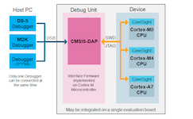

# CMSIS-DAP

[](https://developer.mbed.org/handbook/CMSIS-DAP?utm_source=platformio&utm_medium=docs)

CMSIS-DAP is generally implemented as an on-board interface chip, providing direct USB connection from a development board to a debugger running on a host computer on one side, and over JTAG (Joint Test Action Group) or SWD (Serial Wire Debug) to the target device to access the Coresight DAP on the other. See the [official documentation](https://developer.mbed.org/handbook/CMSIS-DAP?utm_source=platformio&utm_medium=docs).

## Configuration {#configuration}

Select this probe with the [`debug_tool`](../../reference/platformio-ini/env/debug-tool.md) option in [`platformio.ini`](../../reference/platformio-ini/index.md):

```ini
[env:myenv]
platform = ...
board = ...
debug_tool = cmsis-dap
```

To also upload firmware with this probe, set [`upload_protocol`](../../reference/platformio-ini/env/upload-protocol.md):

```ini
[env:myenv]
platform = ...
board = ...
debug_tool = cmsis-dap
upload_protocol = cmsis-dap
```

See also:

- [Debugging options](../../reference/platformio-ini/env/debug-options.md)
- [Upload options](../../reference/platformio-ini/env/upload-options.md)

## Drivers {#drivers}

| Operating system | Driver |
| --- | --- |
| Windows | Install [Windows serial driver](https://os.mbed.com/docs/latest/tutorials/windows-serial-driver.html) and check "USB Driver Installation" guide for your board. |
| macOS | Not required. |
| Linux | Install the [udev rules](../../get-started/install/udev-rules.md). If you installed them before, update them to the latest version. |

<!-- begin_platforms -->

## Platforms

| Name | Description |
|---|---|
| [Atmel SAM](../platforms/atmelsam.md) | Atmel \| SMART offers Flash- based ARM products based on the ARM Cortex-M0+, Cortex-M3 and Cortex-M4 architectures, ranging from 8KB to 2MB of Flash including a rich peripheral and feature mix. |
| [Espressif 32](../platforms/espressif32.mdx) | ESP32 is a series of low-cost, low-power system on a chip microcontrollers with integrated Wi-Fi and Bluetooth. ESP32 integrates an antenna switch, RF balun, power amplifier, low-noise receive amplifier, filters, and power management modules. |
| [Freescale Kinetis](../platforms/freescalekinetis.md) | Freescale Kinetis Microcontrollers is family of multiple hardware- and software-compatible ARM Cortex-M0+, Cortex-M4 and Cortex-M7-based MCU series. Kinetis MCUs offer exceptional low-power performance, scalability and feature integration. |
| [Maxim 32](../platforms/maxim32.md) | Maxim's microcontrollers provide low-power, efficient, and secure solutions for challenging embedded applications. Maxim's processors embed cutting-edge technologies to secure data and intellectual property, proven analog circuitry for real-world applications, and battery-conserving low power operation. |
| [Nordic nRF51](../platforms/nordicnrf51.md) | The Nordic nRF51 Series is a family of highly flexible, multi-protocol, system-on-chip (SoC) devices for ultra-low power wireless applications. nRF51 Series devices support a range of protocol stacks including Bluetooth Smart (previously called Bluetooth low energy), ANT and proprietary 2.4GHz protocols such as Gazell. |
| [Nordic nRF52](../platforms/nordicnrf52.mdx) | The nRF52 Series are built for speed to carry out increasingly complex tasks in the shortest possible time and return to sleep, conserving precious battery power. They have a Cortex-M4F processor which makes them quite capable Bluetooth Smart SoCs. |
| [NXP LPC](../platforms/nxplpc.md) | The NXP LPC is a family of 32-bit microcontroller integrated circuits by NXP Semiconductors. The LPC chips are grouped into related series that are based around the same 32-bit ARM processor core, such as the Cortex-M4F, Cortex-M3, Cortex-M0+, or Cortex-M0. Internally, each microcontroller consists of the processor core, static RAM memory, flash memory, debugging interface, and various peripherals. |
| [Raspberry Pi RP2040](../platforms/raspberrypi.md) | RP2040 is a low-cost, high-performance microcontroller device with a large on-chip memory, symmetric dual-core processor complex, and rich peripheral. |
| [Renesas RA](../platforms/renesas-ra.md) | Renesas Advanced (RA) 32-bit microcontrollers with the Arm Cortex-M33, -M23 and -M4 processor cores deliver key advantages compared to competitive Arm Cortex-M MCUs by providing stronger embedded security, superior CoreMark performance and ultra-low power operation. |
| [ST STM32](../platforms/ststm32.mdx) | The STM32 family of 32-bit Flash MCUs based on the ARM Cortex-M processor is designed to offer new degrees of freedom to MCU users. It offers a 32-bit product range that combines very high performance, real-time capabilities, digital signal processing, and low-power, low-voltage operation, while maintaining full integration and ease of development. |

## Frameworks

| Name | Description |
|---|---|
| [Arduino](../frameworks/arduino.mdx) | Arduino Wiring-based Framework allows writing cross-platform software to control devices attached to a wide range of Arduino boards to create all kinds of creative coding, interactive objects, spaces or physical experiences. |
| [CMSIS](../frameworks/cmsis.md) | Vendor-independent hardware abstraction layer for the Cortex-M processor series |
| [Espressif IoT Development Framework](../frameworks/espidf.mdx) | Espressif IoT Development Framework. Official development framework for ESP32 chip |
| [Renesas Flexible Software Package](../frameworks/fsp.md) | The Renesas Flexible Software Package (FSP) is an enhanced software package designed to provide easy-to-use, scalable, high-quality software for embedded system designs using Renesas RA family of Arm Microcontrollers. |
| [LibOpenCM3](../frameworks/libopencm3.md) | The libopencm3 project aims to create an open-source firmware library for various ARM Cortex-M microcontrollers. |
| [Mbed](../frameworks/mbed.mdx) | Arm Mbed OS is a platform operating system designed for the internet of things |
| [Standard Peripheral Library](../frameworks/spl.mdx) | Standard Peripheral Library for ST STM32 microcontrollers |
| [STM32Cube](../frameworks/stm32cube.mdx) | STM32Cube embedded software libraries, including: The HAL hardware abstraction layer, enabling portability between different STM32 devices via standardized API calls; The Low-Layer (LL) APIs, a light-weight, optimized, expert oriented set of APIs designed for both performance and runtime efficiency |
| [Zephyr](../frameworks/zephyr.mdx) | Zephyr is a new generation, scalable, optimized, secure RTOS for multiple hardware architectures |

## Boards

| Name | Platform | Debug | MCU | Frequency | Flash | RAM |
|---|---|---|---|---|---|---|
| [1Bitsy](../boards/ststm32/1bitsy-stm32f415rgt.md) | [ST STM32](../platforms/ststm32.mdx) | External | STM32F415RGT | 168MHz | 1MB | 128KB |
| [32F412GDISCOVERY](../boards/ststm32/disco-f412zg.md) | [ST STM32](../platforms/ststm32.mdx) | On-board | STM32F412ZGT6 | 100MHz | 1MB | 256KB |
| [32F723EDISCOVERY](../boards/ststm32/disco-f723ie.md) | [ST STM32](../platforms/ststm32.mdx) | On-board | STM32F723IEK6 | 216MHz | 512KB | 192KB |
| [3D Printer Controller](../boards/ststm32/armed-v1.md) | [ST STM32](../platforms/ststm32.mdx) | External | STM32F407VET6 | 168MHz | 512KB | 128KB |
| [3D Printer control board](../boards/ststm32/rumba32-f446ve.md) | [ST STM32](../platforms/ststm32.mdx) | External | STM32F446RET6 | 180MHz | 512KB | 128KB |
| [3D printer controller](../boards/ststm32/remram-v1.md) | [ST STM32](../platforms/ststm32.mdx) | On-board | STM32F765VIT6 | 216MHz | 2MB | 512KB |
| [3DP001V1 Evaluation board for 3D printer](../boards/ststm32/st3dp001-eval.md) | [ST STM32](../platforms/ststm32.mdx) | On-board | STM32F401VET6 | 84MHz | 512KB | 96KB |
| [4D Systems GEN4-ESP32 16MB (ESP32S3-R8N16)](../boards/espressif32/4d-systems-esp32s3-gen4-r8n16.md) | [Espressif 32](../platforms/espressif32.mdx) | External | ESP32S3 | 240MHz | 16MB | 320KB |
| [96Boards Argonkey (STEVAL-MKI187V1)](../boards/ststm32/b96b-argonkey.md) | [ST STM32](../platforms/ststm32.mdx) | External | STM32F412CG | 100MHz | 1MB | 256KB |
| [96Boards B96B-F446VE](../boards/ststm32/b96b-f446ve.md) | [ST STM32](../platforms/ststm32.mdx) | On-board | STM32F446VET6 | 168MHz | 512KB | 128KB |
| [96Boards Neonkey](../boards/ststm32/b96b-neonkey.md) | [ST STM32](../platforms/ststm32.mdx) | External | STM32F411CE | 100MHz | 512KB | 128KB |
| [ACSIP S76S](../boards/ststm32/acsip-s76s.md) | [ST STM32](../platforms/ststm32.mdx) | External | STM32L073RZ | 32MHz | 192KB | 20KB |
| [AI Thinker ESP32-CAM](../boards/espressif32/esp32cam.md) | [Espressif 32](../platforms/espressif32.mdx) | External | ESP32 | 240MHz | 4MB | 320KB |
| [ALKS ESP32](../boards/espressif32/alksesp32.md) | [Espressif 32](../platforms/espressif32.mdx) | External | ESP32 | 240MHz | 4MB | 320KB |
| [AZ-Delivery ESP-32 Dev Kit C V4](../boards/espressif32/az-delivery-devkit-v4.md) | [Espressif 32](../platforms/espressif32.mdx) | External | ESP32 | 240MHz | 4MB | 520KB |
| [Adafruit Bluefruit nRF52832 Feather](../boards/nordicnrf52/adafruit-feather-nrf52832.md) | [Nordic nRF52](../platforms/nordicnrf52.mdx) | External | NRF52832 | 64MHz | 512KB | 64KB |
| [Adafruit CLUE nRF52840](../boards/nordicnrf52/adafruit-clue-nrf52840.md) | [Nordic nRF52](../platforms/nordicnrf52.mdx) | External | NRF52840 | 64MHz | 796KB | 243KB |
| [Adafruit ESP32 Feather](../boards/espressif32/featheresp32.md) | [Espressif 32](../platforms/espressif32.mdx) | External | ESP32 | 240MHz | 4MB | 320KB |
| [Adafruit ESP32-S2 Feather Development Board](../boards/espressif32/featheresp32-s2.md) | [Espressif 32](../platforms/espressif32.mdx) | External | ESP32S2 | 240MHz | 4MB | 320KB |
| [Adafruit Feather Bluefruit Sense](../boards/nordicnrf52/adafruit-feather-nrf52840-sense.md) | [Nordic nRF52](../platforms/nordicnrf52.mdx) | External | NRF52840 | 64MHz | 796KB | 243KB |
| [Adafruit Feather ESP32 V2](../boards/espressif32/adafruit-feather-esp32-v2.md) | [Espressif 32](../platforms/espressif32.mdx) | External | ESP32 | 240MHz | 8MB | 320KB |
| [Adafruit Feather ESP32-C6](../boards/espressif32/adafruit-feather-esp32c6.md) | [Espressif 32](../platforms/espressif32.mdx) | External | ESP32C6 | 160MHz | 4MB | 320KB |
| [Adafruit Feather ESP32-S2](../boards/espressif32/adafruit-feather-esp32s2.md) | [Espressif 32](../platforms/espressif32.mdx) | External | ESP32S2 | 240MHz | 4MB | 320KB |
| [Adafruit Feather ESP32-S2 Reverse TFT](../boards/espressif32/adafruit-feather-esp32s2-reversetft.md) | [Espressif 32](../platforms/espressif32.mdx) | External | ESP32S2 | 240MHz | 4MB | 320KB |
| [Adafruit Feather ESP32-S2 TFT](../boards/espressif32/adafruit-feather-esp32s2-tft.md) | [Espressif 32](../platforms/espressif32.mdx) | External | ESP32S2 | 240MHz | 4MB | 320KB |
| [Adafruit Feather ESP32-S3 2MB PSRAM](../boards/espressif32/adafruit-feather-esp32s3.md) | [Espressif 32](../platforms/espressif32.mdx) | External | ESP32S3 | 240MHz | 4MB | 320KB |
| [Adafruit Feather ESP32-S3 No PSRAM](../boards/espressif32/adafruit-feather-esp32s3-nopsram.md) | [Espressif 32](../platforms/espressif32.mdx) | External | ESP32S3 | 240MHz | 8MB | 320KB |
| [Adafruit Feather ESP32-S3 Reverse TFT](../boards/espressif32/adafruit-feather-esp32s3-reversetft.md) | [Espressif 32](../platforms/espressif32.mdx) | External | ESP32S3 | 240MHz | 4MB | 320KB |
| [Adafruit Feather ESP32-S3 TFT](../boards/espressif32/adafruit-feather-esp32s3-tft.md) | [Espressif 32](../platforms/espressif32.mdx) | External | ESP32S3 | 240MHz | 4MB | 320KB |
| [Adafruit Feather nRF52840 Express](../boards/nordicnrf52/adafruit-feather-nrf52840.md) | [Nordic nRF52](../platforms/nordicnrf52.mdx) | External | NRF52840 | 64MHz | 796KB | 243KB |
| [Adafruit FunHouse](../boards/espressif32/adafruit-funhouse-esp32s2.md) | [Espressif 32](../platforms/espressif32.mdx) | External | ESP32S2 | 240MHz | 4MB | 320KB |
| [Adafruit ItsyBitsy ESP32](../boards/espressif32/adafruit-itsybitsy-esp32.md) | [Espressif 32](../platforms/espressif32.mdx) | External | ESP32 | 240MHz | 8MB | 320KB |
| [Adafruit LED Glasses Driver nRF52840](../boards/nordicnrf52/adafruit-ledglasses-nrf52840.md) | [Nordic nRF52](../platforms/nordicnrf52.mdx) | External | NRF52840 | 64MHz | 796KB | 232KB |
| [Adafruit MagTag 2.9](../boards/espressif32/adafruit-magtag29-esp32s2.md) | [Espressif 32](../platforms/espressif32.mdx) | External | ESP32S2 | 240MHz | 4MB | 320KB |
| [Adafruit MatrixPortal ESP32-S3](../boards/espressif32/adafruit-matrixportal-esp32s3.md) | [Espressif 32](../platforms/espressif32.mdx) | External | ESP32S3 | 240MHz | 8MB | 320KB |
| [Adafruit Metro ESP32-S2](../boards/espressif32/adafruit-metro-esp32s2.md) | [Espressif 32](../platforms/espressif32.mdx) | External | ESP32S2 | 240MHz | 4MB | 320KB |
| [Adafruit Metro ESP32-S3](../boards/espressif32/adafruit-metro-esp32s3.md) | [Espressif 32](../platforms/espressif32.mdx) | External | ESP32S3 | 240MHz | 16MB | 320KB |
| [Adafruit QT Py ESP32](../boards/espressif32/adafruit-qtpy-esp32.md) | [Espressif 32](../platforms/espressif32.mdx) | External | ESP32 | 240MHz | 8MB | 320KB |
| [Adafruit QT Py ESP32-C3](../boards/espressif32/adafruit-qtpy-esp32c3.md) | [Espressif 32](../platforms/espressif32.mdx) | External | ESP32C3 | 160MHz | 4MB | 320KB |
| [Adafruit QT Py ESP32-S2](../boards/espressif32/adafruit-qtpy-esp32s2.md) | [Espressif 32](../platforms/espressif32.mdx) | External | ESP32S2 | 240MHz | 4MB | 320KB |
| [Adafruit QT Py ESP32-S3 (4M Flash 2M PSRAM)](../boards/espressif32/adafruit-qtpy-esp32s3-n4r2.md) | [Espressif 32](../platforms/espressif32.mdx) | External | ESP32S3 | 240MHz | 4MB | 320KB |
| [Adafruit QT Py ESP32-S3 No PSRAM](../boards/espressif32/adafruit-qtpy-esp32s3-nopsram.md) | [Espressif 32](../platforms/espressif32.mdx) | External | ESP32S3 | 240MHz | 8MB | 320KB |
| [Adafruit Qualia ESP32-S3 RGB666](../boards/espressif32/adafruit-qualia-s3-rgb666.md) | [Espressif 32](../platforms/espressif32.mdx) | External | ESP32S3 | 240MHz | 16MB | 320KB |
| [Adafruit pyCamera S3](../boards/espressif32/adafruit-camera-esp32s3.md) | [Espressif 32](../platforms/espressif32.mdx) | External | ESP32S3 | 240MHz | 4MB | 320KB |
| [AfroFlight Rev5 (8MHz)](../boards/ststm32/afroflight-f103cb.md) | [ST STM32](../platforms/ststm32.mdx) | External | STM32F103CBT6 | 72MHz | 128KB | 20KB |
| [Ai-Thinker ESP-C3-M1-I-Kit](../boards/espressif32/esp32-c3-m1i-kit.md) | [Espressif 32](../platforms/espressif32.mdx) | External | ESP32C3 | 160MHz | 4MB | 320KB |
| [Ai-Thinker NodeMCU-32S2 (ESP-12K)](../boards/espressif32/nodemcu-32s2.md) | [Espressif 32](../platforms/espressif32.mdx) | External | ESP32S2 | 240MHz | 4MB | 320KB |
| [AirM2M CORE ESP32C3](../boards/espressif32/airm2m-core-esp32c3.md) | [Espressif 32](../platforms/espressif32.mdx) | External | ESP32C3 | 160MHz | 4MB | 320KB |
| [Arduino Giga R1 (M4 core)](../boards/ststm32/giga-r1-m4.md) | [ST STM32](../platforms/ststm32.mdx) | External | STM32H747XIH6 | 480MHz | 1MB | 287.35KB |
| [Arduino Giga R1 (M7 core)](../boards/ststm32/giga-r1-m7.md) | [ST STM32](../platforms/ststm32.mdx) | External | STM32H747XIH6 | 480MHz | 768KB | 511.35KB |
| [Arduino M0 Pro (Programming/Debug Port)](../boards/atmelsam/mzeropro.md) | [Atmel SAM](../platforms/atmelsam.md) | On-board | SAMD21G18A | 48MHz | 256KB | 32KB |
| [Arduino Nano 33 BLE](../boards/nordicnrf52/nano33ble.md) | [Nordic nRF52](../platforms/nordicnrf52.mdx) | External | NRF52840 | 64MHz | 960KB | 256KB |
| [Arduino Nano ESP32](../boards/espressif32/arduino-nano-esp32.md) | [Espressif 32](../platforms/espressif32.mdx) | External | ESP32S3 | 240MHz | 16MB | 320KB |
| [Arduino Nano R4](../boards/renesas-ra/nano-r4.md) | [Renesas RA](../platforms/renesas-ra.md) | External | RA4M1 | 48MHz | 256KB | 32KB |
| [Arduino Nano RP2040 Connect](../boards/raspberrypi/nanorp2040connect.md) | [Raspberry Pi RP2040](../platforms/raspberrypi.md) | External | RP2040 | 133MHz | 2MB | 264KB |
| [Arduino Nicla Sense ME](../boards/nordicnrf52/nicla-sense-me.md) | [Nordic nRF52](../platforms/nordicnrf52.mdx) | On-board | NRF52832 | 64MHz | 515.25KB | 62.78KB |
| [Arduino Nicla Vision](../boards/ststm32/nicla-vision.md) | [ST STM32](../platforms/ststm32.mdx) | External | STM32H747XIH6 | 480MHz | 768KB | 511.35KB |
| [Arduino Nicla Vision (M4 core)](../boards/ststm32/nicla-vision-m4.md) | [ST STM32](../platforms/ststm32.mdx) | External | STM32H747XIH6 | 480MHz | 1MB | 287.35KB |
| [Arduino Opta](../boards/ststm32/opta.md) | [ST STM32](../platforms/ststm32.mdx) | External | STM32H747XIH6 | 480MHz | 768KB | 511.35KB |
| [Arduino Opta (M4 core)](../boards/ststm32/opta-m4.md) | [ST STM32](../platforms/ststm32.mdx) | External | STM32H747XIH6 | 480MHz | 1MB | 287.35KB |
| [Arduino Portenta H7 (M4 core)](../boards/ststm32/portenta-h7-m4.md) | [ST STM32](../platforms/ststm32.mdx) | External | STM32H747XIH6 | 480MHz | 1MB | 287.35KB |
| [Arduino Portenta H7 (M7 core)](../boards/ststm32/portenta-h7-m7.md) | [ST STM32](../platforms/ststm32.mdx) | External | STM32H747XIH6 | 480MHz | 768KB | 511.35KB |
| [Arduino Uno R4 Minima](../boards/renesas-ra/uno-r4-minima.md) | [Renesas RA](../platforms/renesas-ra.md) | External | RA4M1 | 48MHz | 256KB | 32KB |
| [Arduino Uno R4 WiFi](../boards/renesas-ra/uno-r4-wifi.md) | [Renesas RA](../platforms/renesas-ra.md) | On-board | RA4M1 | 48MHz | 256KB | 32KB |
| [Arduino Zero (Programming/Debug Port)](../boards/atmelsam/zero.md) | [Atmel SAM](../platforms/atmelsam.md) | On-board | SAMD21G18A | 48MHz | 256KB | 32KB |
| [Armstrap Eagle 1024](../boards/ststm32/armstrap-eagle1024.md) | [ST STM32](../platforms/ststm32.mdx) | On-board | STM32F417VGT6 | 168MHz | 1MB | 192KB |
| [Armstrap Eagle 2048](../boards/ststm32/armstrap-eagle2048.md) | [ST STM32](../platforms/ststm32.mdx) | On-board | STM32F427VIT6 | 168MHz | 1.99MB | 256KB |
| [Armstrap Eagle 512](../boards/ststm32/armstrap-eagle512.md) | [ST STM32](../platforms/ststm32.mdx) | On-board | STM32F407VET6 | 168MHz | 512KB | 128KB |
| [ArtronShop ATD1.47-S3](../boards/espressif32/atd147-s3.md) | [Espressif 32](../platforms/espressif32.mdx) | External | ESP32S3 | 240MHz | 8MB | 320KB |
| [ArtronShop IOXESP32](../boards/espressif32/ioxesp32.md) | [Espressif 32](../platforms/espressif32.mdx) | External | ESP32 | 240MHz | 4MB | 320KB |
| [ArtronShop IOXESP32PS](../boards/espressif32/ioxesp32ps.md) | [Espressif 32](../platforms/espressif32.mdx) | External | ESP32 | 240MHz | 4MB | 320KB |
| [Atmel ATSAMR21-XPRO](../boards/atmelsam/samr21-xpro.md) | [Atmel SAM](../platforms/atmelsam.md) | On-board | SAMR21G18A | 48MHz | 256KB | 32KB |
| [Atmel ATSAMW25-XPRO](../boards/atmelsam/samd21g18a.md) | [Atmel SAM](../platforms/atmelsam.md) | On-board | SAMD21G18A | 48MHz | 256KB | 32KB |
| [Atmel SAMC21-XPRO](../boards/atmelsam/samc21-xpro.md) | [Atmel SAM](../platforms/atmelsam.md) | On-board | SAMC21J18A | 48MHz | 256KB | 32KB |
| [Atmel SAMD21-XPRO](../boards/atmelsam/samd21-xpro.md) | [Atmel SAM](../platforms/atmelsam.md) | On-board | SAMD21J18A | 48MHz | 256KB | 32KB |
| [Aventen S3 Sync](../boards/espressif32/aventen-s3-sync.md) | [Espressif 32](../platforms/espressif32.mdx) | External | ESP32S3 | 240MHz | 16MB | 320KB |
| [BBC micro:bit](../boards/nordicnrf51/bbcmicrobit.md) | [Nordic nRF51](../platforms/nordicnrf51.md) | On-board | NRF51822 | 16MHz | 256KB | 16KB |
| [BBC micro:bit V2](../boards/nordicnrf52/bbcmicrobit-v2.md) | [Nordic nRF52](../platforms/nordicnrf52.mdx) | On-board | NRF52833 | 64MHz | 512KB | 128KB |
| [BL652 Development Kit](../boards/nordicnrf52/laird-bl652-dvk.md) | [Nordic nRF52](../platforms/nordicnrf52.mdx) | On-board | NRF52832 | 64MHz | 512KB | 64KB |
| [BL653 Development Kit](../boards/nordicnrf52/laird-bl653-dvk.md) | [Nordic nRF52](../platforms/nordicnrf52.mdx) | On-board | NRF52833 | 64MHz | 512KB | 128KB |
| [BL654 Development Kit](../boards/nordicnrf52/laird-bl654-dvk.md) | [Nordic nRF52](../platforms/nordicnrf52.mdx) | On-board | NRF52840 | 64MHz | 1MB | 256KB |
| [BPI-Leaf-S3](../boards/espressif32/bpi-leaf-s3.md) | [Espressif 32](../platforms/espressif32.mdx) | External | ESP32S3 | 240MHz | 8MB | 320KB |
| [Big Tree Tech EBB42 V1.1](../boards/ststm32/btt-ebb42-v1-1.md) | [ST STM32](../platforms/ststm32.mdx) | On-board | STM32G0B1RET6 | 64MHz | 128KB | 144KB |
| [Black STM32F407VE](../boards/ststm32/black-f407ve.md) | [ST STM32](../platforms/ststm32.mdx) | External | STM32F407VET6 | 168MHz | 512KB | 128KB |
| [Black STM32F407VG](../boards/ststm32/black-f407vg.md) | [ST STM32](../platforms/ststm32.mdx) | External | STM32F407VGT6 | 168MHz | 512KB | 128KB |
| [Black STM32F407ZE](../boards/ststm32/black-f407ze.md) | [ST STM32](../platforms/ststm32.mdx) | External | STM32F407ZET6 | 168MHz | 512KB | 128KB |
| [Black STM32F407ZG](../boards/ststm32/black-f407zg.md) | [ST STM32](../platforms/ststm32.mdx) | External | STM32F407ZGT6 | 168MHz | 1MB | 128KB |
| [BlackPill F103C8](../boards/ststm32/blackpill-f103c8.md) | [ST STM32](../platforms/ststm32.mdx) | External | STM32F103C8T6 | 72MHz | 64KB | 20KB |
| [BlackPill F103C8 (128k)](../boards/ststm32/blackpill-f103c8-128.md) | [ST STM32](../platforms/ststm32.mdx) | External | STM32F103C8T6 | 72MHz | 128KB | 20KB |
| [BlackPill F303CC](../boards/ststm32/robotdyn-blackpill-f303cc.md) | [ST STM32](../platforms/ststm32.mdx) | External | STM32F303CCT6 | 72MHz | 256KB | 40KB |
| [Blinker WiFiduino32S3](../boards/espressif32/wifiduino32s3.md) | [Espressif 32](../platforms/espressif32.mdx) | External | ESP32S3 | 240MHz | 8MB | 320KB |
| [Blinker WiFiduinoV2 (ESP32-C3)](../boards/espressif32/wifiduino32c3.md) | [Espressif 32](../platforms/espressif32.mdx) | External | ESP32C3 | 160MHz | 4MB | 320KB |
| [Blue STM32F407VE Mini](../boards/ststm32/blue-f407ve-mini.md) | [ST STM32](../platforms/ststm32.mdx) | External | STM32F407VET6 | 168MHz | 512KB | 128KB |
| [BluePill F103C6](../boards/ststm32/bluepill-f103c6.md) | [ST STM32](../platforms/ststm32.mdx) | External | STM32F103C6T6 | 72MHz | 32KB | 10KB |
| [BluePill F103C8](../boards/ststm32/bluepill-f103c8.md) | [ST STM32](../platforms/ststm32.mdx) | External | STM32F103C8T6 | 72MHz | 64KB | 20KB |
| [BluePill F103C8 (128k)](../boards/ststm32/bluepill-f103c8-128k.md) | [ST STM32](../platforms/ststm32.mdx) | External | STM32F103C8T6 | 72MHz | 128KB | 20KB |
| [Blues Cygnet](../boards/ststm32/blues-cygnet.md) | [ST STM32](../platforms/ststm32.mdx) | External | STM32L433CCT6 | 80MHz | 256KB | 64KB |
| [Blues Swan R5](../boards/ststm32/blues-swan-r5.md) | [ST STM32](../platforms/ststm32.mdx) | External | STM32L4R5ZIY6 | 120MHz | 2MB | 640KB |
| [BluesWireless Swan R5](../boards/ststm32/bw-swan-r5.md) | [ST STM32](../platforms/ststm32.mdx) | External | STM32L4R5ZIY6 | 120MHz | 2MB | 640KB |
| [Bluey nRF52832 IoT](../boards/nordicnrf52/bluey.md) | [Nordic nRF52](../platforms/nordicnrf52.mdx) | External | NRF52832 | 64MHz | 512KB | 64KB |
| [Calliope Mini v3](../boards/nordicnrf52/calliopemini-v3.md) | [Nordic nRF52](../platforms/nordicnrf52.mdx) | External | NRF52833 | 64MHz | 512KB | 128KB |
| [Calliope mini](../boards/nordicnrf51/calliope-mini.md) | [Nordic nRF51](../platforms/nordicnrf51.md) | On-board | NRF51822 | 16MHz | 256KB | 16KB |
| [Circuit Playground Bluefruit](../boards/nordicnrf52/adafruit-cplaynrf52840.md) | [Nordic nRF52](../platforms/nordicnrf52.mdx) | External | NRF52840 | 64MHz | 796KB | 243KB |
| [Connaxio's Espoir](../boards/espressif32/connaxio-espoir.md) | [Espressif 32](../platforms/espressif32.mdx) | External | ESP32 | 240MHz | 4MB | 320KB |
| [Core board F401RCT6](../boards/ststm32/coreboard-f401rc.md) | [ST STM32](../platforms/ststm32.mdx) | External | STM32F401RCT6 | 84MHz | 256KB | 64KB |
| [Cytron Maker Feather AIoT S3](../boards/espressif32/cytron-maker-feather-aiot-s3.md) | [Espressif 32](../platforms/espressif32.mdx) | External | ESP32S3 | 240MHz | 8MB | 320KB |
| [D-duino-32](../boards/espressif32/d-duino-32.md) | [Espressif 32](../platforms/espressif32.mdx) | External | ESP32 | 240MHz | 4MB | 320KB |
| [DFRobot Beetle ESP32-C3](../boards/espressif32/dfrobot-beetle-esp32c3.md) | [Espressif 32](../platforms/espressif32.mdx) | External | ESP32C3 | 160MHz | 4MB | 320KB |
| [DFRobot Edge101 IOT Controller](../boards/espressif32/dfrobot-edge101.md) | [Espressif 32](../platforms/espressif32.mdx) | External | ESP32 | 240MHz | 16MB | 320KB |
| [DFRobot Firebeetle 2 ESP32-E](../boards/espressif32/dfrobot-firebeetle2-esp32e.md) | [Espressif 32](../platforms/espressif32.mdx) | External | ESP32 | 240MHz | 4MB | 320KB |
| [DFRobot Firebeetle 2 ESP32-S3](../boards/espressif32/dfrobot-firebeetle2-esp32s3.md) | [Espressif 32](../platforms/espressif32.mdx) | External | ESP32S3 | 240MHz | 4MB | 320KB |
| [DFRobot Romeo ESP32-S3](../boards/espressif32/dfrobot-romeo-esp32s3.md) | [Espressif 32](../platforms/espressif32.mdx) | External | ESP32S3 | 240MHz | 16MB | 320KB |
| [DOIT ESP32 DEVKIT V1](../boards/espressif32/esp32doit-devkit-v1.md) | [Espressif 32](../platforms/espressif32.mdx) | External | ESP32 | 240MHz | 4MB | 320KB |
| [DOIT ESPduino32](../boards/espressif32/esp32doit-espduino.md) | [Espressif 32](../platforms/espressif32.mdx) | External | ESP32 | 240MHz | 4MB | 320KB |
| [Delta DFBM-NQ620](../boards/nordicnrf52/delta-dfbm-nq620.md) | [Nordic nRF52](../platforms/nordicnrf52.mdx) | On-board | NRF52832 | 64MHz | 512KB | 64KB |
| [Demo F030F4](../boards/ststm32/demo-f030f4.md) | [ST STM32](../platforms/ststm32.mdx) | External | STM32F030F4P6 | 48MHz | 16KB | 4KB |
| [Deneyap Kart](../boards/espressif32/deneyapkart.md) | [Espressif 32](../platforms/espressif32.mdx) | External | ESP32 | 240MHz | 4MB | 320KB |
| [Deneyap Kart 1A](../boards/espressif32/deneyapkart1a.md) | [Espressif 32](../platforms/espressif32.mdx) | External | ESP32 | 240MHz | 4MB | 320KB |
| [Deneyap Kart 1A v2](../boards/espressif32/deneyapkart1av2.md) | [Espressif 32](../platforms/espressif32.mdx) | External | ESP32S3 | 240MHz | 4MB | 320KB |
| [Deneyap Kart G](../boards/espressif32/deneyapkartg.md) | [Espressif 32](../platforms/espressif32.mdx) | External | ESP32C3 | 160MHz | 4MB | 320KB |
| [Deneyap Mini](../boards/espressif32/deneyapmini.md) | [Espressif 32](../platforms/espressif32.mdx) | External | ESP32S2 | 240MHz | 4MB | 320KB |
| [Deneyap Mini v2](../boards/espressif32/deneyapminiv2.md) | [Espressif 32](../platforms/espressif32.mdx) | External | ESP32S2 | 240MHz | 4MB | 320KB |
| [Department of Alchemy MiniMain ESP32-S2](../boards/espressif32/minimain-esp32s2.md) | [Espressif 32](../platforms/espressif32.mdx) | External | ESP32S2 | 240MHz | 4MB | 320KB |
| [DevEBox H743VITX](../boards/ststm32/devebox-h743vitx.md) | [ST STM32](../platforms/ststm32.mdx) | External | STM32H743VIT6 | 480MHz | 2MB | 512KB |
| [DevEBox H750VBTX](../boards/ststm32/devebox-h750vbtx.md) | [ST STM32](../platforms/ststm32.mdx) | External | STM32H750VBT6 | 480MHz | 512KB | 128KB |
| [Dongsen Tech Pocket 32](../boards/espressif32/pocket-32.md) | [Espressif 32](../platforms/espressif32.mdx) | External | ESP32 | 240MHz | 4MB | 320KB |
| [ESP32 FM DevKit](../boards/espressif32/fm-devkit.md) | [Espressif 32](../platforms/espressif32.mdx) | External | ESP32 | 240MHz | 4MB | 320KB |
| [ESP32 Pico Kit](../boards/espressif32/pico32.md) | [Espressif 32](../platforms/espressif32.mdx) | External | ESP32 | 240MHz | 4MB | 320KB |
| [ESP32-S3 PowerFeather](../boards/espressif32/esp32s3-powerfeather.md) | [Espressif 32](../platforms/espressif32.mdx) | External | ESP32S3 | 240MHz | 8MB | 320KB |
| [ESP32S3 CAM LCD](../boards/espressif32/esp32s3camlcd.md) | [Espressif 32](../platforms/espressif32.mdx) | External | ESP32S3 | 240MHz | 8MB | 320KB |
| [ESP32vn IoT Uno](../boards/espressif32/esp32vn-iot-uno.md) | [Espressif 32](../platforms/espressif32.mdx) | External | ESP32 | 240MHz | 4MB | 320KB |
| [ESPectro32](../boards/espressif32/espectro32.md) | [Espressif 32](../platforms/espressif32.mdx) | External | ESP32 | 240MHz | 4MB | 320KB |
| [ESPino32](../boards/espressif32/espino32.md) | [Espressif 32](../platforms/espressif32.mdx) | External | ESP32 | 240MHz | 4MB | 320KB |
| [ElectronutLabs Blip](../boards/nordicnrf52/electronut-blip.md) | [Nordic nRF52](../platforms/nordicnrf52.mdx) | On-board | NRF52840 | 64MHz | 1MB | 256KB |
| [ElectronutLabs Papyr](../boards/nordicnrf52/electronut-papyr.md) | [Nordic nRF52](../platforms/nordicnrf52.mdx) | On-board | NRF52840 | 64MHz | 1MB | 256KB |
| [Electrosmith Daisy](../boards/ststm32/electrosmith-daisy.md) | [ST STM32](../platforms/ststm32.mdx) | External | STM32H750IBK6 | 400MHz | 128KB | 512KB |
| [Electrosmith Daisy Patch SM](../boards/ststm32/electrosmith-daisy-patch-sm.md) | [ST STM32](../platforms/ststm32.mdx) | External | STM32H750IBK6 | 400MHz | 128KB | 512KB |
| [Electrosmith Daisy Petal SM](../boards/ststm32/electrosmith-daisy-petal-sm.md) | [ST STM32](../platforms/ststm32.mdx) | External | STM32H750IBK6 | 400MHz | 128KB | 512KB |
| [Elektor LoRa Node Core F072C8 (128 kB)](../boards/ststm32/elektor-f072cb.md) | [ST STM32](../platforms/ststm32.mdx) | External | STM32F072C8T6 | 48MHz | 128KB | 16KB |
| [Elektor LoRa Node Core F072C8 (64 kB)](../boards/ststm32/elektor-f072c8.md) | [ST STM32](../platforms/ststm32.mdx) | External | STM32F072C8T6 | 48MHz | 64KB | 16KB |
| [Elektrofuzzis ftSwarmControl USB-C](../boards/espressif32/ftswarmcontrolusbc.md) | [Espressif 32](../platforms/espressif32.mdx) | On-board | ESP32S3 | 240MHz | 4MB | 320KB |
| [Elektrofuzzis ftSwarmControl USBMicro](../boards/espressif32/ftswarmcontrolusbmicro.md) | [Espressif 32](../platforms/espressif32.mdx) | External | ESP32 | 240MHz | 4MB | 320KB |
| [Elektrofuzzis ftSwarmDuino](../boards/espressif32/ftswarmduino.md) | [Espressif 32](../platforms/espressif32.mdx) | On-board | ESP32S3 | 240MHz | 4MB | 320KB |
| [Elektrofuzzis ftSwarmJST](../boards/espressif32/ftswarmjst.md) | [Espressif 32](../platforms/espressif32.mdx) | External | ESP32 | 240MHz | 4MB | 320KB |
| [Elektrofuzzis ftSwarmPwrDrive](../boards/espressif32/ftswarmpwrdrive.md) | [Espressif 32](../platforms/espressif32.mdx) | On-board | ESP32S3 | 240MHz | 4MB | 320KB |
| [Elektrofuzzis ftSwarmXL](../boards/espressif32/ftswarmxl.md) | [Espressif 32](../platforms/espressif32.mdx) | On-board | ESP32S3 | 240MHz | 4MB | 320KB |
| [EspinalLab ATMegaZero ESP32-S2](../boards/espressif32/atmegazero-esp32s2.md) | [Espressif 32](../platforms/espressif32.mdx) | External | ESP32S2 | 240MHz | 16MB | 320KB |
| [Espotel LoRa Module](../boards/ststm32/elmo-f411re.md) | [ST STM32](../platforms/ststm32.mdx) | External | STM32F411RET6 | 100MHz | 512KB | 128KB |
| [Espressif ESP-WROVER-KIT](../boards/espressif32/esp-wrover-kit.md) | [Espressif 32](../platforms/espressif32.mdx) | On-board | ESP32 | 240MHz | 4MB | 320KB |
| [Espressif ESP32 Dev Module](../boards/espressif32/esp32dev.md) | [Espressif 32](../platforms/espressif32.mdx) | External | ESP32 | 240MHz | 4MB | 320KB |
| [Espressif ESP32-C3-DevKitC-02](../boards/espressif32/esp32-c3-devkitc-02.md) | [Espressif 32](../platforms/espressif32.mdx) | External | ESP32C3 | 160MHz | 4MB | 320KB |
| [Espressif ESP32-C3-DevKitM-1](../boards/espressif32/esp32-c3-devkitm-1.md) | [Espressif 32](../platforms/espressif32.mdx) | External | ESP32C3 | 160MHz | 4MB | 320KB |
| [Espressif ESP32-C6-DevKitM-1](../boards/espressif32/esp32-c6-devkitm-1.md) | [Espressif 32](../platforms/espressif32.mdx) | External | ESP32C6 | 160MHz | 4MB | 320KB |
| [Espressif ESP32-S2-Kaluga-1 Kit](../boards/espressif32/esp32-s2-kaluga-1.md) | [Espressif 32](../platforms/espressif32.mdx) | On-board | ESP32S2 | 240MHz | 4MB | 320KB |
| [Espressif ESP32-S2-Saola-1](../boards/espressif32/esp32-s2-saola-1.md) | [Espressif 32](../platforms/espressif32.mdx) | External | ESP32S2 | 240MHz | 4MB | 320KB |
| [Espressif ESP32-S3-Box](../boards/espressif32/esp32s3box.md) | [Espressif 32](../platforms/espressif32.mdx) | External | ESP32S3 | 240MHz | 16MB | 320KB |
| [Espressif ESP32-S3-DevKitC-1-N8 (8 MB QD, No PSRAM)](../boards/espressif32/esp32-s3-devkitc-1.md) | [Espressif 32](../platforms/espressif32.mdx) | On-board | ESP32S3 | 240MHz | 8MB | 320KB |
| [Espressif ESP32-S3-DevKitM-1](../boards/espressif32/esp32-s3-devkitm-1.md) | [Espressif 32](../platforms/espressif32.mdx) | On-board | ESP32S3 | 240MHz | 8MB | 320KB |
| [Espressif ESP32-S3-USB-OTG](../boards/espressif32/esp32s3usbotg.md) | [Espressif 32](../platforms/espressif32.mdx) | On-board | ESP32S3 | 240MHz | 8MB | 320KB |
| [Ethernet IoT Starter Kit](../boards/freescalekinetis/ibmethernetkit.md) | [Freescale Kinetis](../platforms/freescalekinetis.md) | On-board | MK64FN1M0VLL12 | 120MHz | 1MB | 256KB |
| [F407VG](../boards/ststm32/diymore-f407vgt.md) | [ST STM32](../platforms/ststm32.mdx) | External | STM32F407VGT6 | 168MHz | 1MB | 128KB |
| [FK407M1](../boards/ststm32/fk407m1.md) | [ST STM32](../platforms/ststm32.mdx) | External | STM32F407VET6 | 168MHz | 512KB | 128KB |
| [FYSETC S6](../boards/ststm32/fysetc-s6.md) | [ST STM32](../platforms/ststm32.mdx) | External | STM32F446VET6 | 168MHz | 512KB | 128KB |
| [FireBeetle-ESP32](../boards/espressif32/firebeetle32.md) | [Espressif 32](../platforms/espressif32.mdx) | External | ESP32 | 240MHz | 16MB | 520KB |
| [Franzininho WiFi](../boards/espressif32/franzininho-wifi-esp32s2.md) | [Espressif 32](../platforms/espressif32.mdx) | External | ESP32S2 | 240MHz | 4MB | 320KB |
| [Franzininho WiFi Board](../boards/espressif32/esp32-s2-franzininho.md) | [Espressif 32](../platforms/espressif32.mdx) | External | ESP32S2 | 240MHz | 4MB | 320KB |
| [Franzininho WiFi MSC](../boards/espressif32/franzininho-wifi-msc-esp32s2.md) | [Espressif 32](../platforms/espressif32.mdx) | External | ESP32S2 | 240MHz | 4MB | 320KB |
| [Freenove ESP32-S3 WROOM N8R8 (8MB Flash / 8MB PSRAM)](../boards/espressif32/freenove-esp32-s3-wroom.md) | [Espressif 32](../platforms/espressif32.mdx) | On-board | ESP32S3 | 240MHz | 8MB | 320KB |
| [Freenove ESP32-Wrover](../boards/espressif32/freenove-esp32-wrover.md) | [Espressif 32](../platforms/espressif32.mdx) | External | ESP32 | 240MHz | 4MB | 320KB |
| [Freescale Kinetis FRDM-K22F](../boards/freescalekinetis/frdm-k22f.md) | [Freescale Kinetis](../platforms/freescalekinetis.md) | On-board | MK22FN512VLH12 | 120MHz | 512KB | 128KB |
| [Freescale Kinetis FRDM-K64F](../boards/freescalekinetis/frdm-k64f.md) | [Freescale Kinetis](../platforms/freescalekinetis.md) | On-board | MK64FN1M0VLL12 | 120MHz | 1MB | 256KB |
| [Freescale Kinetis FRDM-K66F](../boards/freescalekinetis/frdm-k66f.md) | [Freescale Kinetis](../platforms/freescalekinetis.md) | On-board | MK66FN2M0VMD18 | 180MHz | 2MB | 256KB |
| [Freescale Kinetis FRDM-K82F](../boards/freescalekinetis/frdm-k82f.md) | [Freescale Kinetis](../platforms/freescalekinetis.md) | On-board | MK82FN256VLL15 | 150MHz | 256KB | 256KB |
| [Freescale Kinetis FRDM-KL25Z](../boards/freescalekinetis/frdm-kl25z.md) | [Freescale Kinetis](../platforms/freescalekinetis.md) | On-board | MKL25Z128VLK4 | 48MHz | 128KB | 16KB |
| [Freescale Kinetis FRDM-KL43Z](../boards/freescalekinetis/frdm-kl43z.md) | [Freescale Kinetis](../platforms/freescalekinetis.md) | On-board | MKL43Z256VLH4 | 48MHz | 256KB | 32KB |
| [Freescale Kinetis FRDM-KL46Z](../boards/freescalekinetis/frdm-kl46z.md) | [Freescale Kinetis](../platforms/freescalekinetis.md) | On-board | MKL46Z256VLL4 | 48MHz | 256KB | 32KB |
| [Freescale Kinetis FRDM-KW41Z](../boards/freescalekinetis/frdm-kw41z.md) | [Freescale Kinetis](../platforms/freescalekinetis.md) | On-board | MKW41Z512VHT4 | 48MHz | 512KB | 128KB |
| [Frog Board ESP32](../boards/espressif32/frogboard.md) | [Espressif 32](../platforms/espressif32.mdx) | External | ESP32 | 240MHz | 4MB | 320KB |
| [Geekble nano ESP32-S3](../boards/espressif32/geekble-nano-esp32s3.md) | [Espressif 32](../platforms/espressif32.mdx) | External | ESP32S3 | 240MHz | 4MB | 320KB |
| [HONEYLemon](../boards/espressif32/honeylemon.md) | [Espressif 32](../platforms/espressif32.mdx) | External | ESP32 | 240MHz | 4MB | 320KB |
| [Heltec Capsule Sensor v3](../boards/espressif32/heltec-capsule-sensor-v3.md) | [Espressif 32](../platforms/espressif32.mdx) | External | ESP32S3 | 240MHz | 8MB | 320KB |
| [Heltec Vision Master E213](../boards/espressif32/heltec-vision-master-e213.md) | [Espressif 32](../platforms/espressif32.mdx) | External | ESP32S3 | 240MHz | 8MB | 320KB |
| [Heltec Vision Master E290](../boards/espressif32/heltec-vision-master-e290.md) | [Espressif 32](../platforms/espressif32.mdx) | External | ESP32S3 | 240MHz | 8MB | 320KB |
| [Heltec Vision Master T190](../boards/espressif32/heltec-vision-master-t190.md) | [Espressif 32](../platforms/espressif32.mdx) | External | ESP32S3 | 240MHz | 8MB | 320KB |
| [Heltec WiFi Kit 32 (V3)](../boards/espressif32/heltec-wifi-kit-32-v3.md) | [Espressif 32](../platforms/espressif32.mdx) | External | ESP32S3 | 240MHz | 8MB | 320KB |
| [Heltec WiFi LoRa 32](../boards/espressif32/heltec-wifi-lora-32.md) | [Espressif 32](../platforms/espressif32.mdx) | External | ESP32 | 240MHz | 4MB | 320KB |
| [Heltec WiFi LoRa 32 (V2)](../boards/espressif32/heltec-wifi-lora-32-v2.md) | [Espressif 32](../platforms/espressif32.mdx) | External | ESP32 | 240MHz | 8MB | 320KB |
| [Heltec WiFi LoRa 32 (V3)](../boards/espressif32/heltec-wifi-lora-32-v3.md) | [Espressif 32](../platforms/espressif32.mdx) | External | ESP32S3 | 240MHz | 8MB | 320KB |
| [Heltec WiFi LoRa 32 v4](../boards/espressif32/heltec-wifi-lora-32-v4.md) | [Espressif 32](../platforms/espressif32.mdx) | External | ESP32S3 | 240MHz | 16MB | 320KB |
| [Heltec Wireless Bridge](../boards/espressif32/heltec-wireless-bridge.md) | [Espressif 32](../platforms/espressif32.mdx) | External | ESP32 | 240MHz | 8MB | 320KB |
| [Heltec Wireless Paper](../boards/espressif32/heltec-wireless-paper.md) | [Espressif 32](../platforms/espressif32.mdx) | External | ESP32S3 | 240MHz | 8MB | 320KB |
| [Heltec Wireless Shell v3](../boards/espressif32/heltec-wireless-shell-v3.md) | [Espressif 32](../platforms/espressif32.mdx) | External | ESP32S3 | 240MHz | 8MB | 320KB |
| [Heltec Wireless Stick](../boards/espressif32/heltec-wireless-stick.md) | [Espressif 32](../platforms/espressif32.mdx) | External | ESP32 | 240MHz | 8MB | 320KB |
| [Heltec Wireless Stick Lite v3](../boards/espressif32/heltec-wireless-stick-lite-v3.md) | [Espressif 32](../platforms/espressif32.mdx) | External | ESP32S3 | 240MHz | 8MB | 320KB |
| [Heltec Wireless Stick v3](../boards/espressif32/heltec-wireless-stick-v3.md) | [Espressif 32](../platforms/espressif32.mdx) | External | ESP32S3 | 240MHz | 8MB | 320KB |
| [Heltec Wireless Tracker](../boards/espressif32/heltec-wireless-tracker.md) | [Espressif 32](../platforms/espressif32.mdx) | External | ESP32S3 | 240MHz | 8MB | 320KB |
| [Hexiwear](../boards/freescalekinetis/hexiwear.md) | [Freescale Kinetis](../platforms/freescalekinetis.md) | External | MK64FN1M0VDC12 | 120MHz | 1MB | 256KB |
| [Holyiot YJ-16019](../boards/nordicnrf52/holyiot-yj16019.md) | [Nordic nRF52](../platforms/nordicnrf52.mdx) | External | NRF52832 | 64MHz | 512KB | 64KB |
| [Hornbill ESP32 Dev](../boards/espressif32/hornbill32dev.md) | [Espressif 32](../platforms/espressif32.mdx) | External | ESP32 | 240MHz | 4MB | 320KB |
| [Hornbill ESP32 Minima](../boards/espressif32/hornbill32minima.md) | [Espressif 32](../platforms/espressif32.mdx) | External | ESP32 | 240MHz | 4MB | 320KB |
| [IoTaaP Magnolia](../boards/espressif32/iotaap-magnolia.md) | [Espressif 32](../platforms/espressif32.mdx) | External | ESP32 | 240MHz | 4MB | 320KB |
| [ItsyBitsy nRF52840 Express](../boards/nordicnrf52/adafruit-itsybitsy-nrf52840.md) | [Nordic nRF52](../platforms/nordicnrf52.mdx) | External | NRF52840 | 64MHz | 796KB | 243KB |
| [Kinetic Dynamics Nebula S3](../boards/espressif32/nebulas3.md) | [Espressif 32](../platforms/espressif32.mdx) | External | ESP32S3 | 240MHz | 4MB | 320KB |
| [L476DMW1K](../boards/ststm32/rhombio-l476dmw1k.md) | [ST STM32](../platforms/ststm32.mdx) | On-board | STM32L476VGT6 | 80MHz | 1MB | 128KB |
| [LOGISENSES Senses Weizen](../boards/espressif32/sensesiot-weizen.md) | [Espressif 32](../platforms/espressif32.mdx) | External | ESP32 | 240MHz | 4MB | 320KB |
| [LPCXpresso11U68](../boards/nxplpc/lpc11u68.md) | [NXP LPC](../platforms/nxplpc.md) | On-board | LPC11U68 | 50MHz | 256KB | 36KB |
| [Laird Connectivity Pinnacle 100 DVK](../boards/nordicnrf52/laird-pinnacle-100-dvk.md) | [Nordic nRF52](../platforms/nordicnrf52.mdx) | External | NRF52840 | 64MHz | 1MB | 256KB |
| [Leafony Systems AP03](../boards/ststm32/leafony-ap03.md) | [ST STM32](../platforms/ststm32.mdx) | On-board | STM32L452RET6 | 80MHz | 512KB | 160KB |
| [Lilka v2](../boards/espressif32/lilka-v2.md) | [Espressif 32](../platforms/espressif32.mdx) | External | ESP32S3 | 240MHz | 16MB | 320KB |
| [LilyGo T-Display-S3](../boards/espressif32/lilygo-t-display-s3.md) | [Espressif 32](../platforms/espressif32.mdx) | External | ESP32S3 | 240MHz | 16MB | 320KB |
| [LilyGo T3-S3](../boards/espressif32/lilygo-t3-s3.md) | [Espressif 32](../platforms/espressif32.mdx) | External | ESP32S3 | 240MHz | 4MB | 320KB |
| [Lion:Bit Dev Board](../boards/espressif32/lionbit.md) | [Espressif 32](../platforms/espressif32.mdx) | External | ESP32 | 240MHz | 4MB | 320KB |
| [Lion:Bit S3 STEM Dev Board](../boards/espressif32/lionbits3.md) | [Espressif 32](../platforms/espressif32.mdx) | On-board | ESP32S3 | 240MHz | 4MB | 320KB |
| [M200 V2](../boards/ststm32/malyanm200-f070cb.md) | [ST STM32](../platforms/ststm32.mdx) | External | STM32F070CBT6 | 48MHz | 120KB | 14.81KB |
| [M5Stack AtomS3](../boards/espressif32/m5stack-atoms3.md) | [Espressif 32](../platforms/espressif32.mdx) | External | ESP32S3 | 240MHz | 8MB | 320KB |
| [M5Stack Capsule](../boards/espressif32/m5stack-capsule.md) | [Espressif 32](../platforms/espressif32.mdx) | External | ESP32S3 | 240MHz | 4MB | 320KB |
| [M5Stack Cardputer](../boards/espressif32/m5stack-cardputer.md) | [Espressif 32](../platforms/espressif32.mdx) | External | ESP32S3 | 240MHz | 4MB | 320KB |
| [M5Stack CoreS3](../boards/espressif32/m5stack-cores3.md) | [Espressif 32](../platforms/espressif32.mdx) | External | ESP32S3 | 240MHz | 16MB | 320KB |
| [M5Stack Dial](../boards/espressif32/m5stack-dial.md) | [Espressif 32](../platforms/espressif32.mdx) | External | ESP32S3 | 240MHz | 4MB | 320KB |
| [M5Stack DinMeter](../boards/espressif32/m5stack-dinmeter.md) | [Espressif 32](../platforms/espressif32.mdx) | External | ESP32S3 | 240MHz | 4MB | 320KB |
| [M5Stack M5Paper](../boards/espressif32/m5stack-paper.md) | [Espressif 32](../platforms/espressif32.mdx) | External | ESP32 | 240MHz | 16MB | 4.31MB |
| [M5Stack NanoC6](../boards/espressif32/m5stack-nanoc6.md) | [Espressif 32](../platforms/espressif32.mdx) | External | ESP32C6 | 160MHz | 4MB | 320KB |
| [M5Stack PoE CAM](../boards/espressif32/m5stack-poe-cam.md) | [Espressif 32](../platforms/espressif32.mdx) | External | ESP32 | 240MHz | 4MB | 320KB |
| [M5Stack Stamp-C3](../boards/espressif32/m5stack-stamp-c3.md) | [Espressif 32](../platforms/espressif32.mdx) | External | ESP32C3 | 160MHz | 4MB | 320KB |
| [M5Stack StampS3](../boards/espressif32/m5stack-stamps3.md) | [Espressif 32](../platforms/espressif32.mdx) | External | ESP32S3 | 240MHz | 8MB | 320KB |
| [M5Stack StickC](../boards/espressif32/m5stick-c.md) | [Espressif 32](../platforms/espressif32.mdx) | External | ESP32 | 240MHz | 4MB | 320KB |
| [M5Stack StickC-Plus](../boards/espressif32/m5stack-stickc-plus.md) | [Espressif 32](../platforms/espressif32.mdx) | External | ESP32 | 240MHz | 4MB | 320KB |
| [M5Stack StickC-Plus2](../boards/espressif32/m5stack-stickc-plus2.md) | [Espressif 32](../platforms/espressif32.mdx) | External | ESP32 | 240MHz | 8MB | 320KB |
| [M5Stack Tough](../boards/espressif32/m5stack-tough.md) | [Espressif 32](../platforms/espressif32.mdx) | External | ESP32 | 240MHz | 16MB | 4.31MB |
| [M5Stack Unit CAM](../boards/espressif32/m5stack-unit-cam.md) | [Espressif 32](../platforms/espressif32.mdx) | External | ESP32 | 240MHz | 4MB | 320KB |
| [M5Stack Unit CamS3](../boards/espressif32/m5stack-unit-cams3.md) | [Espressif 32](../platforms/espressif32.mdx) | External | ESP32S3 | 240MHz | 16MB | 320KB |
| [MH ET LIVE ESP32DevKIT](../boards/espressif32/mhetesp32devkit.md) | [Espressif 32](../platforms/espressif32.mdx) | External | ESP32 | 240MHz | 4MB | 320KB |
| [MH ET LIVE ESP32MiniKit](../boards/espressif32/mhetesp32minikit.md) | [Espressif 32](../platforms/espressif32.mdx) | External | ESP32 | 240MHz | 4MB | 320KB |
| [MKR Sharky](../boards/ststm32/mkr-sharky.md) | [ST STM32](../platforms/ststm32.mdx) | External | STM32WB55CG | 64MHz | 512KB | 192KB |
| [MTS Dragonfly](../boards/ststm32/mts-dragonfly-f411re.md) | [ST STM32](../platforms/ststm32.mdx) | External | STM32F411RET6 | 100MHz | 512KB | 128KB |
| [MakerAsia KB32-FT](../boards/espressif32/kb32-ft.md) | [Espressif 32](../platforms/espressif32.mdx) | External | ESP32 | 240MHz | 4MB | 320KB |
| [Makerdiary nRF52832-MDK](../boards/nordicnrf52/nrf52832-mdk.md) | [Nordic nRF52](../platforms/nordicnrf52.mdx) | On-board | NRF52832 | 64MHz | 512KB | 64KB |
| [Makerdiary nRF52840-MDK](../boards/nordicnrf52/nrf52840-mdk.md) | [Nordic nRF52](../platforms/nordicnrf52.mdx) | On-board | NRF52840 | 64MHz | 1MB | 256KB |
| [Malyan M200 V1](../boards/ststm32/malyanm200-f103cb.md) | [ST STM32](../platforms/ststm32.mdx) | External | STM32F103CBT6 | 72MHz | 120KB | 20KB |
| [Maple](../boards/ststm32/maple.md) | [ST STM32](../platforms/ststm32.mdx) | External | STM32F103RBT6 | 72MHz | 108KB | 17KB |
| [Maple (RET6)](../boards/ststm32/maple-ret6.md) | [ST STM32](../platforms/ststm32.mdx) | External | STM32F103RET6 | 72MHz | 256KB | 48KB |
| [Maple Mini Bootloader 2.0](../boards/ststm32/maple-mini-b20.md) | [ST STM32](../platforms/ststm32.mdx) | External | STM32F103CBT6 | 72MHz | 120KB | 20KB |
| [Maple Mini Original](../boards/ststm32/maple-mini-origin.md) | [ST STM32](../platforms/ststm32.mdx) | External | STM32F103CBT6 | 72MHz | 108KB | 20KB |
| [Maxim ARM mbed Enabled Development Platform for MAX32600](../boards/maxim32/max32600mbed.md) | [Maxim 32](../platforms/maxim32.md) | On-board | MAX32600 | 24MHz | 256KB | 32KB |
| [Maxim Wireless Sensor Node Demonstrator](../boards/maxim32/maxwsnenv.md) | [Maxim 32](../platforms/maxim32.md) | External | MAX32610 | 24MHz | 256KB | 32KB |
| [Mbed Connect Cloud](../boards/ststm32/mbed-connect-odin.md) | [ST STM32](../platforms/ststm32.mdx) | On-board | STM32F439ZIY6 | 168MHz | 2MB | 256KB |
| [Metro nRF52840 Express](../boards/nordicnrf52/adafruit-metro-nrf52840.md) | [Nordic nRF52](../platforms/nordicnrf52.mdx) | External | NRF52840 | 64MHz | 796KB | 243KB |
| [Microduino Core STM32 to Flash](../boards/ststm32/microduino32-flash.md) | [ST STM32](../platforms/ststm32.mdx) | External | STM32F103CBT6 | 72MHz | 105.47KB | 20KB |
| [Microsoft Azure IoT Development Kit (MXChip AZ3166)](../boards/ststm32/mxchip-az3166.md) | [ST STM32](../platforms/ststm32.mdx) | On-board | STM32F412ZGT6 | 100MHz | 1MB | 256KB |
| [Moteino M0](../boards/atmelsam/moteino-zero.md) | [Atmel SAM](../platforms/atmelsam.md) | External | SAMD21G18A | 48MHz | 256KB | 32KB |
| [MotorGo Mini 1 (ESP32-S3)](../boards/espressif32/motorgo-mini-1.md) | [Espressif 32](../platforms/espressif32.mdx) | External | ESP32S3 | 240MHz | 4MB | 320KB |
| [MultiTech mDot](../boards/ststm32/mts-mdot-f405rg.md) | [ST STM32](../platforms/ststm32.mdx) | External | STM32F411RET6 | 100MHz | 512KB | 128KB |
| [MultiTech mDot F411](../boards/ststm32/mts-mdot-f411re.md) | [ST STM32](../platforms/ststm32.mdx) | External | STM32F411RET6 | 100MHz | 512KB | 128KB |
| [MultiTech xDot](../boards/ststm32/xdot-l151cc.md) | [ST STM32](../platforms/ststm32.mdx) | External | STM32L151CCU6 | 32MHz | 256KB | 32KB |
| [Munich Labs RedPill ESP32-S3](../boards/espressif32/redpill-esp32s3.md) | [Espressif 32](../platforms/espressif32.mdx) | External | ESP32S3 | 240MHz | 8MB | 320KB |
| [NAMote72](../boards/ststm32/mote-l152rc.md) | [ST STM32](../platforms/ststm32.mdx) | External | STM32L152RC | 32MHz | 256KB | 32KB |
| [NXP LPCXpresso54114](../boards/nxplpc/lpc54114.md) | [NXP LPC](../platforms/nxplpc.md) | On-board | LPC54114J256BD64 | 100MHz | 256KB | 192KB |
| [NXP mbed LPC1768](../boards/nxplpc/lpc1768.md) | [NXP LPC](../platforms/nxplpc.md) | On-board | LPC1768 | 96MHz | 512KB | 64KB |
| [Namino Arancio](../boards/espressif32/namino-arancio.md) | [Espressif 32](../platforms/espressif32.mdx) | External | ESP32S3 | 240MHz | 4MB | 320KB |
| [Namino Rosso](../boards/espressif32/namino-rosso.md) | [Espressif 32](../platforms/espressif32.mdx) | External | ESP32S3 | 240MHz | 4MB | 320KB |
| [Node32s](../boards/espressif32/node32s.md) | [Espressif 32](../platforms/espressif32.mdx) | External | ESP32 | 240MHz | 4MB | 320KB |
| [NodeMCU-32S](../boards/espressif32/nodemcu-32s.md) | [Espressif 32](../platforms/espressif32.mdx) | External | ESP32 | 240MHz | 4MB | 320KB |
| [Nordic Beacon Kit (PCA20006)](../boards/nordicnrf51/nrf51-beacon.md) | [Nordic nRF51](../platforms/nordicnrf51.md) | On-board | NRF51822 | 32MHz | 256KB | 32KB |
| [Nordic Thingy:52 (nRF52-PCA20020)](../boards/nordicnrf52/thingy-52.md) | [Nordic nRF52](../platforms/nordicnrf52.mdx) | External | NRF52832 | 64MHz | 512KB | 64KB |
| [Nordic nRF51 Dongle (PCA10031)](../boards/nordicnrf51/nrf51-dongle.md) | [Nordic nRF51](../platforms/nordicnrf51.md) | On-board | NRF51822 | 32MHz | 256KB | 32KB |
| [Nordic nRF51X22 Development Kit(PCA1000X)](../boards/nordicnrf51/nrf51-dk.md) | [Nordic nRF51](../platforms/nordicnrf51.md) | On-board | NRF51822 | 32MHz | 256KB | 32KB |
| [Nordic nRF52-DK](../boards/nordicnrf52/nrf52-dk.md) | [Nordic nRF52](../platforms/nordicnrf52.mdx) | On-board | NRF52832 | 64MHz | 512KB | 64KB |
| [Nordic nRF52833-DK](../boards/nordicnrf52/nrf52833-dk.md) | [Nordic nRF52](../platforms/nordicnrf52.mdx) | On-board | NRF52833 | 64MHz | 512KB | 128KB |
| [Nordic nRF52840-DK](../boards/nordicnrf52/nrf52840-dk.md) | [Nordic nRF52](../platforms/nordicnrf52.mdx) | On-board | NRF52840 | 64MHz | 1MB | 256KB |
| [Nordic nRF52840-DK (Adafruit BSP)](../boards/nordicnrf52/nrf52840-dk-adafruit.md) | [Nordic nRF52](../platforms/nordicnrf52.mdx) | On-board | NRF52840 | 64MHz | 796KB | 243KB |
| [Nucleo G070RB](../boards/ststm32/nucleo-g070rb.md) | [ST STM32](../platforms/ststm32.mdx) | On-board | STM32G070RBT6 | 64MHz | 128KB | 36KB |
| [Nucleo G071RB](../boards/ststm32/nucleo-g071rb.md) | [ST STM32](../platforms/ststm32.mdx) | On-board | STM32G071RBT6 | 64MHz | 128KB | 36KB |
| [Nucleo G431KB](../boards/ststm32/nucleo-g431kb.md) | [ST STM32](../platforms/ststm32.mdx) | On-board | STM32G431KBT6 | 170MHz | 128KB | 32KB |
| [Nucleo G431RB](../boards/ststm32/nucleo-g431rb.md) | [ST STM32](../platforms/ststm32.mdx) | On-board | STM32G431RBT6 | 170MHz | 128KB | 32KB |
| [Nucleo G474RE](../boards/ststm32/nucleo-g474re.md) | [ST STM32](../platforms/ststm32.mdx) | On-board | STM32G474RET6 | 170MHz | 512KB | 128KB |
| [Nucleo G491RE](../boards/ststm32/nucleo-g491re.md) | [ST STM32](../platforms/ststm32.mdx) | On-board | STM32G491RET6 | 170MHz | 512KB | 112KB |
| [OLIMEX ESP32-DevKit-LiPo](../boards/espressif32/esp32-devkitlipo.md) | [Espressif 32](../platforms/espressif32.mdx) | External | ESP32 | 240MHz | 4MB | 320KB |
| [OLIMEX ESP32-EVB](../boards/espressif32/esp32-evb.md) | [Espressif 32](../platforms/espressif32.mdx) | External | ESP32 | 240MHz | 4MB | 320KB |
| [OLIMEX ESP32-GATEWAY](../boards/espressif32/esp32-gateway.md) | [Espressif 32](../platforms/espressif32.mdx) | External | ESP32 | 240MHz | 4MB | 320KB |
| [OLIMEXINO-STM32](../boards/ststm32/olimexino.md) | [ST STM32](../platforms/ststm32.mdx) | External | STM32F103RBT6 | 72MHz | 128KB | 20KB |
| [Olimex OLIMEXINO-STM32F3](../boards/ststm32/olimexino-stm32f3.md) | [ST STM32](../platforms/ststm32.mdx) | External | STM32F303RCT6 | 72MHz | 256KB | 40KB |
| [Olimex STM32-H103](../boards/ststm32/olimex-f103.md) | [ST STM32](../platforms/ststm32.mdx) | External | STM32F103RBT6 | 72MHz | 128KB | 20KB |
| [Olimex STM32-P405](../boards/ststm32/olimex-p405.md) | [ST STM32](../platforms/ststm32.mdx) | External | STM32F405RGT6 | 168MHz | 1MB | 128KB |
| [P-Nucleo WB55RG](../boards/ststm32/nucleo-wb55rg-p.md) | [ST STM32](../platforms/ststm32.mdx) | On-board | STM32WB55RG | 64MHz | 512KB | 192KB |
| [PHYTEC reel board](../boards/nordicnrf52/reel-board.md) | [Nordic nRF52](../platforms/nordicnrf52.mdx) | On-board | NRF52840 | 64MHz | 1MB | 256KB |
| [PHYTEC reel board v2](../boards/nordicnrf52/reel-board-v2.md) | [Nordic nRF52](../platforms/nordicnrf52.mdx) | On-board | NRF52840 | 64MHz | 1MB | 256KB |
| [PYBStick 26 Pro](../boards/ststm32/pybstick26-pro.md) | [ST STM32](../platforms/ststm32.mdx) | External | STM32F412RE | 100MHz | 512KB | 256KB |
| [PYBStick Lite 26](../boards/ststm32/pybstick26-lite.md) | [ST STM32](../platforms/ststm32.mdx) | External | STM32F401CEU6 | 84MHz | 512KB | 96KB |
| [PYBStick Standard 26](../boards/ststm32/pybstick26-std.md) | [ST STM32](../platforms/ststm32.mdx) | External | STM32F411CEU6 | 100MHz | 512KB | 128KB |
| [Particle Argon](../boards/nordicnrf52/particle-argon.md) | [Nordic nRF52](../platforms/nordicnrf52.mdx) | External | NRF52840 | 64MHz | 796KB | 243KB |
| [Particle Boron](../boards/nordicnrf52/particle-boron.md) | [Nordic nRF52](../platforms/nordicnrf52.mdx) | External | NRF52840 | 64MHz | 796KB | 243KB |
| [Particle Xenon](../boards/nordicnrf52/particle-xenon.md) | [Nordic nRF52](../platforms/nordicnrf52.mdx) | External | NRF52840 | 64MHz | 796KB | 243KB |
| [Pycom LoPy](../boards/espressif32/lopy.md) | [Espressif 32](../platforms/espressif32.mdx) | External | ESP32 | 240MHz | 4MB | 320KB |
| [Pycom LoPy4](../boards/espressif32/lopy4.md) | [Espressif 32](../platforms/espressif32.mdx) | External | ESP32 | 240MHz | 4MB | 1.25MB |
| [Pycom WiPy3](../boards/espressif32/wipy3.md) | [Espressif 32](../platforms/espressif32.mdx) | External | ESP32 | 240MHz | 4MB | 1.25MB |
| [RAK811 LoRa Tracker](../boards/ststm32/rak811-tracker.md) | [ST STM32](../platforms/ststm32.mdx) | External | STM32L151RBT6 | 32MHz | 128KB | 16KB |
| [RAK811 LoRa Tracker](../boards/ststm32/rak811-tracker-32.md) | [ST STM32](../platforms/ststm32.mdx) | External | STM32L151RBT6 | 32MHz | 128KB | 32KB |
| [RHF76 052](../boards/ststm32/rhf76-052.md) | [ST STM32](../platforms/ststm32.mdx) | External | STM32L051C8T6 | 32MHz | 64KB | 8KB |
| [RYMCU ESP32-C3-DevKitM-1](../boards/espressif32/rymcu-esp32-c3-devkitm-1.md) | [Espressif 32](../platforms/espressif32.mdx) | External | ESP32C3 | 160MHz | 4MB | 320KB |
| [RYMCU ESP32-DevKitC](../boards/espressif32/rymcu-esp32-devkitc.md) | [Espressif 32](../platforms/espressif32.mdx) | External | ESP32 | 240MHz | 4MB | 320KB |
| [RYMCU ESP32-S3-DevKitC-1-N8R2 (8 MB QD, 2 MB PSRAM)](../boards/espressif32/rymcu-esp32-s3-devkitc-1.md) | [Espressif 32](../platforms/espressif32.mdx) | On-board | ESP32S3 | 240MHz | 8MB | 320KB |
| [RYMCU Nebula Pi F103VE (64k RAM. 512k Flash)](../boards/ststm32/rymcu-nebulapi-f103ve.md) | [ST STM32](../platforms/ststm32.mdx) | External | STM32F103VET6 | 72MHz | 512KB | 64KB |
| [RYMCU STM32F407VE (192k RAM. 512k Flash)](../boards/ststm32/rymcu-f407ve.md) | [ST STM32](../platforms/ststm32.mdx) | External | STM32F407VET6 | 168MHz | 502.23KB | 128KB |
| [Raspberry Pi Pico](../boards/raspberrypi/pico.md) | [Raspberry Pi RP2040](../platforms/raspberrypi.md) | External | RP2040 | 133MHz | 2MB | 264KB |
| [Raytac MDBT50Q-RX Dongle](../boards/nordicnrf52/raytac-mdbt50q-rx.md) | [Nordic nRF52](../platforms/nordicnrf52.mdx) | External | NRF52840 | 64MHz | 796KB | 243KB |
| [RedBearLab BLE Nano 1.5](../boards/nordicnrf51/redbearlabblenano.md) | [Nordic nRF51](../platforms/nordicnrf51.md) | On-board | NRF51822 | 16MHz | 256KB | 32KB |
| [RedBearLab BLE Nano 2](../boards/nordicnrf52/redbear-blenano2.md) | [Nordic nRF52](../platforms/nordicnrf52.mdx) | On-board | NRF52832 | 64MHz | 512KB | 64KB |
| [RedBearLab Blend 2](../boards/nordicnrf52/redbear-blend2.md) | [Nordic nRF52](../platforms/nordicnrf52.mdx) | On-board | NRF52832 | 64MHz | 512KB | 64KB |
| [RedBearLab nRF51822](../boards/nordicnrf51/redbearlab.md) | [Nordic nRF51](../platforms/nordicnrf51.md) | On-board | NRF51822 | 16MHz | 256KB | 16KB |
| [RushUp Cloud-JAM](../boards/ststm32/cloud-jam.md) | [ST STM32](../platforms/ststm32.mdx) | On-board | STM32F401RET6 | 84MHz | 512KB | 96KB |
| [RushUp Cloud-JAM L4](../boards/ststm32/cloud-jam-l4.md) | [ST STM32](../platforms/ststm32.mdx) | On-board | STM32L476RGT6 | 80MHz | 1MB | 128KB |
| [Ruuvi Tag](../boards/nordicnrf52/ruuvitag.md) | [Nordic nRF52](../platforms/nordicnrf52.mdx) | External | NRF52832 | 64MHz | 512KB | 64KB |
| [SDT52832B](../boards/nordicnrf52/sdt52832b.md) | [Nordic nRF52](../platforms/nordicnrf52.mdx) | External | NRF52832 | 64MHz | 512KB | 64KB |
| [SG-O AirMon](../boards/espressif32/sg-o-airmon.md) | [Espressif 32](../platforms/espressif32.mdx) | External | ESP32 | 240MHz | 4MB | 320KB |
| [SQFMI Watchy v2.0](../boards/espressif32/watchy.md) | [Espressif 32](../platforms/espressif32.mdx) | External | ESP32 | 240MHz | 4MB | 320KB |
| [ST 32F3348DISCOVERY](../boards/ststm32/disco-f334c8.md) | [ST STM32](../platforms/ststm32.mdx) | On-board | STM32F334C8T6 | 72MHz | 64KB | 12KB |
| [ST 32F401CDISCOVERY](../boards/ststm32/disco-f401vc.md) | [ST STM32](../platforms/ststm32.mdx) | On-board | STM32F401VCT6 | 84MHz | 256KB | 64KB |
| [ST 32F411EDISCOVERY](../boards/ststm32/disco-f411ve.md) | [ST STM32](../platforms/ststm32.mdx) | On-board | STM32F411VET6 | 100MHz | 512KB | 128KB |
| [ST 32F413HDISCOVERY](../boards/ststm32/disco-f413zh.md) | [ST STM32](../platforms/ststm32.mdx) | On-board | STM32F413ZHT6 | 100MHz | 1.50MB | 320KB |
| [ST 32F429IDISCOVERY](../boards/ststm32/disco-f429zi.md) | [ST STM32](../platforms/ststm32.mdx) | On-board | STM32F429ZIT6 | 180MHz | 2MB | 256KB |
| [ST 32F469IDISCOVERY](../boards/ststm32/disco-f469ni.md) | [ST STM32](../platforms/ststm32.mdx) | On-board | STM32F469NIH6 | 180MHz | 2MB | 384KB |
| [ST 32F746GDISCOVERY](../boards/ststm32/disco-f746ng.md) | [ST STM32](../platforms/ststm32.mdx) | On-board | STM32F746NGH6 | 216MHz | 1MB | 320KB |
| [ST 32F769IDISCOVERY](../boards/ststm32/disco-f769ni.md) | [ST STM32](../platforms/ststm32.mdx) | On-board | STM32F769NIH6 | 216MHz | 2MB | 512KB |
| [ST 32L0538DISCOVERY](../boards/ststm32/disco-l053c8.md) | [ST STM32](../platforms/ststm32.mdx) | On-board | STM32L053C8T6 | 32MHz | 64KB | 8KB |
| [ST 32L476GDISCOVERY](../boards/ststm32/disco-l476vg.md) | [ST STM32](../platforms/ststm32.mdx) | On-board | STM32L476VGT6 | 80MHz | 1MB | 128KB |
| [ST 32L496GDISCOVERY](../boards/ststm32/disco-l496ag.md) | [ST STM32](../platforms/ststm32.mdx) | On-board | STM32L496AGI6 | 80MHz | 1MB | 320KB |
| [ST B-G431B-ESC1 Discovery](../boards/ststm32/disco-b-g431b-esc1.md) | [ST STM32](../platforms/ststm32.mdx) | On-board | STM32G431CBU6 | 170MHz | 128KB | 32KB |
| [ST B-L475E-IOT01A Discovery kit](../boards/ststm32/disco-l475vg-iot01a.md) | [ST STM32](../platforms/ststm32.mdx) | On-board | STM32L475VGT6 | 80MHz | 1MB | 96KB |
| [ST B-U585I-IOT02A Discovery](../boards/ststm32/disco-b-u585i-iot02a.md) | [ST STM32](../platforms/ststm32.mdx) | On-board | STM32U585AII6Q | 160MHz | 2MB | 256KB |
| [ST DISCO-L072CZ-LRWAN1](../boards/ststm32/disco-l072cz-lrwan1.md) | [ST STM32](../platforms/ststm32.mdx) | On-board | STM32L072CZ | 32MHz | 192KB | 20KB |
| [ST Discovery F072RB](../boards/ststm32/disco-f072rb.md) | [ST STM32](../platforms/ststm32.mdx) | On-board | STM32F072RBT6 | 48MHz | 128KB | 16KB |
| [ST NUCLEO-G031K8](../boards/ststm32/nucleo-g031k8.md) | [ST STM32](../platforms/ststm32.mdx) | On-board | STM32G031K8 | 64MHz | 64KB | 8KB |
| [ST Nucleo C031C6](../boards/ststm32/nucleo-c031c6.md) | [ST STM32](../platforms/ststm32.mdx) | On-board | STM32C031C6T6 | 48MHz | 32KB | 12KB |
| [ST Nucleo C071RB](../boards/ststm32/nucleo-c071rb.md) | [ST STM32](../platforms/ststm32.mdx) | On-board | STM32C071RBT6 | 48MHz | 128KB | 24KB |
| [ST Nucleo C092RC](../boards/ststm32/nucleo-c092rc.md) | [ST STM32](../platforms/ststm32.mdx) | On-board | STM32C092RCT6 | 48MHz | 256KB | 30KB |
| [ST Nucleo F030R8](../boards/ststm32/nucleo-f030r8.md) | [ST STM32](../platforms/ststm32.mdx) | On-board | STM32F030R8T6 | 48MHz | 64KB | 8KB |
| [ST Nucleo F031K6](../boards/ststm32/nucleo-f031k6.md) | [ST STM32](../platforms/ststm32.mdx) | On-board | STM32F031K6T6 | 48MHz | 32KB | 4KB |
| [ST Nucleo F042K6](../boards/ststm32/nucleo-f042k6.md) | [ST STM32](../platforms/ststm32.mdx) | On-board | STM32F042K6T6 | 48MHz | 32KB | 6KB |
| [ST Nucleo F070RB](../boards/ststm32/nucleo-f070rb.md) | [ST STM32](../platforms/ststm32.mdx) | On-board | STM32F070RBT6 | 48MHz | 128KB | 16KB |
| [ST Nucleo F072RB](../boards/ststm32/nucleo-f072rb.md) | [ST STM32](../platforms/ststm32.mdx) | On-board | STM32F072RBT6 | 48MHz | 128KB | 16KB |
| [ST Nucleo F091RC](../boards/ststm32/nucleo-f091rc.md) | [ST STM32](../platforms/ststm32.mdx) | On-board | STM32F091RCT6 | 48MHz | 256KB | 32KB |
| [ST Nucleo F103RB](../boards/ststm32/nucleo-f103rb.md) | [ST STM32](../platforms/ststm32.mdx) | On-board | STM32F103RBT6 | 72MHz | 128KB | 20KB |
| [ST Nucleo F207ZG](../boards/ststm32/nucleo-f207zg.md) | [ST STM32](../platforms/ststm32.mdx) | On-board | STM32F207ZGT6 | 120MHz | 1MB | 128KB |
| [ST Nucleo F302R8](../boards/ststm32/nucleo-f302r8.md) | [ST STM32](../platforms/ststm32.mdx) | On-board | STM32F302R8T6 | 72MHz | 64KB | 16KB |
| [ST Nucleo F303K8](../boards/ststm32/nucleo-f303k8.md) | [ST STM32](../platforms/ststm32.mdx) | On-board | STM32F303K8T6 | 72MHz | 64KB | 12KB |
| [ST Nucleo F303RE](../boards/ststm32/nucleo-f303re.md) | [ST STM32](../platforms/ststm32.mdx) | On-board | STM32F303RET6 | 72MHz | 512KB | 64KB |
| [ST Nucleo F303ZE](../boards/ststm32/nucleo-f303ze.md) | [ST STM32](../platforms/ststm32.mdx) | On-board | STM32F303ZET6 | 72MHz | 512KB | 64KB |
| [ST Nucleo F334R8](../boards/ststm32/nucleo-f334r8.md) | [ST STM32](../platforms/ststm32.mdx) | On-board | STM32F334R8T6 | 72MHz | 64KB | 16KB |
| [ST Nucleo F401RE](../boards/ststm32/nucleo-f401re.md) | [ST STM32](../platforms/ststm32.mdx) | On-board | STM32F401RET6 | 84MHz | 512KB | 96KB |
| [ST Nucleo F410RB](../boards/ststm32/nucleo-f410rb.md) | [ST STM32](../platforms/ststm32.mdx) | On-board | STM32F410RBT6 | 100MHz | 128KB | 32KB |
| [ST Nucleo F411RE](../boards/ststm32/nucleo-f411re.md) | [ST STM32](../platforms/ststm32.mdx) | On-board | STM32F411RET6 | 100MHz | 512KB | 128KB |
| [ST Nucleo F412ZG](../boards/ststm32/nucleo-f412zg.md) | [ST STM32](../platforms/ststm32.mdx) | On-board | STM32F412ZGT6 | 100MHz | 1MB | 256KB |
| [ST Nucleo F413ZH](../boards/ststm32/nucleo-f413zh.md) | [ST STM32](../platforms/ststm32.mdx) | On-board | STM32F413ZHT6 | 100MHz | 1.50MB | 320KB |
| [ST Nucleo F429ZI](../boards/ststm32/nucleo-f429zi.md) | [ST STM32](../platforms/ststm32.mdx) | On-board | STM32F429ZIT6 | 180MHz | 2MB | 192KB |
| [ST Nucleo F439ZI](../boards/ststm32/nucleo-f439zi.md) | [ST STM32](../platforms/ststm32.mdx) | On-board | STM32F439ZIT6 | 180MHz | 2MB | 192KB |
| [ST Nucleo F446RE](../boards/ststm32/nucleo-f446re.md) | [ST STM32](../platforms/ststm32.mdx) | On-board | STM32F446RET6 | 180MHz | 512KB | 128KB |
| [ST Nucleo F446ZE](../boards/ststm32/nucleo-f446ze.md) | [ST STM32](../platforms/ststm32.mdx) | On-board | STM32F446ZET6 | 180MHz | 512KB | 128KB |
| [ST Nucleo F722ZE](../boards/ststm32/nucleo-f722ze.md) | [ST STM32](../platforms/ststm32.mdx) | On-board | STM32F722ZET6 | 216MHz | 512KB | 256KB |
| [ST Nucleo F746ZG](../boards/ststm32/nucleo-f746zg.md) | [ST STM32](../platforms/ststm32.mdx) | On-board | STM32F746ZGT6 | 216MHz | 1MB | 320KB |
| [ST Nucleo F756ZG](../boards/ststm32/nucleo-f756zg.md) | [ST STM32](../platforms/ststm32.mdx) | On-board | STM32F756ZG | 216MHz | 1MB | 320KB |
| [ST Nucleo F767ZI](../boards/ststm32/nucleo-f767zi.md) | [ST STM32](../platforms/ststm32.mdx) | On-board | STM32F767ZIT6 | 216MHz | 2MB | 512KB |
| [ST Nucleo G0B1RE](../boards/ststm32/nucleo-g0b1re.md) | [ST STM32](../platforms/ststm32.mdx) | On-board | STM32G0B1RET6 | 64MHz | 512KB | 144KB |
| [ST Nucleo H723ZG](../boards/ststm32/nucleo-h723zg.md) | [ST STM32](../platforms/ststm32.mdx) | On-board | STM32H723ZGT6 | 550MHz | 1MB | 320KB |
| [ST Nucleo H743ZI](../boards/ststm32/nucleo-h743zi.md) | [ST STM32](../platforms/ststm32.mdx) | On-board | STM32H743ZIT6 | 400MHz | 2MB | 512KB |
| [ST Nucleo H745ZI-Q](../boards/ststm32/nucleo-h745zi-q.md) | [ST STM32](../platforms/ststm32.mdx) | On-board | STM32H745ZIT6 | 480MHz | 1MB | 512KB |
| [ST Nucleo H753ZI](../boards/ststm32/nucleo-h753zi.md) | [ST STM32](../platforms/ststm32.mdx) | On-board | STM32H753ZIT6 | 400MHz | 2MB | 512KB |
| [ST Nucleo L010RB](../boards/ststm32/nucleo-l010rb.md) | [ST STM32](../platforms/ststm32.mdx) | On-board | STM32L010RBT6 | 32MHz | 128KB | 20KB |
| [ST Nucleo L011K4](../boards/ststm32/nucleo-l011k4.md) | [ST STM32](../platforms/ststm32.mdx) | On-board | STM32L011K4T6 | 32MHz | 16KB | 2KB |
| [ST Nucleo L031K6](../boards/ststm32/nucleo-l031k6.md) | [ST STM32](../platforms/ststm32.mdx) | On-board | STM32L031K6T6 | 32MHz | 32KB | 8KB |
| [ST Nucleo L053R8](../boards/ststm32/nucleo-l053r8.md) | [ST STM32](../platforms/ststm32.mdx) | On-board | STM32L053R8T6 | 32MHz | 64KB | 8KB |
| [ST Nucleo L073RZ](../boards/ststm32/nucleo-l073rz.md) | [ST STM32](../platforms/ststm32.mdx) | On-board | STM32L073RZ | 32MHz | 192KB | 20KB |
| [ST Nucleo L152RE](../boards/ststm32/nucleo-l152re.md) | [ST STM32](../platforms/ststm32.mdx) | On-board | STM32L152RET6 | 32MHz | 512KB | 80KB |
| [ST Nucleo L412KB](../boards/ststm32/nucleo-l412kb.md) | [ST STM32](../platforms/ststm32.mdx) | On-board | STM32L412KBU6 | 80MHz | 128KB | 40KB |
| [ST Nucleo L412RB-P](../boards/ststm32/nucleo-l412rb-p.md) | [ST STM32](../platforms/ststm32.mdx) | On-board | STM32L412RBT6P | 80MHz | 128KB | 40KB |
| [ST Nucleo L432KC](../boards/ststm32/nucleo-l432kc.md) | [ST STM32](../platforms/ststm32.mdx) | On-board | STM32L432KCU6 | 80MHz | 256KB | 64KB |
| [ST Nucleo L433RC-P](../boards/ststm32/nucleo-l433rc-p.md) | [ST STM32](../platforms/ststm32.mdx) | On-board | STM32L433RC | 80MHz | 256KB | 64KB |
| [ST Nucleo L452RE](../boards/ststm32/nucleo-l452re.md) | [ST STM32](../platforms/ststm32.mdx) | On-board | STM32L452RET6 | 80MHz | 512KB | 160KB |
| [ST Nucleo L476RG](../boards/ststm32/nucleo-l476rg.md) | [ST STM32](../platforms/ststm32.mdx) | On-board | STM32L476RGT6 | 80MHz | 1MB | 96KB |
| [ST Nucleo L486RG](../boards/ststm32/nucleo-l486rg.md) | [ST STM32](../platforms/ststm32.mdx) | On-board | STM32L486RGT6 | 80MHz | 1MB | 128KB |
| [ST Nucleo L496ZG](../boards/ststm32/nucleo-l496zg.md) | [ST STM32](../platforms/ststm32.mdx) | On-board | STM32L496ZGT6 | 80MHz | 1MB | 320KB |
| [ST Nucleo L496ZG-P](../boards/ststm32/nucleo-l496zg-p.md) | [ST STM32](../platforms/ststm32.mdx) | On-board | STM32L496ZGT6P | 80MHz | 1MB | 320KB |
| [ST Nucleo L4R5ZI](../boards/ststm32/nucleo-l4r5zi.md) | [ST STM32](../platforms/ststm32.mdx) | On-board | STM32L4R5ZIT6 | 120MHz | 2MB | 640KB |
| [ST Nucleo L552ZE-Q](../boards/ststm32/nucleo-l552ze-q.md) | [ST STM32](../platforms/ststm32.mdx) | On-board | STM32L552ZET6 | 80MHz | 512KB | 192KB |
| [ST Nucleo U575ZI-Q](../boards/ststm32/nucleo-u575zi-q.md) | [ST STM32](../platforms/ststm32.mdx) | On-board | STM32U575ZIT6Q | 160MHz | 2MB | 768KB |
| [ST Nucleo WL55JC](../boards/ststm32/nucleo-wl55jc.md) | [ST STM32](../platforms/ststm32.mdx) | On-board | STM32WL55JC | 48MHz | 256KB | 64KB |
| [ST STM32C0116-DK Discovery Kit](../boards/ststm32/disco-c011f6.md) | [ST STM32](../platforms/ststm32.mdx) | On-board | STM32C011F6U6 | 48MHz | 32KB | 6KB |
| [ST STM32C0316-DK Discovery Kit](../boards/ststm32/disco-c031c6.md) | [ST STM32](../platforms/ststm32.mdx) | On-board | STM32C031C6T6 | 48MHz | 32KB | 12KB |
| [ST STM32F0308DISCOVERY](../boards/ststm32/disco-f030r8.md) | [ST STM32](../platforms/ststm32.mdx) | On-board | STM32F030R8T6 | 48MHz | 64KB | 8KB |
| [ST STM32F0DISCOVERY](../boards/ststm32/disco-f051r8.md) | [ST STM32](../platforms/ststm32.mdx) | On-board | STM32F051R8T6 | 48MHz | 64KB | 8KB |
| [ST STM32F3DISCOVERY](../boards/ststm32/disco-f303vc.md) | [ST STM32](../platforms/ststm32.mdx) | On-board | STM32F303VCT6 | 72MHz | 256KB | 40KB |
| [ST STM32F4DISCOVERY](../boards/ststm32/disco-f407vg.md) | [ST STM32](../platforms/ststm32.mdx) | On-board | STM32F407VGT6 | 168MHz | 1MB | 128KB |
| [ST STM32G0316-DISCO](../boards/ststm32/disco-g031j6.md) | [ST STM32](../platforms/ststm32.mdx) | External | STM32G031J6 | 64MHz | 32KB | 8KB |
| [ST STM32G071B Discovery](../boards/ststm32/disco-g071rb.md) | [ST STM32](../platforms/ststm32.mdx) | On-board | STM32G071RBT6 | 64MHz | 128KB | 36KB |
| [ST STM32L073Z-EVAL](../boards/ststm32/eval-l073z.md) | [ST STM32](../platforms/ststm32.mdx) | On-board | STM32L073VZT6 | 32MHz | 192KB | 20KB |
| [ST STM32L4+ Discovery kit IoT node](../boards/ststm32/disco-l4s5i-iot01a.md) | [ST STM32](../platforms/ststm32.mdx) | On-board | STM32L4S5VIT6 | 80MHz | 2MB | 640KB |
| [ST STM32LDISCOVERY](../boards/ststm32/disco-l152rb.md) | [ST STM32](../platforms/ststm32.mdx) | On-board | STM32L152RBT6 | 32MHz | 128KB | 16KB |
| [ST STM32VLDISCOVERY](../boards/ststm32/disco-f100rb.md) | [ST STM32](../platforms/ststm32.mdx) | On-board | STM32F100RBT6 | 24MHz | 128KB | 8KB |
| [ST Sensor Node](../boards/ststm32/silica-sensor-node.md) | [ST STM32](../platforms/ststm32.mdx) | On-board | STM32L476JG | 80MHz | 1MB | 128KB |
| [STEVAL-FCU001V1 Flight controller unit evaluation board](../boards/ststm32/steval-fcu001v1.md) | [ST STM32](../platforms/ststm32.mdx) | External | STM32F401CCU6 | 84MHz | 256KB | 64KB |
| [STM32-E407](../boards/ststm32/olimex-e407.md) | [ST STM32](../platforms/ststm32.mdx) | External | STM32F407ZGT6 | 168MHz | 1MB | 128KB |
| [STM32-H407](../boards/ststm32/olimex-h407.md) | [ST STM32](../platforms/ststm32.mdx) | External | STM32F407ZGT6 | 168MHz | 1MB | 128KB |
| [STM3210C-EVAL](../boards/ststm32/eval-f107vc.md) | [ST STM32](../platforms/ststm32.mdx) | External | STM32F107VCT6 | 72MHz | 256KB | 64KB |
| [STM32373C-EVAL](../boards/ststm32/eval-f373vc.md) | [ST STM32](../platforms/ststm32.mdx) | External | STM32F373VCT6 | 72MHz | 256KB | 32KB |
| [STM32F072-EVAL](../boards/ststm32/eval-f072vb.md) | [ST STM32](../platforms/ststm32.mdx) | External | STM32F072VBT6 | 48MHz | 128KB | 16KB |
| [STM32F103C6 (10k RAM. 32k Flash)](../boards/ststm32/genericstm32f103c6.md) | [ST STM32](../platforms/ststm32.mdx) | External | STM32F103C6T6 | 72MHz | 32KB | 10KB |
| [STM32F103C8 (20k RAM. 64k Flash)](../boards/ststm32/genericstm32f103c8.md) | [ST STM32](../platforms/ststm32.mdx) | External | STM32F103C8T6 | 72MHz | 64KB | 20KB |
| [STM32F103CB (20k RAM. 128k Flash)](../boards/ststm32/genericstm32f103cb.md) | [ST STM32](../platforms/ststm32.mdx) | External | STM32F103CBT6 | 72MHz | 128KB | 20KB |
| [STM32F103R8 (20k RAM. 64 Flash)](../boards/ststm32/genericstm32f103r8.md) | [ST STM32](../platforms/ststm32.mdx) | External | STM32F103R8T6 | 72MHz | 64KB | 20KB |
| [STM32F103RB (20k RAM. 128k Flash)](../boards/ststm32/genericstm32f103rb.md) | [ST STM32](../platforms/ststm32.mdx) | External | STM32F103RBT6 | 72MHz | 128KB | 20KB |
| [STM32F103RC (48k RAM. 256k Flash)](../boards/ststm32/genericstm32f103rc.md) | [ST STM32](../platforms/ststm32.mdx) | External | STM32F103RCT6 | 72MHz | 256KB | 48KB |
| [STM32F103RE (64k RAM. 512k Flash)](../boards/ststm32/genericstm32f103re.md) | [ST STM32](../platforms/ststm32.mdx) | External | STM32F103RET6 | 72MHz | 512KB | 64KB |
| [STM32F103T8 (20k RAM. 64k Flash)](../boards/ststm32/genericstm32f103t8.md) | [ST STM32](../platforms/ststm32.mdx) | External | STM32F103T8U6 | 72MHz | 64KB | 20KB |
| [STM32F103TB (20k RAM. 128k Flash)](../boards/ststm32/genericstm32f103tb.md) | [ST STM32](../platforms/ststm32.mdx) | External | STM32F103TBU6 | 72MHz | 128KB | 20KB |
| [STM32F103VB (20k RAM. 128k Flash)](../boards/ststm32/genericstm32f103vb.md) | [ST STM32](../platforms/ststm32.mdx) | External | STM32F103VBT6 | 72MHz | 128KB | 20KB |
| [STM32F103VC (48k RAM. 256k Flash)](../boards/ststm32/genericstm32f103vc.md) | [ST STM32](../platforms/ststm32.mdx) | External | STM32F103VCT6 | 72MHz | 256KB | 48KB |
| [STM32F103VD (64k RAM. 384k Flash)](../boards/ststm32/genericstm32f103vd.md) | [ST STM32](../platforms/ststm32.mdx) | External | STM32F103VDT6 | 72MHz | 384KB | 64KB |
| [STM32F103VE (64k RAM. 512k Flash)](../boards/ststm32/genericstm32f103ve.md) | [ST STM32](../platforms/ststm32.mdx) | External | STM32F103VET6 | 72MHz | 512KB | 64KB |
| [STM32F103ZC (48k RAM. 256k Flash)](../boards/ststm32/genericstm32f103zc.md) | [ST STM32](../platforms/ststm32.mdx) | External | STM32F103ZCT6 | 72MHz | 256KB | 48KB |
| [STM32F103ZD (64k RAM. 384k Flash)](../boards/ststm32/genericstm32f103zd.md) | [ST STM32](../platforms/ststm32.mdx) | External | STM32F103ZDT6 | 72MHz | 384KB | 64KB |
| [STM32F103ZE (64k RAM. 512k Flash)](../boards/ststm32/genericstm32f103ze.md) | [ST STM32](../platforms/ststm32.mdx) | External | STM32F103ZET6 | 72MHz | 512KB | 64KB |
| [STM32F303CB (32k RAM. 128k Flash)](../boards/ststm32/genericstm32f303cb.md) | [ST STM32](../platforms/ststm32.mdx) | External | STM32F303CBT6 | 72MHz | 128KB | 32KB |
| [STM32F373RC (32k RAM. 256k Flash)](../boards/ststm32/genericstm32f373rc.md) | [ST STM32](../platforms/ststm32.mdx) | External | STM32F373RCT6 | 72MHz | 256KB | 32KB |
| [STM32F7508-DK](../boards/ststm32/disco-f750n8.md) | [ST STM32](../platforms/ststm32.mdx) | On-board | STM32F750N8H6 | 216MHz | 64KB | 340KB |
| [STM32G431CB (32k RAM. 128k Flash)](../boards/ststm32/genericstm32g431cb.md) | [ST STM32](../platforms/ststm32.mdx) | External | STM32G431CBU6 | 170MHz | 128KB | 32KB |
| [STM32H735G-DK Discovery kit](../boards/ststm32/disco-h735ig.md) | [ST STM32](../platforms/ststm32.mdx) | On-board | STM32H735IGK6 | 550MHz | 1MB | 432KB |
| [STM32H747I-DISCO](../boards/ststm32/disco-h747xi.md) | [ST STM32](../platforms/ststm32.mdx) | On-board | STM32H747XIH6 | 400MHz | 2MB | 512KB |
| [STorM32 BGC v1.31 RC](../boards/ststm32/storm32-v1-31-rc.md) | [ST STM32](../platforms/ststm32.mdx) | External | STM32F103RCT6 | 72MHz | 256KB | 48KB |
| [Seeed Arch Max](../boards/ststm32/seeedarchmax.md) | [ST STM32](../platforms/ststm32.mdx) | On-board | STM32F407VET6 | 168MHz | 512KB | 192KB |
| [Seeed Arch Pro](../boards/nxplpc/seeedarchpro.md) | [NXP LPC](../platforms/nxplpc.md) | On-board | LPC1768 | 96MHz | 512KB | 64KB |
| [Seeed Studio Edgebox-ESP-100](../boards/espressif32/edgebox-esp-100.md) | [Espressif 32](../platforms/espressif32.mdx) | External | ESP32S3 | 240MHz | 16MB | 320KB |
| [Seeed Studio XIAO ESP32C3](../boards/espressif32/seeed-xiao-esp32c3.md) | [Espressif 32](../platforms/espressif32.mdx) | External | ESP32C3 | 160MHz | 4MB | 320KB |
| [Seeed Studio XIAO ESP32C6](../boards/espressif32/seeed-xiao-esp32c6.md) | [Espressif 32](../platforms/espressif32.mdx) | External | ESP32C6 | 160MHz | 4MB | 320KB |
| [Seeed Studio XIAO ESP32S3](../boards/espressif32/seeed-xiao-esp32s3.md) | [Espressif 32](../platforms/espressif32.mdx) | External | ESP32S3 | 240MHz | 8MB | 320KB |
| [Seeed Tiny BLE](../boards/nordicnrf51/seeedtinyble.md) | [Nordic nRF51](../platforms/nordicnrf51.md) | On-board | NRF51822 | 16MHz | 256KB | 16KB |
| [SensorTile.box](../boards/ststm32/steval-mksboxv1.md) | [ST STM32](../platforms/ststm32.mdx) | External | STM32L4R9ZI | 120MHz | 2MB | 640KB |
| [Sigma IC AGAFIA SG0](../boards/ststm32/agafia-sg0.md) | [ST STM32](../platforms/ststm32.mdx) | External | STM32G071RBT6 | 64MHz | 128KB | 36KB |
| [Silicognition wESP32](../boards/espressif32/wesp32.md) | [Espressif 32](../platforms/espressif32.mdx) | External | ESP32 | 240MHz | 4MB | 320KB |
| [Smart Bee Data Logger](../boards/espressif32/bee-data-logger.md) | [Espressif 32](../platforms/espressif32.mdx) | External | ESP32S3 | 240MHz | 8MB | 320KB |
| [Smart Bee Motion](../boards/espressif32/bee-motion.md) | [Espressif 32](../platforms/espressif32.mdx) | External | ESP32S2 | 240MHz | 4MB | 320KB |
| [Smart Bee Motion Mini](../boards/espressif32/bee-motion-mini.md) | [Espressif 32](../platforms/espressif32.mdx) | External | ESP32C3 | 160MHz | 4MB | 320KB |
| [Smart Bee Motion S3](../boards/espressif32/bee-motion-s3.md) | [Espressif 32](../platforms/espressif32.mdx) | External | ESP32S3 | 240MHz | 8MB | 320KB |
| [Smart Bee S3](../boards/espressif32/bee-s3.md) | [Espressif 32](../platforms/espressif32.mdx) | External | ESP32S3 | 240MHz | 8MB | 320KB |
| [SparkFun ESP32 IoT RedBoard](../boards/espressif32/sparkfun-esp32-iot-redboard.md) | [Espressif 32](../platforms/espressif32.mdx) | External | ESP32 | 240MHz | 4MB | 320KB |
| [SparkFun ESP32 Thing](../boards/espressif32/esp32thing.md) | [Espressif 32](../platforms/espressif32.mdx) | External | ESP32 | 240MHz | 4MB | 320KB |
| [SparkFun ESP32 Thing Plus](../boards/espressif32/esp32thing-plus.md) | [Espressif 32](../platforms/espressif32.mdx) | External | ESP32 | 240MHz | 16MB | 320KB |
| [SparkFun ESP32 Thing Plus C](../boards/espressif32/sparkfun-esp32s2-thing-plus-c.md) | [Espressif 32](../platforms/espressif32.mdx) | External | ESP32 | 240MHz | 16MB | 320KB |
| [SparkFun ESP32-S2 Thing Plus](../boards/espressif32/sparkfun-esp32s2-thing-plus.md) | [Espressif 32](../platforms/espressif32.mdx) | External | ESP32S2 | 240MHz | 4MB | 320KB |
| [SparkFun ESP32-S3 Thing Plus](../boards/espressif32/sparkfun-esp32s3-thing-plus.md) | [Espressif 32](../platforms/espressif32.mdx) | External | ESP32S3 | 240MHz | 4MB | 320KB |
| [SparkFun LoRa Gateway 1-Channel](../boards/espressif32/sparkfun-lora-gateway-1-channel.md) | [Espressif 32](../platforms/espressif32.mdx) | External | ESP32 | 240MHz | 4MB | 320KB |
| [Sparky V1 F303](../boards/ststm32/sparky-v1.md) | [ST STM32](../platforms/ststm32.mdx) | External | STM32F303CCT6 | 72MHz | 256KB | 40KB |
| [TAMC DPU ESP32](../boards/espressif32/dpu-esp32.md) | [Espressif 32](../platforms/espressif32.mdx) | External | ESP32 | 240MHz | 8MB | 320KB |
| [TAMC Termod S3](../boards/espressif32/tamc-termod-s3.md) | [Espressif 32](../platforms/espressif32.mdx) | External | ESP32S3 | 240MHz | 8MB | 320KB |
| [TTGO LoRa32-OLED V1](../boards/espressif32/ttgo-lora32-v1.md) | [Espressif 32](../platforms/espressif32.mdx) | External | ESP32 | 240MHz | 4MB | 320KB |
| [TTGO LoRa32-OLED V2](../boards/espressif32/ttgo-lora32-v2.md) | [Espressif 32](../platforms/espressif32.mdx) | External | ESP32 | 240MHz | 4MB | 320KB |
| [TTGO LoRa32-OLED v2.1.6](../boards/espressif32/ttgo-lora32-v21.md) | [Espressif 32](../platforms/espressif32.mdx) | External | ESP32 | 240MHz | 4MB | 320KB |
| [TTGO T-Beam](../boards/espressif32/ttgo-t-beam.md) | [Espressif 32](../platforms/espressif32.mdx) | External | ESP32 | 240MHz | 4MB | 1.25MB |
| [TTGO T-OI PLUS RISC-V ESP32-C3](../boards/espressif32/ttgo-t-oi-plus.md) | [Espressif 32](../platforms/espressif32.mdx) | External | ESP32C3 | 160MHz | 4MB | 320KB |
| [TTGO T1](../boards/espressif32/ttgo-t1.md) | [Espressif 32](../platforms/espressif32.mdx) | External | ESP32 | 240MHz | 4MB | 320KB |
| [TTGO T7 V1.4 Mini32](../boards/espressif32/ttgo-t7-v14-mini32.md) | [Espressif 32](../platforms/espressif32.mdx) | External | ESP32 | 240MHz | 4MB | 1.25MB |
| [Taida Century nRF52 mini board](../boards/nordicnrf52/stct-nrf52-minidev.md) | [Nordic nRF52](../platforms/nordicnrf52.mdx) | External | NRF52832 | 64MHz | 512KB | 64KB |
| [ThingPulse ePulse Feather](../boards/espressif32/thingpulse-epulse-feather.md) | [Espressif 32](../platforms/espressif32.mdx) | External | ESP32 | 240MHz | 8MB | 320KB |
| [ThingPulse ePulse Feather C6](../boards/espressif32/thingpulse-epulse-feather-c6.md) | [Espressif 32](../platforms/espressif32.mdx) | External | ESP32C6 | 160MHz | 4MB | 320KB |
| [ThunderPack v1.1+](../boards/ststm32/thunder-pack-f411.md) | [ST STM32](../platforms/ststm32.mdx) | External | STM32F411CEU6 | 100MHz | 512KB | 128KB |
| [Tiny STM103T](../boards/ststm32/hy-tinystm103tb.md) | [ST STM32](../platforms/ststm32.mdx) | External | STM32F103TBU6 | 72MHz | 128KB | 20KB |
| [Trueverit ESP32 Universal IoT Driver](../boards/espressif32/trueverit-iot-driver.md) | [Espressif 32](../platforms/espressif32.mdx) | External | ESP32 | 240MHz | 4MB | 320KB |
| [Trueverit ESP32 Universal IoT Driver MK II](../boards/espressif32/trueverit-iot-driver-mk2.md) | [Espressif 32](../platforms/espressif32.mdx) | External | ESP32 | 240MHz | 4MB | 320KB |
| [Trueverit ESP32 Universal IoT Driver MK III](../boards/espressif32/trueverit-iot-driver-mk3.md) | [Espressif 32](../platforms/espressif32.mdx) | External | ESP32 | 240MHz | 4MB | 320KB |
| [Unexpected Maker FeatherS2](../boards/espressif32/um-feathers2.md) | [Espressif 32](../platforms/espressif32.mdx) | External | ESP32S2 | 240MHz | 16MB | 320KB |
| [Unexpected Maker FeatherS2 Neo](../boards/espressif32/um-feathers2-neo.md) | [Espressif 32](../platforms/espressif32.mdx) | External | ESP32S2 | 240MHz | 4MB | 320KB |
| [Unexpected Maker FeatherS3](../boards/espressif32/um-feathers3.md) | [Espressif 32](../platforms/espressif32.mdx) | External | ESP32S3 | 240MHz | 16MB | 320KB |
| [Unexpected Maker NanoS3](../boards/espressif32/um-nanos3.md) | [Espressif 32](../platforms/espressif32.mdx) | External | ESP32S3 | 240MHz | 8MB | 320KB |
| [Unexpected Maker PROS3](../boards/espressif32/um-pros3.md) | [Espressif 32](../platforms/espressif32.mdx) | External | ESP32S3 | 240MHz | 16MB | 320KB |
| [Unexpected Maker RMP](../boards/espressif32/um-rmp.md) | [Espressif 32](../platforms/espressif32.mdx) | External | ESP32S2 | 240MHz | 4MB | 320KB |
| [Unexpected Maker TinyS2](../boards/espressif32/um-tinys2.md) | [Espressif 32](../platforms/espressif32.mdx) | External | ESP32S2 | 240MHz | 4MB | 320KB |
| [Unexpected Maker TinyS3](../boards/espressif32/um-tinys3.md) | [Espressif 32](../platforms/espressif32.mdx) | External | ESP32S3 | 240MHz | 8MB | 320KB |
| [VAkE v1.0](../boards/ststm32/vake-v1.md) | [ST STM32](../platforms/ststm32.mdx) | External | STM32F446RET6 | 180MHz | 512KB | 128KB |
| [VCCGND F103ZET6 Mini](../boards/ststm32/vccgnd-f103zet6.md) | [ST STM32](../platforms/ststm32.mdx) | External | STM32F103ZET6 | 72MHz | 512KB | 64KB |
| [VCCGND F407ZGT6 Mini](../boards/ststm32/vccgnd-f407zg-mini.md) | [ST STM32](../platforms/ststm32.mdx) | External | STM32F407ZGT6 | 168MHz | 1MB | 128KB |
| [VNG VBLUNO51](../boards/nordicnrf51/vbluno51.md) | [Nordic nRF51](../platforms/nordicnrf51.md) | On-board | NRF51822 | 16MHz | 128KB | 32KB |
| [VNG VBLUno52](../boards/nordicnrf52/vbluno52.md) | [Nordic nRF52](../platforms/nordicnrf52.mdx) | On-board | NRF52832 | 64MHz | 512KB | 64KB |
| [Valetron Systems VALTRACK-V4MVF](../boards/espressif32/valtrack-v4-mfw-esp32-c3.md) | [Espressif 32](../platforms/espressif32.mdx) | External | ESP32C3 | 160MHz | 4MB | 320KB |
| [Valetron Systems VALTRACK-V4VTS](../boards/espressif32/valtrack-v4-vts-esp32-c3.md) | [Espressif 32](../platforms/espressif32.mdx) | External | ESP32C3 | 160MHz | 4MB | 320KB |
| [VintLabs ESP32 Devkit](../boards/espressif32/vintlabs-devkit-v1.md) | [Espressif 32](../platforms/espressif32.mdx) | External | ESP32 | 240MHz | 4MB | 320KB |
| [WEMOS D1 MINI ESP32](../boards/espressif32/wemos-d1-mini32.md) | [Espressif 32](../platforms/espressif32.mdx) | External | ESP32 | 240MHz | 4MB | 320KB |
| [WEMOS D1 R32](../boards/espressif32/wemos-d1-uno32.md) | [Espressif 32](../platforms/espressif32.mdx) | External | ESP32 | 240MHz | 4MB | 320KB |
| [WEMOS LOLIN C3 Mini](../boards/espressif32/lolin-c3-mini.md) | [Espressif 32](../platforms/espressif32.mdx) | External | ESP32C3 | 160MHz | 4MB | 320KB |
| [WEMOS LOLIN D32](../boards/espressif32/lolin-d32.md) | [Espressif 32](../platforms/espressif32.mdx) | External | ESP32 | 240MHz | 4MB | 320KB |
| [WEMOS LOLIN D32 PRO](../boards/espressif32/lolin-d32-pro.md) | [Espressif 32](../platforms/espressif32.mdx) | External | ESP32 | 240MHz | 4MB | 320KB |
| [WEMOS LOLIN S2 Mini](../boards/espressif32/lolin-s2-mini.md) | [Espressif 32](../platforms/espressif32.mdx) | External | ESP32S2 | 240MHz | 4MB | 320KB |
| [WEMOS LOLIN S2 PICO](../boards/espressif32/lolin-s2-pico.md) | [Espressif 32](../platforms/espressif32.mdx) | External | ESP32S2 | 240MHz | 4MB | 320KB |
| [WEMOS LOLIN S3](../boards/espressif32/lolin-s3.md) | [Espressif 32](../platforms/espressif32.mdx) | External | ESP32S3 | 240MHz | 16MB | 320KB |
| [WEMOS LOLIN S3 Mini](../boards/espressif32/lolin-s3-mini.md) | [Espressif 32](../platforms/espressif32.mdx) | External | ESP32S3 | 240MHz | 4MB | 320KB |
| [WEMOS LOLIN S3 PRO](../boards/espressif32/lolin-s3-pro.md) | [Espressif 32](../platforms/espressif32.mdx) | External | ESP32S3 | 240MHz | 16MB | 320KB |
| [WEMOS LOLIN32](../boards/espressif32/lolin32.md) | [Espressif 32](../platforms/espressif32.mdx) | External | ESP32 | 240MHz | 4MB | 320KB |
| [WEMOS LOLIN32 Lite](../boards/espressif32/lolin32-lite.md) | [Espressif 32](../platforms/espressif32.mdx) | External | ESP32 | 240MHz | 4MB | 320KB |
| [Waveshare ESP32-C3-Zero](../boards/espressif32/waveshare-esp32c3-zero.md) | [Espressif 32](../platforms/espressif32.mdx) | External | ESP32C3 | 160MHz | 4MB | 320KB |
| [Waveshare ESP32-C6-Zero](../boards/espressif32/waveshare-esp32-c6-zero.md) | [Espressif 32](../platforms/espressif32.mdx) | External | ESP32C6 | 160MHz | 4MB | 320KB |
| [Waveshare ESP32-S3-LCD-1.46](../boards/espressif32/waveshare-esp32-s3-lcd-146.md) | [Espressif 32](../platforms/espressif32.mdx) | External | ESP32S3 | 240MHz | 16MB | 320KB |
| [Waveshare ESP32-S3-LCD-1.47](../boards/espressif32/waveshare-esp32-s3-lcd-147.md) | [Espressif 32](../platforms/espressif32.mdx) | External | ESP32S3 | 240MHz | 16MB | 320KB |
| [Waveshare ESP32-S3-LCD-1.69](../boards/espressif32/waveshare-esp32-s3-lcd-169.md) | [Espressif 32](../platforms/espressif32.mdx) | External | ESP32S3 | 240MHz | 16MB | 320KB |
| [Waveshare ESP32-S3-LCD-1.85](../boards/espressif32/waveshare-esp32-s3-lcd-185.md) | [Espressif 32](../platforms/espressif32.mdx) | External | ESP32S3 | 240MHz | 16MB | 320KB |
| [Waveshare ESP32-S3-RGB-Matrix](../boards/espressif32/waveshare-esp32-s3-rgb-matrix.md) | [Espressif 32](../platforms/espressif32.mdx) | External | ESP32S3 | 240MHz | 32MB | 320KB |
| [Waveshare ESP32-S3-Relay-6CH](../boards/espressif32/waveshare-esp32-s3-relay-6ch.md) | [Espressif 32](../platforms/espressif32.mdx) | External | ESP32S3 | 240MHz | 8MB | 320KB |
| [Waveshare ESP32-S3-Touch-AMOLED-1.43](../boards/espressif32/waveshare-esp32-s3-touch-amoled-143.md) | [Espressif 32](../platforms/espressif32.mdx) | External | ESP32S3 | 240MHz | 16MB | 320KB |
| [Waveshare ESP32-S3-Touch-AMOLED-1.64](../boards/espressif32/waveshare-esp32-s3-touch-amoled-164.md) | [Espressif 32](../platforms/espressif32.mdx) | External | ESP32S3 | 240MHz | 16MB | 320KB |
| [Waveshare ESP32-S3-Touch-AMOLED-1.8](../boards/espressif32/waveshare-esp32-s3-touch-amoled-18.md) | [Espressif 32](../platforms/espressif32.mdx) | External | ESP32S3 | 240MHz | 16MB | 320KB |
| [Waveshare ESP32-S3-Touch-AMOLED-1.91](../boards/espressif32/waveshare-esp32-s3-touch-amoled-191.md) | [Espressif 32](../platforms/espressif32.mdx) | External | ESP32S3 | 240MHz | 16MB | 320KB |
| [Waveshare ESP32-S3-Touch-AMOLED-2.06](../boards/espressif32/waveshare-esp32-s3-touch-amoled-206.md) | [Espressif 32](../platforms/espressif32.mdx) | External | ESP32S3 | 240MHz | 32MB | 320KB |
| [Waveshare ESP32-S3-Touch-AMOLED-2.41](../boards/espressif32/waveshare-esp32-s3-touch-amoled-241.md) | [Espressif 32](../platforms/espressif32.mdx) | External | ESP32S3 | 240MHz | 16MB | 320KB |
| [Waveshare ESP32-S3-Touch-LCD-1.28 (16 MB QD, 2MB PSRAM)](../boards/espressif32/waveshare-esp32s3-touch-lcd-128.md) | [Espressif 32](../platforms/espressif32.mdx) | External | ESP32S3 | 240MHz | 16MB | 320KB |
| [Waveshare ESP32-S3-Touch-LCD-1.46](../boards/espressif32/waveshare-esp32-s3-touch-lcd-146.md) | [Espressif 32](../platforms/espressif32.mdx) | External | ESP32S3 | 240MHz | 16MB | 320KB |
| [Waveshare ESP32-S3-Touch-LCD-1.69](../boards/espressif32/waveshare-esp32-s3-touch-lcd-169.md) | [Espressif 32](../platforms/espressif32.mdx) | External | ESP32S3 | 240MHz | 16MB | 320KB |
| [Waveshare ESP32-S3-Touch-LCD-1.85](../boards/espressif32/waveshare-esp32-s3-touch-lcd-185.md) | [Espressif 32](../platforms/espressif32.mdx) | External | ESP32S3 | 240MHz | 16MB | 320KB |
| [Waveshare ESP32-S3-Touch-LCD-1.85-BOX](../boards/espressif32/waveshare-esp32-s3-touch-lcd-185-box.md) | [Espressif 32](../platforms/espressif32.mdx) | External | ESP32S3 | 240MHz | 16MB | 320KB |
| [Waveshare ESP32-S3-Touch-LCD-2.1](../boards/espressif32/waveshare-esp32-s3-touch-lcd-21.md) | [Espressif 32](../platforms/espressif32.mdx) | External | ESP32S3 | 240MHz | 16MB | 320KB |
| [Waveshare ESP32-S3-Touch-LCD-2.8](../boards/espressif32/waveshare-esp32-s3-touch-lcd-28.md) | [Espressif 32](../platforms/espressif32.mdx) | External | ESP32S3 | 240MHz | 16MB | 320KB |
| [Waveshare ESP32-S3-Touch-LCD-4](../boards/espressif32/waveshare-esp32-s3-touch-lcd-4.md) | [Espressif 32](../platforms/espressif32.mdx) | External | ESP32S3 | 240MHz | 16MB | 320KB |
| [Waveshare ESP32-S3-Touch-LCD-4.3](../boards/espressif32/waveshare-esp32-s3-touch-lcd-43.md) | [Espressif 32](../platforms/espressif32.mdx) | External | ESP32S3 | 240MHz | 8MB | 320KB |
| [Waveshare ESP32-S3-Touch-LCD-4.3B](../boards/espressif32/waveshare-esp32-s3-touch-lcd-43b.md) | [Espressif 32](../platforms/espressif32.mdx) | External | ESP32S3 | 240MHz | 16MB | 320KB |
| [Waveshare ESP32-S3-Touch-LCD-4.3C](../boards/espressif32/waveshare-esp32-s3-touch-lcd-43c.md) | [Espressif 32](../platforms/espressif32.mdx) | External | ESP32S3 | 240MHz | 16MB | 320KB |
| [Waveshare ESP32-S3-Touch-LCD-5](../boards/espressif32/waveshare-esp32-s3-touch-lcd-5.md) | [Espressif 32](../platforms/espressif32.mdx) | External | ESP32S3 | 240MHz | 16MB | 320KB |
| [Waveshare ESP32-S3-Touch-LCD-5B](../boards/espressif32/waveshare-esp32-s3-touch-lcd-5b.md) | [Espressif 32](../platforms/espressif32.mdx) | External | ESP32S3 | 240MHz | 16MB | 320KB |
| [Waveshare ESP32-S3-Touch-LCD-7](../boards/espressif32/waveshare-esp32-s3-touch-lcd-7.md) | [Espressif 32](../platforms/espressif32.mdx) | External | ESP32S3 | 240MHz | 8MB | 320KB |
| [Waveshare ESP32-S3-Touch-LCD-7C-BOX](../boards/espressif32/waveshare-esp32-s3-touch-lcd-7c.md) | [Espressif 32](../platforms/espressif32.mdx) | External | ESP32S3 | 240MHz | 32MB | 320KB |
| [Waveshare ESP32-S3-Zero](../boards/espressif32/waveshare-esp32-s3-zero.md) | [Espressif 32](../platforms/espressif32.mdx) | External | ESP32S3 | 240MHz | 4MB | 320KB |
| [Waveshare Open103Z](../boards/ststm32/waveshare-open103z.md) | [ST STM32](../platforms/ststm32.mdx) | External | STM32F103ZET6 | 72MHz | 512KB | 64KB |
| [WeAct Studio BlackPill V2.0 (STM32F401CC)](../boards/ststm32/blackpill-f401cc.md) | [ST STM32](../platforms/ststm32.mdx) | External | STM32F401CCU6 | 84MHz | 256KB | 64KB |
| [WeAct Studio BlackPill V2.0 (STM32F411CE)](../boards/ststm32/blackpill-f411ce.md) | [ST STM32](../platforms/ststm32.mdx) | External | STM32F411CEU6 | 100MHz | 512KB | 128KB |
| [WeAct Studio BlackPill V3.0 (STM32F401CE)](../boards/ststm32/blackpill-f401ce.md) | [ST STM32](../platforms/ststm32.mdx) | External | STM32F401CEU6 | 84MHz | 512KB | 96KB |
| [WeAct Studio ESP32C3CoreBoard](../boards/espressif32/weactstudio-esp32c3coreboard.md) | [Espressif 32](../platforms/espressif32.mdx) | External | ESP32C3 | 160MHz | 384KB | 400KB |
| [WeAct Studio MiniSTM32H743VITX](../boards/ststm32/weact-mini-h743vitx.md) | [ST STM32](../platforms/ststm32.mdx) | External | STM32H743VIT6 | 480MHz | 2MB | 512KB |
| [WeAct Studio MiniSTM32H750VBTX](../boards/ststm32/weact-mini-h750vbtx.md) | [ST STM32](../platforms/ststm32.mdx) | External | STM32H750VBT6 | 480MHz | 512KB | 128KB |
| [WeAct Studio STM32G474 CoreBoard](../boards/ststm32/weact-g474ceu6.md) | [ST STM32](../platforms/ststm32.mdx) | External | STM32G474CEU6 | 170MHz | 512KB | 128KB |
| [WeMos WiFi and Bluetooth Battery](../boards/espressif32/wemosbat.md) | [Espressif 32](../platforms/espressif32.mdx) | External | ESP32 | 240MHz | 4MB | 320KB |
| [Wireless-Tag WT32-ETH01 Ethernet Module](../boards/espressif32/wt32-eth01.md) | [Espressif 32](../platforms/espressif32.mdx) | External | ESP32 | 240MHz | 4MB | 320KB |
| [XinaBox CW02](../boards/espressif32/xinabox-cw02.md) | [Espressif 32](../platforms/espressif32.mdx) | External | ESP32 | 240MHz | 4MB | 320KB |
| [cezerio dev ESP32C6](../boards/espressif32/cezerio-dev-esp32c6.md) | [Espressif 32](../platforms/espressif32.mdx) | External | ESP32C6 | 160MHz | 4MB | 320KB |
| [cezerio mini dev ESP32C6](../boards/espressif32/cezerio-mini-dev-esp32c6.md) | [Espressif 32](../platforms/espressif32.mdx) | External | ESP32C6 | 160MHz | 4MB | 320KB |
| [decaWave DWM1001 Module Development Board](../boards/nordicnrf52/dwm1001-dev.md) | [Nordic nRF52](../platforms/nordicnrf52.mdx) | On-board | NRF52832 | 64MHz | 512KB | 64KB |
| [ftSwarmRC](../boards/espressif32/ftswarmrc.md) | [Espressif 32](../platforms/espressif32.mdx) | On-board | ESP32S3 | 240MHz | 4MB | 320KB |
| [ftSwarmRS](../boards/espressif32/ftswarmrs.md) | [Espressif 32](../platforms/espressif32.mdx) | On-board | ESP32S3 | 240MHz | 8MB | 320KB |
| [hackaBLE](../boards/nordicnrf52/hackable.md) | [Nordic nRF52](../platforms/nordicnrf52.mdx) | External | NRF52832 | 64MHz | 512KB | 64KB |
| [microS2](../boards/espressif32/micros2.md) | [Espressif 32](../platforms/espressif32.mdx) | External | ESP32S2 | 240MHz | 16MB | 320KB |
| [oddWires IoT-Bus Io](../boards/espressif32/iotbusio.md) | [Espressif 32](../platforms/espressif32.mdx) | External | ESP32 | 240MHz | 4MB | 320KB |
| [oddWires IoT-Bus Proteus](../boards/espressif32/iotbusproteus.md) | [Espressif 32](../platforms/espressif32.mdx) | External | ESP32 | 240MHz | 4MB | 320KB |
| [sakura.io Evaluation Board](../boards/ststm32/sakuraio-evb-01.md) | [ST STM32](../platforms/ststm32.mdx) | On-board | STM32F411RET6 | 100MHz | 1MB | 128KB |
| [senseBox MCU-S2 ESP32-S2](../boards/espressif32/sensebox-mcu-esp32s2.md) | [Espressif 32](../platforms/espressif32.mdx) | External | ESP32S2 | 240MHz | 4MB | 320KB |
| [u-blox BMD-345-EVAL](../boards/nordicnrf52/ublox-bmd345eval-nrf52840.md) | [Nordic nRF52](../platforms/nordicnrf52.mdx) | On-board | NRF52840 | 64MHz | 1MB | 256KB |
| [u-blox C030-N211 IoT Starter Kit](../boards/ststm32/ublox-c030-n211.md) | [ST STM32](../platforms/ststm32.mdx) | External | STM32F437VG | 180MHz | 1MB | 256KB |
| [u-blox C030-U201 IoT Starter Kit](../boards/ststm32/ublox-c030-u201.md) | [ST STM32](../platforms/ststm32.mdx) | External | STM32F437VG | 180MHz | 1MB | 256KB |
| [u-blox EVK-NINA-B1](../boards/nordicnrf52/ublox-evk-nina-b1.md) | [Nordic nRF52](../platforms/nordicnrf52.mdx) | On-board | NRF52832 | 64MHz | 512KB | 64KB |
| [u-blox EVK-ODIN-W2](../boards/ststm32/ublox-evk-odin-w2.md) | [ST STM32](../platforms/ststm32.mdx) | External | STM32F439ZIY6 | 168MHz | 2MB | 256KB |
| [u-blox ODIN-W2](../boards/ststm32/mtb-ublox-odin-w2.md) | [ST STM32](../platforms/ststm32.mdx) | On-board | STM32F439ZIY6 | 168MHz | 2MB | 256KB |
| [uPesy EDU ESP32](../boards/espressif32/upesy-edu-esp32.md) | [Espressif 32](../platforms/espressif32.mdx) | External | ESP32 | 240MHz | 4MB | 320KB |
| [uPesy ESP32 Wroom DevKit](../boards/espressif32/upesy-wroom.md) | [Espressif 32](../platforms/espressif32.mdx) | External | ESP32 | 240MHz | 4MB | 320KB |
| [uPesy ESP32 Wrover DevKit](../boards/espressif32/upesy-wrover.md) | [Espressif 32](../platforms/espressif32.mdx) | External | ESP32 | 240MHz | 16MB | 320KB |
| [uPesy ESP32C3 Basic](../boards/espressif32/upesy-esp32c3-basic.md) | [Espressif 32](../platforms/espressif32.mdx) | External | ESP32C3 | 160MHz | 4MB | 320KB |
| [uPesy ESP32C3 Mini](../boards/espressif32/upesy-esp32c3-mini.md) | [Espressif 32](../platforms/espressif32.mdx) | External | ESP32C3 | 160MHz | 4MB | 320KB |
| [uPesy ESP32S3 Basic](../boards/espressif32/upesy-esp32s3-basic.md) | [Espressif 32](../platforms/espressif32.mdx) | External | ESP32S3 | 240MHz | 16MB | 320KB |
| [unPhone 7](../boards/espressif32/unphone7.md) | [Espressif 32](../platforms/espressif32.mdx) | External | ESP32 | 240MHz | 4MB | 320KB |
| [unPhone 8](../boards/espressif32/unphone8.md) | [Espressif 32](../platforms/espressif32.mdx) | External | ESP32S3 | 240MHz | 7.94MB | 2.31MB |
| [unPhone 9](../boards/espressif32/unphone9.md) | [Espressif 32](../platforms/espressif32.mdx) | External | ESP32S3 | 240MHz | 7.94MB | 8.31MB |
