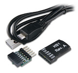

# JTAG-HS1

[](https://store.digilentinc.com/jtag-hs1-programming-cable-retired/?utm_source=platformio&utm_medium=docs)

The JTAG-HS1 programming cable is a high-speed programming solution for Xilinx® FPGAs. See the [official documentation](https://store.digilentinc.com/jtag-hs1-programming-cable-retired/?utm_source=platformio&utm_medium=docs).

## Configuration {#configuration}

Select this probe with the [`debug_tool`](../../reference/platformio-ini/env/debug-tool.md) option in [`platformio.ini`](../../reference/platformio-ini/index.md):

```ini
[env:myenv]
platform = ...
board = ...
debug_tool = digilent-hs1
```

To also upload firmware with this probe, set [`upload_protocol`](../../reference/platformio-ini/env/upload-protocol.md):

```ini
[env:myenv]
platform = ...
board = ...
debug_tool = digilent-hs1
upload_protocol = digilent-hs1
```

See also:

- [Debugging options](../../reference/platformio-ini/env/debug-options.md)
- [Upload options](../../reference/platformio-ini/env/upload-options.md)

<!-- begin_platforms -->

## Platforms

| Name | Description |
|---|---|
| [CHIPS Alliance](../platforms/chipsalliance.md) | The CHIPS Alliance develops high-quality, open source hardware designs relevant to silicon devices and FPGAs. |
| [OpenHW Group](../platforms/openhw.md) | OpenHW Group is a not-for-profit, global organization that provides an infrastructure for hosting high quality open-source HW developments in line with industry best practices. The OpenHW CV32E40P RISC-V core is the first open-source core for high-volume chips verified with the state-of-the-art process required for high-integrity, commercial SoCs. |

## Frameworks

| Name | Description |
|---|---|
| [FreeRTOS](../frameworks/freertos.md) | FreeRTOS is a real-time operating system kernel for embedded devices that has been ported to 40 microcontroller platforms. |
| [PULP Runtime Environment](../frameworks/pulp-runtime.md) | Runtime Environment for Parallel Ultra Low Power platform |
| [PULP SDK](../frameworks/pulp-sdk.md) | Software Development Kit for Parallel Ultra Low Power platform |
| [WD-Firmware](../frameworks/wd-riscv-sdk.md) | The WD Firmware package contains Firmware applications and Processor Support Package (PSP) for various cores, alongside demos which support all features. |

## Boards

| Name | Platform | Debug | MCU | Frequency | Flash | RAM |
|---|---|---|---|---|---|---|
| [Digilent Nexys A7](../boards/openhw/nexys-a7.md) | [OpenHW Group](../platforms/openhw.md) | On-board |  | 320MHz | 16MB | 1.16MB |
| [RVfpga: Digilent Nexys A7](../boards/chipsalliance/swervolf-nexys.md) | [CHIPS Alliance](../platforms/chipsalliance.md) | On-board |  | 320MHz | 16MB | 1.16MB |
