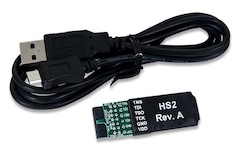

<a id="debugging-tool-digilent-hs2"></a>

# JTAG-HS2 {#jtag-hs2}

[](https://store.digilentinc.com/jtag-hs2-programming-cable/?utm_source=platformio&utm_medium=docs)

The JTAG-HS2 programming cable is a high-speed programming solution for Xilinx® FPGAs. Official reference can be found [here](https://store.digilentinc.com/jtag-hs2-programming-cable/?utm_source=platformio&utm_medium=docs).

## Configuration {#configuration}

You can configure debugging tool using [debug_tool](../../reference/platformio-ini/env/debug-tool.md) option in ["platformio.ini" (Project Configuration File)](../../reference/platformio-ini/index.md):

```ini
[env:myenv]
platform = ...
board = ...
debug_tool = digilent-hs2
```

If you would like to use this tool for firmware uploading, please change upload protocol:

```ini
[env:myenv]
platform = ...
board = ...
debug_tool = digilent-hs1
upload_protocol = digilent-hs1
```

More options:

- [Debugging options](../../reference/platformio-ini/env/debug-options.md)
- [Upload options](../../reference/platformio-ini/env/upload-options.md)

<!-- begin_platforms -->

## Platforms

| Name | Description |
|---|---|
| [OpenHW Group](../platforms/openhw.md) | OpenHW Group is a not-for-profit, global organization that provides an infrastructure for hosting high quality open-source HW developments in line with industry best practices. The OpenHW CV32E40P RISC-V core is the first open-source core for high-volume chips verified with the state-of-the-art process required for high-integrity, commercial SoCs. |

## Frameworks

| Name | Description |
|---|---|
| [PULP Runtime Environment](../frameworks/pulp-runtime.md) | Runtime Environment for Parallel Ultra Low Power platform |
| [PULP SDK](../frameworks/pulp-sdk.md) | Software Development Kit for Parallel Ultra Low Power platform |

## Boards

:::note

For more detailed `board` information please scroll tables below by horizontal.

:::

| Name | Platform | Debug | MCU | Frequency | Flash | RAM |
|---|---|---|---|---|---|---|
| [Digilent Nexys A7](../boards/openhw/nexys-a7.md) | [OpenHW Group](../platforms/openhw.md) | On-board |  | 320MHz | 16MB | 1.16MB |
