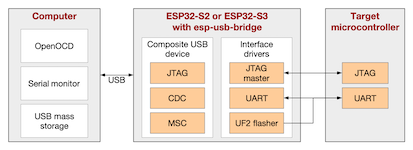

# ESP USB bridge

[](https://github.com/espressif/esp-usb-bridge?utm_source=platformio&utm_medium=docs)

The ESP USB Bridge is an ESP-IDF project utilizing an ESP32-S2 (or optionally, an ESP32-S3) chip to create a bridge between a computer (PC) and a target microcontroller (MCU). It can serve as a replacement for USB-to-UART chips (e.g. CP210x). See the [official documentation](https://github.com/espressif/esp-usb-bridge?utm_source=platformio&utm_medium=docs).

## Configuration {#configuration}

Select this probe with the [`debug_tool`](../../reference/platformio-ini/env/debug-tool.md) option in [`platformio.ini`](../../reference/platformio-ini/index.md):

```ini
[env:myenv]
platform = ...
board = ...
debug_tool = esp-usb-bridge
```

To also upload firmware with this probe, set [`upload_protocol`](../../reference/platformio-ini/env/upload-protocol.md):

```ini
[env:myenv]
platform = ...
board = ...
debug_tool = esp-usb-bridge
upload_protocol = esp-usb-bridge
```

See also:

- [Debugging options](../../reference/platformio-ini/env/debug-options.md)
- [Upload options](../../reference/platformio-ini/env/upload-options.md)

## Tutorials {#tutorials}

- [Use the PlatformIO Debugger on the ESP32 Using an ESP-prog](https://www.hackster.io/brian-lough/use-the-platformio-debugger-on-the-esp32-using-an-esp-prog-f633b6)

<!-- begin_platforms -->

## Platforms {#platforms}

| Name | Description |
|---|---|
| [Espressif 32](/hardware/platforms/espressif32) | Espressif Systems is a privately held fabless semiconductor company. They provide wireless communications and Wi-Fi chips which are widely used in mobile devices and the Internet of Things applications. |

## Frameworks {#frameworks}

| Name | Description |
|---|---|
| [Arduino](/hardware/frameworks/arduino) | Arduino Wiring-based Framework allows writing cross-platform software to control devices attached to a wide range of Arduino boards to create all kinds of creative coding, interactive objects, spaces or physical experiences |
| [Espressif IoT Development Framework](/hardware/frameworks/espidf) | ESP-IDF is the official development framework for the ESP32 and ESP32-S Series SoCs. |
