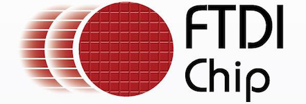

<a id="debugging-tool-ftdi"></a>

# FTDI chip {#ftdi-chip}

[](http://www.ftdichip.com/USB.html?utm_source=platformio&utm_medium=docs)

FTDI Chip develops innovative silicon solutions that enhance interaction with today’s technology. When a designer needs to add a USB port, rest assured that FTDI Chip has a full range of USB solutions to get the job done. See the [official documentation](http://www.ftdichip.com/USB.html?utm_source=platformio&utm_medium=docs).

## Configuration {#configuration}

Select this probe with the [`debug_tool`](../../reference/platformio-ini/env/debug-tool.md) option in [`platformio.ini`](../../reference/platformio-ini/index.md):

```ini
[env:myenv]
platform = ...
board = ...
debug_tool = ftdi
```

To also upload firmware with this probe, set [`upload_protocol`](../../reference/platformio-ini/env/upload-protocol.md):

```ini
[env:myenv]
platform = ...
board = ...
debug_tool = ftdi
upload_protocol = ftdi
```

See also:

- [Debugging options](../../reference/platformio-ini/env/debug-options.md)
- [Upload options](../../reference/platformio-ini/env/upload-options.md)

## Drivers {#drivers}

| Operating system | Driver |
| --- | --- |
| Windows | - [Step-by-step guide: Drivers, Zadig, Wiring](https://community.platformio.org/t/esp32-pio-unified-debugger/4541/20) - [Video tutorial](https://www.hackster.io/brian-lough/use-the-platformio-debugger-on-the-esp32-using-an-esp-prog-f633b6) |
| macOS | macOS contains default FTDIUSBSerialDriver driver which conflicts with debug tools which are based on this chip. FTDI Chip company recommends removing this default driver from a system. Everything should work after system rebooting. See detailed instruction in official application note (Page 16, Section 4: Uninstalling FTDI Drivers on OS X) [AN134: FTDI Drivers Installation guide for MAC OS X](http://www.ftdichip.com/Support/Documents/AppNotes/AN_134_FTDI_Drivers_Installation_Guide_for_MAC_OSX.pdf) |
| Linux | Install the [udev rules](../../get-started/install/udev-rules.md). If you installed them before, update them to the latest version. |

<!-- begin_platforms -->

## Platforms

| Name | Description |
|---|---|
| [Espressif 32](../platforms/espressif32.mdx) | ESP32 is a series of low-cost, low-power system on a chip microcontrollers with integrated Wi-Fi and Bluetooth. ESP32 integrates an antenna switch, RF balun, power amplifier, low-noise receive amplifier, filters, and power management modules. |
| [RISC-V GAP](../platforms/riscv-gap.mdx) | GreenWaves GAP8 IoT application processor enables the cost-effective development, deployment and autonomous operation of intelligent sensing devices that capture, analyze, classify and act on the fusion of rich data sources such as images, sounds or vibrations. |
| [Shakti](../platforms/shakti.md) | Shakti is an open-source initiative by the RISE group at IIT-Madras, which is not only building open source, production grade processors, but also associated components like interconnect fabrics, verification tools, storage controllers, peripheral IPs and SOC tools. |
| [SiFive](../platforms/sifive.md) | SiFive brings the power of open source and software automation to the semiconductor industry, making it possible to develop new hardware faster and more affordably than ever before. |

## Frameworks

| Name | Description |
|---|---|
| [Arduino](../frameworks/arduino.mdx) | Arduino Wiring-based Framework allows writing cross-platform software to control devices attached to a wide range of Arduino boards to create all kinds of creative coding, interactive objects, spaces or physical experiences. |
| [Espressif IoT Development Framework](../frameworks/espidf.mdx) | Espressif IoT Development Framework. Official development framework for ESP32 chip |
| [Freedom E SDK](../frameworks/freedom-e-sdk.mdx) | Open Source Software for Developing on the SiFive Freedom E Platform |
| [FreeRTOS](../frameworks/freertos.md) | FreeRTOS is a real-time operating system kernel for embedded devices that has been ported to 40 microcontroller platforms. |
| [Mbed](../frameworks/mbed.mdx) | Arm Mbed OS is a platform operating system designed for the internet of things |
| [PULP OS](../frameworks/pulp-os.md) | SDK for Greenwaves Technologies' GAP8 IoT Application Processor |
| [Shakti SDK](../frameworks/shakti-sdk.md) | A software development kit for developing applications on Shakti class of processors |
| [Zephyr](../frameworks/zephyr.mdx) | Zephyr is a new generation, scalable, optimized, secure RTOS for multiple hardware architectures |

## Boards

| Name | Platform | Debug | MCU | Frequency | Flash | RAM |
|---|---|---|---|---|---|---|
| [Artix-7 35T Arty FPGA Evaluation Kit](../boards/shakti/artix7-35t.md) | [Shakti](../platforms/shakti.md) | On-board | E-CLASS | 50MHz | 0B | 128KB |
| [Arty A7-100: Artix-7 FPGA Development Board](../boards/shakti/artix7-100t.md) | [Shakti](../platforms/shakti.md) | On-board | C-CLASS | 50MHz | 0B | 128MB |
| [Arty FPGA Dev Kit](../boards/sifive/e310-arty.md) | [SiFive](../platforms/sifive.md) | On-board | FE310 | 450MHz | 16MB | 256MB |
| [Espressif ESP-WROVER-KIT](../boards/espressif32/esp-wrover-kit.md) | [Espressif 32](../platforms/espressif32.mdx) | On-board | ESP32 | 240MHz | 4MB | 320KB |
| [Espressif ESP32-S2-Kaluga-1 Kit](../boards/espressif32/esp32-s2-kaluga-1.md) | [Espressif 32](../platforms/espressif32.mdx) | On-board | ESP32S2 | 240MHz | 4MB | 320KB |
| [GAPuino GAP8](../boards/riscv-gap/gapuino.md) | [RISC-V GAP](../platforms/riscv-gap.mdx) | On-board | GAP8 | 250MHz | 64MB | 8MB |
| [HiFive Unleashed](../boards/sifive/hifive-unleashed.md) | [SiFive](../platforms/sifive.md) | On-board | FU540 | 1500MHz | 32MB | 8GB |
| [HiFive1](../boards/sifive/hifive1.md) | [SiFive](../platforms/sifive.md) | On-board | FE310 | 320MHz | 16MB | 16KB |
| [Parashu on Artix-7 100T Arty FPGA Evaluation Kit](../boards/shakti/parashu.md) | [Shakti](../platforms/shakti.md) | On-board | E-CLASS | 50MHz | 0B | 128KB |
| [Pinaka on Artix-7 35T Arty FPGA Evaluation Kit](../boards/shakti/pinaka.md) | [Shakti](../platforms/shakti.md) | On-board | E-CLASS | 50MHz | 0B | 128KB |
| [Vajra on Arty A7-100: Artix-7 FPGA Development Board](../boards/shakti/vajra.md) | [Shakti](../platforms/shakti.md) | On-board | C-CLASS | 50MHz | 0B | 128MB |
