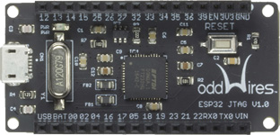

# oddWires IOT-Bus JTAG

[](http://www.oddwires.com/iot-bus-esp32-jtag/?utm_source=platformio&utm_medium=docs)

This IoT-Bus module provides JTAG debugging for the [oddWires IoT-Bus Io](/hardware/boards/espressif32/iotbusio) and [oddWires IoT-Bus Proteus](/hardware/boards/espressif32/iotbusproteus) boards (can be used with other boards too, see wiring connections below). The board uses the FT232H to provide a USB controller with JTAG support. Both debugging and flashing is possible using this port. See the [official documentation](http://www.oddwires.com/iot-bus-esp32-jtag/?utm_source=platformio&utm_medium=docs).

## Configuration {#configuration}

Select this probe with the [`debug_tool`](../../reference/platformio-ini/env/debug-tool.md) option in [`platformio.ini`](../../reference/platformio-ini/index.md):

```ini
[env:myenv]
platform = ...
board = ...
debug_tool = iot-bus-jtag
```

To also upload firmware with this probe, set [`upload_protocol`](../../reference/platformio-ini/env/upload-protocol.md):

```ini
[env:myenv]
platform = ...
board = ...
debug_tool = iot-bus-jtag
upload_protocol = iot-bus-jtag
```

See also:

- [Debugging options](../../reference/platformio-ini/env/debug-options.md)
- [Upload options](../../reference/platformio-ini/env/upload-options.md)

## Drivers {#drivers}

| Operating system | Driver |
| --- | --- |
| Windows | - [Step-by-step guide: Drivers, Zadig, Wiring](https://community.platformio.org/t/esp32-pio-unified-debugger/4541/20) - [Video tutorial](https://www.hackster.io/brian-lough/use-the-platformio-debugger-on-the-esp32-using-an-esp-prog-f633b6) |
| macOS | macOS contains default FTDIUSBSerialDriver driver which conflicts with debug tools which are based on this chip. FTDI Chip company recommends removing this default driver from a system. Everything should work after system rebooting. See detailed instruction in official application note (Page 16, Section 4: Uninstalling FTDI Drivers on OS X) [AN134: FTDI Drivers Installation guide for MAC OS X](http://www.ftdichip.com/Support/Documents/AppNotes/AN_134_FTDI_Drivers_Installation_Guide_for_MAC_OSX.pdf) |
| Linux | Install the [udev rules](../../get-started/install/udev-rules.md). If you installed them before, update them to the latest version. |

## Wiring connections {#wiring-connections}

| IOT-Bus JTAG Pin | Board JTAG Pin | Description |
|---|---|---|
| 3V3 | VCC | Positive Supply Voltage — Power supply for JTAG interface drivers |
| GND | GND | Digital ground |
| 12 | TDI | Test Data In pin |
| 14 | TMS | Test Mode State pin |
| 13 | TCK | JTAG Return Test Clock |
| 15 | TDO | Test Data Out pin |
| EN | RESET | Connect this pin to the (active low) reset input of the target CPU (EN for ESP32) |

<!-- begin_platforms -->

## Platforms

| Name | Description |
|---|---|
| [Espressif 32](../platforms/espressif32.mdx) | ESP32 is a series of low-cost, low-power system on a chip microcontrollers with integrated Wi-Fi and Bluetooth. ESP32 integrates an antenna switch, RF balun, power amplifier, low-noise receive amplifier, filters, and power management modules. |

## Frameworks

| Name | Description |
|---|---|
| [Arduino](../frameworks/arduino.mdx) | Arduino Wiring-based Framework allows writing cross-platform software to control devices attached to a wide range of Arduino boards to create all kinds of creative coding, interactive objects, spaces or physical experiences. |
| [Espressif IoT Development Framework](../frameworks/espidf.mdx) | Espressif IoT Development Framework. Official development framework for ESP32 chip |

## Boards

| Name | Platform | Debug | MCU | Frequency | Flash | RAM |
|---|---|---|---|---|---|---|
| [4D Systems GEN4-ESP32 16MB (ESP32S3-R8N16)](../boards/espressif32/4d-systems-esp32s3-gen4-r8n16.md) | [Espressif 32](../platforms/espressif32.mdx) | External | ESP32S3 | 240MHz | 16MB | 320KB |
| [AI Thinker ESP32-CAM](../boards/espressif32/esp32cam.md) | [Espressif 32](../platforms/espressif32.mdx) | External | ESP32 | 240MHz | 4MB | 320KB |
| [ALKS ESP32](../boards/espressif32/alksesp32.md) | [Espressif 32](../platforms/espressif32.mdx) | External | ESP32 | 240MHz | 4MB | 320KB |
| [AZ-Delivery ESP-32 Dev Kit C V4](../boards/espressif32/az-delivery-devkit-v4.md) | [Espressif 32](../platforms/espressif32.mdx) | External | ESP32 | 240MHz | 4MB | 520KB |
| [Adafruit ESP32 Feather](../boards/espressif32/featheresp32.md) | [Espressif 32](../platforms/espressif32.mdx) | External | ESP32 | 240MHz | 4MB | 320KB |
| [Adafruit ESP32-S2 Feather Development Board](../boards/espressif32/featheresp32-s2.md) | [Espressif 32](../platforms/espressif32.mdx) | External | ESP32S2 | 240MHz | 4MB | 320KB |
| [Adafruit Feather ESP32 V2](../boards/espressif32/adafruit-feather-esp32-v2.md) | [Espressif 32](../platforms/espressif32.mdx) | External | ESP32 | 240MHz | 8MB | 320KB |
| [Adafruit Feather ESP32-C6](../boards/espressif32/adafruit-feather-esp32c6.md) | [Espressif 32](../platforms/espressif32.mdx) | External | ESP32C6 | 160MHz | 4MB | 320KB |
| [Adafruit Feather ESP32-S2](../boards/espressif32/adafruit-feather-esp32s2.md) | [Espressif 32](../platforms/espressif32.mdx) | External | ESP32S2 | 240MHz | 4MB | 320KB |
| [Adafruit Feather ESP32-S2 Reverse TFT](../boards/espressif32/adafruit-feather-esp32s2-reversetft.md) | [Espressif 32](../platforms/espressif32.mdx) | External | ESP32S2 | 240MHz | 4MB | 320KB |
| [Adafruit Feather ESP32-S2 TFT](../boards/espressif32/adafruit-feather-esp32s2-tft.md) | [Espressif 32](../platforms/espressif32.mdx) | External | ESP32S2 | 240MHz | 4MB | 320KB |
| [Adafruit Feather ESP32-S3 2MB PSRAM](../boards/espressif32/adafruit-feather-esp32s3.md) | [Espressif 32](../platforms/espressif32.mdx) | External | ESP32S3 | 240MHz | 4MB | 320KB |
| [Adafruit Feather ESP32-S3 No PSRAM](../boards/espressif32/adafruit-feather-esp32s3-nopsram.md) | [Espressif 32](../platforms/espressif32.mdx) | External | ESP32S3 | 240MHz | 8MB | 320KB |
| [Adafruit Feather ESP32-S3 Reverse TFT](../boards/espressif32/adafruit-feather-esp32s3-reversetft.md) | [Espressif 32](../platforms/espressif32.mdx) | External | ESP32S3 | 240MHz | 4MB | 320KB |
| [Adafruit Feather ESP32-S3 TFT](../boards/espressif32/adafruit-feather-esp32s3-tft.md) | [Espressif 32](../platforms/espressif32.mdx) | External | ESP32S3 | 240MHz | 4MB | 320KB |
| [Adafruit FunHouse](../boards/espressif32/adafruit-funhouse-esp32s2.md) | [Espressif 32](../platforms/espressif32.mdx) | External | ESP32S2 | 240MHz | 4MB | 320KB |
| [Adafruit ItsyBitsy ESP32](../boards/espressif32/adafruit-itsybitsy-esp32.md) | [Espressif 32](../platforms/espressif32.mdx) | External | ESP32 | 240MHz | 8MB | 320KB |
| [Adafruit MagTag 2.9](../boards/espressif32/adafruit-magtag29-esp32s2.md) | [Espressif 32](../platforms/espressif32.mdx) | External | ESP32S2 | 240MHz | 4MB | 320KB |
| [Adafruit MatrixPortal ESP32-S3](../boards/espressif32/adafruit-matrixportal-esp32s3.md) | [Espressif 32](../platforms/espressif32.mdx) | External | ESP32S3 | 240MHz | 8MB | 320KB |
| [Adafruit Metro ESP32-S2](../boards/espressif32/adafruit-metro-esp32s2.md) | [Espressif 32](../platforms/espressif32.mdx) | External | ESP32S2 | 240MHz | 4MB | 320KB |
| [Adafruit Metro ESP32-S3](../boards/espressif32/adafruit-metro-esp32s3.md) | [Espressif 32](../platforms/espressif32.mdx) | External | ESP32S3 | 240MHz | 16MB | 320KB |
| [Adafruit QT Py ESP32](../boards/espressif32/adafruit-qtpy-esp32.md) | [Espressif 32](../platforms/espressif32.mdx) | External | ESP32 | 240MHz | 8MB | 320KB |
| [Adafruit QT Py ESP32-C3](../boards/espressif32/adafruit-qtpy-esp32c3.md) | [Espressif 32](../platforms/espressif32.mdx) | External | ESP32C3 | 160MHz | 4MB | 320KB |
| [Adafruit QT Py ESP32-S2](../boards/espressif32/adafruit-qtpy-esp32s2.md) | [Espressif 32](../platforms/espressif32.mdx) | External | ESP32S2 | 240MHz | 4MB | 320KB |
| [Adafruit QT Py ESP32-S3 (4M Flash 2M PSRAM)](../boards/espressif32/adafruit-qtpy-esp32s3-n4r2.md) | [Espressif 32](../platforms/espressif32.mdx) | External | ESP32S3 | 240MHz | 4MB | 320KB |
| [Adafruit QT Py ESP32-S3 No PSRAM](../boards/espressif32/adafruit-qtpy-esp32s3-nopsram.md) | [Espressif 32](../platforms/espressif32.mdx) | External | ESP32S3 | 240MHz | 8MB | 320KB |
| [Adafruit Qualia ESP32-S3 RGB666](../boards/espressif32/adafruit-qualia-s3-rgb666.md) | [Espressif 32](../platforms/espressif32.mdx) | External | ESP32S3 | 240MHz | 16MB | 320KB |
| [Adafruit pyCamera S3](../boards/espressif32/adafruit-camera-esp32s3.md) | [Espressif 32](../platforms/espressif32.mdx) | External | ESP32S3 | 240MHz | 4MB | 320KB |
| [Ai-Thinker ESP-C3-M1-I-Kit](../boards/espressif32/esp32-c3-m1i-kit.md) | [Espressif 32](../platforms/espressif32.mdx) | External | ESP32C3 | 160MHz | 4MB | 320KB |
| [Ai-Thinker NodeMCU-32S2 (ESP-12K)](../boards/espressif32/nodemcu-32s2.md) | [Espressif 32](../platforms/espressif32.mdx) | External | ESP32S2 | 240MHz | 4MB | 320KB |
| [AirM2M CORE ESP32C3](../boards/espressif32/airm2m-core-esp32c3.md) | [Espressif 32](../platforms/espressif32.mdx) | External | ESP32C3 | 160MHz | 4MB | 320KB |
| [Arduino Nano ESP32](../boards/espressif32/arduino-nano-esp32.md) | [Espressif 32](../platforms/espressif32.mdx) | External | ESP32S3 | 240MHz | 16MB | 320KB |
| [ArtronShop ATD1.47-S3](../boards/espressif32/atd147-s3.md) | [Espressif 32](../platforms/espressif32.mdx) | External | ESP32S3 | 240MHz | 8MB | 320KB |
| [ArtronShop IOXESP32](../boards/espressif32/ioxesp32.md) | [Espressif 32](../platforms/espressif32.mdx) | External | ESP32 | 240MHz | 4MB | 320KB |
| [ArtronShop IOXESP32PS](../boards/espressif32/ioxesp32ps.md) | [Espressif 32](../platforms/espressif32.mdx) | External | ESP32 | 240MHz | 4MB | 320KB |
| [Aventen S3 Sync](../boards/espressif32/aventen-s3-sync.md) | [Espressif 32](../platforms/espressif32.mdx) | External | ESP32S3 | 240MHz | 16MB | 320KB |
| [BPI-Leaf-S3](../boards/espressif32/bpi-leaf-s3.md) | [Espressif 32](../platforms/espressif32.mdx) | External | ESP32S3 | 240MHz | 8MB | 320KB |
| [Blinker WiFiduino32S3](../boards/espressif32/wifiduino32s3.md) | [Espressif 32](../platforms/espressif32.mdx) | External | ESP32S3 | 240MHz | 8MB | 320KB |
| [Blinker WiFiduinoV2 (ESP32-C3)](../boards/espressif32/wifiduino32c3.md) | [Espressif 32](../platforms/espressif32.mdx) | External | ESP32C3 | 160MHz | 4MB | 320KB |
| [Connaxio's Espoir](../boards/espressif32/connaxio-espoir.md) | [Espressif 32](../platforms/espressif32.mdx) | External | ESP32 | 240MHz | 4MB | 320KB |
| [Cytron Maker Feather AIoT S3](../boards/espressif32/cytron-maker-feather-aiot-s3.md) | [Espressif 32](../platforms/espressif32.mdx) | External | ESP32S3 | 240MHz | 8MB | 320KB |
| [D-duino-32](../boards/espressif32/d-duino-32.md) | [Espressif 32](../platforms/espressif32.mdx) | External | ESP32 | 240MHz | 4MB | 320KB |
| [DFRobot Beetle ESP32-C3](../boards/espressif32/dfrobot-beetle-esp32c3.md) | [Espressif 32](../platforms/espressif32.mdx) | External | ESP32C3 | 160MHz | 4MB | 320KB |
| [DFRobot Edge101 IOT Controller](../boards/espressif32/dfrobot-edge101.md) | [Espressif 32](../platforms/espressif32.mdx) | External | ESP32 | 240MHz | 16MB | 320KB |
| [DFRobot Firebeetle 2 ESP32-E](../boards/espressif32/dfrobot-firebeetle2-esp32e.md) | [Espressif 32](../platforms/espressif32.mdx) | External | ESP32 | 240MHz | 4MB | 320KB |
| [DFRobot Firebeetle 2 ESP32-S3](../boards/espressif32/dfrobot-firebeetle2-esp32s3.md) | [Espressif 32](../platforms/espressif32.mdx) | External | ESP32S3 | 240MHz | 4MB | 320KB |
| [DFRobot Romeo ESP32-S3](../boards/espressif32/dfrobot-romeo-esp32s3.md) | [Espressif 32](../platforms/espressif32.mdx) | External | ESP32S3 | 240MHz | 16MB | 320KB |
| [DOIT ESP32 DEVKIT V1](../boards/espressif32/esp32doit-devkit-v1.md) | [Espressif 32](../platforms/espressif32.mdx) | External | ESP32 | 240MHz | 4MB | 320KB |
| [DOIT ESPduino32](../boards/espressif32/esp32doit-espduino.md) | [Espressif 32](../platforms/espressif32.mdx) | External | ESP32 | 240MHz | 4MB | 320KB |
| [Deneyap Kart](../boards/espressif32/deneyapkart.md) | [Espressif 32](../platforms/espressif32.mdx) | External | ESP32 | 240MHz | 4MB | 320KB |
| [Deneyap Kart 1A](../boards/espressif32/deneyapkart1a.md) | [Espressif 32](../platforms/espressif32.mdx) | External | ESP32 | 240MHz | 4MB | 320KB |
| [Deneyap Kart 1A v2](../boards/espressif32/deneyapkart1av2.md) | [Espressif 32](../platforms/espressif32.mdx) | External | ESP32S3 | 240MHz | 4MB | 320KB |
| [Deneyap Kart G](../boards/espressif32/deneyapkartg.md) | [Espressif 32](../platforms/espressif32.mdx) | External | ESP32C3 | 160MHz | 4MB | 320KB |
| [Deneyap Mini](../boards/espressif32/deneyapmini.md) | [Espressif 32](../platforms/espressif32.mdx) | External | ESP32S2 | 240MHz | 4MB | 320KB |
| [Deneyap Mini v2](../boards/espressif32/deneyapminiv2.md) | [Espressif 32](../platforms/espressif32.mdx) | External | ESP32S2 | 240MHz | 4MB | 320KB |
| [Department of Alchemy MiniMain ESP32-S2](../boards/espressif32/minimain-esp32s2.md) | [Espressif 32](../platforms/espressif32.mdx) | External | ESP32S2 | 240MHz | 4MB | 320KB |
| [Dongsen Tech Pocket 32](../boards/espressif32/pocket-32.md) | [Espressif 32](../platforms/espressif32.mdx) | External | ESP32 | 240MHz | 4MB | 320KB |
| [ESP32 FM DevKit](../boards/espressif32/fm-devkit.md) | [Espressif 32](../platforms/espressif32.mdx) | External | ESP32 | 240MHz | 4MB | 320KB |
| [ESP32 Pico Kit](../boards/espressif32/pico32.md) | [Espressif 32](../platforms/espressif32.mdx) | External | ESP32 | 240MHz | 4MB | 320KB |
| [ESP32-S3 PowerFeather](../boards/espressif32/esp32s3-powerfeather.md) | [Espressif 32](../platforms/espressif32.mdx) | External | ESP32S3 | 240MHz | 8MB | 320KB |
| [ESP32S3 CAM LCD](../boards/espressif32/esp32s3camlcd.md) | [Espressif 32](../platforms/espressif32.mdx) | External | ESP32S3 | 240MHz | 8MB | 320KB |
| [ESP32vn IoT Uno](../boards/espressif32/esp32vn-iot-uno.md) | [Espressif 32](../platforms/espressif32.mdx) | External | ESP32 | 240MHz | 4MB | 320KB |
| [ESPectro32](../boards/espressif32/espectro32.md) | [Espressif 32](../platforms/espressif32.mdx) | External | ESP32 | 240MHz | 4MB | 320KB |
| [ESPino32](../boards/espressif32/espino32.md) | [Espressif 32](../platforms/espressif32.mdx) | External | ESP32 | 240MHz | 4MB | 320KB |
| [Elektrofuzzis ftSwarmControl USB-C](../boards/espressif32/ftswarmcontrolusbc.md) | [Espressif 32](../platforms/espressif32.mdx) | On-board | ESP32S3 | 240MHz | 4MB | 320KB |
| [Elektrofuzzis ftSwarmControl USBMicro](../boards/espressif32/ftswarmcontrolusbmicro.md) | [Espressif 32](../platforms/espressif32.mdx) | External | ESP32 | 240MHz | 4MB | 320KB |
| [Elektrofuzzis ftSwarmDuino](../boards/espressif32/ftswarmduino.md) | [Espressif 32](../platforms/espressif32.mdx) | On-board | ESP32S3 | 240MHz | 4MB | 320KB |
| [Elektrofuzzis ftSwarmJST](../boards/espressif32/ftswarmjst.md) | [Espressif 32](../platforms/espressif32.mdx) | External | ESP32 | 240MHz | 4MB | 320KB |
| [Elektrofuzzis ftSwarmPwrDrive](../boards/espressif32/ftswarmpwrdrive.md) | [Espressif 32](../platforms/espressif32.mdx) | On-board | ESP32S3 | 240MHz | 4MB | 320KB |
| [Elektrofuzzis ftSwarmXL](../boards/espressif32/ftswarmxl.md) | [Espressif 32](../platforms/espressif32.mdx) | On-board | ESP32S3 | 240MHz | 4MB | 320KB |
| [EspinalLab ATMegaZero ESP32-S2](../boards/espressif32/atmegazero-esp32s2.md) | [Espressif 32](../platforms/espressif32.mdx) | External | ESP32S2 | 240MHz | 16MB | 320KB |
| [Espressif ESP-WROVER-KIT](../boards/espressif32/esp-wrover-kit.md) | [Espressif 32](../platforms/espressif32.mdx) | On-board | ESP32 | 240MHz | 4MB | 320KB |
| [Espressif ESP32 Dev Module](../boards/espressif32/esp32dev.md) | [Espressif 32](../platforms/espressif32.mdx) | External | ESP32 | 240MHz | 4MB | 320KB |
| [Espressif ESP32-C3-DevKitC-02](../boards/espressif32/esp32-c3-devkitc-02.md) | [Espressif 32](../platforms/espressif32.mdx) | External | ESP32C3 | 160MHz | 4MB | 320KB |
| [Espressif ESP32-C3-DevKitM-1](../boards/espressif32/esp32-c3-devkitm-1.md) | [Espressif 32](../platforms/espressif32.mdx) | External | ESP32C3 | 160MHz | 4MB | 320KB |
| [Espressif ESP32-C6-DevKitM-1](../boards/espressif32/esp32-c6-devkitm-1.md) | [Espressif 32](../platforms/espressif32.mdx) | External | ESP32C6 | 160MHz | 4MB | 320KB |
| [Espressif ESP32-S2-Kaluga-1 Kit](../boards/espressif32/esp32-s2-kaluga-1.md) | [Espressif 32](../platforms/espressif32.mdx) | On-board | ESP32S2 | 240MHz | 4MB | 320KB |
| [Espressif ESP32-S2-Saola-1](../boards/espressif32/esp32-s2-saola-1.md) | [Espressif 32](../platforms/espressif32.mdx) | External | ESP32S2 | 240MHz | 4MB | 320KB |
| [Espressif ESP32-S3-Box](../boards/espressif32/esp32s3box.md) | [Espressif 32](../platforms/espressif32.mdx) | External | ESP32S3 | 240MHz | 16MB | 320KB |
| [Espressif ESP32-S3-DevKitC-1-N8 (8 MB QD, No PSRAM)](../boards/espressif32/esp32-s3-devkitc-1.md) | [Espressif 32](../platforms/espressif32.mdx) | On-board | ESP32S3 | 240MHz | 8MB | 320KB |
| [Espressif ESP32-S3-DevKitM-1](../boards/espressif32/esp32-s3-devkitm-1.md) | [Espressif 32](../platforms/espressif32.mdx) | On-board | ESP32S3 | 240MHz | 8MB | 320KB |
| [Espressif ESP32-S3-USB-OTG](../boards/espressif32/esp32s3usbotg.md) | [Espressif 32](../platforms/espressif32.mdx) | On-board | ESP32S3 | 240MHz | 8MB | 320KB |
| [FireBeetle-ESP32](../boards/espressif32/firebeetle32.md) | [Espressif 32](../platforms/espressif32.mdx) | External | ESP32 | 240MHz | 16MB | 520KB |
| [Franzininho WiFi](../boards/espressif32/franzininho-wifi-esp32s2.md) | [Espressif 32](../platforms/espressif32.mdx) | External | ESP32S2 | 240MHz | 4MB | 320KB |
| [Franzininho WiFi Board](../boards/espressif32/esp32-s2-franzininho.md) | [Espressif 32](../platforms/espressif32.mdx) | External | ESP32S2 | 240MHz | 4MB | 320KB |
| [Franzininho WiFi MSC](../boards/espressif32/franzininho-wifi-msc-esp32s2.md) | [Espressif 32](../platforms/espressif32.mdx) | External | ESP32S2 | 240MHz | 4MB | 320KB |
| [Freenove ESP32-S3 WROOM N8R8 (8MB Flash / 8MB PSRAM)](../boards/espressif32/freenove-esp32-s3-wroom.md) | [Espressif 32](../platforms/espressif32.mdx) | On-board | ESP32S3 | 240MHz | 8MB | 320KB |
| [Freenove ESP32-Wrover](../boards/espressif32/freenove-esp32-wrover.md) | [Espressif 32](../platforms/espressif32.mdx) | External | ESP32 | 240MHz | 4MB | 320KB |
| [Frog Board ESP32](../boards/espressif32/frogboard.md) | [Espressif 32](../platforms/espressif32.mdx) | External | ESP32 | 240MHz | 4MB | 320KB |
| [Geekble nano ESP32-S3](../boards/espressif32/geekble-nano-esp32s3.md) | [Espressif 32](../platforms/espressif32.mdx) | External | ESP32S3 | 240MHz | 4MB | 320KB |
| [HONEYLemon](../boards/espressif32/honeylemon.md) | [Espressif 32](../platforms/espressif32.mdx) | External | ESP32 | 240MHz | 4MB | 320KB |
| [Heltec Capsule Sensor v3](../boards/espressif32/heltec-capsule-sensor-v3.md) | [Espressif 32](../platforms/espressif32.mdx) | External | ESP32S3 | 240MHz | 8MB | 320KB |
| [Heltec Vision Master E213](../boards/espressif32/heltec-vision-master-e213.md) | [Espressif 32](../platforms/espressif32.mdx) | External | ESP32S3 | 240MHz | 8MB | 320KB |
| [Heltec Vision Master E290](../boards/espressif32/heltec-vision-master-e290.md) | [Espressif 32](../platforms/espressif32.mdx) | External | ESP32S3 | 240MHz | 8MB | 320KB |
| [Heltec Vision Master T190](../boards/espressif32/heltec-vision-master-t190.md) | [Espressif 32](../platforms/espressif32.mdx) | External | ESP32S3 | 240MHz | 8MB | 320KB |
| [Heltec WiFi Kit 32 (V3)](../boards/espressif32/heltec-wifi-kit-32-v3.md) | [Espressif 32](../platforms/espressif32.mdx) | External | ESP32S3 | 240MHz | 8MB | 320KB |
| [Heltec WiFi LoRa 32](../boards/espressif32/heltec-wifi-lora-32.md) | [Espressif 32](../platforms/espressif32.mdx) | External | ESP32 | 240MHz | 4MB | 320KB |
| [Heltec WiFi LoRa 32 (V2)](../boards/espressif32/heltec-wifi-lora-32-v2.md) | [Espressif 32](../platforms/espressif32.mdx) | External | ESP32 | 240MHz | 8MB | 320KB |
| [Heltec WiFi LoRa 32 (V3)](../boards/espressif32/heltec-wifi-lora-32-v3.md) | [Espressif 32](../platforms/espressif32.mdx) | External | ESP32S3 | 240MHz | 8MB | 320KB |
| [Heltec WiFi LoRa 32 v4](../boards/espressif32/heltec-wifi-lora-32-v4.md) | [Espressif 32](../platforms/espressif32.mdx) | External | ESP32S3 | 240MHz | 16MB | 320KB |
| [Heltec Wireless Bridge](../boards/espressif32/heltec-wireless-bridge.md) | [Espressif 32](../platforms/espressif32.mdx) | External | ESP32 | 240MHz | 8MB | 320KB |
| [Heltec Wireless Paper](../boards/espressif32/heltec-wireless-paper.md) | [Espressif 32](../platforms/espressif32.mdx) | External | ESP32S3 | 240MHz | 8MB | 320KB |
| [Heltec Wireless Shell v3](../boards/espressif32/heltec-wireless-shell-v3.md) | [Espressif 32](../platforms/espressif32.mdx) | External | ESP32S3 | 240MHz | 8MB | 320KB |
| [Heltec Wireless Stick](../boards/espressif32/heltec-wireless-stick.md) | [Espressif 32](../platforms/espressif32.mdx) | External | ESP32 | 240MHz | 8MB | 320KB |
| [Heltec Wireless Stick Lite v3](../boards/espressif32/heltec-wireless-stick-lite-v3.md) | [Espressif 32](../platforms/espressif32.mdx) | External | ESP32S3 | 240MHz | 8MB | 320KB |
| [Heltec Wireless Stick v3](../boards/espressif32/heltec-wireless-stick-v3.md) | [Espressif 32](../platforms/espressif32.mdx) | External | ESP32S3 | 240MHz | 8MB | 320KB |
| [Heltec Wireless Tracker](../boards/espressif32/heltec-wireless-tracker.md) | [Espressif 32](../platforms/espressif32.mdx) | External | ESP32S3 | 240MHz | 8MB | 320KB |
| [Hornbill ESP32 Dev](../boards/espressif32/hornbill32dev.md) | [Espressif 32](../platforms/espressif32.mdx) | External | ESP32 | 240MHz | 4MB | 320KB |
| [Hornbill ESP32 Minima](../boards/espressif32/hornbill32minima.md) | [Espressif 32](../platforms/espressif32.mdx) | External | ESP32 | 240MHz | 4MB | 320KB |
| [IoTaaP Magnolia](../boards/espressif32/iotaap-magnolia.md) | [Espressif 32](../platforms/espressif32.mdx) | External | ESP32 | 240MHz | 4MB | 320KB |
| [Kinetic Dynamics Nebula S3](../boards/espressif32/nebulas3.md) | [Espressif 32](../platforms/espressif32.mdx) | External | ESP32S3 | 240MHz | 4MB | 320KB |
| [LOGISENSES Senses Weizen](../boards/espressif32/sensesiot-weizen.md) | [Espressif 32](../platforms/espressif32.mdx) | External | ESP32 | 240MHz | 4MB | 320KB |
| [Lilka v2](../boards/espressif32/lilka-v2.md) | [Espressif 32](../platforms/espressif32.mdx) | External | ESP32S3 | 240MHz | 16MB | 320KB |
| [LilyGo T-Display-S3](../boards/espressif32/lilygo-t-display-s3.md) | [Espressif 32](../platforms/espressif32.mdx) | External | ESP32S3 | 240MHz | 16MB | 320KB |
| [LilyGo T3-S3](../boards/espressif32/lilygo-t3-s3.md) | [Espressif 32](../platforms/espressif32.mdx) | External | ESP32S3 | 240MHz | 4MB | 320KB |
| [Lion:Bit Dev Board](../boards/espressif32/lionbit.md) | [Espressif 32](../platforms/espressif32.mdx) | External | ESP32 | 240MHz | 4MB | 320KB |
| [Lion:Bit S3 STEM Dev Board](../boards/espressif32/lionbits3.md) | [Espressif 32](../platforms/espressif32.mdx) | On-board | ESP32S3 | 240MHz | 4MB | 320KB |
| [M5Stack AtomS3](../boards/espressif32/m5stack-atoms3.md) | [Espressif 32](../platforms/espressif32.mdx) | External | ESP32S3 | 240MHz | 8MB | 320KB |
| [M5Stack Capsule](../boards/espressif32/m5stack-capsule.md) | [Espressif 32](../platforms/espressif32.mdx) | External | ESP32S3 | 240MHz | 4MB | 320KB |
| [M5Stack Cardputer](../boards/espressif32/m5stack-cardputer.md) | [Espressif 32](../platforms/espressif32.mdx) | External | ESP32S3 | 240MHz | 4MB | 320KB |
| [M5Stack CoreS3](../boards/espressif32/m5stack-cores3.md) | [Espressif 32](../platforms/espressif32.mdx) | External | ESP32S3 | 240MHz | 16MB | 320KB |
| [M5Stack Dial](../boards/espressif32/m5stack-dial.md) | [Espressif 32](../platforms/espressif32.mdx) | External | ESP32S3 | 240MHz | 4MB | 320KB |
| [M5Stack DinMeter](../boards/espressif32/m5stack-dinmeter.md) | [Espressif 32](../platforms/espressif32.mdx) | External | ESP32S3 | 240MHz | 4MB | 320KB |
| [M5Stack M5Paper](../boards/espressif32/m5stack-paper.md) | [Espressif 32](../platforms/espressif32.mdx) | External | ESP32 | 240MHz | 16MB | 4.31MB |
| [M5Stack NanoC6](../boards/espressif32/m5stack-nanoc6.md) | [Espressif 32](../platforms/espressif32.mdx) | External | ESP32C6 | 160MHz | 4MB | 320KB |
| [M5Stack PoE CAM](../boards/espressif32/m5stack-poe-cam.md) | [Espressif 32](../platforms/espressif32.mdx) | External | ESP32 | 240MHz | 4MB | 320KB |
| [M5Stack Stamp-C3](../boards/espressif32/m5stack-stamp-c3.md) | [Espressif 32](../platforms/espressif32.mdx) | External | ESP32C3 | 160MHz | 4MB | 320KB |
| [M5Stack StampS3](../boards/espressif32/m5stack-stamps3.md) | [Espressif 32](../platforms/espressif32.mdx) | External | ESP32S3 | 240MHz | 8MB | 320KB |
| [M5Stack StickC](../boards/espressif32/m5stick-c.md) | [Espressif 32](../platforms/espressif32.mdx) | External | ESP32 | 240MHz | 4MB | 320KB |
| [M5Stack StickC-Plus](../boards/espressif32/m5stack-stickc-plus.md) | [Espressif 32](../platforms/espressif32.mdx) | External | ESP32 | 240MHz | 4MB | 320KB |
| [M5Stack StickC-Plus2](../boards/espressif32/m5stack-stickc-plus2.md) | [Espressif 32](../platforms/espressif32.mdx) | External | ESP32 | 240MHz | 8MB | 320KB |
| [M5Stack Tough](../boards/espressif32/m5stack-tough.md) | [Espressif 32](../platforms/espressif32.mdx) | External | ESP32 | 240MHz | 16MB | 4.31MB |
| [M5Stack Unit CAM](../boards/espressif32/m5stack-unit-cam.md) | [Espressif 32](../platforms/espressif32.mdx) | External | ESP32 | 240MHz | 4MB | 320KB |
| [M5Stack Unit CamS3](../boards/espressif32/m5stack-unit-cams3.md) | [Espressif 32](../platforms/espressif32.mdx) | External | ESP32S3 | 240MHz | 16MB | 320KB |
| [MH ET LIVE ESP32DevKIT](../boards/espressif32/mhetesp32devkit.md) | [Espressif 32](../platforms/espressif32.mdx) | External | ESP32 | 240MHz | 4MB | 320KB |
| [MH ET LIVE ESP32MiniKit](../boards/espressif32/mhetesp32minikit.md) | [Espressif 32](../platforms/espressif32.mdx) | External | ESP32 | 240MHz | 4MB | 320KB |
| [MakerAsia KB32-FT](../boards/espressif32/kb32-ft.md) | [Espressif 32](../platforms/espressif32.mdx) | External | ESP32 | 240MHz | 4MB | 320KB |
| [MotorGo Mini 1 (ESP32-S3)](../boards/espressif32/motorgo-mini-1.md) | [Espressif 32](../platforms/espressif32.mdx) | External | ESP32S3 | 240MHz | 4MB | 320KB |
| [Munich Labs RedPill ESP32-S3](../boards/espressif32/redpill-esp32s3.md) | [Espressif 32](../platforms/espressif32.mdx) | External | ESP32S3 | 240MHz | 8MB | 320KB |
| [Namino Arancio](../boards/espressif32/namino-arancio.md) | [Espressif 32](../platforms/espressif32.mdx) | External | ESP32S3 | 240MHz | 4MB | 320KB |
| [Namino Rosso](../boards/espressif32/namino-rosso.md) | [Espressif 32](../platforms/espressif32.mdx) | External | ESP32S3 | 240MHz | 4MB | 320KB |
| [Node32s](../boards/espressif32/node32s.md) | [Espressif 32](../platforms/espressif32.mdx) | External | ESP32 | 240MHz | 4MB | 320KB |
| [NodeMCU-32S](../boards/espressif32/nodemcu-32s.md) | [Espressif 32](../platforms/espressif32.mdx) | External | ESP32 | 240MHz | 4MB | 320KB |
| [OLIMEX ESP32-DevKit-LiPo](../boards/espressif32/esp32-devkitlipo.md) | [Espressif 32](../platforms/espressif32.mdx) | External | ESP32 | 240MHz | 4MB | 320KB |
| [OLIMEX ESP32-EVB](../boards/espressif32/esp32-evb.md) | [Espressif 32](../platforms/espressif32.mdx) | External | ESP32 | 240MHz | 4MB | 320KB |
| [OLIMEX ESP32-GATEWAY](../boards/espressif32/esp32-gateway.md) | [Espressif 32](../platforms/espressif32.mdx) | External | ESP32 | 240MHz | 4MB | 320KB |
| [Pycom LoPy](../boards/espressif32/lopy.md) | [Espressif 32](../platforms/espressif32.mdx) | External | ESP32 | 240MHz | 4MB | 320KB |
| [Pycom LoPy4](../boards/espressif32/lopy4.md) | [Espressif 32](../platforms/espressif32.mdx) | External | ESP32 | 240MHz | 4MB | 1.25MB |
| [Pycom WiPy3](../boards/espressif32/wipy3.md) | [Espressif 32](../platforms/espressif32.mdx) | External | ESP32 | 240MHz | 4MB | 1.25MB |
| [RYMCU ESP32-C3-DevKitM-1](../boards/espressif32/rymcu-esp32-c3-devkitm-1.md) | [Espressif 32](../platforms/espressif32.mdx) | External | ESP32C3 | 160MHz | 4MB | 320KB |
| [RYMCU ESP32-DevKitC](../boards/espressif32/rymcu-esp32-devkitc.md) | [Espressif 32](../platforms/espressif32.mdx) | External | ESP32 | 240MHz | 4MB | 320KB |
| [RYMCU ESP32-S3-DevKitC-1-N8R2 (8 MB QD, 2 MB PSRAM)](../boards/espressif32/rymcu-esp32-s3-devkitc-1.md) | [Espressif 32](../platforms/espressif32.mdx) | On-board | ESP32S3 | 240MHz | 8MB | 320KB |
| [SG-O AirMon](../boards/espressif32/sg-o-airmon.md) | [Espressif 32](../platforms/espressif32.mdx) | External | ESP32 | 240MHz | 4MB | 320KB |
| [SQFMI Watchy v2.0](../boards/espressif32/watchy.md) | [Espressif 32](../platforms/espressif32.mdx) | External | ESP32 | 240MHz | 4MB | 320KB |
| [Seeed Studio Edgebox-ESP-100](../boards/espressif32/edgebox-esp-100.md) | [Espressif 32](../platforms/espressif32.mdx) | External | ESP32S3 | 240MHz | 16MB | 320KB |
| [Seeed Studio XIAO ESP32C3](../boards/espressif32/seeed-xiao-esp32c3.md) | [Espressif 32](../platforms/espressif32.mdx) | External | ESP32C3 | 160MHz | 4MB | 320KB |
| [Seeed Studio XIAO ESP32C6](../boards/espressif32/seeed-xiao-esp32c6.md) | [Espressif 32](../platforms/espressif32.mdx) | External | ESP32C6 | 160MHz | 4MB | 320KB |
| [Seeed Studio XIAO ESP32S3](../boards/espressif32/seeed-xiao-esp32s3.md) | [Espressif 32](../platforms/espressif32.mdx) | External | ESP32S3 | 240MHz | 8MB | 320KB |
| [Silicognition wESP32](../boards/espressif32/wesp32.md) | [Espressif 32](../platforms/espressif32.mdx) | External | ESP32 | 240MHz | 4MB | 320KB |
| [Smart Bee Data Logger](../boards/espressif32/bee-data-logger.md) | [Espressif 32](../platforms/espressif32.mdx) | External | ESP32S3 | 240MHz | 8MB | 320KB |
| [Smart Bee Motion](../boards/espressif32/bee-motion.md) | [Espressif 32](../platforms/espressif32.mdx) | External | ESP32S2 | 240MHz | 4MB | 320KB |
| [Smart Bee Motion Mini](../boards/espressif32/bee-motion-mini.md) | [Espressif 32](../platforms/espressif32.mdx) | External | ESP32C3 | 160MHz | 4MB | 320KB |
| [Smart Bee Motion S3](../boards/espressif32/bee-motion-s3.md) | [Espressif 32](../platforms/espressif32.mdx) | External | ESP32S3 | 240MHz | 8MB | 320KB |
| [Smart Bee S3](../boards/espressif32/bee-s3.md) | [Espressif 32](../platforms/espressif32.mdx) | External | ESP32S3 | 240MHz | 8MB | 320KB |
| [SparkFun ESP32 IoT RedBoard](../boards/espressif32/sparkfun-esp32-iot-redboard.md) | [Espressif 32](../platforms/espressif32.mdx) | External | ESP32 | 240MHz | 4MB | 320KB |
| [SparkFun ESP32 Thing](../boards/espressif32/esp32thing.md) | [Espressif 32](../platforms/espressif32.mdx) | External | ESP32 | 240MHz | 4MB | 320KB |
| [SparkFun ESP32 Thing Plus](../boards/espressif32/esp32thing-plus.md) | [Espressif 32](../platforms/espressif32.mdx) | External | ESP32 | 240MHz | 16MB | 320KB |
| [SparkFun ESP32 Thing Plus C](../boards/espressif32/sparkfun-esp32s2-thing-plus-c.md) | [Espressif 32](../platforms/espressif32.mdx) | External | ESP32 | 240MHz | 16MB | 320KB |
| [SparkFun ESP32-S2 Thing Plus](../boards/espressif32/sparkfun-esp32s2-thing-plus.md) | [Espressif 32](../platforms/espressif32.mdx) | External | ESP32S2 | 240MHz | 4MB | 320KB |
| [SparkFun ESP32-S3 Thing Plus](../boards/espressif32/sparkfun-esp32s3-thing-plus.md) | [Espressif 32](../platforms/espressif32.mdx) | External | ESP32S3 | 240MHz | 4MB | 320KB |
| [SparkFun LoRa Gateway 1-Channel](../boards/espressif32/sparkfun-lora-gateway-1-channel.md) | [Espressif 32](../platforms/espressif32.mdx) | External | ESP32 | 240MHz | 4MB | 320KB |
| [TAMC DPU ESP32](../boards/espressif32/dpu-esp32.md) | [Espressif 32](../platforms/espressif32.mdx) | External | ESP32 | 240MHz | 8MB | 320KB |
| [TAMC Termod S3](../boards/espressif32/tamc-termod-s3.md) | [Espressif 32](../platforms/espressif32.mdx) | External | ESP32S3 | 240MHz | 8MB | 320KB |
| [TTGO LoRa32-OLED V1](../boards/espressif32/ttgo-lora32-v1.md) | [Espressif 32](../platforms/espressif32.mdx) | External | ESP32 | 240MHz | 4MB | 320KB |
| [TTGO LoRa32-OLED V2](../boards/espressif32/ttgo-lora32-v2.md) | [Espressif 32](../platforms/espressif32.mdx) | External | ESP32 | 240MHz | 4MB | 320KB |
| [TTGO LoRa32-OLED v2.1.6](../boards/espressif32/ttgo-lora32-v21.md) | [Espressif 32](../platforms/espressif32.mdx) | External | ESP32 | 240MHz | 4MB | 320KB |
| [TTGO T-Beam](../boards/espressif32/ttgo-t-beam.md) | [Espressif 32](../platforms/espressif32.mdx) | External | ESP32 | 240MHz | 4MB | 1.25MB |
| [TTGO T-OI PLUS RISC-V ESP32-C3](../boards/espressif32/ttgo-t-oi-plus.md) | [Espressif 32](../platforms/espressif32.mdx) | External | ESP32C3 | 160MHz | 4MB | 320KB |
| [TTGO T1](../boards/espressif32/ttgo-t1.md) | [Espressif 32](../platforms/espressif32.mdx) | External | ESP32 | 240MHz | 4MB | 320KB |
| [TTGO T7 V1.4 Mini32](../boards/espressif32/ttgo-t7-v14-mini32.md) | [Espressif 32](../platforms/espressif32.mdx) | External | ESP32 | 240MHz | 4MB | 1.25MB |
| [ThingPulse ePulse Feather](../boards/espressif32/thingpulse-epulse-feather.md) | [Espressif 32](../platforms/espressif32.mdx) | External | ESP32 | 240MHz | 8MB | 320KB |
| [ThingPulse ePulse Feather C6](../boards/espressif32/thingpulse-epulse-feather-c6.md) | [Espressif 32](../platforms/espressif32.mdx) | External | ESP32C6 | 160MHz | 4MB | 320KB |
| [Trueverit ESP32 Universal IoT Driver](../boards/espressif32/trueverit-iot-driver.md) | [Espressif 32](../platforms/espressif32.mdx) | External | ESP32 | 240MHz | 4MB | 320KB |
| [Trueverit ESP32 Universal IoT Driver MK II](../boards/espressif32/trueverit-iot-driver-mk2.md) | [Espressif 32](../platforms/espressif32.mdx) | External | ESP32 | 240MHz | 4MB | 320KB |
| [Trueverit ESP32 Universal IoT Driver MK III](../boards/espressif32/trueverit-iot-driver-mk3.md) | [Espressif 32](../platforms/espressif32.mdx) | External | ESP32 | 240MHz | 4MB | 320KB |
| [Unexpected Maker FeatherS2](../boards/espressif32/um-feathers2.md) | [Espressif 32](../platforms/espressif32.mdx) | External | ESP32S2 | 240MHz | 16MB | 320KB |
| [Unexpected Maker FeatherS2 Neo](../boards/espressif32/um-feathers2-neo.md) | [Espressif 32](../platforms/espressif32.mdx) | External | ESP32S2 | 240MHz | 4MB | 320KB |
| [Unexpected Maker FeatherS3](../boards/espressif32/um-feathers3.md) | [Espressif 32](../platforms/espressif32.mdx) | External | ESP32S3 | 240MHz | 16MB | 320KB |
| [Unexpected Maker NanoS3](../boards/espressif32/um-nanos3.md) | [Espressif 32](../platforms/espressif32.mdx) | External | ESP32S3 | 240MHz | 8MB | 320KB |
| [Unexpected Maker PROS3](../boards/espressif32/um-pros3.md) | [Espressif 32](../platforms/espressif32.mdx) | External | ESP32S3 | 240MHz | 16MB | 320KB |
| [Unexpected Maker RMP](../boards/espressif32/um-rmp.md) | [Espressif 32](../platforms/espressif32.mdx) | External | ESP32S2 | 240MHz | 4MB | 320KB |
| [Unexpected Maker TinyS2](../boards/espressif32/um-tinys2.md) | [Espressif 32](../platforms/espressif32.mdx) | External | ESP32S2 | 240MHz | 4MB | 320KB |
| [Unexpected Maker TinyS3](../boards/espressif32/um-tinys3.md) | [Espressif 32](../platforms/espressif32.mdx) | External | ESP32S3 | 240MHz | 8MB | 320KB |
| [Valetron Systems VALTRACK-V4MVF](../boards/espressif32/valtrack-v4-mfw-esp32-c3.md) | [Espressif 32](../platforms/espressif32.mdx) | External | ESP32C3 | 160MHz | 4MB | 320KB |
| [Valetron Systems VALTRACK-V4VTS](../boards/espressif32/valtrack-v4-vts-esp32-c3.md) | [Espressif 32](../platforms/espressif32.mdx) | External | ESP32C3 | 160MHz | 4MB | 320KB |
| [VintLabs ESP32 Devkit](../boards/espressif32/vintlabs-devkit-v1.md) | [Espressif 32](../platforms/espressif32.mdx) | External | ESP32 | 240MHz | 4MB | 320KB |
| [WEMOS D1 MINI ESP32](../boards/espressif32/wemos-d1-mini32.md) | [Espressif 32](../platforms/espressif32.mdx) | External | ESP32 | 240MHz | 4MB | 320KB |
| [WEMOS D1 R32](../boards/espressif32/wemos-d1-uno32.md) | [Espressif 32](../platforms/espressif32.mdx) | External | ESP32 | 240MHz | 4MB | 320KB |
| [WEMOS LOLIN C3 Mini](../boards/espressif32/lolin-c3-mini.md) | [Espressif 32](../platforms/espressif32.mdx) | External | ESP32C3 | 160MHz | 4MB | 320KB |
| [WEMOS LOLIN D32](../boards/espressif32/lolin-d32.md) | [Espressif 32](../platforms/espressif32.mdx) | External | ESP32 | 240MHz | 4MB | 320KB |
| [WEMOS LOLIN D32 PRO](../boards/espressif32/lolin-d32-pro.md) | [Espressif 32](../platforms/espressif32.mdx) | External | ESP32 | 240MHz | 4MB | 320KB |
| [WEMOS LOLIN S2 Mini](../boards/espressif32/lolin-s2-mini.md) | [Espressif 32](../platforms/espressif32.mdx) | External | ESP32S2 | 240MHz | 4MB | 320KB |
| [WEMOS LOLIN S2 PICO](../boards/espressif32/lolin-s2-pico.md) | [Espressif 32](../platforms/espressif32.mdx) | External | ESP32S2 | 240MHz | 4MB | 320KB |
| [WEMOS LOLIN S3](../boards/espressif32/lolin-s3.md) | [Espressif 32](../platforms/espressif32.mdx) | External | ESP32S3 | 240MHz | 16MB | 320KB |
| [WEMOS LOLIN S3 Mini](../boards/espressif32/lolin-s3-mini.md) | [Espressif 32](../platforms/espressif32.mdx) | External | ESP32S3 | 240MHz | 4MB | 320KB |
| [WEMOS LOLIN S3 PRO](../boards/espressif32/lolin-s3-pro.md) | [Espressif 32](../platforms/espressif32.mdx) | External | ESP32S3 | 240MHz | 16MB | 320KB |
| [WEMOS LOLIN32](../boards/espressif32/lolin32.md) | [Espressif 32](../platforms/espressif32.mdx) | External | ESP32 | 240MHz | 4MB | 320KB |
| [WEMOS LOLIN32 Lite](../boards/espressif32/lolin32-lite.md) | [Espressif 32](../platforms/espressif32.mdx) | External | ESP32 | 240MHz | 4MB | 320KB |
| [Waveshare ESP32-C3-Zero](../boards/espressif32/waveshare-esp32c3-zero.md) | [Espressif 32](../platforms/espressif32.mdx) | External | ESP32C3 | 160MHz | 4MB | 320KB |
| [Waveshare ESP32-C6-Zero](../boards/espressif32/waveshare-esp32-c6-zero.md) | [Espressif 32](../platforms/espressif32.mdx) | External | ESP32C6 | 160MHz | 4MB | 320KB |
| [Waveshare ESP32-S3-LCD-1.46](../boards/espressif32/waveshare-esp32-s3-lcd-146.md) | [Espressif 32](../platforms/espressif32.mdx) | External | ESP32S3 | 240MHz | 16MB | 320KB |
| [Waveshare ESP32-S3-LCD-1.47](../boards/espressif32/waveshare-esp32-s3-lcd-147.md) | [Espressif 32](../platforms/espressif32.mdx) | External | ESP32S3 | 240MHz | 16MB | 320KB |
| [Waveshare ESP32-S3-LCD-1.69](../boards/espressif32/waveshare-esp32-s3-lcd-169.md) | [Espressif 32](../platforms/espressif32.mdx) | External | ESP32S3 | 240MHz | 16MB | 320KB |
| [Waveshare ESP32-S3-LCD-1.85](../boards/espressif32/waveshare-esp32-s3-lcd-185.md) | [Espressif 32](../platforms/espressif32.mdx) | External | ESP32S3 | 240MHz | 16MB | 320KB |
| [Waveshare ESP32-S3-RGB-Matrix](../boards/espressif32/waveshare-esp32-s3-rgb-matrix.md) | [Espressif 32](../platforms/espressif32.mdx) | External | ESP32S3 | 240MHz | 32MB | 320KB |
| [Waveshare ESP32-S3-Relay-6CH](../boards/espressif32/waveshare-esp32-s3-relay-6ch.md) | [Espressif 32](../platforms/espressif32.mdx) | External | ESP32S3 | 240MHz | 8MB | 320KB |
| [Waveshare ESP32-S3-Touch-AMOLED-1.43](../boards/espressif32/waveshare-esp32-s3-touch-amoled-143.md) | [Espressif 32](../platforms/espressif32.mdx) | External | ESP32S3 | 240MHz | 16MB | 320KB |
| [Waveshare ESP32-S3-Touch-AMOLED-1.64](../boards/espressif32/waveshare-esp32-s3-touch-amoled-164.md) | [Espressif 32](../platforms/espressif32.mdx) | External | ESP32S3 | 240MHz | 16MB | 320KB |
| [Waveshare ESP32-S3-Touch-AMOLED-1.8](../boards/espressif32/waveshare-esp32-s3-touch-amoled-18.md) | [Espressif 32](../platforms/espressif32.mdx) | External | ESP32S3 | 240MHz | 16MB | 320KB |
| [Waveshare ESP32-S3-Touch-AMOLED-1.91](../boards/espressif32/waveshare-esp32-s3-touch-amoled-191.md) | [Espressif 32](../platforms/espressif32.mdx) | External | ESP32S3 | 240MHz | 16MB | 320KB |
| [Waveshare ESP32-S3-Touch-AMOLED-2.06](../boards/espressif32/waveshare-esp32-s3-touch-amoled-206.md) | [Espressif 32](../platforms/espressif32.mdx) | External | ESP32S3 | 240MHz | 32MB | 320KB |
| [Waveshare ESP32-S3-Touch-AMOLED-2.41](../boards/espressif32/waveshare-esp32-s3-touch-amoled-241.md) | [Espressif 32](../platforms/espressif32.mdx) | External | ESP32S3 | 240MHz | 16MB | 320KB |
| [Waveshare ESP32-S3-Touch-LCD-1.28 (16 MB QD, 2MB PSRAM)](../boards/espressif32/waveshare-esp32s3-touch-lcd-128.md) | [Espressif 32](../platforms/espressif32.mdx) | External | ESP32S3 | 240MHz | 16MB | 320KB |
| [Waveshare ESP32-S3-Touch-LCD-1.46](../boards/espressif32/waveshare-esp32-s3-touch-lcd-146.md) | [Espressif 32](../platforms/espressif32.mdx) | External | ESP32S3 | 240MHz | 16MB | 320KB |
| [Waveshare ESP32-S3-Touch-LCD-1.69](../boards/espressif32/waveshare-esp32-s3-touch-lcd-169.md) | [Espressif 32](../platforms/espressif32.mdx) | External | ESP32S3 | 240MHz | 16MB | 320KB |
| [Waveshare ESP32-S3-Touch-LCD-1.85](../boards/espressif32/waveshare-esp32-s3-touch-lcd-185.md) | [Espressif 32](../platforms/espressif32.mdx) | External | ESP32S3 | 240MHz | 16MB | 320KB |
| [Waveshare ESP32-S3-Touch-LCD-1.85-BOX](../boards/espressif32/waveshare-esp32-s3-touch-lcd-185-box.md) | [Espressif 32](../platforms/espressif32.mdx) | External | ESP32S3 | 240MHz | 16MB | 320KB |
| [Waveshare ESP32-S3-Touch-LCD-2.1](../boards/espressif32/waveshare-esp32-s3-touch-lcd-21.md) | [Espressif 32](../platforms/espressif32.mdx) | External | ESP32S3 | 240MHz | 16MB | 320KB |
| [Waveshare ESP32-S3-Touch-LCD-2.8](../boards/espressif32/waveshare-esp32-s3-touch-lcd-28.md) | [Espressif 32](../platforms/espressif32.mdx) | External | ESP32S3 | 240MHz | 16MB | 320KB |
| [Waveshare ESP32-S3-Touch-LCD-4](../boards/espressif32/waveshare-esp32-s3-touch-lcd-4.md) | [Espressif 32](../platforms/espressif32.mdx) | External | ESP32S3 | 240MHz | 16MB | 320KB |
| [Waveshare ESP32-S3-Touch-LCD-4.3](../boards/espressif32/waveshare-esp32-s3-touch-lcd-43.md) | [Espressif 32](../platforms/espressif32.mdx) | External | ESP32S3 | 240MHz | 8MB | 320KB |
| [Waveshare ESP32-S3-Touch-LCD-4.3B](../boards/espressif32/waveshare-esp32-s3-touch-lcd-43b.md) | [Espressif 32](../platforms/espressif32.mdx) | External | ESP32S3 | 240MHz | 16MB | 320KB |
| [Waveshare ESP32-S3-Touch-LCD-4.3C](../boards/espressif32/waveshare-esp32-s3-touch-lcd-43c.md) | [Espressif 32](../platforms/espressif32.mdx) | External | ESP32S3 | 240MHz | 16MB | 320KB |
| [Waveshare ESP32-S3-Touch-LCD-5](../boards/espressif32/waveshare-esp32-s3-touch-lcd-5.md) | [Espressif 32](../platforms/espressif32.mdx) | External | ESP32S3 | 240MHz | 16MB | 320KB |
| [Waveshare ESP32-S3-Touch-LCD-5B](../boards/espressif32/waveshare-esp32-s3-touch-lcd-5b.md) | [Espressif 32](../platforms/espressif32.mdx) | External | ESP32S3 | 240MHz | 16MB | 320KB |
| [Waveshare ESP32-S3-Touch-LCD-7](../boards/espressif32/waveshare-esp32-s3-touch-lcd-7.md) | [Espressif 32](../platforms/espressif32.mdx) | External | ESP32S3 | 240MHz | 8MB | 320KB |
| [Waveshare ESP32-S3-Touch-LCD-7C-BOX](../boards/espressif32/waveshare-esp32-s3-touch-lcd-7c.md) | [Espressif 32](../platforms/espressif32.mdx) | External | ESP32S3 | 240MHz | 32MB | 320KB |
| [Waveshare ESP32-S3-Zero](../boards/espressif32/waveshare-esp32-s3-zero.md) | [Espressif 32](../platforms/espressif32.mdx) | External | ESP32S3 | 240MHz | 4MB | 320KB |
| [WeAct Studio ESP32C3CoreBoard](../boards/espressif32/weactstudio-esp32c3coreboard.md) | [Espressif 32](../platforms/espressif32.mdx) | External | ESP32C3 | 160MHz | 384KB | 400KB |
| [WeMos WiFi and Bluetooth Battery](../boards/espressif32/wemosbat.md) | [Espressif 32](../platforms/espressif32.mdx) | External | ESP32 | 240MHz | 4MB | 320KB |
| [Wireless-Tag WT32-ETH01 Ethernet Module](../boards/espressif32/wt32-eth01.md) | [Espressif 32](../platforms/espressif32.mdx) | External | ESP32 | 240MHz | 4MB | 320KB |
| [XinaBox CW02](../boards/espressif32/xinabox-cw02.md) | [Espressif 32](../platforms/espressif32.mdx) | External | ESP32 | 240MHz | 4MB | 320KB |
| [cezerio dev ESP32C6](../boards/espressif32/cezerio-dev-esp32c6.md) | [Espressif 32](../platforms/espressif32.mdx) | External | ESP32C6 | 160MHz | 4MB | 320KB |
| [cezerio mini dev ESP32C6](../boards/espressif32/cezerio-mini-dev-esp32c6.md) | [Espressif 32](../platforms/espressif32.mdx) | External | ESP32C6 | 160MHz | 4MB | 320KB |
| [ftSwarmRC](../boards/espressif32/ftswarmrc.md) | [Espressif 32](../platforms/espressif32.mdx) | On-board | ESP32S3 | 240MHz | 4MB | 320KB |
| [ftSwarmRS](../boards/espressif32/ftswarmrs.md) | [Espressif 32](../platforms/espressif32.mdx) | On-board | ESP32S3 | 240MHz | 8MB | 320KB |
| [microS2](../boards/espressif32/micros2.md) | [Espressif 32](../platforms/espressif32.mdx) | External | ESP32S2 | 240MHz | 16MB | 320KB |
| [oddWires IoT-Bus Io](../boards/espressif32/iotbusio.md) | [Espressif 32](../platforms/espressif32.mdx) | External | ESP32 | 240MHz | 4MB | 320KB |
| [oddWires IoT-Bus Proteus](../boards/espressif32/iotbusproteus.md) | [Espressif 32](../platforms/espressif32.mdx) | External | ESP32 | 240MHz | 4MB | 320KB |
| [senseBox MCU-S2 ESP32-S2](../boards/espressif32/sensebox-mcu-esp32s2.md) | [Espressif 32](../platforms/espressif32.mdx) | External | ESP32S2 | 240MHz | 4MB | 320KB |
| [uPesy EDU ESP32](../boards/espressif32/upesy-edu-esp32.md) | [Espressif 32](../platforms/espressif32.mdx) | External | ESP32 | 240MHz | 4MB | 320KB |
| [uPesy ESP32 Wroom DevKit](../boards/espressif32/upesy-wroom.md) | [Espressif 32](../platforms/espressif32.mdx) | External | ESP32 | 240MHz | 4MB | 320KB |
| [uPesy ESP32 Wrover DevKit](../boards/espressif32/upesy-wrover.md) | [Espressif 32](../platforms/espressif32.mdx) | External | ESP32 | 240MHz | 16MB | 320KB |
| [uPesy ESP32C3 Basic](../boards/espressif32/upesy-esp32c3-basic.md) | [Espressif 32](../platforms/espressif32.mdx) | External | ESP32C3 | 160MHz | 4MB | 320KB |
| [uPesy ESP32C3 Mini](../boards/espressif32/upesy-esp32c3-mini.md) | [Espressif 32](../platforms/espressif32.mdx) | External | ESP32C3 | 160MHz | 4MB | 320KB |
| [uPesy ESP32S3 Basic](../boards/espressif32/upesy-esp32s3-basic.md) | [Espressif 32](../platforms/espressif32.mdx) | External | ESP32S3 | 240MHz | 16MB | 320KB |
| [unPhone 7](../boards/espressif32/unphone7.md) | [Espressif 32](../platforms/espressif32.mdx) | External | ESP32 | 240MHz | 4MB | 320KB |
| [unPhone 8](../boards/espressif32/unphone8.md) | [Espressif 32](../platforms/espressif32.mdx) | External | ESP32S3 | 240MHz | 7.94MB | 2.31MB |
| [unPhone 9](../boards/espressif32/unphone9.md) | [Espressif 32](../platforms/espressif32.mdx) | External | ESP32S3 | 240MHz | 7.94MB | 8.31MB |
