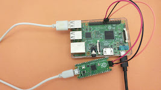

# Raspberry pi SWD

[](https://www.electronicshub.org/programming-raspberry-pi-pico-with-swd?utm_source=platformio&utm_medium=docs)

[Learn how to Program and Debug Raspberry Pi Pico with SWD](https://www.electronicshub.org/programming-raspberry-pi-pico-with-swd/).

## Configuration {#configuration}

Select this probe with the [`debug_tool`](../../reference/platformio-ini/env/debug-tool.md) option in [`platformio.ini`](../../reference/platformio-ini/index.md):

```ini
[env:myenv]
platform = ...
board = ...
debug_tool = raspberrypi-swd
```

To also upload firmware with this probe, set [`upload_protocol`](../../reference/platformio-ini/env/upload-protocol.md):

```ini
[env:myenv]
platform = ...
board = ...
debug_tool = raspberrypi-swd
upload_protocol = raspberrypi-swd
```

See also:

- [Debugging options](../../reference/platformio-ini/env/debug-options.md)
- [Upload options](../../reference/platformio-ini/env/upload-options.md)

<!-- begin_platforms -->

## Platforms

| Name | Description |
|---|---|
| [Raspberry Pi RP2040](../platforms/raspberrypi.md) | RP2040 is a low-cost, high-performance microcontroller device with a large on-chip memory, symmetric dual-core processor complex, and rich peripheral. |

## Frameworks

| Name | Description |
|---|---|
| [Arduino](../frameworks/arduino.mdx) | Arduino Wiring-based Framework allows writing cross-platform software to control devices attached to a wide range of Arduino boards to create all kinds of creative coding, interactive objects, spaces or physical experiences. |

## Boards

| Name | Platform | Debug | MCU | Frequency | Flash | RAM |
|---|---|---|---|---|---|---|
| [Arduino Nano RP2040 Connect](../boards/raspberrypi/nanorp2040connect.md) | [Raspberry Pi RP2040](../platforms/raspberrypi.md) | External | RP2040 | 133MHz | 2MB | 264KB |
| [Raspberry Pi Pico](../boards/raspberrypi/pico.md) | [Raspberry Pi RP2040](../platforms/raspberrypi.md) | External | RP2040 | 133MHz | 2MB | 264KB |
