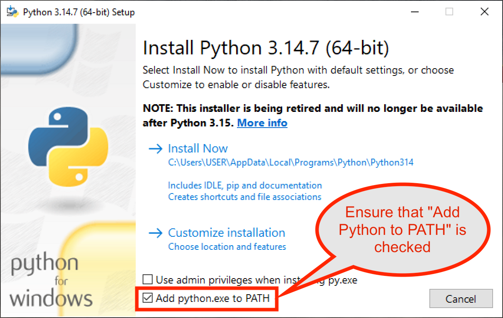

# Install Python Interpreter {#install-python-interpreter}

[PlatformIO Core (CLI)](../../get-started/platformio-core.md) is written in [Python](https://www.python.org/downloads/) that is installed by default on all the popular OSs except Windows.

Please navigate to official website and [Download the latest Python](https://www.python.org/downloads/) and install it. Please **READ NOTES BELOW**.

<dl>

<dt>

Linux

</dt>

<dd>

Most linux distributions will include a Python installation already. You may need to ensure that the Python Virtual Environment is installed.

Debian/Ubuntu derivatives have this package in Apt as `python3-venv`.

`sudo apt install python3-venv` should be all that is required.

For more details, please check the [platformio-core-installer/issues/85](https://github.com/platformio/platformio-core-installer/issues/85).

</dd>

<dt>

macOS

</dt>

<dd>

Please read the "Important Information" displayed during installation for information about SSL/TLS certificate validation and the running the **"Install Certificates.command"**.

If you do not install SSL/TLS certificates, PlatformIO will not be able to download dependent packages, libraries, and toolchains.

</dd>

<dt>

Windows

</dt>

<dd>

Please select `Add Python to Path` (see below), otherwise, `python` command will not be available.

</dd>

</dl>
